# Grafo de decisões — kits, checkout e o loop de verificação (2026-09-25)

Para não repetir erro: cada problema do dia, o caminho que **não** funcionou e por quê, a
correção que ficou e a guarda que impede a volta. Decisões de negócio em
[`03-decisoes-tomadas.md` §Rodada 14](03-decisoes-tomadas.md); detalhe técnico em
[`registro.md` M-09](../../agente-ia/08-mudancas/registro.md). Cada "guarda" é um teste e
uma mutação em `pnpm verificar:guardas` (o bug reinstalado tem de deixar o teste vermelho).

Legenda: 🟥 sintoma · 🟧 tentativa que falhou · 🟩 correção que ficou · 🛡️ guarda.

## Como ler antes de mexer

1. Vai mexer num **gate de preço ou prazo**? Leia os grafos 1, 2 e 8 — todos os atalhos
   óbvios já foram tentados e abriram mentira ou vetaram frase honesta.
2. Vai mexer em **estado da conversa** (kit, caminho, retry)? Grafos 3, 4 e 5.
3. Vai mexer em **handoff, despedida ou pós-venda**? Grafos 6 e 7.
4. As **lições** no fim valem para qualquer heurística de texto.

---

## 1. De quantas peças fala um preço?

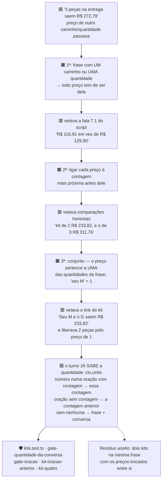

**Por que o conserto definitivo foi sair do texto:** três tentativas adivinhavam a
quantidade pelas palavras, e cada uma quebrou num formato novo. O turno determina a
quantidade de forma determinística (`quantityOf` + `leads.units`); o gate passou a
recebê-la em vez de inferir.

## 2. O preço de comparação ("em vez de R$ 129,90")

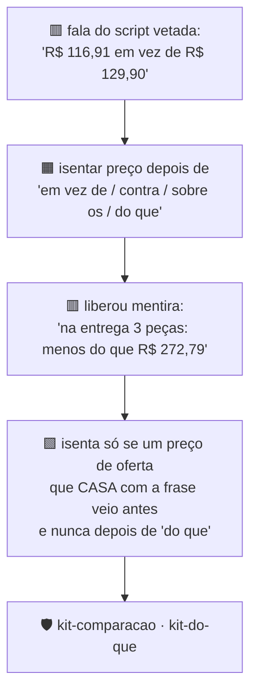

## 3. Qual caminho ela escolheu?

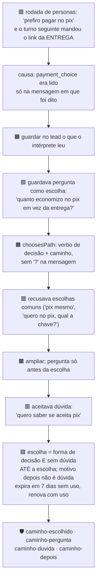

**Efeito colateral que o loop pegou:** guardar o caminho deixou conversas no antecipado
por mais tempo, e isso expôs o grafo 8 (prazo da entrega lido como prazo do antecipado).

## 4. Quando o kit é esquecido?

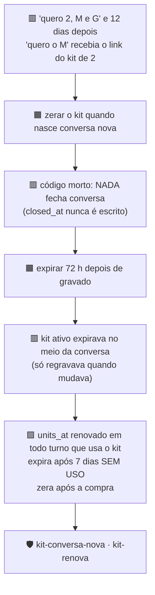

## 5. A nova tentativa (retry) duplica tamanhos?

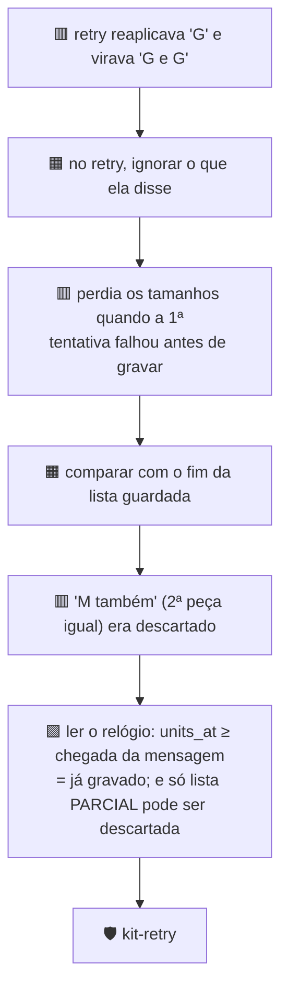

## 6. Pós-venda: quando passar para uma pessoa?

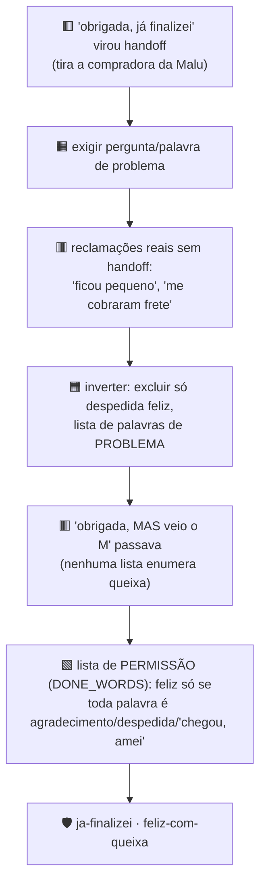

## 7. Despedida depois do link

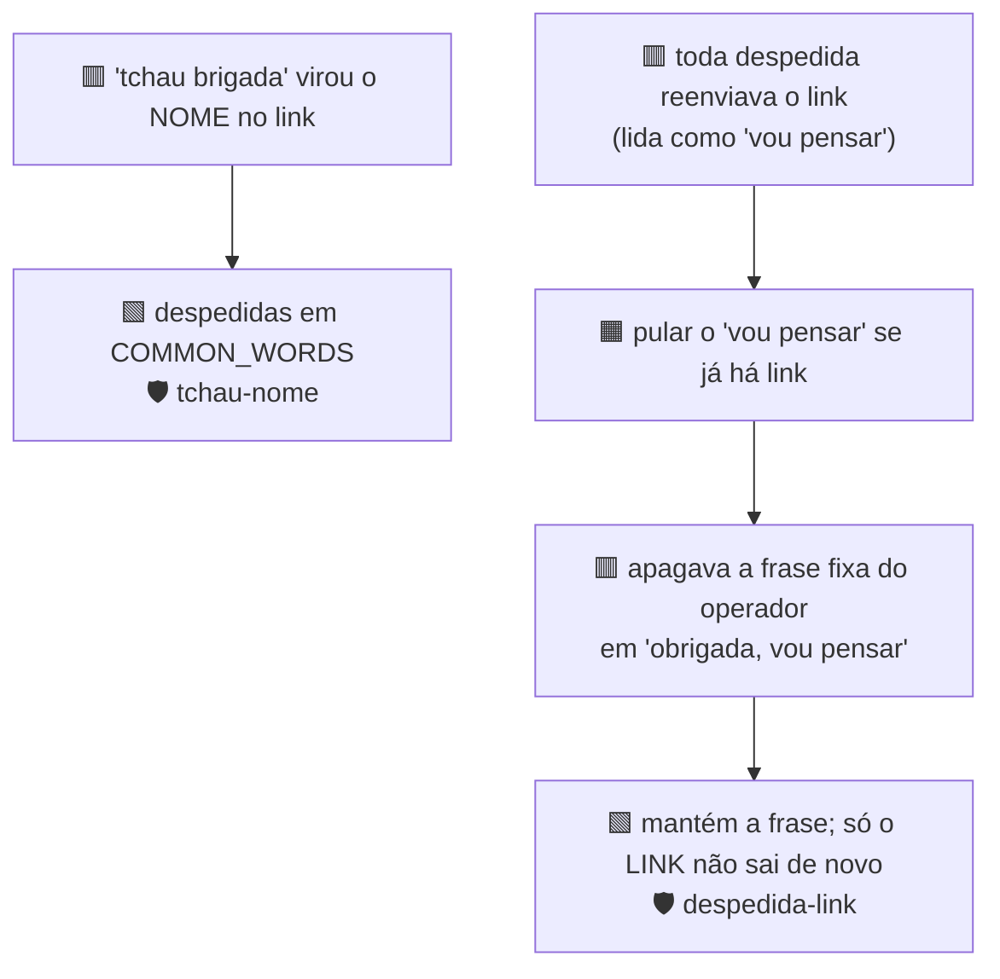

## 8. Prazo: de qual caminho é o número?

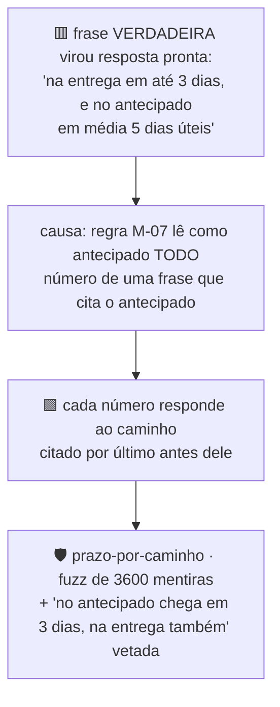

## 9. Peça grátis sem número

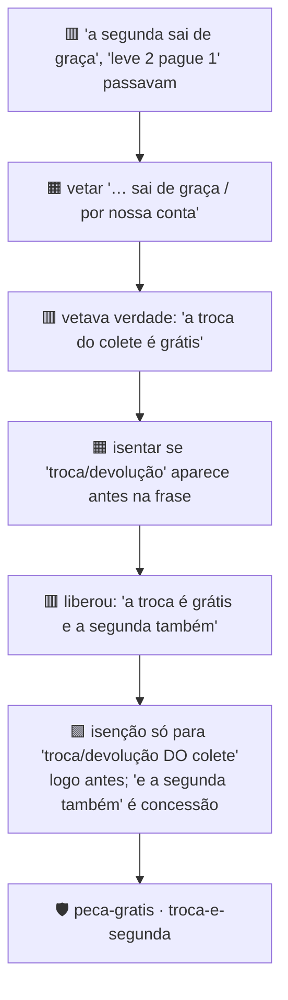

## 10. Régua pós-compra num kit

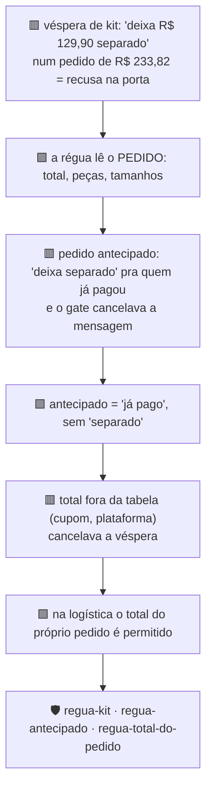

## 11. Checkout e integrações

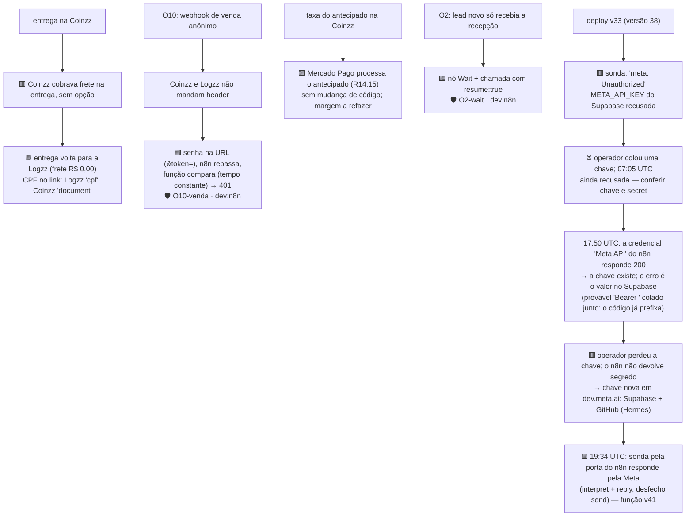

## 12. Quando o link sai? (H-2)

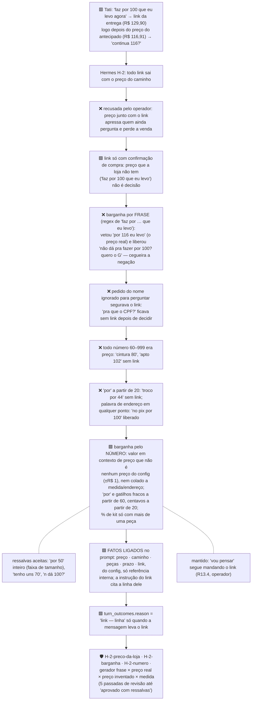

## 13. Ligar o WhatsApp sem abrir uma porta (R14.16)

```mermaid
flowchart TD
  S["Canal oficial precisa entrar antes do número existir"]
  G1["🟥 deliveryFor testado mas NÃO ligado à varredura:<br/>régua mandaria texto livre fora das 24h"]
  C1["🟩 varredura decide texto, template ou bloqueado (WA-1)"]
  R1["🟥 revisão: encorpa-inbound e a função turn são portas públicas<br/>(chave anon abre a função; o n8n repassava o corpo inteiro)"]
  C2["🟩 selo da entrada (HMAC) + lista fechada no n8n<br/>+ TURN_REQUIRE_SERVICE_ROLE"]
  R2["🟥 revisão: last_inbound_at gravado no fim do turno,<br/>na retomada e na nova tentativa: janela esticada"]
  C3["🟩 gravado uma vez, na mensagem dela, com o horário da Meta;<br/>janela fecha 10 min antes"]
  R3["🟥 revisão: mensagem perdida depois do 200 sem rastro;<br/>toque bloqueado cancelado em silêncio"]
  C4["🟩 envio em paralelo com log por id; e-mail dos toques bloqueados"]
  R4["🟥 2ª revisão: n8n enviava pelo campo channel, que o chamador escreve;<br/>recibo de leitura disparava em qualquer POST; 401 de selo virava e-mail"]
  C5["🟩 turno devolve sealed; n8n só envia com ele;<br/>recibo sai da função whatsapp (assinatura da Meta conferida)"]
  OFF["🟩 envio desligado (CANAL_ATIVO=false) até os valores do sócio"]
  GD["🛡️ WA-1-janela · WA-selo · WA-janela-no-fim · WA-envio-desligado · WA-canal-forjado ·<br/>regras n8n (corpo inteiro, channel, sealed) · teste do nó de envio contra src/channel"]
  S --> G1 --> C1 --> R1 --> C2 --> R2 --> C3 --> R3 --> C4 --> R4 --> C5 --> OFF --> GD
```

## 14. Margem do antecipado com o Mercado Pago (R14.15)

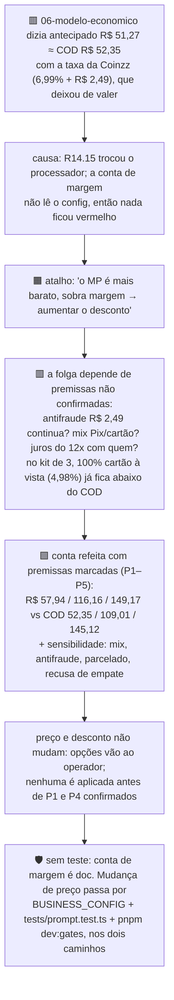

**Fechado em 2026-09-26:** P1 confirmado (antifraude não é cobrado) e o operador manteve
preços e descontos.

**Resíduo:** o número vale enquanto P4 (parcelado) não for confirmado
no painel do Mercado Pago/Coinzz. Trocou taxa, processador ou mix, refaça a tabela da caixa
de 2026-09-25 em [`06-modelo-economico.md`](../contexto-negocio/06-modelo-economico.md).

## 15. `perdido` sem dono (plano v2, 7.4)

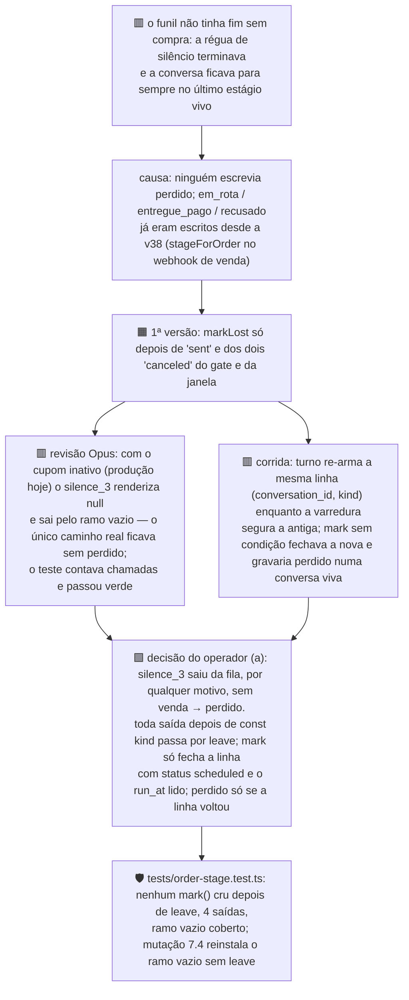

Ela volta sozinha: `furthest(perdido, x)` devolve o estágio que o próximo turno alcança.
Opt-out e handoff saem antes e não marcam; toque adiado não saiu da fila.

**Limites conhecidos:**
- **Venda que o webhook não casou** (`unknown_lead`, `ambiguous_phone`) deixa a régua viva.
  Três dias depois a conversa vira `perdido` sobre uma compra real. Isso se corrige sozinho
  se o webhook chegar depois (`furthest(perdido, pedido_criado)`).
- **Envio depois da resposta dela:** fechado em 2026-09-26, na segunda revisão. O toque só
  é gravado e enviado depois que a varredura fecha a linha. Se a cliente respondeu no
  intervalo, a linha já foi reagendada pelo turno dela e o toque velho não sai. A nova
  tentativa de turno segue a mesma regra. O custo é que o envio passa a ser no máximo uma
  vez: uma falha depois de fechar a linha perde um toque, em vez de enviar dois.
- **Sem conversa sintética:** não há conversa sintética de ponta a ponta; o teste lê a
  estrutura da varredura, que roda só no Deno.

## 16. Dois pedidos no mesmo lead

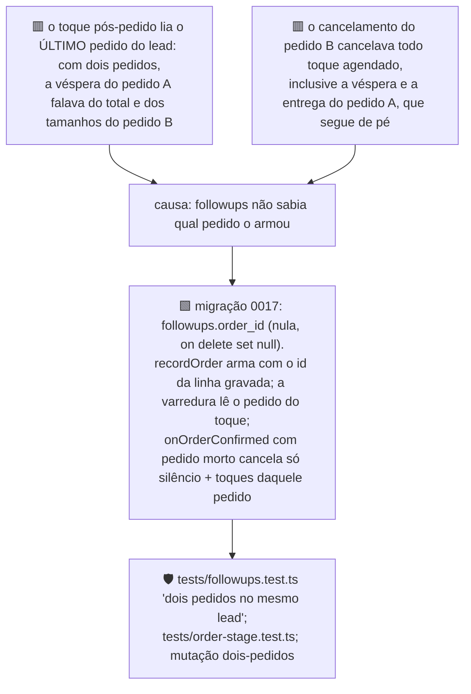

**Ordem de deploy:** aplicar a 0017 **antes** de publicar a `turn`. A varredura seleciona
`order_id`, e sem a coluna o PostgREST recusa a leitura: nenhum toque sai.

**Limites conhecidos:**
- **O segundo pedido não ganha régua própria**, porque `unique (conversation_id, kind)` já
  está ocupado pelos toques do primeiro. Mudar isso é mudar a chave da tabela, e fica fora
  deste passo.
- **Estágio por lead (revisão Opus, corrigido no mesmo dia):** o cancelamento do pedido B
  gravava `recusado`, que é terminal, enquanto o pedido A estava em rota. Quando A era
  entregue, a venda continuava contando como recusa. Agora `stageForLead` só grava
  `recusado` se nenhum outro pedido do lead estiver vivo. Continua em aberto o caso de
  ordem inversa: um pedido A recusado sozinho e, depois, um pedido B novo e entregue. A
  conversa fica em `recusado`, porque o estágio terminal não reabre.
  "Vivo" quer dizer "não morto" (`isOrderDead`). Um Pix expirado ou parado em "aguardando
  pagamento" conta como vivo e impede o `recusado` de outro pedido. O erro vai para o lado
  seguro: um estágio não terminal. Incluir `expir` em `isOrderDead` quando o vocabulário real
  das plataformas for conhecido.
- **Linha armada antes da 0017** tem `order_id` nulo e segue a regra antiga: lê o último
  pedido e morre com qualquer pedido cancelado.

## 17. O lembrete de 15 minutos depois do link nunca foi agendado (§R10.4)

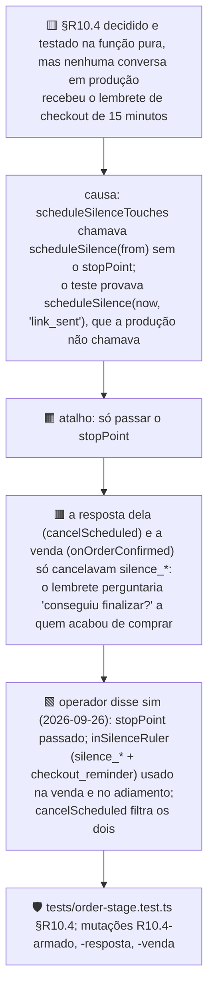

**Sexta revisão (NEEDS WORK, corrigida no mesmo dia):**
- **Lembrete duplicado:** com o link mandado às 23:40, o lembrete sai às 23:55. O
  `silence_1` era adiado para as 06:00 e reancorava a régua inteira, e o upsert reativava
  o lembrete que já tinha saído. Agora `rulerFor` só rearma o lembrete quando o toque
  adiado é o próprio lembrete, e o cancelamento do reancoramento não toca nele.
- **Lembrete de link que não saiu:** `stopPointOf` armava `link_sent` pela palavra
  "link" ou "checkout", que aparecem também em oferta e negação ("quer que eu te mande o
  link?"). Agora só conta se o texto leva um dos links de checkout, pela mesma função do
  M-03 (`linkSentRecently`), com os testes de negação. A sétima revisão pegou uma primeira
  versão com um segundo helper igual; a lista de links agora é montada uma vez só, em
  `CHECKOUT_BASES`.
- **Guardas:** mutações R10.4-duplicado e R10.4-palavra-link.

Achado pela revisão Opus de 2026-09-26 (terceira passada do §15), fora do diff que ela
revisava. **Lição:** um teste da função pura não prova que a produção chama a função com
esse argumento.

## 18. M-08: prazo do antecipado por extenso

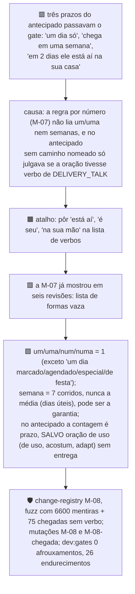

**Primeira revisão independente (NEEDS WORK, corrigida no mesmo dia):**
- **Faixa em semanas:** "1 a 2 semanas" escapava nos dois caminhos, porque o fim da faixa
  ia para uma checagem que só lia dias.
- **Âncora da garantia:** o backtracking em `(?:receb|cheg)\w*` derrotava o lookahead. Com
  isso, "tem uma semana pra trocar depois que chega em uma semana" era isentada como
  garantia.
- **Isenção de uso:** valia para a oração inteira, e "em 3 dias ele está aí pra você se
  adaptar" passava. Agora só isenta quando o uso governa a contagem.
- **Arrependimento:** "7 dias pra desistir, a contar do dia que receber" era vetada, e
  agora passa.
- **Guardas:** cada família tem gerador de fuzz, e há as mutações M-08-semanas, -ancora e
  -uso. Contra o `main`, 0 afrouxamentos.

**Segunda revisão (NEEDS WORK, corrigida no mesmo dia):**
- **Âncora com enchimento:** a âncora nova "a contar do dia que" e o `desist` abriram
  "tem 7 dias pra desistir quando chegar aí em 7 dias". O lookahead só protegia a contagem
  colada no verbo. Agora a âncora não sai quando o verbo dela tem uma contagem na mesma
  oração.
- **Troca ao lado de chegada sem verbo:** "pode trocar: em 7 dias ele está aí" passava
  (desde a M-07), e o "que é quando ele chega" era apagado como âncora. Agora os dois são
  barrados.
- **Guardas:** mutações M-08-enchimento, -troca-chegada e -que-e-quando. A M-08-ancora foi
  reescrita, porque a versão antiga deixou de reinstalar o bug.
- **Aceito em `gate-loosen-accepted.txt`:** "No pix você tem 7 dias pra desistir, a contar
  do dia que receber." É a frase honesta do arrependimento (CDC), e a base a vetava.

**Terceira revisão (NEEDS WORK, sem afrouxamento):** os consertos da segunda tinham sido
de sintoma, por lista de preposições, e os irmãos passavam: "em uns/cerca de/no prazo de 7
dias", "e em 7 dias ele está aí", "7 dias, bem quando ele chega". Agora a correção é pela
oração:
- **Contagem e âncora:** uma contagem na mesma oração do verbo da âncora é complemento
  dele, e a âncora fica. O único corte é "(você) tem/terá/são/é" logo antes da contagem.
- **Oração nova:** uma conjunção colada à contagem abre oração nova, e aí a troca não
  isenta mais.
- **Âncora depois da contagem:** só é retirada se estiver colada à contagem.
- **Dois-pontos:** ":" não abre oração quando vem seguido de "você tem".
- **Guardas:** 11 mutações da M-08.

**Quarta revisão (NEEDS WORK, sem afrouxamento) → ônus invertido:** depois de quatro
rodadas fechando formas enquanto os irmãos seguiam abertos, veio a mentira mais grave com o
pix nomeado: "o prazo até quando chegar é de 7 dias". O desenho foi invertido. A contagem
da garantia só é isenta quando uma forma de garantia a governa **positivamente**:
- **Propósito colado:** "7 dias pra trocar".
- **Palavra de troca tomando a contagem:** "a troca é em 7 dias", "pode trocar em até 7
  dias".
- **Depois da contagem, só o permitido:** "corridos/úteis", o propósito, uma âncora de
  início ou uma oração que não fala de chegada.

Saíram oito regexes (`anchor`, `anchorAfter`, `glued`, `newClause`…) e mais quatro variáveis
de apoio. **Lição:** numa isenção, liste o que prova a exceção, não o que a desmente.

**Quinta revisão (APROVADO COM RESSALVAS):** nenhuma mentira de chegada passa. As ressalvas
eram falsos positivos em frases honestas, e foram corrigidas no mesmo dia:
- **Falas do roteiro:** a fala para a objeção do antecipado ("7 dias pra trocar ou devolver
  contando do dia que receber", `02-script-do-agente.md:252`) era vetada. Agora passa.
- **Troca de tamanho:** "7 dias pra trocar de tamanho" era vetada. Agora passa.
- **Chegada por extenso:** "e ele está com você" e "o colete é seu" passaram a ser julgadas
  como chegada.
- **Aceitos:** as quatro frases do roteiro e da base que a base vetava.
- **Risco aceito:** depois de ";" só verbo de entrega e presença são julgados. É isso que
  deixa passar a frase inteira do roteiro, e "Pode trocar em 7 dias; que é o tempo da
  viagem." também passaria.

**Sexta revisão (NEEDS WORK, com afrouxamento real):** os dois caminhos novos da quinta
abriram brechas. O caso "são/o prazo é de N depois que recebermos" isentava prazo sem
palavra de troca: "No pix, são 7 dias depois que recebermos" passava nos dois caminhos. E o
texto depois de ";" não era julgado, então "No pix você tem 7 dias pra trocar; a entrega
também." passava. Os consertos:
- **Isenção sem troca:** só vale com "você tem/terá" e com ela recebendo
  (`receb(er|e|eu|a)`).
- **Depois de ";":** é julgado como o resto da frase. Só sai a locução do roteiro "do
  pedido até a entrega".
- **Guardas:** geradores de fuzz para os dois caminhos e mutações M-08-recebermos e
  M-08-ponto-e-virgula.
- **Aceito:** a fala inteira do roteiro (`:252`).
- **Fora da M-08, família da M-10:** "Pagou no pix? São 7 dias…" passa no caminho da
  entrega, porque o nome do caminho está na frase anterior.

**Sétima revisão (NEEDS WORK, com afrouxamento real):** a locução do roteiro "do pedido até
a entrega" era retirada em qualquer lugar, e com isso "No pix, você tem 7 dias pra trocar do
pedido até a entrega" passava nos dois caminhos. Os consertos:
- **Locução:** agora só sai com o sujeito do roteiro ("eu fico aqui… com você do pedido até
  a entrega").
- **"Prazo":** "o prazo pra trocar é de 7 dias" voltou a passar.
- **Presença:** "tá aqui com você" passou a ser vetada.
- **Guardas:** mutações M-08-locucao e M-08-prazo-de-troca. Ao todo, 16 mutações na M-08.

**Oitava revisão (NEEDS WORK, um achado):** tirar o `!prazo` fez "a troca é fácil, e o
prazo é 7 dias" voltar a passar, porque uma troca solta em outra oração tomava a contagem.
Os consertos:
- **Troca governando:** agora a troca só toma a contagem quando a governa ("o prazo pra
  trocar é de", "pra trocar, o prazo é de", "é só trocar: você tem").
- **Cópula:** o substantivo aceita no máximo uma cópula, então "garantia e são" não vira
  mais "garantia é são".
- **Guardas:** um gerador com 1568 mentiras e as mutações M-08-troca-solta e M-08-copula.

**Nona revisão → APROVADO COM RESSALVAS:** num corpus acumulado de 612 frases das nove
rodadas, rodado no `main` e no branch nos dois caminhos, sobrou uma família só: "se precisar
receber e trocar, são 7 dias". Ali o "se" atravessava a chegada. Foi corrigida com um gerador
e a mutação M-08-se-chegada.

Ressalvas aceitas:
- **Garantia como condição:** "se quiser garantia, são 7 dias" já passava no `main`.
- **Frase ambígua:** "o prazo com garantia de troca é de 7 dias".
- **Nome na frase anterior:** "Pagou no pix? São 7 dias…" passa no caminho da entrega. É a
  família da M-10.
- **Dois falsos positivos baratos no antecipado.**

**Lição das nove rodadas:** cada exceção aberta para uma frase honesta foi a porta da mentira
seguinte. O que convergiu foi governo positivo, verificado por um corpus acumulado de
mentiras rodado contra o `main` a cada passada.

**Custo aceito:** no antecipado, uma contagem sem caminho nomeado e fora de uma oração de
uso agora é julgada. "Sua festa é daqui a uma semana" é vetada e custa uma reescrita,
nunca uma mentira. Das frases do corpus que passaram a ser vetadas, a maioria já é barrada
por outro gate. As exceções são falsos positivos baratos, como "já faz 10 dias" na fala da
cliente.

## 19. M-10: prazo da entrega por extenso, e o caminho nomeado na frase anterior

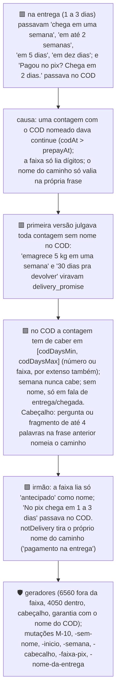

**Custo aceito:** falsos positivos baratos que custam uma reescrita cada. O mais provável é
"…7 dias pra trocar e suporte todo dia", porque a cauda da garantia recusa "dia".

**Revisão independente: APROVADO COM RESSALVAS.** Nenhuma mentira que o `main` vete passa no
branch. A negação no cabeçalho ("Sem pix, chega em 1 a 3 dias" vetada; "Nada de pix. Chega em
5 dias, depende da região" passando) foi corrigida em seguida.

A correção:
- **Negadores:** `prepaidNamed` ignora o nome do antecipado quando ele vem negado ("sem",
  "nada de", "não precisa", "não quer" fora de pergunta, "pix não!").
- **Onde vale:** no cabeçalho, na faixa e na regra de número.
- **Sombreamento:** o `PREPAY_NAME` local da faixa sombreava o externo, e com isso "Te mando
  o link e chega em 1 a 3 dias" era vetada. Foi consertado.
- **Guardas:** gerador com 802 frases e 5 mutações novas. Esta correção **não teve revisão
  independente**.

**Fora do conserto, já existiam antes e ficam registrados:**
- **Nome do COD depois da contagem:** "Chega em uma semana na entrega." passa no
  antecipado.
- **Cabeçalho COD com corpo de média:** "Na entrega? Varia, em média 5 dias úteis." passa.
- **"Entregador" ou "na porta" como nome do COD em frase do antecipado:** "No pix, o
  entregador leva em 2 dias." vai para a faixa de 1 a 3 dias.
- **Contagens fora da regra:** "um mês", "quinzena", "meia semana", "de zero a três dias",
  "às vezes cinco", "nunca passa de 5 dias", e "5 dias." sozinho.
- **Duas frases de caminho:** "Na entrega ou no pix, chega em 1 a 3 dias." passa no COD.

**Custo aceito, falsos positivos baratos no COD:** o `ARRIVAL` inclui "aí" (a muleta da
Malu) e casa "saia" em `sai\w*`. "E aí, em 2 semanas você já se acostuma" e "A garantia é de
7 dias pagando na porta" são vetadas.

**Instável, causa provável achada na revisão final de 2026-09-27:** `pnpm verificar:guardas`
deu 100, 101 e 102 de 102 no mesmo HEAD. A ferramenta lia a lista de mutações do arquivo da
árvore, mas aplicava cada mutação num worktree do commit. Com edição não commitada, as duas
versões divergiam. Além disso, uma guarda morta por timeout contava como "pegou".

A ferramenta agora:
- lê o HEAD uma vez só;
- recusa rodar com a árvore suja;
- trata guarda sem status como inconclusiva.

**Registro:** as mutações M-08-tomada e M-08-troca-solta tinham ficado com o texto de antes
da nona revisão, e foram atualizadas neste commit. Toda mudança numa linha âncora de mutação
tem de rodar `pnpm verificar:guardas` inteiro, não só a mutação nova.

## 20. Revisão final do branch (2026-09-27)

Quatro revisores Opus em paralelo (correção, integração, segurança, testes) sobre
`main...claude/focused-gates-fjpixt`.

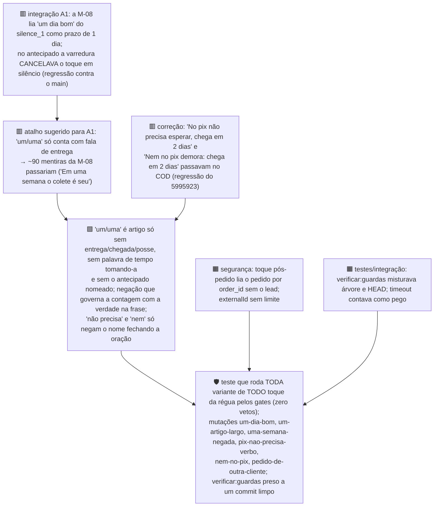

**Provado na PostgREST real, com leituras apenas:** `or=(kind.like.silence_*,kind.eq.checkout_reminder)`
casa, e a igualdade no timestamp que a própria API devolve (`…403606+00:00`) casa em `eq.`. Com
isso, o fechamento pela `run_at` e o cancelamento na resposta funcionam no banco de verdade.

**Aviso ao operador (corrigido em 2026-09-28):** o `perdido` não acontece de uma vez no
deploy. Produção tem 0 linhas em `followups`, e a v41 já cancela os `silence_3` vencidos. Com o
cupom inativo o `silence_3` sai cancelado, e isso é o fim da régua (opção a), um lead de cada vez.

**Resíduos:**
- **Mentira que passa no COD sem caminho nomeado:** "Uma semana e ele tá contigo". O `main`
  também deixava passar.
- **Negação só por extenso:** a negação que governa a contagem vale só para "um/uma".
- **Envio no máximo uma vez:** com o canal ligado, uma falha da Cloud API perde o toque. Fica
  só o e-mail de falha.
- **Testes só textuais:** vários testes de `index.ts` só leem o texto do arquivo. A prova de
  produção é a sonda da varredura pela porta do n8n depois do deploy.
- **Conferência final (APROVADO COM RESSALVAS):** a exceção do artigo deixa passar no
  antecipado mentiras de "uma semana" que o 5995923 vetava. O `main` também as deixava
  passar, então não é regressão. Os casos:
  - "Uma semana, no máximo." — o teste da cauda não aceita a vírgula; `^[\s,]+` resolve.
  - "Numa semana você já está com ele." — falta "com ele / o colete" na lista de posse.
  - "Daqui (a) uma semana você já está usando." — falta "daqui (a)" nas palavras de tempo
    antes da contagem.
  - "Numa semana você já veste." — chegada disfarçada de uso.

  A gravidade é baixa: uma semana corrida fica perto da média de 5 dias úteis. É o próximo
  item de gate.

## 21. Segunda revisão, por execução (2026-09-28): consertos fora do gate

A segunda revisão rodou o código da `turn` contra um PostgREST falso, com um harness de
execução fora do repositório, e foi cética com os commits anteriores. Estes são os achados
fora do gate, cada um reproduzido na base e corrigido com prova por execução (18/18):

| # | Sintoma | Conserto | Guarda |
|---|---|---|---|
| 1 | **Regressão:** o turno depois do link ("qualquer dúvida no checkout me chama") armava `before_size`, e ela ouvia "que tamanho você usa?" depois de comprar | `stopPointOf` lê a janela M-03 (as 3 últimas saídas e a resposta); o lembrete de 15 minutos só é armado no turno que traz o link (`linkInReply`) | R2-link-janela, R2-lembrete-so-no-link, R2-lembrete-turno |
| 2 | `silence_2` ou `silence_3` adiado rearmava os toques já enviados | reancorada, a régua recomeça do toque adiado (`ruler.slice(at)`) | R2-regua-recomeca |
| 3 | o adiamento sobrescrevia a régua que o turno dela acabara de armar | adiar exige reivindicar a linha (`status` + `run_at`) | R2-adiamento-posse |
| 4a | A e B criados, A cancelado: B ficava sem véspera | `orderTakeOver` passa os `order_*` não enviados ao pedido vivo | R2-dois-pedidos-vivo, R2-mesmo-pedido-nao-herda |
| 4b | depois de um pedido recusado, um pedido novo ficava em `recusado` | `reopensRefused`: reabre quando ESTE pedido está vivo e outro do lead está morto | R2-recusado-reabre |
| 5 | nova tentativa fora da janela virava handoff mesmo sem fechar a linha | handoff só com a linha fechada | R2-retry-janela-posse |
| 6 | `externalId` com surrogate isolado causava URIError depois do upsert | `isWellFormed()` antes de gravar, com recusa própria | R2-externalid-malformado |
| 7 | uma linha que lançava erro derrubava a varredura inteira | `sweepRow` isolada por linha; o erro vai para `skipped` | R2-varredura-isolada |

**Fica aberto:**
- **Webhook atrasado:** um webhook atrasado reescreve `orders.status`, e um "Enviado" que chega
  depois de um "Cancelado" faz o pedido parecer vivo.
- **Telefone malformado:** um telefone com surrogate isolado dá 500 antes de gravar qualquer
  coisa.
- **Tipo repetido na resposta:** a resposta de `recordOrder` lista o mesmo tipo em `canceled` e
  em `armed` quando o toque é passado ao pedido vivo.

## 22. O gate `delivery_promise` reestruturado (2026-09-28, decisão do operador: "unificar e consertar")

**Sintoma:** dez rodadas de revisão (M-08 e M-10) sem convergir. A auditoria adversarial da
segunda revisão, com cerca de 315 mil execuções, mostrou três coisas. O branch reduzia as
mentiras (de 112 mil para 39 mil), mas vetava frases honestas novas: recusar a data
impossível, garantia com média, reembolso e a fala do próprio prompt. E abria uma regressão:
"Sem pix, em 5 dias o colete é seu".

**Causa:**
- três listas diferentes para o nome do antecipado;
- quatro vocabulários de chegada;
- as regras de contagem e de faixa decidiam o caminho cada uma de um jeito.

Cada conserto remendava uma lista, e o vazamento seguinte vinha por outra.

**Correção, passo 1 (refatoração, sem mudar veredito):**
- um `PREPAY_NAME` e um `COD_NAME` ("entregador" solto não nomeia a entrega);
- uma função `pathOf`, usada pelas duas regras;
- um `ARRIVAL` único, que inclui a posse ("é seu", "tá com você").

Contra o HEAD: 1 afrouxamento honesto e 15 endurecimentos, todos em pontos onde as listas
divergiam.

**Correção, passo 2:**
- a) recusar a data impossível passa;
- b) garantia e média na mesma frase passa;
- c) o antecipado negado com posse é vetado;
- d) o fallback do antecipado exige fala de entrega/chegada, então reembolso, promoção, uso,
  recontato e a fala do prompt passam;
- e) cauda da garantia: "logo", "contigo", "todo dia" e "perder tempo" não derrubam a
  isenção;
- f) "sem/nada de <nome> <adjetivo>" não nega o nome;
- g) nome depois do número, os dois caminhos ligados e cabeçalho da entrega na faixa.

**Guarda:**
- geradores de fuzz com sonda negada em cada item;
- 11 mutações novas e 13 reapontadas;
- 7 afrouxamentos honestos aceitos (R2).
- Desempenho no pior caso a 4.096 caracteres: 56 ms, contra 85–90 ms antes.
- O extrator do corpus (`gate-diff.ts`) passou a descartar trecho entre crases que atravessa
  linhas, porque aquilo é código e não fala.

**Resíduo:** no antecipado, sem palavra de chegada e com a contagem no meio da oração, passam
frases como "Te mando o link e é 2 dias."

---

## 23. A varredura falhava sem avisar ninguém (branch `claude/upbeat-newton-6l6dzz`, 2026-09-28)

> Escrito em paralelo ao PR #37, que reescreve este arquivo até §22 — as duas séries de
> seções se somam no merge, sem colisão de número.

```mermaid
flowchart TD
  S["🟥 sintoma: o nó 'Varre a regua' não tinha saída de erro ligada"]
  C["causa: uma Edge Function recusada (coluna ausente, erro de banco) reprovava a<br/>cada 5 minutos, e ninguém era avisado — nem e-mail, nem log lido por humano"]
  F["🟧 tentativa que não foi tentada: nenhuma — o furo só apareceu ao escrever a<br/>regra 'toda chamada de Edge Function precisa de saída de erro ligada'<br/>(src/dev/n8n-rules.ts) e rodar contra o workflow existente"]
  R["🟩 saída de erro no nó + e-mail; por linha, um campo 'erro:' no relatório da<br/>varredura pula o e-mail daquela linha em vez de falhar a rodada inteira"]
  G["🛡️ regra em src/dev/n8n-rules.ts, provada por tests/n8n-workflows.test.ts;<br/>pnpm dev:n8n falha em qualquer chamada de Edge Function sem saída de erro"]
  S --> C --> F --> R --> G
```

**Ainda em aberto:** o workflow corrigido está só no arquivo do repositório
(`n8n/workflows/relogio-da-regua.json`); a versão publicada no n8n é a antiga, sem a saída de
erro. `pnpm dev:n8n` compara contra a publicada — por isso ele acusa FALHA de propósito até o
operador importar o arquivo novo.

## 24. O rascunho de template não provava nada sobre o texto gated (2026-09-28)

```mermaid
flowchart TD
  S["🟥 sintoma: 03-templates-meta.md tinha o texto do template escrito à mão,<br/>sem checar contra o que deliveryFor realmente manda depois da cadeia de gates"]
  C["causa: 'o template está pronto para a Meta' era lido como 'o texto está certo',<br/>mas as duas coisas nunca tinham sido comparadas byte a byte"]
  R["🟩 tests/whatsapp-templates.test.ts renderiza o texto gated (sentVsGated) e compara<br/>com o corpo do rascunho, placeholder por placeholder"]
  D["🟥 duas divergências reais apareceram ao comparar: order_eve do antecipado cobra<br/>quem já pagou; a 2ª variante do silence_2 vira texto livre onde deveria haver template"]
  G["🛡️ as duas divergências ficam fixadas com it.fails (visíveis, não silenciadas) até<br/>o conserto entrar em deliveryFor — nenhuma delas é ignorada em silêncio"]
  S --> C --> R --> D --> G
```

## 25. O opt-in: oito revisões lendo texto, e a correção no canal

Escrito em paralelo com o PR #37 (que vai até o §22).

```mermaid
flowchart TD
  S["🟥 sintoma: consentimento de marketing decidido por texto livre —<br/>um sim falso manda marketing a quem não aceitou e arrisca o único número"]
  F1["🟧 tentativas 1–4: 'sim' ancorado por includes, igualdade, id da última mensagem,<br/>só depois do after_price — sempre sobrava uma pergunta da agente que o 'sim' respondia"]
  F2["🟧 tentativa 5: palavra-chave OFERTAS — concedia bem, mas a revogação<br/>virou leitura de negação"]
  F3["🟧 tentativas 6–8: revogar por 'marketing E negação' (palavra, radical) ou por<br/>'palavra sozinha' — perdia 'n quero ofertas' ou revogava quem negocia desconto"]
  C["🟦 causa: src/channel/whatsapp.ts textOf transformava o toque no botão em texto<br/>e descartava o id — o sistema não tinha sinal estruturado de sim/não"]
  R["🟩 correção (17decb7): reply = {id, contextId} no canal; pergunta com botões e nonce;<br/>sim = toque na pergunta atual em 24h; não = botão, user_preferences, 131050, opt-out;<br/>texto só suspende e reabre uma pergunta"]
  G["🛡️ tests/opt-in.test.ts (toques pelo parser real; texto nunca concede),<br/>tests/whatsapp-channel.test.ts, tests/n8n-whatsapp-send.test.ts"]
  S --> F1 --> F2 --> F3 --> C --> R --> G
```

**Lição:** quando toda heurística de texto tem furo nos dois sentidos, procure o sinal
estruturado que alguma camada está jogando fora antes de escrever a próxima regex.

**Ainda por ligar (pós-merge do PR #37):** a lista está no `HANDOFF.md`, e inclui pôr
`reply.id` no selo no mesmo commit em que o turno passar a lê-lo.

## 26. `classifyOptOut` não lê três frases comuns de opt-out (fechado no §28)

```mermaid
flowchart TD
  S["🟥 sintoma: 'não quero mais promoção', 'não quero receber mais mensagens' e<br/>'chega de mensagem' não são lidas como opt-out por classifyOptOut"]
  G["🟩 fixado com it.fails em tests/opt-out-gaps.test.ts — visível, vermelho quando<br/>o conserto entrar, em vez de silenciado"]
  ABERTO["🟥 o conserto é em src/agent/guardrails.ts, área que o PR #37 reescreve;<br/>não editado nesta branch para não colidir com o merge dele"]
  S --> G --> ABERTO
```

## 27. Terceira revisão e itens do PR #38 (2026-09-28)

**Pedido morto ressuscitado (regressão do bf23390):** um webhook atrasado ("created" ou
"Enviado" depois de "Cancelado") reescrevia `orders.status`, porque o upsert grava o que chega
por último. A `orderTakeOver` então dava a régua inteira, com a véspera, a um pedido cancelado.
- **Causa:** o status morto não era terminal.
- **Correção:** `orderStatusAfter`. Status morto não volta a vivo. O status efetivo é lido antes
  do upsert e usado em todas as decisões. `created_at` passa a ser a data do pedido, então o
  takeover agenda pela data certa.

**Divergências de template (it.fails do #38):**
- **Véspera do antecipado:** usa `order_eve_pago` e fica bloqueada até esse template existir.
- **`silence_2` fora da janela:** sai sempre a 1ª variante.
- **Varredura:** faz o gate sobre o texto que de fato sai (`delivery.body`).

**Opt-in ligado, com a flag `channel.askMarketingOptIn`, ausente = desligado:**
- **Com a flag desligada:** nenhuma coluna da 0019 é lida.
- **Selo:** o `reply.id` entra no selo só quando existe.
- **`silence_2`/`silence_3` como template:** exigem opt-in.

**Bloqueio de deploy:** o nó "Cerebro do turno" do n8n descartava o `reply`, e isso dá 401 em
todo toque de botão com o selo ligado.

**Ordem de deploy:**
1. aplicar a 0018 e a 0019;
2. publicar a `turn`;
3. publicar a `whatsapp` e o n8n com o `reply`, ainda com a flag desligada;
4. ligar a flag;
5. pôr `order_eve_pago` em `channel.templates` depois da aprovação da Meta.

**Aberto:**
- **N3c e N3e:** a regra `furthest` deixa o estágio em `em_rota` ou em `endereco_coletado`
  quando o "Cancelado" chega primeiro. Não manda mensagem errada.
- **Corrida:** dois webhooks do mesmo pedido no mesmo instante.

## 28. Terceira revisão do PR #37: regressões do gate de prazo, desempenho e opt-out (2026-09-28)

Cada item foi reproduzido contra a base `9222dc6` antes do conserto, com a causa lida no código.

```mermaid
flowchart TD
  S1["🟥 'Sem pix, em 5 dias você tem o colete' passava nos dois caminhos (a base vetava)"]
  K1["causa: a negação dava o caminho da entrega (by: denial), mas a regra da entrega<br/>ainda exigia fala de chegada — e 'você tem o colete' não era chegada no ARRIVAL"]
  C1["🟩 a negação nomeia a entrega como 'na entrega': julga sem palavra de chegada;<br/>idem na exceção do artigo 'um/uma'; posse com 'ter' entra no ARRIVAL"]
  S2["🟥 'Você tem 7 dias pra devolver, e a entrega leva de 1 a 3 dias' vetada (desde a M-10)"]
  S3["🟥 '7 dias de garantia, e a média do antecipado é de 5 dias' — cada gate<br/>pegava o número da outra oração"]
  C2["🟩 a cauda da garantia aceita a janela da própria entrega como oração só dela;<br/>a janela do antecipado lê a média como sujeito; warranty_promise larga o número<br/>cuja oração é a média de um caminho"]
  P["🟥 'se trocar 7 dias' repetido até 16k: 7 a 26 s no delivery_promise"]
  KP["causa: cada regra lê a sentença inteira da contagem — custo contagens × sentença,<br/>e o 'se …' preguiçoso de takenAfterReturn revarre a sentença a partir de cada 'se'"]
  CP["🟩 resposta com mais de 20 contagens ou sentença acima de 1000 caracteres volta<br/>para reescrita (corpus: 2 e 269); caminhada do cabeçalho calculada uma vez"]
  O["🟥 §26: 'não quero receber mais mensagens', 'chega de mensagem'… liam none"]
  CO["🟩 formas novas (ordem livre, promoção/oferta), sem ler pedido de compra como recusa;<br/>'não para de mandar' deixou de ser opt-out (revertido no §31)"]
  G["🛡️ geradores em prepaid-deadline-fuzz (1 a 4) e opt-out-gaps; mutações R3-*;<br/>dev:gates: 15 afrouxamentos honestos aceitos (R3), 5 endurecimentos"]
  S1 --> K1 --> C1 --> G
  S2 --> C2
  S3 --> C2 --> G
  P --> KP --> CP --> G
  O --> CO --> G
```

**Caminho descartado:** limitar o `se …` a 80 caracteres e trocar os 14 `slice(0, at).split(…).pop()` por
leitura a partir de `at`. Os dois foram medidos: abaixo do teto de contagens não mudavam nada mensurável,
e o primeiro ainda era um aperto semântico. Por isso saíram.

**Verificado e deixado como está:**
- **"Pelo link, o prazo médio é de 5 dias":** vetada na base e no branch, e com razão. O prompt ensina
  "varia por região, em média", e "médio" não diz que varia.
- **Reembolso ou estorno com número:** a `warranty_promise` veta, igual à base. O prompt, o roteiro e a
  régua não têm fala de reembolso com prazo.
- **"Não consigo garantir 2 dias. Varia, em média 5 dias úteis.":** a `warranty_promise` lê "garantir"
  como garantia. Igual à base.
- **"…e a entrega leva 2 dias" depois da garantia:** a `warranty_promise` veta o 2, porque "leva" não
  isenta. Igual à base.
- **"Sem pix, em 2 dias chega" no caminho antecipado:** continua vetada. Ali o "sem pix" pode ser o
  cartão, e o desenho deixa a contagem para as duas regras.

**Aberto:** o nível `ambiguous` de `classifyOptOut` não é lido pela `turn` (só `explicit` para a
agente). "Parar" sozinho não pede confirmação em produção.

---

## 29. Frete grátis na entrega: o gate vetava a verdade que vende (R15.3, 2026-09-28)

Reproduzido no HEAD `ca691f6` com o config de exemplo antes do conserto: "Pagando na entrega o
frete é grátis.", "O frete é grátis e você só paga quando receber." e "Na entrega não tem frete,
você paga R$ 129,90 e mais nada." vetadas nos dois caminhos por `shipping_promise`.

```mermaid
flowchart TD
  S1["🟥 a frase verdadeira da entrega vetada: 'Pagando na entrega o frete é grátis'"]
  K1["causa: um só flag para os dois caminhos — freeShipping !== true (22/09) vetava<br/>todo 'grátis' (guardrails.ts, ramo não grátis de shipping_promise); o freightBriefing<br/>(prompt.ts) mandava nunca dizer 'grátis'. A verdade mudou por caminho, o config não"]
  S2["🟥 mentiras do antecipado passavam no HEAD: 'Nem no pix tem frete', 'No pix não<br/>cobramos frete', 'No antecipado você não paga frete', 'A entrega é grátis no pix'"]
  K2["causa: só 'grátis/zero/sem frete/nenhum frete' eram lidos como promessa;<br/>o frete negado pelo verbo (cobrar, pagar) e 'entrega grátis' não"]
  S3["🟥 a negação honesta vetada: 'No pix não tem frete grátis'"]
  K3["causa: o briefing de 22/09 proibia a palavra mesmo negada, e o gate não lia negação"]
  T1["🟧 descartado: liberar o 'frete grátis' seco quando paymentPath = cod — o turno passa<br/>cod quando ela não escolheu nada, inclusive quando pergunta do pix; welcome, handoff e<br/>despedida passam cod sempre"]
  T2["🟧 descartado: reusar prepaidNamed (com negação) no frete — içá-lo mudava a indentação<br/>de duas mutações (nem-no-pix, nega-adjetivo); sem ele, 'sem pix, na entrega o frete é<br/>grátis' custa uma reescrita (falso positivo aceito)"]
  C["🟩 codFreeShipping (ausente = grátis na entrega, !== false). Cada promessa julgada na<br/>sua frase: passa negada (FREE_DENIED) ou com a entrega nomeada (COD_NAME, PAID_ON_RECEIPT)<br/>e nada além (PREPAY_NAME, preço do antecipado, BEYOND_COD); reticência depois dela ('No pix<br/>também.') e 'igual ao da entrega' vetam. Prompt ensina a frase com o caminho"]
  G["🛡️ tests/honest-sales-lines.test.ts (verdades × mentira espelhada, config de exemplo e<br/>secret sem a chave; gerador 768 mentiras × 96 verdades); prompt.test.ts com 6 cantos;<br/>dev:gates: 22 afrouxamentos aceitos (R15.3), 14 endurecimentos no frete"]
  S1 --> K1 --> C
  S2 --> K2 --> C
  S3 --> K3 --> C
  T1 -.-> C
  T2 -.-> C
  C --> G
```

**Verificado e deixado como está:**
- **"Nenhum frete grátis existe aqui"** (sem caminho): continua vetada, como decidido em 22/09 — com
  o grátis da entrega verdadeiro, ela é falsa sobre a entrega.
- **Reticência sem nome de caminho** ("Pagando na entrega o frete é grátis. E no site também."):
  passa. "Site" é dos dois caminhos; o gate não lê elipse sem nome.
- **"O frete não é cobrado à parte"** no antecipado: passa, igual à base. É promessa de frete
  incluído, não de grátis, e fica fora deste conserto.
- **"Se não servir, você pode trocar pelo tamanho certo em até 7 dias após o recebimento"**: vetada
  pelo `delivery_promise`, igual à base (o objeto "pelo tamanho certo" não é conhecido). Fixada
  como `it.fails` em `honest-sales-lines.test.ts`, para conserto próprio. **Consertada no §30.**

---

## 30. Quatro verdades de troca e de frete vetadas por gate (2026-09-28)

A regra do operador foi que as travas não podem ser tão fortes a ponto de barrar a verdade que
vende. Cada item abaixo foi reproduzido no HEAD `ad15714` com o config de exemplo, nos dois
caminhos. A causa foi lida no código antes do conserto.

```mermaid
flowchart TD
  S1["🟥 'Se não servir, você pode trocar pelo tamanho certo em até 7 dias após o recebimento'<br/>vetada pelo delivery_promise (7 fora de 1-3 / 7 não é a média 5)"]
  K1["causa: o 7 só é garantia se uma forma de troca o governa (governedBefore, takenAfterReturn,<br/>PURPOSE), e as três passam por OBJECT, que só lia 'de/o/a/por outro' + substantivo (6f3130d).<br/>Sem governo, o 7 vai para as regras de prazo, e o 'recebimento' da âncora é ARRIVAL"]
  S2["🟥 'Você tem 7 dias pra trocar de tamanho' vetada pelo unverified_size<br/>sempre que sizeChecked é undefined: antes do CEP e com a consulta de região falhando"]
  K2["causa: CLAIMS_STOCK casa 'tem … até 28 caracteres … tamanho', e o 'tem' que toma<br/>a contagem da garantia era lido como 'tem o seu tamanho'. Os fuzz da M-08 liam só o<br/>trace do delivery_promise e nunca viram esse veto"]
  S3["🟥 'Na entrega não tem frete: você paga só R$ 129,90' vetada pelo shipping_promise"]
  K3["causa: o 'não … só' do BEYOND_COD (e824091) parava na vírgula mas não em ':' e ';',<br/>então o 'não' de uma oração pegava o 'só' do preço na oração seguinte"]
  S4["🟥 'No kit de 2 peças pagando na entrega o frete também é grátis' vetada"]
  K4["causa: dois ramos do BEYOND_COD liam 'frete (é grátis) também' como outro caminho,<br/>mesmo quando o que o 'também' soma é o kit nomeado na própria oração"]
  T1["🟧 descartado: tirar 'após o recebimento' ou 'receb' do ARRIVAL.<br/>É a chegada sempre que a contagem não é garantia, e 'em até 7 dias após o pagamento<br/>você recebe' passaria"]
  T2["🟧 descartado: isentar do unverified_size qualquer 'tem' seguido de troca.<br/>'tem pra troca no seu tamanho' é estoque"]
  C["🟩 OBJECT aceita 'pelo' e um adjetivo (certo/correto/ideal/maior/menor);<br/>unverified_size corta só '(você) tem/terá (até) N dias/semanas pra trocar/devolver' antes de casar;<br/>'não … só' para em ':' e ';'; o 'também' do frete é do kit quando 'kit/peças' vem<br/>antes na mesma oração, sem pontuação no meio. 'Também no/pelo/com …' continua vetado"]
  G["🛡️ honest-sales-lines: it.fails virou HONEST, mais a janela de troca e o frete do kit nos dois<br/>sentidos, com o gate dono de cada mentira; geradores: objeto (180 verdades, 540 mentiras,<br/>WARRANTY_BAITS com o objeto) e kit (48 verdades, 588 mentiras).<br/>dev:gates contra o HEAD: 14 afrouxamentos aceitos (§30), 0 endurecimentos"]
  S1 --> K1 --> T1 --> C
  S2 --> K2 --> T2 --> C
  S3 --> K3 --> C
  S4 --> K4 --> C
  C --> G
```

**Varredura da base e do roteiro (só leitura):** 214 falas de
`docs/agente-ia/01-conhecimento/` e `docs/agente-ia/06-script/` rodaram pela `runGates` com
o config de exemplo, nos dois caminhos. As falas incluídas foram citações, blocos `>` e células
longas de tabela. Nenhuma fala verdadeira ensinada ali é vetada por bug de gate. Todos os vetos
caem em um destes casos:
- **Fala da entrega no caminho antecipado:** "1 a 3 dias" sem o nome do caminho.
- **Fala proibida de propósito:** a lista "nunca diga", o script antigo do diagnóstico, os
  exemplos do changelog.
- **Fala certa fora do contexto de produção.** Três casos, que passam no contexto real:
  - a véspera, com `stage: logistics`;
  - o handoff, com `layer: auto`;
  - o cupom, com `active: true`.

**Deixado como está:**
- **"No kit de 3 peças, pagando na entrega, o frete também é grátis":** continua vetada. A
  vírgula separa o kit do "também", e abrir a vírgula traria "…, e no site o frete também".
  Custa uma reescrita.
- **"A troca de tamanho é garantida em até 7 dias":** continua vetada pelo `unverified_size`.
  O `STOCK_AFTER` lê "tamanho … garantida" como reserva. É fora deste conserto.
- **"Pode trocar pelo tamanho certo em até 7 dias após o pagamento":** passa, igual à base, e
  passa também sem o objeto. A âncora está errada (a garantia conta do recebimento), mas não é
  promessa de entrega. Nenhum gate lê o início da garantia.

---

## 31. Quarta revisão do branch: opt-out que bloqueava compradora, frete grátis por outro pagamento, garantia da média (2026-09-29)

Uma revisão independente reprovou o branch no HEAD `dd530a7`. Cada item foi reproduzido com as sondas da
revisão, no HEAD e na base `c1c0cdf`, e a causa foi lida no código antes do conserto.

```mermaid
flowchart TD
  S1["🟥 'Não quero mais oferta de kit, quero só 1', 'chega de promoção, me manda o link',<br/>'não quero receber nada pelo correio' → explicit → bloqueado terminal (a base lia none)"]
  K1["causa: as formas novas do §28 aceitavam oferta/promoção/nada sem 'receber', e a exceção<br/>de compra era lista de proibição (quero fechar/comprar…): 'quero só 1', 'fico com', 'manda o link' fora dela"]
  S5["🟥 'Vocês não para de mandar mensagem, que saco' → none (a base lia explicit)"]
  K5["causa: o lookbehind (?<!nao) do §28 largava toda forma negada, e a negada é quase sempre a reclamação"]
  S2["🟥 frete grátis do antecipado passava nos dois caminhos: 'Antes ou na entrega', 'Tanto antes quanto<br/>na entrega', '…e pagando pela internet também', 'igual pagando por cartão', 'todos os pagamentos'"]
  K2["causa: BEYOND_COD é lista de proibição; não tinha 'X ou na entrega', 'quanto na entrega',<br/>'também' fechando a oração, 'igual', 'todos os pagamentos'; e nenhum verbo 'pag…' era lido"]
  S3["🟥 'Na entrega em média você tem 3 dias pra trocar' passava (a base vetava)"]
  K3["causa: warranty_promise lia como 'oração' só o texto antes do número (§28); a troca vinha depois"]
  S6["🟧 verdades vetadas: '…grátis; no pix você ganha 10% de desconto', 'Entrega grátis pagando na hora que receber'"]
  S7["🟧 sentença de 1222 caracteres sem contagem vetada pelo teto de custo do delivery_promise"]
  T1["🟧 descartado: crescer a lista de compra do opt-out ou o BEYOND_COD palavra a palavra —<br/>é o que a revisão acabou de derrubar (Lição 3)"]
  C1["🟩 opt-out: as formas novas só valem se TODA palavra da mensagem for recusa, cortesia ou<br/>queixa (REFUSAL_ONLY, lista de permissão, como HUMAN_REQUEST_PHRASES); 'não para/param de mandar'<br/>é explicit, salvo gosto dito e não negado ('tô gostando', 'oferta boa', 'quero ver')"]
  C2["🟩 frete: todo 'pag…' da frase do grátis tem de ser o da porta (COD_PAY, lista de permissão);<br/>BEYOND_COD ganha 'ou/quanto … na entrega', 'também' no fim da oração (fora o do kit), 'igual/idem',<br/>'todas as formas'. A oração do desconto do antecipado, sem nada do frete, é lida à parte;<br/>PAID_ON_RECEIPT lê 'na hora que receber'. Frase já aprovada não é julgada de novo"]
  C3["🟩 a oração da garantia vai até a pontuação depois do número; o teto de custo só vale com contagem"]
  G["🛡️ honest-sales-lines: 24 mentiras da revisão, gerador outro pagamento × forma (5520) e oração do<br/>desconto (144 verdades, 1008 mentiras); opt-out-gaps com gerador recusa × resto (63 + 84);<br/>dev:gates contra dd530a7: 3 afrouxamentos aceitos (§31), 25 endurecimentos; 14 mutações simuladas, todas pegas"]
  S1 --> K1 --> T1 --> C1 --> G
  S5 --> K5 --> C1
  S2 --> K2 --> T1
  K2 --> C2 --> G
  S3 --> K3 --> C3 --> G
  S6 --> C2
  S7 --> C3
```

**Verificado e deixado como está:**
- **"Não quero mais nada, só o colete M"** e **"Não quero mais mensagem de promoção, quero fechar o
  pedido"**: continuam `explicit`, iguais à base. O primeiro item da lista original
  (`nao quero mais (receber|nada|mensage)`) não passa pela lista de permissão. "Não quero mais nada,
  obrigada" depois de "quer mais alguma coisa?" bloqueia uma compradora. **Decisão do operador em
  aberto.**
- **"Chega de mensagem, só me diz quando chega meu pedido"** e **"Não quero receber mais mensagens, só
  a do rastreio"**: voltam a `none`, como na base. O `bloqueado` corta também a régua do pedido.
- **"Pagando na entrega o frete é grátis, sempre"**: passa. O "sempre" é da entrega.
- **"Pagando na entrega o frete é grátis. E no site também."**: passa a vetar. O §29 a deixava passar
  porque o gate não lia elipse sem nome, e o "também" no fim da oração agora é lido.
- **"No pix o frete sai zerado / fica por conta da loja"**, **"No pix a gente paga o frete"** e
  **"pagando antecipado você não paga nada"**: passam, iguais na base e no HEAD. Nenhuma palavra de
  grátis é lida. Fica fora deste conserto.
- **Resposta degenerada sem contagem de dias** (16k caracteres, uma sentença): não é mais vetada pelo
  teto de custo, que só vale com contagem. O `shipping_promise` leva cerca de 200 ms numa sentença de
  16k com 430 alegações de grátis (no HEAD, cerca de 270 ms). O custo já existia. Nenhum gate limita o
  tamanho da resposta.

---

## 32. Frete grátis julgado pela frase inteira, contra uma lista de frases canônicas (2026-09-29)

Duas revisões independentes reprovaram o gate de frete do §31 no HEAD `2587a24`. Cada sonda foi
reproduzida no HEAD e na base `c1c0cdf`. Passavam no HEAD e eram vetadas na base: "Frete grátis na
entrega e pagando R$ 129,90 pela internet." (o `COD_PAY` lia a vírgula decimal do preço como fim de
oração), "…e no site.", "…e comprando pelo site.", "…e pela internet.", "…e na Coinzz.", "…e fechando
agora.", "Na entrega o frete é grátis, e comprando no site o frete é grátis.", "…, e quem compra agora
não paga frete.", "O frete é grátis na entrega e na loja." e "Aqui o frete é sempre grátis, na entrega
por exemplo.". O custo era quadrático: 990 ms numa resposta de 16 mil caracteres com "frete zero"
repetido, porque o `sentenceAt` rodava uma vez por alegação.

```mermaid
flowchart TD
  S1["🟥 mentiras do antecipado passavam no HEAD e eram vetadas na base: '…na entrega e no site',<br/>'…e pela internet', '…e na Coinzz', '…e pagando R$ 129,90 pela internet'"]
  K1["causa: shipping_promise tentava provar, a partir de texto livre, que o 'grátis' ficava<br/>preso à entrega. Uma frase tem formas sem fim; a lista de proibição (BEYOND_COD) e a<br/>lista de permissão de verbos (COD_PAY) cobriam pedaços dela, nunca a frase"]
  F1["🟧 §29: COD_NAME na frase e nada de PREPAY_NAME/BEYOND_COD —<br/>'…e no site também', 'antes ou na entrega' passaram"]
  F2["🟧 §30: 'não … só' e o 'também' do kit abertos — cada exceção abriu uma irmã"]
  F3["🟧 §31: todo 'pag…' preso ao da porta (COD_PAY), oração do desconto lida à parte —<br/>'e no site', 'e na Coinzz' (sem verbo 'pag') e a vírgula de 'R$ 129,90' passaram"]
  S2["🟥 opt-out: 'Minhas amigas não param de me mandar foto com o colete, quero comprar um' → explicit"]
  K2["causa: o ramo 'não para(m) de mandar' do §31 não lia o sujeito"]
  S3["🟥 'Pagando antecipado a média é de 5 dias e a troca é em 7 dias' vetada (regressão sobre dd530a7)"]
  K3["causa: a oração do número no warranty_promise (§31) atravessava o 'e' até a troca do 7"]
  C1["🟩 canonicalFree: a frase inteira da alegação (corte em . ! ? e quebra de linha, nunca na<br/>vírgula), depois de norm, tem de ser abertura × núcleo × cauda, com os preços da entrega<br/>exatos. O resto custa uma reescrita. 'nenhum frete a mais' entra na mesma lista enquanto a<br/>entrega é grátis. Reticência curta ('No pix também.', 'Vale pros dois.') veta. Fronteiras<br/>calculadas uma vez. Prompt e briefing ensinam a mesma frase, 'numa frase só dela'"]
  C2["🟩 opt-out: o sujeito de 'não para(m) de mandar' é lista de permissão: nenhum, 'vocês',<br/>'essa loja', 'esse número'"]
  C3["🟩 a oração do número termina em 'mas' e no 'e' sem acento; 'é' não corta<br/>('em média 3 dias é o prazo pra trocar' continua vetada). O acento vem do texto original"]
  G["🛡️ honest-sales-lines: canônicas (960), canônica estendida (2720) e com preço do antecipado<br/>(50) geradas; 154 mentiras das duas revisões; COSTS_A_REWRITE (21 verdades que agora custam<br/>reescrita, explícitas); prompt.test prova que a frase dos dois briefings é a mesma e passa;<br/>opt-out-gaps com sujeito de terceiro; dev:gates contra HEAD: 3 afrouxamentos aceitos (garantia),<br/>74 endurecimentos no frete; contra c1c0cdf: 58 afrouxamentos, todos aceitos; 17 mutações simuladas, todas pegas"]
  S1 --> K1
  F1 --> F2 --> F3 --> K1
  K1 --> C1 --> G
  S2 --> K2 --> C2 --> G
  S3 --> K3 --> C3 --> G
```

**Por que as três rodadas falharam.** Todas tentavam provar uma restrição (o grátis vale só na
entrega) a partir de texto livre. O §29 procurava o nome da entrega e a ausência do antecipado. O
§30 abriu exceções dentro dessa busca. O §31 trocou uma das listas de proibição por uma lista de
permissão de verbos. Mas o que precisava ser permitido era a frase inteira, e não as palavras dela.
A cada rodada a revisão seguinte achou uma família nova ("e no site", "e na Coinzz", "fechando
agora"), porque a frase continuava aberta depois do trecho provado.

**O conjunto canônico** (em `canonicalFree`, `guardrails.ts`):
- **abertura opcional:** "e", "ah", "olha", "e olha", "aqui", "lembrando que";
- **núcleo:**
  - "(pagando | no pagamento | com pagamento) na entrega, o frete é grátis/gratuito";
  - "na entrega, o frete é grátis";
  - "o frete é grátis (pagando) na entrega";
  - "frete grátis (pagando) na entrega";
  - "na entrega não tem frete";
  - "o frete na entrega é grátis";
  - "na entrega, nenhum frete a mais";
- **cauda opcional**, depois de ":", ",", "—" ou "e":
  - "você (só) paga (só) (o valor de | os) R$ <preço da entrega> (quando receber | quando o colete chegar | na porta) (e mais nada)";
  - "você só paga quando receber";
  - "sem nada a mais na porta".

Pontuação, aspas e emoji nas pontas não contam.

**Custa uma reescrita** (explícito em `COSTS_A_REWRITE`): 21 verdades. Entre elas estão "O frete é
grátis e você só paga quando receber", "Na entrega o frete sai de graça", "…grátis; no pix você ganha
10% de desconto", "…grátis, sempre", "Pagando na entrega você não paga frete", "No kit de 2 peças
pagando na entrega o frete também é grátis" e "Na entrega você paga R$ 129,90 e nenhum frete a mais na
porta". A frase que o prompt ensina passa, e a reescrita cai nela.

**Deixado como está:**
- **Grátis sem nenhuma palavra que o gate lê:** "No pix o frete sai zerado", "…fica por conta da
  loja", "No pix a gente paga o frete", "No site é tudo grátis", "Nenhuma cobrança de frete na entrega
  nem no site" e "Quanto ao frete, pagando antecipado você não paga nada". Passam no HEAD e na base,
  como antes. Ficam fora deste conserto.
- **Reticência com mais de seis palavras e sem palavra de grátis:** "Pagando no pix é a mesma coisa."
  (7 palavras) passa depois de uma frase canônica.
- **`codFreeShipping: false`:** o "nenhum frete a mais" qualificado continua julgado pela regra de
  22/09, que não é uma lista de frases.
- **"Não quero mais nada"** continua `explicit`. É a decisão do operador em aberto (C6).

---

## 33. Terceira revisão do §32: a mentira vinha das outras frases da mensagem (2026-09-29)

Uma revisão independente reprovou o `c0c8dbe` (HEAD `cbd585b`). A frase canônica segurava, e a
mentira vinha das outras frases da mesma mensagem. Cada sonda foi reproduzida no HEAD antes do conserto.

```mermaid
flowchart TD
  S1["🟥 'Pagando na entrega o frete é grátis. Isso também vale se você pagar no pix.' / '… No pix<br/>funciona assim.' / '… E no pix? Sim!' / '… Na Coinzz é assim.' passavam"]
  K1["causa: a extensão só era lida em frase de até 6 palavras com também/igual/mesmo e sem negação<br/>(o laço de reticência do §32) — de novo um pedaço da forma, não a regra"]
  S2["🟥 'Faz o pix de R$ 116,91. Frete grátis na entrega.' / 'Pix feito! Na entrega o frete é grátis'"]
  K2["causa: a frase anterior punha a cliente no pix, e o núcleo sem 'pagando' se lia 'quando chegar'"]
  S3["🟥 'Nossa, não para de mandar mensagem a transportadora', 'Não param de me mandar SMS de rastreio'<br/>→ explicit (bloqueio terminal; regressão sobre c1c0cdf)"]
  K3["causa: o sujeito vazio era aceito sem olhar o que ela recebe nem o sujeito posposto"]
  S4["🟧 num kit, o motivo da reescrita e o prompt mandavam escrever R$ 129,90, que o price_promise veta"]
  S5["🟧 custo: 'Isso mesmo!', 'Eu também uso!', 'Pagando na entrega o frete é grátis, tá?' vetadas"]
  C1["🟩 regra fechada, sem limite de palavras: com uma frase canônica aprovada, toda OUTRA frase que<br/>nomeia outro pagamento (PREPAY_NAME, OTHER_PAYMENT: site, internet, Coinzz, checkout, link,<br/>cartão, pix, 'pros dois', 'qualquer pagamento') passa só negando ou dizendo que ali o frete é<br/>calculado/cobrado (FREIGHT_CHARGED). 'Também/igual/mesmo' só contam com palavra de pagamento na<br/>frase ou na pergunta antes ('Antes também.', 'E antes? Também!')"]
  C2["🟩 no caminho antecipado, só os núcleos com 'pagando / no pagamento na entrega'"]
  C3["🟩 opt-out sem sujeito: o que não para de chegar tem de ser mensagem, promoção, oferta ou nada,<br/>sem sujeito depois"]
  C4["🟩 o motivo cita o preço do kit da conversa; o prompt ensina a frase canônica de cada kit da entrega<br/>e a linha 'No antecipado o frete é calculado por região no checkout, e você ganha 10% de desconto: R$ 116,91.'"]
  C5["🟩 fecho de cortesia (', tá', ', viu', ', amiga', ', ok') e 'o frete sai grátis' / 'é grátis pra você'"]
  G["🛡️ honest-sales-lines: REVIEW6_LIES (39), gerador com PRIORS e as extensões novas, vizinhas neutras<br/>(que passam), canônicas sem 'pagando' vetadas no antecipado, motivo por quantidade; prompt.test: a<br/>linha do desconto e a de cada kit passam ao lado da canônica; opt-out-gaps com sujeito vazio;<br/>dev:gates contra HEAD: 5 afrouxamentos aceitos, 44 endurecimentos; contra c1c0cdf: 62 aceitos;<br/>15 mutações novas ou reapontadas, todas pegas, e as 27 existentes do frete e do opt-out continuam pegas"]
  S1 --> K1 --> C1 --> G
  S2 --> K2 --> C1
  K2 --> C2 --> G
  S3 --> K3 --> C3 --> G
  S4 --> C4 --> G
  S5 --> C5 --> G
```

**Medido antes de aceitar o custo** (nas 730 falas roteirizadas do `dev:conversas`, com a config
dele):
- **Primeira passada vetada pelo `shipping_promise`:** 85 no `c0c8dbe` e 85 nesta árvore com o
  `R.price` antigo ("O colete sai por R$ 129,90, com frete grátis, e você paga na entrega ao
  entregador…", 75 usos, fora da frase canônica desde o §32). No `2587a24` eram 10.
- **Com o `R.price` na frase canônica:** 10, as duas mentiras roteirizadas de propósito ("nos dois
  caminhos").
- **Falas de frete da base e do roteiro:** 9. Em cada caminho, 3 são vetadas: "FRETE GRÁTIS" solto,
  que é título de seção. Igual no HEAD.

**Custa uma reescrita, a mais que no §32:**
- ao lado da frase canônica: "No pix você ganha 10% de desconto.", "No antecipado a garantia também é
  de 7 dias." e "No antecipado o prazo varia por região, em média 5 dias úteis.";
- no caminho antecipado: os núcleos sem "pagando" ("Na entrega o frete é grátis", "Frete grátis na
  entrega", "Na entrega não tem frete").

**Deixado como está:**
- **Negação que não nega o grátis:** uma frase que nomeia o pix e tem qualquer "não/nem" passa
  ("No pix nem precisa esperar, vale igual."). A regra pede só negação, como decidido.
- **"Não para de mandar, quero comprar":** continua `explicit` (a base também lia assim). Não é
  sujeito de terceiro.
- **Custo quadrático já existente:** "Pagando na entrega o frete é grátis" seguido de 16 mil espaços
  leva 133–190 ms, e 600 ms a 32 mil. Era igual no `2587a24`, antes do §32. Não está no
  `shipping_promise` nem veio deste conserto.

---

## 34. CI vermelho no PR #39: a guarda era morta pelo buffer, não pelo tempo (2026-09-29)

**Sintoma:** `pnpm verificar:guardas` no CI: 204/208, quatro "ESCAPOU … (inconclusivo — a guarda
não terminou (SIGTERM))", todas com `tests/honest-sales-lines.test.ts`. Local, as mesmas quatro
pegavam o bug em ~50 s.

**Causa:** com `GITHUB_ACTIONS=true` o vitest usa o repórter de anotações e imprime uma linha por
caso que falha. O `spawnSync` do verificador canalizava a saída com o `maxBuffer` padrão de 1 MB;
estourou (`ENOBUFS`), o Node mata o filho com SIGTERM e `status` vem `null`. O verificador lê
`null` como inconclusivo por desenho (§20), então uma guarda que pegou o bug de fato contava como
escape. Reproduzido localmente só com `CI=true GITHUB_ACTIONS=true`: `ENOBUFS`, 569 KB lidos.

**Caminhos que não valiam:** subir o timeout de 10 min (não era tempo: 48 s); aceitar `null` como
"pegou" (reabriria o furo que o §20 fechou: um travamento de verdade leria como pegada).

**Correção:** `stdio: "ignore"` no `spawnSync`. Só o status importa; a saída nunca foi lida.
**Guarda:** o próprio `verificar:guardas` no CI, que agora roda as quatro sob o ambiente do runner.

## 35. Revisão de riscos do PR #39 e cruzamento com a documentação (2026-09-29)

**Sintoma:** depois do merge, a revisão pedida pelo operador achou 4 furos altos
([`revisao-pr39.md`](../../agente-ia/08-mudancas/revisao-pr39.md)): três deixam passar frete
grátis no antecipado ao lado da frase canônica ou sozinho ("No pix também é grátis."), e um
webhook fora de ordem ("Entregue" → "created") rearma a véspera depois da entrega. O cruzamento
([`divergencias.md`](../../agente-ia/09-cruzamento/divergencias.md)) achou textos fixos da régua
que afirmam o que a operação não cumpre: véspera "amanhã" por relógio (inclusive no antecipado),
"não paga nada agora" para praça sem entrega, e quatro documentos que ainda negam a R15.3.

**Causa:** (a) a extensão da canônica (§33) aceitava como honesta qualquer negação na frase
(`honest`), lia menção a `checkout` como "cobrado" e não reconhecia o preço do antecipado como
nome do caminho — a negativa que não nega, de novo; (b) `orderStatusAfter` só protege a morte,
não a entrega; (c) os toques da régua são escritos por relógio e julgados como `cod` sem saber a
praça nem a data escolhida (`scheduled_for` é gravado e nunca lido).

**Caminhos que não valiam:** nenhum tentado — a regra da tarefa foi inventariar sem consertar.

**Correção:** pendente da escolha do operador, achado por achado (Fase 3).
**Guarda:** cada conserto escolhido entra com teste de negação, mutação em `verify-guards.ts` e
`pnpm dev:gates --fail-on-loosen`.

## 36. Fechamento do cruzamento: o gate não sabia a praça, a régua não sabia a data (2026-09-29)

**Sintoma:** os achados do §35 e as respostas do operador (R16.1–R16.9).

**Causa, em cada frente:** (a) frete: `honest` aceitava qualquer "não"; `FREIGHT_CHARGED` lia
"checkout" solto como cobrança; o preço do antecipado não nomeava o caminho; "grátis" sem "frete"
não era contado. (b) Pagamento na porta: o gate só conhecia `paymentPath`, que junta "praça sem
entrega" e "escolheu o antecipado onde a entrega chega" — no primeiro "paga na entrega" é
mentira, no segundo é a outra opção verdadeira. (c) Pós-venda: `scheduleOrder` armava tudo por
relógio; `orderStatusAfter` só protegia a morte. (d) Escassez: o número ia para o prompt da conversa
inteira. (e) A média do antecipado era lida de três jeitos (prompt, resposta fixa, gate).

**Caminhos que falharam:** vetar pagar na porta em todo `paymentPath: "prepay"` (primeira versão
da frente A) endureceu 59 frases verdadeiras no `dev:gates` ("Prefere pagar na entrega?"); cortar a
janela da garantia na frase afrouxaria "Você tem 30 dias. Para trocar é só chamar."; trocar
`garanti` por `garantia` afrouxaria "30 dias garantidos". Ficou `garanti(?!r\b)` — **e isso também afrouxava** ("Posso garantir 30 dias"): ver §37.

**Correção:** `GateContext.codUnavailable` (turno: região desta volta ou a gravada; varredura:
`leads.address.codAvailable`), `postponing` só no `thinkReply`; toques pós-venda pelo status e pela
`scheduled_for`; entregue é terminal para status anterior; a média do antecipado lida como o gate
(`prepayVariesByRegion && prepayAvgDays`) nos três lugares.

**Guarda:** 37 mutações novas em `verify-guards.ts` (R39-*, R16-*, T1–T8) e a antiga
`vespera-entregue-herda` reapontada; `tests/review-2026-09-29-gates.test.ts`,
`think-reply.test.ts`, `postura-e-depoimentos.test.ts`; `dev:gates --fail-on-loosen` com três
aceites R16.5. **Resíduo:** "depoimento só quando ela pedir" é regra de prompt, sem gate (o gate
não vê a mensagem dela).

## 37. Revisão independente do §36: 19 achados, dois testes que congelavam mentira (2026-09-29)

**Sintoma:** a revisão Opus do `f770757` reprovou: três afrouxamentos não aceitos (garantia pelo
infinitivo, "Últimos dias" sem `allowUnverified`, extensão do grátis por "à parte"), mentiras que
passavam nas frentes dadas como fechadas, e dois testes novos que exigiam frase falsa
("…veste… e só então decide", a D4; "a troca é grátis" como isenção decidida pelo operador).

**Causa:** a mesma do repositório inteiro — lista de proibição fechada onde a família é aberta
(`DOOR_PAYMENT` com três formas; `anyStock` mais estreito que `claims`), negação lida numa janela
em vez de colada ao verbo (`deniedRightBefore` de 3 palavras), e o grátis sem "frete" contado só
na própria frase, nunca na resposta a uma pergunta ("E no pix? É grátis também!").

**Caminho que falhou:** vetar "troca grátis" (achado 5). A regra "a troca custa R$ 20" era
inferência da sessão a partir da página pública da Logzz, escrita na R16.9 como se fosse decisão; o
repositório trata a troca do colete como grátis desde 25/09 (§9, M-08). Revertido; virou pergunta
ao operador.

**Correção:** `deniedRightBefore` só com a negação colada (mais modal); forma "só então decide";
`DOOR_PAYMENT` por família (pagamento + porta/entregador/chegada/recebimento) com a negação do
predicado depois (`DENIED_AFTER`); sem entrega na praça, nenhuma frase condicionada à entrega
passa; grátis sem "frete" na resposta à frase que nomeou outro pagamento; `FREIGHT_CHARGED` não lê
"calculado no preço"/"cobrado só na entrega"; `anyStock` ⊇ `claims`, com o que não é estoque
excluído; dor aliviada/acabada vetada; garantia isenta só "garantir o seu/a sua/o pedido";
`linkPathFor` e a diretiva de tamanho com a praça gravada; kit no "vou pensar"; "entregue para os
Correios" é em rota; status monotônico; cupom pelo caminho.

**Guarda:** 17 mutações `REV-*` e as 5 reapontadas; `tests/review-2026-09-29-ruler.test.ts`; os
dois testes errados invertidos.

## 38. A entrega concluída de R$ 19,99 não existe no antecipado (2026-09-29)

**Sintoma:** o modelo econômico cobrava R$ 19,99 de entrega concluída também do antecipado
(contribuição R$ 57,94, "quase empate" com o COD) e não modelava devolução pós-envio.

**Causa:** premissa de 21/09, "o antecipado paga as mesmas taxas do COD", nunca conferida com a
Logzz/Coinzz. A atendente do suporte corrigiu em 29/09: a entrega concluída só existe no COD;
no antecipado há etiqueta (se a cliente não paga), manuseio e taxas de transação.

**Caminhos que não valiam:** tratar a devolução como a "entrega frustrada" — frustrada é a
cliente recusar na porta, só no COD, e mantém os 15%; devolução/cancelamento pós-envio é outro
custo (frete inteiro + manuseio, nos dois caminhos) sem taxa medida; inventar uma taxa de
devolução para fechar a média seria número sem fonte.

**Correção (R15.4):** `06-modelo-economico.md` ganha a caixa de 29/09 (antecipado R$ 77,93,
mix 70/30 R$ 60,02, devolvido −R$ 24,98 no COD e −(etiqueta + 4,99) no antecipado; fechada no mesmo dia em taxa completa de devolução de R$ 25,00 (manuseio incluso, nos dois caminhos, sem devolução da taxa de transação) e cobrança por pedido confirmada; revisada antes: recusa em R$ 9,99 como confirmado em R10.2, e não 9,98, e etiqueta de São Paulo R$ 13,79, não o `LABEL_COST_BRL` histórico);
`mapa-financeiro.html` deixa de subtrair etiqueta do antecipado entregue. Nenhum código lê
esses valores. **Guarda:** nenhuma automática — é conta de documentação; a taxa de
devolução pós-envio fica registrada como pendência (P6), não como premissa.

## 39. A troca de tamanho não é grátis: o envio é dela, pago por link (R17.1, 2026-09-29)

**Sintoma:** a agente podia dizer "a troca é grátis" (§9, M-08, `RETURN_FREE`), e uma troca num
pedido ia para uma pessoa sem valor nem link. O operador respondeu a pergunta do §37: o envio da
troca é da cliente, pago por um link do Mercado Pago fora da Coinzz e da Logzz.

**Causa:** a troca e a devolução eram tratadas como uma coisa só ("trocar ou devolver"), e o grátis
da devolução (R16.3) valia para as duas.

**Caminhos que não valiam:** (a) ensinar ao modelo o valor da troca: o valor passaria a ser um preço
que `price_promise` teria de aceitar em qualquer mensagem, uma isenção aberta (Lição 1); (b) cortar a
frase por vírgula: "Você tem 7 dias pra trocar ou devolver, sem custo nenhum" perdia o dono do grátis;
(c) dar o grátis à palavra mais próxima: a devolução mais perto tomava o grátis da troca coordenada.

**Correção:** `claimsExchangeFree` em `warranty_promise`, por frase: o grátis é da troca quando a
governa depois ("grátis pra trocar", "o frete da troca"), quando a troca é a mais próxima antes, ou
quando está coordenada com a devolução ("trocar ou devolver"); negado entre as duas, não conta; a
resposta a uma pergunta sobre a troca herda a troca. O valor sai só na resposta fixa
(`exchangeReply`, julgada com `GateContext.exchanging`), quando `wants_exchange` e há pedido. Config
ausente = handoff como antes.

**Guarda:** `tests/exchange-freight.test.ts` (15 mentiras, 9 verdades, a resposta fixa nos dois
contextos, o config inválido, o intérprete e a ligação no turno); mutações `R17-*` (6/6 pegas);
`dev:gates --fail-on-loosen`: 0 afrouxamento, 30 endurecimentos, todos a troca dita grátis. Os
testes do §37 que exigiam "No pix a troca é grátis" passando foram invertidos.

**Adendo R17.2 (2026-09-29, registrado em 2026-09-30):** a pergunta "calcula" da R17.1 fechou — o
envio da troca é **R$ 27,00 fixo por troca**, cobrado da cliente (operador, `05-decisoes-firmes.md`
§9). Nenhum cálculo por região ou peça: `exchange.feeBrl` é um número só, e o link do Mercado Pago
de R$ 27,00 está no `BUSINESS_CONFIG` desde 2026-09-30 (L0.4). Guarda: `tests/exchange-freight.test.ts`.

## 40. Segunda revisão independente: a negação longe e a pergunta de antes (2026-09-29)

**Sintoma:** a revisão Opus de `9183cd4..93a0386` reprovou: com a praça sem pagamento na entrega,
"Você paga na entrega e não tem taxa nenhuma." passava (o `DENIED_AFTER` do §37 aceitava qualquer
"não" a 60 caracteres), e "E no pix? Sim! É grátis também, igual ao pagamento na entrega." passava (a
pergunta só era a frase anterior, e "na entrega" na resposta isentava). Mais oito ressalvas: o remédio
do frete ensinava a frase que o `charge_promise` veta sem entrega na praça; "quando o carteiro
chegar"; "na hora da entrega" lida como "agora"; estoque vetando "Só tenho 2 perguntas" e deixando
passar "Últimas 12 unidades!"; "A gente garante 30 dias."; "a dor nas costas some"; e a devolução
nomeada depois do "sem custo".

**Causa:** a de sempre — negação lida numa janela em vez de colada ao verbo, e lista fechada onde a
família é aberta (sujeito de "quando … chegar", números por extenso, "últimos dias").

**Caminhos que não valiam:** aceitar "é/está/fica" depois de "pagar na entrega" como negação
deixava "Pagar na entrega não é problema nenhum." passar — só com a palavra que desliga a opção
(disponível, possível, liberado); "últimos dias" só com palavra de oferta afrouxava "Últimos dias!".

**Correção:** negação colada (com o advérbio entre vírgulas), `NOT_BEFORE`, sujeito livre de até três
palavras, `lastQuestion` por frase, remédio por praça, `STOCK` exigindo substantivo de estoque, raiz
`garant`, dor como sujeito que some, `FREE_OWNED_AFTER` para a devolução. E o resíduo da R16.7:
`askedTestimonial` vem da mensagem dela (`asksForTestimonial`, largo de propósito) e o gate veta
depoimento não pedido. `recordOrder` com `date_order` ilegível não lança mais.

**Guarda:** `tests/review-2026-09-29-second.test.ts` (111 casos, com a mentira de cada isenção);
21 mutações `REV2-*`, 4 reapontadas, `R17-data-do-pedido-invalida`; `dev:gates --fail-on-loosen` com
7 aceites §40 (frases verdadeiras que o gate vetava).

## 41. Hermes: a fonte de produção media errado, e a citação de cliente não expirava (2026-09-29)

**Sintoma:** análise de viabilidade do Hermes v1
([`06-analise-hermes-v1.md`](../../agente-ia/05-plano/06-analise-hermes-v1.md)). Nada em
produção quebrou, porque o canal está desligado e o Hermes nunca leu cliente real; três
defeitos esperavam o primeiro lead.

**Causa:**
- `fromSupabase` montava as respostas sem `status` e sem custo; `messages` não tem status.
  Na fonte de produção, o placar lia 0 respostas prontas e 0 handoffs em qualquer
  rodada, contava a boas-vindas como resposta 1 da Malu e custo 0. Nenhum teste passava ali.
- `hermes_proposals.evidence` copia literalmente as frases da cliente, sem `expires_at` e
  fora do `purge_expired`; o PR da Action commitava as mesmas frases no git.
- `hermes_backlog` e a leitura contavam conversas de persona (`5500099`) como leads.

**Caminhos que não valiam:**
- Adicionar coluna `status` em `messages`: mexe na função no ar, e o desfecho já existe
  em `turn_outcomes`.
- Apagar a linha inteira da proposta aos 90 dias: perderia o histórico que o Hermes lê
  antes de propor (R14.14).
- `evidence = null` (a primeira versão, pega na revisão): apagava `objetivo` e `como_medir`
  de uma proposta aprovada e ainda não implementada.
- Redigir a cópia do git copiando todas as chaves e aplicando a troca só nos textos (também
  pega na revisão): proposta rejeitada com chave desconhecida, objeto aninhado ou evidência
  em texto passava inteira. Agora é uma lista de permissão de chaves.
- Tirar o documento do PR: o operador perde o relatório da rodada. Basta tirar o trecho.

**Correção:**
- `rowsToConversations` (pura, em `hermes-core.ts`) liga cada desfecho à última resposta
  antes dele e depois do desfecho anterior e da última mensagem dela (`deferred`,
  `stopped` e alguns handoffs não gravam mensagem; sem o piso, roubariam um toque da régua),
  marca a boas-vindas por `conversations.welcomed_at` e descarta o prefixo sintético.
- `withoutQuotes` troca trecho e texto entre aspas por um marcador na cópia que vai ao git
  (`.md`, `.json` e o resumo); o banco guarda o original.
- A migração `0020` põe `expires_at` em `hermes_proposals`. O `purge_expired` tira só a
  chave `evidencias` da `evidence` aos 90 dias e marca `evidence_redacted_at`, porque
  `objetivo` e `como_medir` só existem ali e a implementação de uma aprovada ainda os lê. A
  mesma migração tira o prefixo sintético do `hermes_backlog`.
- `hermes.yml` faz checkout com `persist-credentials: false`.

**Guarda:** `tests/hermes-core.test.ts` (fonte de produção e redação),
`tests/migrations.test.ts` (definições vigentes), e cinco mutações em `verify-guards.ts`
(`hermes-fonte-*`, `hermes-git-sem-trecho`, `hermes-retencao`).

**Resíduo:**
- `rationale` (`o_que — por_que`) não expira e pode parafrasear a cliente.
- Desfecho ligado por horário, não por id (`gate_traces.message_id` segue vazio).
- A migração é aplicada à mão pelo operador.


## 42. Hermes: ler onde está o problema, provar o que afirma, medir o efeito (2026-09-29)

**Sintoma:** conclusão da análise do Hermes v1 (`06-analise-hermes-v1.md`):
- o Hermes lia as 50 últimas conversas, calculava número no texto e propunha "mentira" sem
  dizer qual regra foi quebrada;
- ninguém media se uma proposta publicada funcionou: o `result` era só `"publicada: <url>"`;
- o operador aprovava sem ver a conversa;
- o deploy publicava qualquer commit com `hermes:<uuid>`.

**Causa:** o loop de R14.14 fechava no clique, mas o clique via só o que o modelo escreveu,
e o aprendizado vinha só da opinião do operador, nunca do efeito medido.

**Caminhos que não valiam:**
- Um juiz com perguntas tipadas por conversa (a ideia do JEV): sem tráfego não há o que
  calibrar, e o juiz custaria na ordem da conversa (§b, §f).
- Confiança declarada pelo modelo: não calibrada.
- Medir no n8n: regra de negócio, e o n8n é cano.

**Correção:**
- `hermes_sample` (view) e `pickSample`: sinal primeiro, mais controle.
- `numeros.md` com as views da 0018.
- `prompt.md` e `fato_contradito`, validado por substring.
- `discardAlreadyVetoed`.
- `measureEffect` sobre `published_at`, reescrito em `result` a cada passada.
- O e-mail mostra trecho e "hoje".
- `deploy-hermes.yml` confere `accepted`/`implementing` e recusa diff em
  `gate-loosen-accepted.txt`.
- Hermes com `cwd` no pacote e env mínimo; `scrubSecrets` no documento; `HERMES_MAX_USD`
  opcional; auditoria no `hermes_runs` (hash da skill, commit, ids).

**Guarda:** testes em `hermes-core`, `migrations` e `n8n-workflows`; mutações
`hermes-fato-contradito`, `hermes-ja-vetada*`, `hermes-afrouxa-sinonimo`,
`hermes-amostra-controle`, `hermes-segredo`, `hermes-email-trecho`.

**Resíduo:**
- A medida é leitura, não veredito, até o piso de amostra ser assinado.
- O controle da amostra é "as mais caras e mais novas sem sinal", não aleatório.
- O teto de custo é verificado depois da passada.
- A calibração segue com 3 defeitos.

## 43. A pessoa do handoff não tinha por onde responder (R17.3, 2026-09-30)

**Sintoma:** a agente passa a conversa para uma pessoa em três portas (pedido explícito, teto de
custo, falha do provedor) e para de responder para sempre (`handoff_at`). Com a Cloud API no lugar
do WAHA, o número não abre no celular de ninguém: o e-mail de handoff chegava, e não havia como
responder a cliente (bloqueio 2 do pipeline 80/20).

**Causa:** o canal humano ficou implícito quando o WAHA saiu (R5): no WAHA a pessoa respondia pelo
WhatsApp Web do próprio número.

**Caminhos que não valiam para o V1:** (b) coexistência do app WhatsApp Business com a Cloud API:
depende de o número aceitar, e o que a pessoa escrevesse no celular não entraria no histórico que o
Hermes e o turno leem; (c) Chatwoot: mais um serviço de pé para um operador, cedo para o volume.
Dentro do (a): a regra da janela e do opt-out no nó de código do n8n seria regra de negócio no cano
(CLAUDE.md), sem teste.

**Correção:** formulário n8n "Responder cliente" (senha básica) → `turn` com
`{ job: "human_reply", phone, text }` (só `service_role`) → `checkHumanReply` decide: texto não
vazio e até 4096, lead existe, não pediu para parar, janela de 24 h aberta com a mesma margem de
10 min da régua (`windowIsOpen`), e não é o mesmo texto de 2 min atrás (clique duplo). Se sai, a
mensagem é gravada como saída na conversa e o n8n entrega ao "WhatsApp envio". `handoff_at` não é
tocado: a agente continua fora.

**Guarda:** `tests/human-reply.test.ts` (cada recusa, a borda da janela, e a negação do duplicado);
`checkWorkflow` recusa o formulário de resposta humana sem senha (`tests/n8n-workflows.test.ts`,
com a negação: o formulário do Hermes não é pego).

**Resíduo:** fora da janela de 24 h não há resposta (só template); a pessoa liga ou espera ela
escrever. Sem mídia: só texto.
## 44. A CI levava 30 min, quase todos numa fila de mutações (2026-09-30)

**Sintoma:** todo PR esperava ~30 min de CI; o operador compara com 8 min nos outros projetos.

**Causa:** `pnpm verificar:guardas` roda 306 mutações uma depois da outra, cada uma com o seu
vitest, num runner de 4 núcleos usando um.

**Caminhos que não valiam:** rodar só as mutações dos arquivos do PR deixaria um PR quebrar a
guarda de outro arquivo sem ninguém ver até o `main`.

**Correção:** um pool de `availableParallelism()` guardas ao mesmo tempo (`GUARDS_JOBS=1` volta ao
serial); `git worktree add/remove` continuam em fila; o vitest de cada guarda roda com `--no-cache`,
porque o `node_modules` é um symlink só e dois vitest gravando o mesmo cache podiam derrubar uma
guarda — e guarda derrubada conta como "pegou".

**Guarda:** a própria rodada: 306/306 pegas em 684 s com 4 em paralelo (antes ~30 min).

## 44. O cupom ativo valia para a conversa inteira, não só para o follow-up (R17.4, 2026-09-30)

**Sintoma:** o operador ligou o cupom SUPER20 para o terceiro toque de silêncio (`silence_3`,
quem não comprou de primeira). Com `coupon.active: true`, o briefing dizia "o cupom de 20% está
ativo e você pode citá-lo" e `coupon_exists` e o gate de desconto deixavam passar os 20% já no
primeiro contato — a oferta de retenção virava desconto de entrada.

**Causa:** uma chave só (`coupon.active`) respondia duas perguntas: "o toque do cupom sai?" e "a
conversa pode citar o cupom?".

**Caminhos descartados:** (a) chave nova `coupon.followupOnly` — configurabilidade que ninguém
pediu, e a chave ausente teria de ler como a verdade de hoje; (b) mexer em `coupon_exists` e no
briefing — dois lugares para a mesma regra, e o gate não sabe o que foi enviado a ela.

**Caminho que falhou na revisão (Opus):** ler `status = 'sent'`. O fim de todo turno rearma a
régua com upsert `merge-duplicates` e devolve o `silence_3` para `scheduled` — o cupom valia só no
primeiro turno depois do toque e sumia quando ela pedia o link com os 20%. E `sent_at` não servia
como estava: o sweep o gravava também ao cancelar.

**Correção:** `conversationCoupon(config, couponTouchSent)` em `followups.ts`. O sweep grava
`sent_at` só no envio (o upsert da régua nunca escreve `sent_at`, então ele sobrevive ao rearme).
O `handleTurn` lê, uma vez, se algum `silence_3` dela tem `sent_at` (em qualquer conversa dela) e
monta `turnConfig`;
todo gate, o prompt e a leitura de preço próprio do turno leem `turnConfig`. A régua continua
lendo `CONFIG`, então o toque sai. Leitura que falha deixa o cupom reservado.

**Guarda:** `tests/coupon-followup-only.test.ts` (antes do toque: anúncio e 20% vetados, "não temos
cupom" permitido; depois: passa; o turno não passa `CONFIG` cru a gate nem a prompt).
`pnpm dev:gates`: nenhum veredito mudou (o gate é o mesmo; muda o config que ele recebe).

**Resíduo:** `sent_at` marca "tomado para envio", não "entregue": se a Meta recusar o template
depois, a conversa libera um cupom que ela não recebeu (janela estreita; "no máximo uma vez" é o
desenho do sweep). O código `SUPER20` não era enviado em lugar nenhum e o toque prometia "eu monto o pedido
com o desconto já aplicado", o que nada fazia — **consertado no mesmo dia (R17.4 a):** Logzz e
Coinzz aceitam o código no checkout; o toque diz "É só usar o código **SUPER20** no checkout", o
template ganha `{{3}}` = `couponCode`, sem `coupon.code` o toque não sai, e o briefing da conversa
(só depois do toque) nomeia o código e diz que nenhum outro existe. Nenhum gate veta um código
inventado: é regra de briefing, não veto. E o `silence_3` só sai
com template MARKETING aprovado e opt-in (`channel.askMarketingOptIn`), ainda desligados.

## 45. O Hermes nunca instalou na Action (A6, L0.7, 2026-09-30)

**Sintoma:** as seis execuções da Action `Hermes` (26–30/09) falharam no passo "Install Hermes
Agent", antes de ler qualquer conversa.

**Causa (log da execução 6):** `RuntimeError: Building wheels or sdists for hermes-agent is not
supported. Hermes is distributed via the shell installer, Docker image, or Nix.` O `setup.py` do
commit fixado bloqueia `bdist_wheel`; `uv tool install "hermes-agent @ git+…"` constrói um wheel.

**Caminhos descartados:** (a) install editável (`uv tool install --editable`) — o `setup.py` o
libera, mas resolve dependências soltas, sem o `uv.lock`; (b) `setup-hermes.sh` — monta o ambiente
de desenvolvimento com as extras de teste.

**Correção:** o instalador oficial (`scripts/install.sh`), baixado do **mesmo commit fixado**, com
`--commit <sha> --skip-setup --skip-browser`; ele sincroniza as dependências com hash pelo
`uv.lock` e publica `~/.local/bin/hermes`, que o passo põe no `GITHUB_PATH` e chama com `--version`.

**Guarda:** a própria execução manual da Action (sem `force`: instala, lê o `hermes_backlog` e sai
se não há 50 leads novos).

## 46. O Turno respondia ao webhook só depois do Wait da recepção (L1.1, 2026-09-30)

**Sintoma:** depois de importar Turno, Relógio, Venda e Envio do `main` (L1.1, `dev:n8n` todo `ok`),
a sonda pela porta do n8n (`dev:personas --door=n8n`) recebeu **502** na primeira mensagem. A
execução 7641 ficou em `waiting` com "Devolve a resposta" sem rodar; ele só rodou às 22:09:12,
depois dos 120 s do Wait.

**Causa:** com `executionOrder: v1`, o n8n executa os filhos de um nó **de cima para baixo pela
posição na tela**, cada ramo até o fim. Os filhos do "Cerebro do turno" eram "Responde no
WhatsApp?" (y −400), "É recepção?" (y −200) → Wait, e "Devolve a resposta" (y 0): o Wait
estacionava a execução antes da resposta. A importação não causou isso (ligações e posições iguais
às da versão anterior). A cliente não sentia (recepção e resposta saem por "Envia a resposta"), mas
a função `whatsapp` registrava falha a cada primeira mensagem e a porta `n8n` não fechava.

**Caminhos descartados:** religar o Wait atrás do "Devolve a resposta" — conserta sem depender da
posição, mas muda a fiação que as regras O2 e os testes já cobrem; mover um nó é o menor diff.

**Correção:** "Devolve a resposta" em y −600, acima de todo irmão. Publicado (versão ativa
`e2e2804e`). A sonda seguinte recebeu `welcomed` na hora e a retomada respondeu dentro do n8n.

**Guarda:** regra em `src/dev/n8n-rules.ts` — um `respondToWebhook` que tem irmão levando a um
Wait precisa estar acima dele (posição ausente conta como falha); roda no `dev:n8n` contra a versão
ativa e em `tests/n8n-workflows.test.ts` contra a versionada. Revisão Opus: aprovada com resíduos —
(1) só compara irmãos diretos: um nó intermediário entre o "Cerebro" e o respond escaparia; (2) a
regra assume `executionOrder: v1` (conferido no ar; os JSON versionados não guardam `settings`).

**Limite desta máquina:** a porta `n8n` a partir do container ainda não fecha uma conversa inteira —
o proxy de saída corta em menos de ~40 s, e um turno com o modelo passa disso (502 com a execução
seguindo no n8n). Sonda completa pela porta do n8n: de uma máquina sem esse proxy, ou pelo canal.

## 47. O modelo padrão nunca tinha falado numa conversa medida (L0.5, L1.2, 2026-09-30/10-01)

**Sintoma:** toda medição de custo e de comportamento tinha sido no `-contributor`, ~15× mais
barato, e a produção seguia com `CONVERSATION_MODEL=muse-spark-1.3-contributor` — a variante que
cede as conversas para treino da Meta (A8).

**Causa:** a troca era "do operador, antes do real" (R14.2) e o teto de R$ 0,50 tinha sido fixado
por premissa (R$ 0,10 por lead), sem rodada no modelo que fala com a cliente.

**Caminhos descartados:** medir pela porta `function` (grava em produção e roda a `turn` com os
segredos do ar, ainda no `-contributor`); estimar pela tabela de preço (a análise do Hermes já
mostrou que a estimativa errava por fator).

**Correção:** rodada das 12 personas pela porta `local` com `CONVERSATION_MODEL=muse-spark-1.3`
(R17.5: p95 R$ 0,546, 3/12 no teto); depois os dois segredos apagados (L1.2) e sonda pela porta
`function`: R$ 0,082 no 1º turno, R$ 0,150 no 2º — o ritmo do modelo padrão.

**Guarda:** o `index.ts` já recusa um modelo novo sem preço (`CONVERSATION_MODEL_PRICE`) e cai no
padrão com a variável ausente; o custo por turno no `llm_calls` denuncia uma volta ao `-contributor`.
O teto em si segue aberto (operador, pelo p95).

## 48. A REST do Supabase dava 401 neste container (L0.5, 2026-09-30)

**Sintoma:** `GET /rest/v1/leads` pelo proxy de saída voltava `401 No API key found`; a Management
API funcionava. O L0.5 ficou travado uma sessão (a porta `local` lê e grava pela REST).

**Causa:** a credencial "Supabase (Dados)" do ambiente estava presa ao host
`hbmkgakzrqmd1svszjeo` (número **1**) — o projeto é `hbmkgakzrqmdlsvszjeo` (letra **l**). O proxy
não injetava nada no host real. Corrigido pelo operador em 30/09.

**Caminho que falhou depois da correção:** a sessão seguinte ainda recebeu o 401 sem cabeçalho de
chave (a sessão começou antes da troca, ou a credencial não injeta `apikey`). O L0.5 rodou com a
service_role passada pelo operador, só em variável de ambiente — que por isso precisa ser rotacionada.

**Guarda:** o passo 1 de toda sessão que usa a REST: `curl …/rest/v1/leads?select=id` com
`Prefer: count=exact`, sem chave, e o `Content-Range` batendo com o `count(*)` da Management API.
Ler a service_role pela Management API está barrado no modo automático — não tente.

## 49. A régua de silêncio pagava e pedia template fora da janela gratuita (mês 1, 2026-10-02)

**Sintoma:** o `silence_3` (cupom) saía 3 dias depois do silêncio (`followups.ts`), e o `silence_2` às
09:00 do dia seguinte — que passa das 24 h de quem parou cedo. Os dois iam como template MARKETING:
pago fora da janela e só para quem deu opt-in.

**Causa:** a régua foi desenhada antes de existir o canal oficial e era ancorada só no instante em que
a agente falou (`from + 3 * DAY`, `nextMorning`); ninguém ancorou os toques nas janelas da Meta (24 h
de atendimento; *free entry point* de 72 h aberta pela primeira resposta a um lead de CTWA — a camada
1, na hora). O memorando de opt-in ainda dizia "até 7 dias"; a página de preços diz 72 h.

**Caminhos considerados e descartados:** (a) contar o CTWA como opt-in — bloqueado em 28/09; (b)
congelar as mudanças do Hermes por fase — recusado pelo operador; (c) "3 dias depois do silêncio" com
limite — a âncora certa é a entrada; (d) **ancorar em `conversations.created_at`** — a `turn` nunca
fecha conversa (`closed_at` não é escrito), então a segunda entrada por anúncio nunca reiniciaria a
contagem; (e) `rulerFor` devolvendo a régua inteira quando o toque adiado não cabe — rearmaria toques
já enviados; (f) fim da régua pelo nome `silence_3` — sem `silence_3`, ninguém marcava `perdido`; (g)
leitura falha arma "como antes" — punha o cupom a 3 dias, fora da janela.

**Correção (PR desta sessão, R18.2):** `conversations.entry_at` (0022), gravado na mensagem com
`referral`; âncora `entry_at ?? created_at`. `silence3At` = entrada + 71 h, recuado para 23:30 da
véspera se cair em 00:00–06:00; `silence_2` = min(09:00 seguinte, última dela + 23 h), mesmo recuo.
Sem faixa, sem toque; fim da régua lido do dado; adiado sem horário no prazo sai por `leave`
(`perdido`); leitura falha arma sem `silence_3`.

**Guarda:** testes de faixa por hora de entrada (00:10, 05:50, 06:00, 12:00, 23:50 e varredura de 10
em 10 min, viradas de horário de verão 2018–2019), `silence_2` ≤ 23 h em 144 horários; mutações
`4a-silence3-3dias`, `4a-silence2-24h`, `4a-fim-pelo-dado`, `4a-adiado-fora-do-prazo`, `4a-entrada`,
`4a-sem-ancora` — todas vermelhas.

## 50. Ninguém separava os turnos de antes e depois de uma publicação (mês 1, 2026-10-02)

**Sintoma:** a regra de reversão do L3 (item 8) compara a versão nova com a anterior, mas não havia
versão em lugar nenhum — nem o Hermes nem o painel separavam antes de depois.

**Causa:** o deploy, a única coisa que sabe que uma publicação aconteceu, não registrava nada.

**Caminhos descartados:** grão dia × versão em `eval_turn_outcomes` (o painel lê uma linha por dia,
`painel.ts:47`); dividir `eval_conversation_cost` por versão (uma conversa cruza deploy, quebra
`counter_drift_brl`); lista de arquivos do deploy escrita à mão (ficou velha três vezes); REST do
container sem chave (401) — o script escreve pela API de gerência.

**Correção (R18.5):** `agent_versions` + `agent_version` em `turn_outcomes`/`llm_calls` (0021);
`pnpm deploy:turn` e `deploy-hermes.yml` inserem `max+1`, gravam `AGENT_VERSION` e só então publicam,
desfazendo tudo se falhar; `eval_version_outcomes` dá os números por versão ao Hermes.

**Guarda:** `tests/agent-version.test.ts`, espelho `agent-version.ts` no `function-drift`, mutação
`versao-da-malu`. Os dois caminhos de deploy falham fechados antes da 0021 (o primeiro write é em
`agent_versions`); deploy à mão por outro caminho perderia os desfechos em silêncio.

## 51. Primeira resposta, teto e recusa: números do operador no código (mês 1, 2026-10-02)

**Sintoma:** a doc dizia 3 min, o código rodava 120 s, o operador decidiu 1 min; o teto do exemplo
(R$ 0,50 + 25%) não era o medido; a recusa estava em R$ 9,90 na memória e R$ 9,99 no plano.
**Correção:** R18.1 (60 s em `retry.ts`, `pacing.ts`, Wait do n8n, runner de personas), R18.4
(R$ 0,55, tolerância 0, no exemplo e no fallback), R18.3 (R$ 9,99). **Guarda:** testes que fixavam
120 s e 3 min passaram a fixar 60 s; o segredo `BUSINESS_CONFIG` é do operador.

## 52. A aprovação do Hermes saía de um link e nada revertia uma versão pior (mês 1, 2026-10-02)

**Sintoma:** o operador aprovava por um link no e-mail, sem ver evidência nem poder corrigir; o e-mail
levava trecho de conversa; e nenhuma regra tirava do ar uma mudança que piorasse o handoff.
**Causa:** R14.14 foi desenhado antes da versão por turno (§50) — sem versão, não havia o que comparar.
**Caminhos descartados:** severidade numa coluna nova (migração só para ordenar; o prefixo
`REVERTER-` basta); a reversão escrita pelo modelo (dependeria de ele seguir a instrução — o código
escreve a de handoff); disparar com amostra pequena (50 leads a ~4 turnos é ruído).
**Correção (R18.6):** e-mail com o texto aprovado e sem link; Rotina com `DECIDIR.md`; `revertCheck`
em `hermes-core.ts` (≥ 200 turnos por versão, z ≥ 1,645); reversão pendente segura as outras.
**Guarda:** `tests/hermes-emails.test.ts` (texto exato, sem link, título escapado),
`tests/hermes-rollback.test.ts` (dispara pior com amostra; não dispara igual, melhor, pouca amostra).
**Resíduo:** recalibrar o Hermes (`pnpm hermes:calibrar`) depois da skill 1.2.0; texto do e-mail de
falha sem aprovação.

## 53. A véspera do pedido já pago perguntava se ela estaria em casa (2026-10-06)

**Sintoma:** revisando os templates antes de submeter, o operador leu na véspera do antecipado
"Se você não estiver em casa amanhã, me avisa que eu tento remarcar".
**Causa:** a linha final era uma só para os dois caminhos. Na entrega, quem recebe paga, então
precisa ser ela; já pago, a portaria ou alguém da casa recebe.
**Caminhos descartados:** trocar a linha nos dois caminhos (o operador recusou: na entrega a
pergunta certa continua sendo se ela está em casa).
**Correção:** `renderFollowup("order_eve")` com `ctx.prepaid` termina em "Se não tiver ninguém
para receber, me avisa que eu tento remarcar."; template `encorpa_vespera_entrega_pago` (seção 4
de `03-templates-meta.md`) com o mesmo texto, ainda não submetido.
**Guarda:** `tests/whatsapp-templates.test.ts` compara o corpo da seção 4 com o texto do código e
passa os dois pela cadeia de gates (ficou vermelho com a doc trocada antes do código).

## 54. Cancelar um pedido que já saiu para entrega recebia "vou checar" (2026-10-06)

**Sintoma:** o operador pediu que, quando a cliente quer cancelar depois que o pedido saiu para a
entrega, a Malu diga que já saiu e que ela espera chegar para pedir a devolução. O turno respondia
`ORDER_HANDOFF_REPLY` ("Vou checar pra você e já te retorno 💛") a todo cancelamento.
**Causa:** o turno não lia o status do pedido no cancelamento — só sabia que havia um pedido
(`orders?select=id&limit=1`, e nem isso quando ela dizia "comprei").
**Caminhos descartados:** deixar o modelo dizer (R11.1: ação e status são código, e o
`order_action_claim` existe porque o modelo prometeu cancelamento); tirar o handoff (uma pessoa
ainda confere — o status pode estar atrasado); texto "você tem 7 dias depois de receber 💛" — o
coração depois da contagem fica na frase e o `delivery_promise` lê como prazo de entrega (vetado nos
dois caminhos, pego pelo teste antes do código ir para o turno).
**Correção:** `pastCancelling(statuses)` em `followups.ts` (todo pedido vivo em `em_rota` por
`stageForOrder`; um ainda em `pedido_criado`, um entregue ou uma tentativa frustrada mantém o
comportamento de antes) e `shippedCancelReply(warrantyDays)` em `retry.ts`, ligados no turno só
quando `handoffKind === "cancel"`, com uma consulta `orders?lead_id=eq.…&select=status`
(`orders_lead_idx`). Continua `handOff`, motivo "a cliente quer cancelar um pedido que já saiu
para entrega". Os dias vêm de `delivery.warrantyDays`.
**Guarda:** `tests/shipped-cancel.test.ts` (o texto passa `runGates` como o `handOff` julga, na
logística, nos dois caminhos e sem pagamento na entrega; dias fora do config vetados; negação: não
enviado, entregue, frustrado, só morto, sem pedido, um pedido ainda cancelável; sem contexto de
pedido não há handoff).
**Achado da revisão (corrigido na raiz):** `isOrderDead` procurava `devolv` e não via "devolução"
— "Em rota de devolução" lia `em_rota`, e ela ouviria "quando ele chegar aí" com o pacote voltando.
A raiz virou `devol`, em `isOrderDead` (que a régua e `stageForOrder` também usam), com os dois
status na negação do teste (vermelho antes, verde depois).
**Resíduo:** no pagamento na entrega ela pode recusar na porta sem pagar; o texto não diz que não
pode, mas "espera chegar para pedir a devolução" não lembra essa saída — decisão do operador.
**Superado em §56** (mesmo dia): `pastCancelling` virou `cancelReplyFor`; na entrega ela é orientada a
recusar na porta, e `shippedCancelReply` ficou só para o antecipado.

## 55. O nó de envio do WhatsApp não tinha credencial (L1.5, 2026-10-06)

**Sintoma:** ao ligar o canal, a versão ativa de "Encorpa — WhatsApp envio" tinha o nó "Envia pela
Cloud API" sem credencial nenhuma e pedindo o tipo `httpTemplatedCustomAuth`; a credencial que a
Parte C manda criar ("WhatsApp Cloud API") é `httpHeaderAuth`. Ligado assim, a Meta recusaria toda
mensagem (o e-mail de falha avisaria, mas nenhuma cliente receberia nada).
**Causa:** o workflow foi importado sem credencial (n8n não exporta credencial) e o tipo de
autenticação ficou no padrão do construtor; nenhuma regra do `dev:n8n` olhava esse nó.
**Caminhos descartados:** criar uma credencial do tipo que o nó pedia (outro formato para o mesmo
cabeçalho, e duas credenciais para o mesmo token).
**Correção:** nó com `genericAuthType: httpHeaderAuth` e a credencial "WhatsApp Cloud API";
"Monta os envios" com `PHONE_NUMBER_ID` e `CANAL_ATIVO = true` (versão ativa `e85cf497`), com a
permissão do operador. Fila conferida antes: 0 toques agendados, 1 lead (de teste).
**Guarda:** regra nova em `src/dev/n8n-rules.ts` (o nó de envio só com "WhatsApp Cloud API" em
Header Auth), testada em `tests/n8n-workflows.test.ts` e conferida contra a versão antiga (acusa
`credential "none"`); `tests/n8n-whatsapp-send.test.ts` exige o canal ligado com o ID do número.

## 56. Cancelar pedido pago na entrega mandava pedir devolução (2026-10-06)

**Sintoma:** o operador decidiu que o cancelamento depende do caminho de pagamento. Com §54, um
pedido na entrega já em rota ouvia "não dá mais pra cancelar… pedir a devolução" — mas na entrega
ela simplesmente recusa na porta e não paga nada (o resíduo de §54). E um antecipado pago que ainda
não saiu recebia "vou checar", sem dizer ao operador o que fazer.
**Causa:** `pastCancelling` só lia o status; o turno consultava `orders?select=status`, sem
`payment_method`.
**Caminhos descartados:** deixar o modelo escolher o texto (R11.1); ler "pago" do texto da
cliente (o caminho é o da plataforma que mandou o webhook: Logzz ou Coinzz `afterpay` = `cod`,
Coinzz = `prepay`, coluna `orders.payment_method`, not null); afrouxar `order_action_claim` para o
texto 3 — desnecessário: "irei dar início no cancelamento" passa a cadeia como está (0 gates
afrouxados); tratar todo `pedido_criado` antecipado como pago — "Aguardando pagamento" também lê
`pedido_criado` em `stageForOrder`.
**Correção:** `cancelReplyFor(orders, codUnavailable)` em `followups.ts` (substitui
`pastCancelling`): pedidos vivos de um só caminho e um só estágio; `cod` em `pedido_criado` ou
`em_rota` → `COD_CANCEL_REPLY`; `prepay` em `em_rota` → `shippedCancelReply`; `prepay` em
`pedido_criado` com todo status na allowlist de pago e não enviado (ver o achado da revisão abaixo)
→ `PREPAID_CANCEL_REPLY`; o resto → null → `ORDER_HANDOFF_REPLY`. No turno,
uma consulta `orders?lead_id=eq.…&select=status,payment_method` (`orders_lead_idx`), só quando
`handoffKind === "cancel"`; os três ramos continuam `handOff`, com motivos distintos — o do
antecipado não saído diz "cancelar manualmente na Coinzz" e chega no e-mail de handoff
("Motivo:") do workflow "turno-da-agente", desde que `handoff.email` esteja no config.
**Achado no teste:** `COD_CANCEL_REPLY` ("pago na entrega") é vetado por `charge_promise` quando o
lead tem `codUnavailable` (região gravada sem entrega) — `handOff` passaria a cliente sem resposta
nenhuma. Em vez de afrouxar o gate, `cancelReplyFor` devolve null nesse caso e ela ouve "vou checar".
**Achado da revisão de da612fd (corrigido):** (1) `stageForOrder` lê como `pedido_criado` qualquer
status que não reconhece, e o "pago" era uma busca por palavra — "Aprovado / Postado", "Pago / Em
transporte", "Aprovado / Em distribuição", "Aprovado / Aguardando retirada", "Aprovado / Out for
delivery", "paid / pending", "Aprovado / Chargeback" ouviam "ainda não saiu… irei dar início no
cancelamento". Correção por allowlist (lição 3): o status é "pagamento / envio" (n8n "Normaliza a
venda"); `prepaid_pending` só com a parte do pagamento exatamente uma palavra de pago (aprovado,
pago, paid, approved, pagamento aprovado/confirmado) e a de envio vazia ou "aguardando envio",
"aguardando coleta", "em separação". O resto vira "vou checar". A lista de `em_rota` de
`stageForOrder` não ganhou "postado", "em transporte" etc.: mudaria a régua (toques de envio e
véspera) sem status real da Coinzz que os confirme — a allowlist basta para o cancelamento.
(2) "Aprovado / Não enviado", "Não despachado", "Não coletado" liam `em_rota` e ouviam "já saiu para
entrega": lookbehind de negação (`nao`, `nao foi`, `nao esta`) na raiz, em `stageForOrder`, que a
régua também usa; no caminho na entrega esses status continuam `cod`.
**Guarda:** `tests/shipped-cancel.test.ts` (textos literais; os três passam `runGates` como o
`handOff` julga — `cod`, sem estágio e na logística; o mapeamento de cada caso e a negação: vazio,
só mortos, "Em rota de devolução", entregue, frustrado, antecipado não pago/pendente/reprovado/sem
status, caminhos misturados ou desconhecidos, estágios diferentes; a fiação de cada ramo no turno).
**Resíduo:** o turno só conhece o último status que o webhook gravou — nenhuma API da Logzz ou da
Coinzz é consultada. Um antecipado que já saiu sem o webhook "Enviado" ter chegado ouve "ainda não
saiu… irei dar início no cancelamento"; por isso o handoff permanece em todos os casos. O
vocabulário de pago da Coinzz só está confirmado para "Aprovado".

## 57. O status do pedido era lido por palpite de raiz (2026-10-06)

**Sintoma:** "Completo" — o entregue e pago da Logzz — lia `pedido_criado`: a régua nunca
mandava o toque de depois da entrega e o funil nunca contava a venda paga. "A caminho" (Logzz,
no roteiro do entregador) lia `pedido_criado`, não `em_rota`; "A reagendar" (Logzz) e "Sem
sucesso" (Coinzz), tentativas frustradas, liam `pedido_criado` em vez de não mover o estágio. Um
status que ninguém conhecia virava uma resposta de cancelamento afirmativa.
**Causa:** `stageForOrder` e `isOrderDead` liam por raiz de palavra, porque "nenhuma plataforma
publica o vocabulário" — e o que não casava raiz nenhuma virava `pedido_criado`. Os status
confirmados da Logzz (central de ajuda) e da Coinzz nunca tinham sido escritos em lugar nenhum.
**Caminhos descartados:** deixar o modelo interpretar o status (R11.1: status é ação, e ação é
código; decisão do operador de 2026-10-06 mantém isso); só acrescentar raízes ("complet",
"caminho") — mais palpite, e "A caminho" vs. "a caminho da devolução" é o tipo de colisão que a
raiz não vê; tratar status desconhecido como morto ou como em rota na régua — os dois mudariam o
que já roda sem status real que justifique.
**Correção:** `ORDER_STATUS_TERMS` em `followups.ts` (espelhado): cada termo normalizado (acento,
caixa e espaço) → pago, não pago, pré-envio, em rota, entregue, tentativa sem sucesso ou morto; o
status "pagamento / envio" da Coinzz é conhecido só se toda parte estiver na tabela.
`isKnownOrderStatus` é público. `stageForOrder` e `isOrderDead` leem a tabela primeiro (morto >
sem sucesso > entregue > em rota > criado) e caem na leitura por raiz de antes só para o
desconhecido — a régua mantém o comportamento de hoje nesse caso. `cancelReplyFor` devolve null
(`ORDER_HANDOFF_REPLY`) se algum pedido vivo tiver status desconhecido, e o "pago e não enviado"
virou leitura da tabela (a allowlist de §56, com as mesmas palavras, mais as da Coinzz). O job
`order` devolve `unknownStatus` (o status cru que chegou) quando ele não é conhecido; no
workflow versionado "Venda confirmada", a saída de sucesso de "Grava o pedido" passa por "Status
novo?" e "Avisa status novo" (mesmo SMTP e destinatário dos outros avisos): "Status novo da
<Logzz|Coinzz>: X — o que ele significa? (pedido …)". **A versão ativa no n8n não foi alterada**
— o operador aplica.
**Muda comportamento além dos três bugs (inferidos, aprovados pelo operador):** "Expirado" e
"Chargeback" passam a pedido morto (cancelam os toques do pedido e liberam a régua de silêncio);
"Postado", "Em transporte", "Em trânsito" da Coinzz passam a `em_rota` (toque de envio; no
cancelamento antecipado, o texto de "já saiu"). Na entrega, um status fora da tabela ("Não
enviado", "Despachado") agora ouve "vou checar" em vez do texto de recusar na porta.
**Guarda:** `tests/order-status-vocabulary.test.ts` (todo status confirmado e inferido → estágio,
morto/vivo, os três bugs, acento/caixa/espaço, negação — "Não entregue", "Não enviado", "Não está
em trânsito" — desconhecidos inclusive `__proto__`, a resposta de cancelamento de cada um, a
fiação de `unknownStatus` no job e o IF + e-mail no JSON do n8n). `tests/shipped-cancel.test.ts`
ajustado nos casos que a decisão mudou.
**Achados da revisão de 82b4643 (corrigidos):** "Expirado" como morto travava para sempre um
pedido pago depois na mesma cobrança reemitida (morto fica morto) — virou não pago, o comportamento
de antes; "A reagendar" na entrega caía em "vou checar", contra a regra do operador (na entrega,
recusar na porta, saído ou não) — termo próprio `reschedule`, que a régua lê como tentativa frustrada
e o cancelamento na entrega lê como mais uma tentativa vindo. Os dois nos testes, vermelhos antes.
**Resíduo:** os inferidos da Coinzz não têm fonte — o e-mail de status novo é o que os corrige. Um
status desconhecido segue sem toque de envio nem de entrega até entrar na tabela. "Pendente /
Enviado" (não pago e enviado) lê `em_rota`, como antes.

## 58. A agente abria a conversa se anunciando "assistente virtual" (Q10, 2026-10-06)

**Sintoma:** primeiro teste real no WhatsApp (agent_version 5). Ela escreveu "oi"; depois da
boas-vindas fixa, a agente abriu com "eu sou a assistente virtual da Encorpa…" e, noutro lead,
"eu sou a Malu, assistente virtual da Encorpa". Quebra a linha 2 da regra do operador (Q10, R3.5:
"não mente, não anuncia") — ninguém perguntou o que ela é.
**Causa:** o prompt dava a identidade como frase pronta em dois lugares — a abertura ("assistente de
vendas da marca… se perguntarem, diz que é a assistente virtual da marca") e o bloco de tom ("o tom,
não a identidade: você continua sendo a assistente virtual da marca"), este sem condição nenhuma. E
nenhum gate conhecia a linha 2: `humanity_claim` só cobria a linha 1 (afirmar ser pessoa, negar ser
robô) e, de propósito, aprovava "sou a assistente virtual da marca" em qualquer contexto.
**Caminhos descartados:** só o prompt — prompt e gate são a mesma promessa escrita duas vezes, e o
prompt sozinho já falhou aqui; vetar "assistente virtual" sempre — deixa a agente sem resposta para
"você é robô?" (o motivo da isenção de antes, linha 3); um gate novo — a regra é a mesma família de
`humanity_claim`, e um nome novo espalharia listas de gates; reaproveitar `namesAPerson`/
`IDENTITY_QUESTION_BEFORE` (interpret.ts) — eles leem o prefixo de uma palavra de pessoa para não
rotear handoff, não respondem "a mensagem pergunta o que ela é" ("é IA?", "isso é um bot?", "com
quem eu tô falando?" não têm palavra de pessoa); ler a negação na pergunta — "você não é robô né?"
é a pergunta.
**Correção:** `asksWhatSheIs(message)` em `guardrails.ts` (espelhado), largo e cego à negação de
propósito, como `asksForTestimonial`: robô, bot, máquina, IA, inteligência artificial, virtual,
automático, humano, "é uma pessoa", "de verdade", "com quem eu tô falando". `GateContext.askedIdentity`
(opcional) e, em `humanity_claim`, com `layer: "agent"` e `askedIdentity === false`, veto a
"assistente/atendente… virtual|digital|automática", "inteligência artificial", "sou (uma) IA/robô/
bot/máquina/programa/virtual", "uma IA/um robô/um bot", "atendimento/mensagem automática" — lido como
escrito, com negação. `undefined` (varredura, despedida, linhas fixas) deixa o veto ocioso. O turno
passa `askedIdentity: asksWhatSheIs(inbound.body ?? "")`; o motivo volta ao modelo pela reescrita de
sempre. O briefing do gate ganhou a linha 2. Prompt: "Você é a {agentName}, da {brand}, e vende pelo
WhatsApp… Quando se apresenta, é "a {agentName}, da {brand}", e só… Nunca diz por conta própria que
é virtual, IA, robô, bot ou assistente virtual: só quando a mensagem dela pergunta o que você é…";
o bloco de tom virou "o tom, não a identidade: você nunca diz que é uma pessoa".
**Achados da revisão de 5fce1df (corrigidos, testes vermelhos antes):** (1) falsos negativos em
`asksWhatSheIs` viravam a resposta honesta em veto e empurravam a reescrita para a mentira — "vc é
real?", "tem alguém aí?" (que estava na lista de não-pergunta: neste contexto é sondar quem responde),
"é atendente?", "é gpt?", "vc é de carne e osso?", "isso é resposta pronta?", "é gravação?", "isso é um
sistema?", "vc é programada?", "falo com quem?", "é vc mesma q responde?", "vc é rbo?" — todos cobertos,
com não-perguntas de venda ("a entrega é programada?", "qual o sistema de entrega?", "custa 129
reais?") seguindo falsas; (2) a resposta honesta inteira ("não sou uma pessoa/gente…, sou a assistente
virtual…") nunca é vetada pelo anúncio, perguntada ou não — ela só existe como resposta (resíduo
aceito pelo operador); (3) buraco da linha 1: "sou de verdade", "sou real", "sou gente", "sou de carne
e osso", "sou eu mesma, uma pessoa" agora vetam como afirmar ser gente, perguntada ou não, com a
negação passando ("não sou de verdade uma pessoa", "não sou gente, sou a assistente virtual"); (4)
"atendimento/mensagem/resposta automática" vetava texto da transportadora ("mensagem automática dos
Correios") — ancorado em "sou/aqui é/isso (aqui) é/este é…" e com Correios/transportadora/rastreio
excluídos.
**Guarda:** `tests/ai-self-disclosure.test.ts` (101 casos: as duas aberturas de produção vetadas
depois de "oi"; 29 perguntas de identidade, negações e erros de digitação inclusive, liberam a
resposta honesta; 12 não-perguntas; a resposta honesta inteira passa sem pergunta; texto da
transportadora passa e "isso aqui é atendimento automático" veta; as afirmações de ser gente vetam
nos três estados do sinal e as negações passam; nome + marca, "loja virtual", "eu ia" passam; linhas
fixas passam; fiação no `index.ts` lida como fonte). `tests/prompt.test.ts` prova que a apresentação
ensinada passa a cadeia e que a frase da produção não. Arco "agente se anuncia virtual sem ela
perguntar" em `dev:conversas` (o motor passa `askedIdentity`). Mutações `G58-anuncia-virtual` e
`G58-fiacao` em `verify-guards.ts`. `dev:gates` ganhou um 13º contexto com `askedIdentity: false`
("sem-pergunta-de-identidade"), para o veto ser visto pelo diff daqui em diante: contra 0d49d9c, 0
afrouxou e 24 endureceram — anúncios não perguntados, perguntas da cliente e trechos de teste/prompt
(só nesse contexto), e as cinco afirmações novas de ser gente (nos 13); nenhuma é resposta honesta
a pergunta de identidade.
**Resíduo:** "sou a assistente virtual da marca" sem o "não sou uma pessoa" na frente veta quando ela
não perguntou (é anúncio); a despedida do opt-out e a varredura não leem a pergunta (veto ocioso lá);
pergunta de identidade feita num turno anterior não libera o turno seguinte; frase de anúncio fora da
lista (ex.: "aqui quem fala é a IA") passa; `asksWhatSheIs` é largo — "o preço é real?" conta como
pergunta e só devolve o comportamento de antes de §58.

## 59. Cada mensagem dela virava uma resposta (primeiro teste real no WhatsApp, 2026-10-06)

**Sintoma:** conversa b6933f88 (agent_version 7). "…ela tem quelas barbatanas de metal?" (14:17:51) e
"Qual o material usado?" (14:17:53) → duas respostas quase iguais, as duas pedindo o CEP. "Mas e se
eu não estiver em casa?", "Leila", "Leila da Silva Claude" (14:22:27–41) → três respostas, o link duas
vezes e um "Valeu, Leila…". Balões de duas execuções se intercalaram (uma linha fixa rápida passou na
frente de uma resposta do modelo em ritmo). Os turnos duplicados foram ~17% do custo da conversa.
**Causa:** o turno é um por evento do canal. Nada esperava ela parar de digitar, e cada turno lia só
`inbound.body` — a mensagem que o disparou —, então dois turnos paralelos respondiam a mesma conversa,
cada um com metade do que ela disse. O guarda "chegou mensagem mais nova" já existia, mas só para a
nova tentativa da varredura (`retryIsMoot`, R13.4).
**Caminhos descartados:** debounce no n8n com um Wait por mensagem — o Wait não sabe se chegou outra,
precisaria de estado no n8n (regra de negócio no cano, R5.2) e cada execução esperando ainda chamaria
o turno; fila/lock por conversa no Postgres — tabela e varredura novas para o que uma leitura do
índice `messages_conversation_idx` já responde; responder só a última mensagem — perde a pergunta da
primeira ("barbatanas de metal?"); juntar só no prompt e deixar os leitores determinísticos na última —
o intérprete, o handoff, o tamanho, o endereço e a identidade decidiriam sobre metade do que ela disse;
descartar também os handoffs na segunda olhada — o handoff já gravou `handoff_at`, o turno seguinte
sai `already_handed_off`, e ela ficaria sem resposta nenhuma.
**Correção:** um bloco só no `index.ts` (2d), por onde passam mensagem nova, retomada e nova
tentativa. Depois de gravar a mensagem, o turno de uma mensagem nova espera `QUIET_WINDOW_MS` (8 s,
`retry.ts`, espelhado) e lê as últimas 20 mensagens da conversa; se a inbound mais nova não é a dele
(`retryIsMoot`, a mesma função da nova tentativa), sai `superseded`, sem resposta, com
`turn_outcomes` `stopped` e motivo "superseded: …". O turno que responde lê
`unansweredInbound(...)` — toda inbound desde a última outbound, sem contar a boas-vindas fixa. Unida
por quebra de linha (`inbound.body`), vai ao intérprete, ao modelo e aos leitores que procuram algo em
qualquer ponto do texto (`namesOwnPrice`, `statesPastPurchase`, `handoffFor`, `quantityOf`,
`saysOwnSize`, `asksForLink`, `closesConversation`, `asksForTestimonial`). Mensagem a mensagem
(`parts`), corrigido na revisão de 5af3a8b: o que é ancorado no texto inteiro ou em que a mais nova
corrige a anterior — opt-out (`classifyOptOutBurst`, a mais forte vence: "oi"+"não quero receber mais
promoção" lia `none`), `asksSomething`, `wantsHuman`, `choosesPath` e `asksWhatSheIs` (qualquer uma);
a decisão de compra (`decisionInBurst`: a última linha que decide vale, e uma linha depois dela que adia
ou desiste — "pensando bem vou esperar", "depois eu vejo" — a desfaz, `wants_to_buy: false`); a
despedida (`goodbyeParks`) e a confirmação do endereço (`confirmsAddress`) só na última mensagem; o
tamanho na mais nova que diz um; endereço e identidade extraídos um a um, em ordem, a mais nova vence
(`extractAddressBurst`, `extractIdentityBurst` — "Leila Souza" sozinha numa mensagem volta a ser nome).
A segunda olhada (`retryGaveUp` → `lateGuard`) vale para todo turno: logo antes de gravar e mandar a
resposta (e a linha fixa), uma inbound mais nova descarta a resposta — sem linha em `messages`, sem
régua, `stopped` com o custo — e o turno novo responde tudo; uma leitura que falha nunca cala a
cliente; a leitura da rajada que falha também não — o turno responde a própria mensagem. O custo
(`costTotal`) deixou de sobrescrever `cost_brl` com o valor lido no começo do turno: cada gravação relê
o total e soma só o que o turno gastou desde a gravação anterior, e o turno relê o total depois da
espera — o gasto de um turno descartado não sai mais do teto. A retomada (`resume: true`) fica moot quando a inbound mais nova não é a que disparou a
boas-vindas (`external_id`): aquela mensagem tem turno próprio e responde a rajada inteira. O kit:
`replayed` deixou de ser só da nova tentativa — um `units_at` gravado depois do começo da rajada é de
um turno descartado, e uma lista parcial não é somada de novo. n8n sem mudança: `superseded` não traz
`bubbles`, e o "Responde no WhatsApp?" só manda com `sealed` e `bubbles`.
**Guarda:** `tests/burst.test.ts` — rajada lida da mais antiga para a mais nova; mensagem sozinha
continua respondida; outbound (régua, pessoa, agente) fecha a rajada, a boas-vindas não; mensagem
nova derruba o turno anterior e a mesma mensagem não; a espera cabe nos 150 s do n8n; fiação lida
como fonte (espera só fora de retomada/nova tentativa, consulta por `conversation_id`, posição entre
a gravação e o primeiro leitor, `wantsHuman` por mensagem, retomada moot por `external_id`,
`lateGuard` sem `if (!isRetry)` e antes do insert final); os probes da revisão de 5af3a8b (opt-out
com outra linha antes, desistência depois da decisão, endereço corrigido, nome sozinho) e as negações
(rajada sem opt-out, decisão seguida de pergunta, "não sei meu CEP" não desiste); a fiação de cada
leitor por mensagem, a leitura com `.catch` e nenhum `cost_brl: spent` sobrando.
`tests/function-drift.test.ts`, `tests/ai-self-disclosure.test.ts` e as mutações `WA-janela-no-fim` e
`G58-fiacao` acompanharam os nomes novos.
**Resíduo:** ela escrever depois da janela enquanto a resposta está em ritmo no WhatsApp ainda gera
duas respostas que podem se intercalar (a segunda olhada só vê o que chegou antes do insert); cada
turno fica 8 s mais lento (no pior caso ~138 s + banco, contra 150 s do n8n e do relógio da Edge
Function); `costTotal` lê e grava em duas chamadas, então duas gravações no mesmo instante ainda podem
perder uma (um incremento atômico pediria uma função SQL e uma migração); a lista de desistência de
`decisionInBurst` é curta e de propósito — "espera, qual o prazo?" não desiste —, e o que ela não
cobre fica com o intérprete; uma "confirmação" seguida de outra mensagem ("sim"+"obrigada") não confirma
o endereço, e a agente lê o endereço de novo; fatos (tamanho, endereço,
identidade) gravados por um turno descartado ficam, e o turno novo os relê da mesma rajada — idem;
depois de um turno que não respondeu (`stopped`, `deferred`), a rajada seguinte inclui as mensagens
dele; acima de 20 mensagens sem resposta, só as 20 últimas entram.

## 60. A resposta solta dela recebia "Desculpa, não entendi" (escada do tamanho, 2026-10-06)

**Sintoma:** produção, agent_version 7. Depois da abertura "Tem alguma roupa que você adora e deixou
de usar?", "Aah ok" recebeu "Desculpa, não entendi, qual o tamanho que deseja?"; "Tem sim, um vestido
azul lindo que ganhei do meu marido!!" — a resposta exata à pergunta — recebeu "Precisa de ajuda para
escolher o tamanho?"; "??" recebeu "Quando decidir é só me falar que prossigo com a criação do seu
pedido." (`turn_outcomes` motivo "escada do tamanho"). Três linhas de robô seguidas, e a terceira
fecharia a conversa em silêncio até ela dizer algo que o código achasse com sentido.
**Causa:** a escada fixa de R13.4 (`decideClarify` / `CLARIFY_SIZE_REPLIES`), estendida em R18.7 a
QUALQUER pergunta da Malu enquanto o tamanho não estava definido. Ela decidia sobre o
`pending_answer: "unrelated"` do intérprete — e o intérprete leu a história do vestido como não
relacionada a uma pergunta de abertura. Uma leitura errada de um campo virava três frases fixas sobre
tamanho e depois silêncio; o modelo, que leria a conversa inteira, nunca era chamado.
**Caminhos descartados:** ajustar o intérprete para ler a abertura melhor — o erro de leitura muda de
lugar, e a escada continua respondendo "não entendi" a quem se fez entender; restringir de novo a
escada só à pergunta do tamanho (desfazer R18.7) — "Aah ok" depois de "qual seu número?" ainda
receberia "não entendi"; trocar as três frases por outras — o operador recusou o mecanismo, não o
texto ("um agente de IA, não um robô binário"); não responder ao reconhecimento (C5 do script v2) —
deixa ela sem resposta, e o operador pediu continuação calorosa.
**Correção:** a escada saiu inteira. `decideClarify`, `ClarifyDecision` e `CLARIFY_SIZE_REPLIES`
apagados de `interpret.ts` (espelhado); o bloco 5f do `index.ts` e a saída silenciosa
"escada do tamanho esgotada" apagados, junto com `parked`, `interpreted` e o import de
`THINK_REPLY` que só ela usava. Toda mensagem vai ao modelo. A diretiva `backToSize` (ela perguntou
outra coisa no lugar do tamanho → responde e volta ao tamanho) fica. O prompt ganhou um item na lista
de táticas: toda resposta dela é conversa; desvio → responde primeiro e volta à pergunta com outras
palavras; "ah ok"/"hm"/"kkk" → continuação curta e calorosa do assunto aberto; "??" → a última
mensagem não ficou clara, diga de novo mais simples, sem pôr a culpa nela; nunca "não entendi".
Custo: nenhuma chamada a mais; cada mensagem que antes levava linha fixa (só a leitura do intérprete)
passa a levar a resposta do modelo, ~R$ 0,05–0,06 a mais por mensagem que caía na escada.
**Guarda:** `tests/function-drift.test.ts` — o turno não contém `decideClarify`,
`CLARIFY_SIZE_REPLIES`, "escada do tamanho" nem a primeira frase, e a diretiva `backToSize` segue;
`tests/interpret.test.ts` — o módulo não exporta mais a escada, e as três mensagens de produção não
param em nenhuma saída fixa (despedida, decisão, quantidade, opt-out, pessoa, handoff);
`tests/prompt.test.ts` — o item novo está no prompt nas seis variantes de config, e as frases
ensinadas seguem passando a cadeia. `tests/burst.test.ts` conta 8 gravações de custo (a saída
silenciosa era a nona). Mutação `neusa-escada-em-qualquer-pergunta` removida de `verify-guards.ts`:
o código que ela mutava não existe. `pnpm dev:gates --base=HEAD`: 0 vereditos mudaram.
**Resíduo:** nenhum gate veta "não entendi" — a proibição está só no prompt (um gate de texto novo
pede `dev:gates` e teste de negação próprios); sem a saída silenciosa, a conversa de "ta"/"?" sem fim
da Neusa volta a gastar um turno de modelo por mensagem até o teto de R$ 1,00 (R18.7), que a manda a
uma pessoa; o corpus do `dev:conversas` não tinha arco da escada nem gate que a marque como BAD, então
nada mudou lá; C3 em `05-conversa-de-venda-v2.md` §12 continua listado como conflito.

## 61. A resposta dela era jogada fora quando ela escrevia de novo (rajada v2, operador, 2026-10-06)

**Sintoma:** depois do §59, uma mensagem que chegava enquanto a Malu escrevia descartava a resposta já
paga (`lateGuard` → `superseded`), e o turno novo começava do zero. O operador: "ela não deve jogar tudo
fora: deve dar um passo para trás, olhar o que já tem como resposta e contexto, introduzir a nova
mensagem e a partir daí criar a resposta — natural, não checklist", esperando 5 s, não 8. E duas regras
novas: "Ainda está aí?" quando a pergunta dela fica 10 min sem resposta, e "sim" no meio de uma pergunta
não manda o checkout.
**Causa:** cada mensagem era dona do próprio turno; nada dizia que outro turno já estava escrevendo. A
confirmação do endereço lia só a última mensagem ("tem rastreio?" + "sim" confirmava).
**Caminhos descartados:** revisar só o texto sem reler a rajada (opt-out, pessoa, cancelamento, tamanho,
endereço e link decidiriam sobre metade do que ela disse); o turno novo esperar o anterior (o orçamento
de 150 s não comporta); mandar o rascunho quando as revisões acabam (as mensagens novas ficariam marcadas
como respondidas sem resposta); tabela nova de lock (uma coluna basta).
**Correção:** migração 0023 (`conversations.replying_since`). Depois de `QUIET_WINDOW_MS` 5 s e do
`superseded`, o turno toma a conversa num PATCH condicional (nulo ou com mais de 150 s); quem não toma sai
`joined`; quem falha ao tentar responde. O `Deno.serve` solta a marca no `finally`. `lateGuard(rewrites,
draft)` não descarta: com mensagem nova chama `handleTurn` com `revise`, que relê a rajada inteira, roda
todos os leitores e rotas, e o modelo reescreve com `reviseInstruction(draft)`; gates iguais. Limite: 2
revisões e 30 s antes do prazo de 110 s; passado o limite, `deferRetry` manda a rajada para a varredura.
"Ainda está aí?": toque `still_there` a 10 min depois de resposta terminada em pergunta, cancelado pela
resposta dela, venda, handoff, opt-out e fora do horário; só texto dentro das 24 h; primeiro na varredura.
"Sim": a confirmação do endereço exige `!parts.some(asksSomething)`, e um "sim" ao lado de uma pergunta
zera `wants_to_buy` quando a decisão não vem das palavras dela.
**Guarda:** `tests/burst.test.ts` (5 s, orçamento, revisão, fiação, migração, "sim"), `tests/still-there.test.ts`;
`pnpm dev:regua` com dois invariantes novos.
**Resíduo:** turno morto pela plataforma deixa a marca por 150 s; update que falha pode gerar duas
respostas; rajada além do limite espera a varredura (1–6 min); resposta com link terminada em pergunta
recebe três toques em 30 min; `asksSomething` é lista de palavras.

## 62. A conversa empurrava uma oferta só e mandava o link antes dos dados (conversa de venda v2, 2026-10-06)

**Sintoma:** teste real da Leila: preço da entrega dito três vezes e só uma opção; link antes do e-mail e
do CPF; tamanho no complemento; "não tenho aqui" sobre material e barbatana. O operador: "parece um robô".
**Causa:** o prompt mandava "Uma oferta só… não pergunte qual ela prefere", "O antecipado é uma SAÍDA, não
uma opção" (2026-09-24) e "mande o link e NÃO peça nome, e-mail nem CPF antes" (R13.4); os fatos do produto
não estavam no prompt; o "complemento" vinha de antes de a Logzz ter seletor de tamanho.
**Caminhos descartados:** afrouxar `charge_promise` para "a transportadora ainda não faz pagamento na
entrega" (virou "não tem"); prazo do antecipado em frase separada (o grátis vaza, `shipping_promise` veta);
"escolhe um dia em que você vai estar" no antecipado (lido como prazo de 1 dia; virou "uma data"); dois
balões (o operador quer até três).
**Correção:** `prompt.ts` e espelho: `twoOptionsMessage` (só com pagamento na entrega no CEP), `noCodMessage`
(só antecipado, com o motivo), `DEFAULT_COD_CONFIRM` (o "sim" vira entrega só onde ela existe),
`productFacts` com os fatos do operador e chave opcional `site`, blocos de público ainda não convencido,
caminho da conversa e dados antes do link (CPF recusado duas vezes: link sem ele), tamanho escolhido no
checkout, "vou pensar" sem link, até três balões de um assunto cada. `tests/change-registry.test.ts` M-04
invertido.
**Guarda:** `tests/prompt.test.ts` (288 testes): as duas opções nas seis variantes, a mensagem sem entrega
com `codUnavailable`, o "sim" vetado onde a entrega não chega, fatos e negações, ausência dos textos antigos.
**Resíduo:** o código ainda manda o link antes dos dados (`readyForLink`, `identityDirectiveFor`,
`thinkReply`) e ainda manda o tamanho no complemento (`checkoutDirectiveFor`); a diretiva de região só sai
com tamanho conhecido; `coverage_claim` não veta "No seu CEP dá pra pagar na entrega" antes da consulta;
prompt +~850 tokens; nada medido contra o modelo ainda.

## 63. O código obedecia o prompt antigo: link antes dos dados, tamanho no complemento (conversa de venda v2, 2026-10-06)

**Sintoma:** o resíduo do §62 — o prompt v2 pedia os dados antes do link, mas o turno ainda mandava o
link pela vontade de comprar (`readyForLink`), mandava o tamanho no complemento, a diretiva de região só
saía com tamanho e três gates vetavam frases que o prompt v2 ensina. Revisão de `7c8bc7c`: "Sim! Como faço
pra pagar?" perdia o link; sem a 0023 cada rajada era respondida duas vezes.
**Causa:** R13.4 ("link primeiro, o checkout pede o resto") vivia no código em quatro lugares; o prompt
mudou sozinho.
**Caminhos descartados:** guardar recusas numa coluna (a conversa já diz quantas vezes ela recusou —
`refusedAsks` lê); detectar a oferta do kit só pela redação (revisão: "as duas saem por R$ 239,80" virava
laço — agora também pelo preço, `kitWasOffered`); aceitar "não faz/trabalha com" antes de qualquer verbo
em `charge_promise` (revisão: "não faz você pagar mais, você paga na entrega" passava — agora só antes do
substantivo "pagamento"); isentar "marcar um dia" no antecipado (não há agendamento lá); contar recusa
por "?" em qualquer ponto da mensagem (revisão: "O CPF vai na nota. Qual tamanho você usa?" + "M" contava,
"me passa seu CPF" + "não passo" não contava).
**Correção:** `missingForLink`/`sendLinkNow` (tamanho → CEP → forma de pagamento → nome → e-mail ou uma
recusa → CPF ou duas recusas); `pathChoiceToStore` grava a escolha natural ("a primeira", "o antecipado")
e o "sim" ao padrão da entrega, também ao lado de pergunta de compradora (`buyerAsk`, que não lê "quero
saber" como compra); `refusedAsks` lê o pedido por frase, com o imperativo; "vou pensar" sem link;
`regionDirectiveFor` independente do tamanho; tamanho escolhido no checkout; Coinzz sem o 55; kit oferecido
uma vez, depois da escolha; `coverage_claim` veta "No seu CEP dá pra pagar na entrega" e "Aí dá pra pagar
na entrega" antes da consulta, com a condição "Se no seu CEP der" isenta; `claimFailed` volta ao descarte
do §59 sem a 0023. Toques depois do link, opção 1 (R18.8): a resposta com link arma só o lembrete de 15 min;
a pergunta de ofertas segue esse lembrete também (`optInFollows`).
Segunda revisão (furos dos consertos): a escolha só se grava quando a resposta CURTA dela nomeia o mesmo
caminho que o intérprete leu (`whichOfTwo`: "a primeira" é a entrega; "é minha primeira compra", "pix
nunca", "a segunda" lido como entrega não gravam); pedido que nomeia outro campo de identidade não é pedido
deste ("me passa seu nome, que depois eu te peço o e-mail e o CPF"); a condição isenta do `coverage_claim`
é só de cobertura ("Se aí tiver alguém em casa, …" segue vetada); `buyerAsk` não lê "quero perguntar/
conferir/tirar uma dúvida" como compra; "não faz o pagamento" é negação; "Daí dá pra pagar" vetado.
**Guarda:** `tests/link-after-data.test.ts` (comportamento das funções puras e fiação), `tests/still-there.test.ts`
(toques depois do link), `tests/opt-in.test.ts`; mutações `toques-depois-do-link` e catorze `R63-*`;
`WA-envio-desligado` reescrita para o canal ligado (desligar `CANAL_ATIVO` corta todo envio).
**Resíduo:** nome e CEP não têm saída por recusa — quem recusa os dois nunca recebe o link (regra do
operador); `answersWhichOfTwo` e `REQUEST` são listas de palavras; nada medido contra o modelo antes da
rodada de personas.

## 64. Rodadas de personas sobre o código da v10 (2026-10-07): nota interna, balões, preço, nome

**Sintoma:** duas rodadas de 12 personas contra a `turn` do disco. No modelo padrão (R$ 5,23): a Malu
mandou "Se o CEP dela? Need ask CEP." à Jussara; 5 de 12 primeiras respostas em 4 balões; o e-mail
recusado pedido três vezes; a oferta do kit colada no pedido do e-mail. No modelo de produção
(`muse-spark-1.3-contributor`, segredos de 06/10 19:30 UTC; R$ 0,33): Neusa e Sandra pediram o preço e
ficaram sem ele até o CEP (Neusa, quinze turnos); Rose caiu na resposta pronta por "a maioria chega aqui
com esse mesmo receio"; Cleide deu "Cleide Barbosa\nRua Paraiba 210, …" e teve o nome pedido de novo.
**Causa:** nenhum gate olhava texto que não é mensagem; `splitBubbles` desistia de juntar acima de 30
palavras; a diretiva dizia "falta o CPF" sem dizer que o e-mail estava dispensado, e o prompt manda
coletar e-mail; o prompt dizia só "antes do CEP… peça o CEP" (o desenho v2 §9.4 q53 dá o preço antes);
o `coverage_claim` lia qualquer "chega aqui" como entrega; `extractName` só aceitava a mensagem que é
só o nome.
**Caminhos descartados:** cortar balão no meio da frase; detectar nota em português na 3ª pessoa
("Pergunte o CEP dela") — veta fala legítima ("a filha dela"); liberar "gente chega aqui" com a palavra
"gente" solta — "a gente entrega aí" é a loja prometendo (pego pelo `dev:gates`); ler a 1ª linha como
nome dentro do `extractName`, sem contexto — bairro e "Segue endereço" virariam nome. **Não eram defeito** (não mexidos): o
veto de composição do frete na 1ª resposta da Neusa (grafo §32), os "?" repetidos (§60), o tamanho pela
calça (Marcinha), "não tem expressa" (`expressActive` false), "500 clientes"/loja em São Paulo/12x
(config), a região nula (Coinzz 302 do container — memória `proxy-sobrescreve-auth-do-supabase`).
**Correção:** gate `internal_note` (22º, reescrita); `splitBubbles` com teto duro de 3 (junta o par vizinho
mais curto); diretiva "o e-mail ela não passou e está dispensado"; oferta do kit sozinha;
`priceBeforeCepMessage` no prompt ("Nunca segure o preço até ela mandar o CEP"); sujeito pessoa
("maioria", "muita gente", "você"…) isenta o `coverage_claim` só em "chega **aqui**", depois do teste do
"sim" e nunca atrás de "pra/para/na" (revisão: a 1ª versão reabria "Pra você chega sim aí em Manaus");
`nameOnFirstLine` (1ª linha acima de linha de rua, sem palavra de lugar) lida pelo turno só logo depois
de a Malu pedir o nome e sem nome guardado (revisão: dentro do `extractName`, "Parque Dez\nRua …" e
"Segue endereço\nRua …" iriam para o pacote).
Rodada final no contribuidor (R$ 0,37, nenhuma resposta pronta, nenhum balão a mais): Jussara recusou o
CPF três vezes e o link nunca saiu — a Malu, obedecendo "peça de novo com outras palavras", pediu "só os
números" (sem a palavra CPF) e depois com o motivo "no seu nome", e a contagem viu uma recusa só; Cleide
recebeu a frase fixa do "vou pensar" duas vezes seguidas. Correção: `refusedAsks` por janela de resposta
— conta quando a janela não traz o dado e responde a um pedido **ou** recusa o campo nas palavras dela;
"Tudo bem sem o CPF, tá?" não é pedido; a frase fixa não se repete sem link novo (o modelo responde).
Três revisões depois, o desenho final: a recusa espontânea só conta com o campo como objeto do verbo
("não passo o cpf", "cpf não vou passar", "n passo cpf"), nunca condicional ("e se eu não passar…") nem
com outro objeto ("não passo cartão", "não dou conta"); a diretiva do 2º pedido manda citar o CPF (a causa
da Jussara: "só os números" não era pedido visível ao código); na despedida o modelo é avisado e o link do
turno é descartado; frase com endereço de e-mail ("me manda um e-mail pra contato@…") não é pedido do
e-mail dela. Confirmação no contribuidor: Jussara recusou o CPF duas vezes e recebeu o link sem ele.
**Guarda:** `tests/internal-note.test.ts`, `tests/pacing.test.ts`, `tests/prompt.test.ts`,
`tests/link-after-data.test.ts`; mutações `P07-*`; 4 afrouxamentos aceitos (P07).
**Resíduo:** citação em inglês da cliente custa uma reescrita; nome com "da/de" sozinho segue não lido
(lista de palavras comuns); o caminho sem pagamento na entrega só se prova pela porta de produção; o
modelo às vezes junta duas perguntas (caminho e e-mail, Karol) ou reconfirma um nome de duas palavras
(Cleide) — obediência ao prompt, sem regra quebrada.

## 65. Cinco defeitos do código da v10 (`agent_version` 10), portados para o desenho de main (2026-10-07)

**Sintoma:** (1) link → "chega quando?" → "e se não servir?" → "aceita troca?" → "tá bom": o link saía de
novo, com os dados, e cada reenvio armava outro `checkout_reminder`. (2) "sim"/"pode ser" às duas opções:
o prompt manda confirmar a entrega (`DEFAULT_COD_CONFIRM`), a diretiva da região mandava perguntar "qual
das duas" de novo — contradição e laço. (3) "desisti"/"não quero mais" no turno em que os dados fechavam
levava o link. (4) Região sem entrega: "ok" à mensagem do antecipado não contava como caminho escolhido, e
o kit era pulado. (5) Revisão (§61) cuja leitura falhava mandava o rascunho que não leu a rajada; e, sem
revisão possível, um `deferRetry` que não gravava virava "mande".
**Causa:** (1) `linkSentRecently` olhava só as 3 últimas mensagens da agente (M-03). (2)
`regionDirectiveFor` não distinguia "ela concordou sem escolher". (3) Nenhum leitor de desistência no
caminho do link. (4) `pathChosen` só aceitava o antecipado forçado com `wants_to_buy`. (5) `lateGuard`:
`if (latest === null && !isRetry) return null;` valia também para a revisão, e `return await deferRetry(…)`
devolvia `null` ao chamador, que lê `null` como "envie".
**Caminhos descartados:** ler a conversa inteira em todo turno (uma consulta a mais por turno: só se lê
quando a janela de 20 não tem link e o link sairia, pelo host do checkout, `limit=1`); reaproveitar
`RETRACTS` como desistência (lê "depois" e "pensar" — "vou pensar" tem resposta própria com link, e
"depois de amanhã pode entregar?" seguraria o link); contar "mudei de ideia" sozinho (é também "mudei de
ideia, quero 2"); gravar "ok" ao antecipado sem olhar a pergunta final da mensagem ("… Qual seu tamanho de
calça?" seria lido como escolha); um campo novo no lead para o link enviado (a conversa já diz).
**Correção:** (1) `lastLinkBase`/`linkHeldBack`: o link deste pedido sai de novo só se ela pede
(`asksForLink`) ou se o pedido mudou (outro caminho ou kit vira o link mais novo); fora da janela, uma
consulta por `or=(body.like.*host*)` nas mensagens da agente — índice `messages_conversation_idx`
(conversation_id, created_at) lido de trás para frente, primeira linha encerra; falha da consulta cai na
janela (envia). (2) `agreesWithoutChoosing` (só com entrega na região e sem escolha guardada): a diretiva
manda confirmar com `DEFAULT_COD_CONFIRM`, e o "sim" seguinte é gravado pelo tratamento do padrão que já
existia em `pathChoiceToStore`. (3) `withdrawsInBurst` (a linha mais nova vence; comprar, pedir o link ou
escolher caminho contam como compra; parte do pedido — "o kit", "duas" — não é desistência): sem link e sem
oferta do kit. (4) `pathChoiceToStore({ noCod })`: "ok"/"sim"/"pode ser" à mensagem do antecipado, sem
pergunta de outro assunto no fim, grava `prepay` — o kit é oferecido uma vez, depois os dados. (5)
`draftMayGo`: leitura que falha manda só no primeiro turno (nunca cala); na revisão, revisa de novo ou vai
para a varredura; sem nova tentativa gravada, `modelFailure(…, reachable = true)` — resposta de espera e
e-mail ao operador, sem `handoff_at`.
**Guarda:** `tests/v10-defects.test.ts` (comportamento e negações dos cinco, fiação lida da fonte);
mutações `R65-link-reenviado`, `R65-sim-sem-escolha`, `R65-desistencia`, `R65-ok-ao-antecipado`,
`R65-rascunho-sem-ler` — as cinco pegas.
**Resíduo:** "mudei de ideia" sozinho não segura o link (o modelo responde); a pergunta final da mensagem
do antecipado é lida por lista de palavras; o "sim" sem escolha confia no modelo escrever a frase do padrão
— se ele parafrasear sem "deixo no pagamento na entrega", o "sim" seguinte não grava e a diretiva volta.
**Revisão (NEEDS WORK, três achados, corrigidos no mesmo dia):** (a) a desistência segurava o link
justo no turno em que os dados fechavam — "deixa pra lá o email", "deixa pra lá, pode mandar",
"desisti do P, manda o M", "desisti não": `PART_OF_ORDER` passa a isentar dado e frete, `buyerAsk`
conta como compra, troca de tamanho e negação depois do verbo não desistem (mutação
`R65-desistencia-recusa-dado`). (b) `agreedOnly` jogava fora o antecipado lido pelo intérprete ("sim,
a com desconto") e trocava por confirmação da entrega: só vale sem `prepay` do intérprete e sem
escolha gravada no turno. (c) link segurado pelo histórico, além da janela, não ligava a diretiva
`afterLink`: `linkAlreadySent` inclui `linkJustSent`.
**Segunda revisão (NEEDS WORK, regressão do ajuste (a)):** a exceção "não depois do verbo" aceitava
vírgula e valia para todo verbo — "desisti, não dá", "não vou levar não" soltavam o link; e `buyerAsk`
contava o "quero" solto — "quero desistir" virava compra. Corrigido: a exceção vale só para "desisti",
sem vírgula; compra é `asksForLink` ou "pode mandar"; "pagar" só isenta "pagar (o) frete". Mutações
`R65-desistencia-nao-depois` e `R65-desistencia-quero-solto`.
**Resíduo da revisão:** "deixa pra lá" sozinho, respondendo ao pedido do CPF, ainda conta como
desistência (sem link; o modelo responde); "quero fechar" dias depois, sem pedir o link, não reenvia —
o modelo é avisado de que ela já o tem.
**Terceira revisão: APPROVED WITH RESIDUALS** (código de `24e9268`, no ar como `agent_version` 11, `turn`
v82, 2026-10-07 13:37 UTC; `verificar:guardas` 370/370). Dois resíduos de uma linha consertados depois,
a pedido do operador (**ainda não publicados**): "pode mandar" negado ("pode mandar não, desisti", "não pode
mandar, desisti") não conta como compra; "nem quero mais" é desistência. Mutações `R65-pode-mandar-negado`
e `R65-nem-quero-mais`.


## 66. Segundo teste real ("Leila 2") e os testes dos amigos: compradora sem link, descadastrada, e a região nula desde 24/09 (2026-10-07)

**Sintoma:** conversa `816795ca-…` (v10 → v11): ela escolheu tamanho e pagamento, deu nome e CPF, pediu o link
cinco vezes; a Malu respondeu quatro vezes "estou deixando seu link prontinho, já te mando" e nunca mandou;
"pare de me mandar confirmações, apenas me mande o link do checkout" → `opted_out`, conversa bloqueada. Nas
conversas dos amigos (finais 7967 e 9393, mesmo dia): CEP de São Paulo gravado sem região, "o checkout
confirma" no lugar das duas opções, quatro "Ainda está aí?" e três lembretes em três horas, o lembrete
pedindo o tamanho a quem já tinha dado, "Que vestido lindo", "modela cintura e quadril", áudio não ouvido.
Anotações do operador (14 itens) somadas na análise.
**Causa (reproduzida com `tsx` contra as funções exportadas e com `curl`):**
(C1) a consulta `stock-and-delivery-day` da Coinzz responde 302 sem o cabeçalho `X-Requested-With:
XMLHttpRequest` desde 24/09 — em produção a região foi nula em todo lead (O-01 do registro, tida como
problema do container). (C2) `classifyOptOut` lia "pare de me mandar …" sem olhar o objeto nem o pedido do
link. (C3) `parseCep` não lê 9 dígitos ("004710090") e o modelo não sabia. (C4) a diretiva do CEP só com
`linkDue`; nome e CPF foram pedidos sem CEP. (C5) nenhum gate via promessa futura de link. (C6)
`asksForLink` não lia "checkout" nem a cobrança. (C7) recusa de dado → `wants_to_think` → resposta fixa do
"vou pensar". (C8) `choosesPath("o na entrega acho")` falso. (C9) "Leila da silva" barrado por "da" ser
palavra comum. (C10) `silence_1` escolhia o texto pela última resposta da Malu, não pelo tamanho do lead.
**Caminhos descartados:** adivinhar o zero a mais do CEP (pode ser o CEP de outra pessoa); isentar o
opt-out por palavra de compra (revisão: "não quero comprar" deixava de bloquear — cegueira a negação ao
contrário); lista de permissão do objeto no lado do bloqueio (revisão: "pare de me mandar mensagem moça"
deixava de bloquear); isentar por "forma da conversa" (`NOT_STOPPING`, segunda revisão: "pare de me mandar a
mesma mensagem, já disse que não quero" deixava de bloquear); partícula de nome isenta sem o pedido do nome
("Vila da Penha" virava nome); idem com o pedido mas sem palavra de tempo (revisão: "fim de semana te passo"
apagava o nome bom); Gemini gratuito para áudio (os termos permitem treino e revisão humana; Brasil fora da
exceção da UE).
**Correção:** C1 `AVAILABILITY_HEADERS` (turn, `checkSize`, varredura de dev). C2 `STOP_SENDING` bloqueia
como antes, exceto com pedido do link/checkout depois do verbo, sem negação nem condição (`buysNow`). C3
`malformedCep` (7/9 dígitos ao lado de "CEP" ou depois do pedido) + `cepState` ("nunca diga que recebeu ou
anotou o CEP"). C4 "Falta o CEP: antes dele não peça nome nem CPF" e CEP pedido também com caminho
escolhido. C5 gate `pending_promise` (`linkInTurn`), com condição verdadeira isenta. C6 `asksForLink` com
checkout, cobrança sem condição e "manda logo"/"pode mandar" inteiros. C7 `refusesAskedDatum` (verbo
`REFUSE_VERB` compartilhado; adiamento junto segue "vou pensar"). C8 artigo e "acho" em `choosesPath`; a
palavra dela não contradiz o intérprete. C9 partículas só depois do pedido do nome, sem palavra de tempo.
C10 o lembrete lê o tamanho na hora do envio. **E-mail fora do fluxo** (operador): não pedido, não guardado
(o lido é descartado; migração 0024 apaga os guardados), o link não espera. **Texto** (operador): recepção
sem "Oii, tudo bem?" (`isReceipt` reconhece as duas); 1ª resposta com `greetingFor` (bom dia 06–12, boa tarde
12–19, boa noite 19–24) e "Em que posso te ajudar?" sem chamar o modelo quando ela só cumprimentou; link fixo
em 3 balões (`linkMessage`); CPF "Para a emissão da nota fiscal, me passa seu CPF por favor?"; prompt sem
"anotei"/resumo/permissão, sem opinar sobre a roupa, sem "soltinha ou justinha", sem quadril, foto → site,
parcelamento com "no antecipado", ganchos na dor dela; gate `noted_claim`. **Ritmo** (operador): 560 ms por
palavra (era 800); sem os 5 s quando já há mais de uma mensagem dela; "Ainda está aí?" aos 20 min e
`silence_1` a 1 h, cada um no máximo uma vez por dia (`oncePerDay` sobre `followups.sent_at`).
**Guarda:** `tests/second-real-test.test.ts` (frase literal de cada conversa + negações, inclusive as que as
revisões acharam); contagens de gate (24); mutações `G66-*`.
**Resíduo:** o pedido Coinzz pela API (`buildCoinzzRequest`) recebe `email: ""` e fica sempre bloqueado —
nenhum workflow lê `orderReady`; `malformedCep` lê um telefone de 9 dígitos como CEP quando o CEP acabou de
ser pedido; sobrenome que é palavra de tempo ("Maria da Hora") não é lido depois do pedido; "quando vai me
mandar o link?" não conta como cobrança; uma rajada de 3+ mensagens custa uma revisão a mais (a 2ª já não
espera); o áudio segue sem transcrição (pesquisa: Meta `muse-voice-transcribe-1.0` exige WAV; decisão do
operador pendente).

**Diagnóstico de origem e a tabela causa → conserto → guarda:**
[`docs/agente-ia/10-auditoria/2026-10-07-teste-real-leila-2.md`](../../agente-ia/10-auditoria/2026-10-07-teste-real-leila-2.md)
(seção "Situação depois do conserto", com as cinco lições). Status: **consertado e publicado** (`turn` v12,
2026-10-08); a auditoria fica no repositório (operador, 2026-10-08).

### §66 — revisão completa (2026-10-07, noite)

Dois revisores Opus (correção e cobertura) e a rodada 2 de personas. Consertado, com teste e negação:

- **Descadastro × compra:** o pedido de link em qualquer ponto da mensagem, ou em outra mensagem da
  rajada, não bloqueia; recusa ("não quero", "não tenho interesse") continua bloqueando.
- **`pending_promise`:** pega "te mando o link agora", "daqui a pouco", "já vou gerar seu link", "deixa eu
  ver o estoque"; a condição libera só o envio, nunca a conferência; a promessa negada é honesta.
  `noted_claim` deixa "ainda não anotei" passar.
- **Áudio:** `spoken()` tira o marcador e o ponto do ASR antes de toda regra fixa (pedido de pessoa, link,
  nome); o modelo continua lendo a mensagem marcada.
- **`size_claim` (25º gate):** veta tamanho diferente do da tabela e medida de calça que ela não mandou
  (Karol: "Com 38 de calça o seu é o M").
- "Quando vai me mandar o link?" é cobrança; `malformedCep` não lê telefone, CEP negado nem "moro no
  1234567"; "deixa pra lá" é desistência; sem CEP, nunca "o checkout confirma".
- **Decisão 16 do operador:** todas as reescritas vetadas → pergunta de preço recebe a frase de preço do
  prompt; o resto vai para uma pessoa com a frase de espera. "Me fala de novo o que você quer saber?" saiu.

**Feito depois, no mesmo PR (2026-10-08):** decisão 17 (`cep_insist`: o 3º pedido de CEP sem CEP lido é
vetado), 18 (`hook_repeat`: o 2º gancho da conversa é vetado) e a rajada já esperando aguarda 2 s
(`BURST_WINDOW_MS`). Também: "Maria da Hora" é nome (só a palavra de tempo no início barra), "antes eu
queria…" não nomeia o antecipado, o link fixo e o "vou pensar" da primeira resposta abrem com a saudação, e
o teste de desempenho mede o melhor de 5 tentativas com o mesmo teto. **Fica como está, de propósito:** o
pedido pela API da Coinzz exige e-mail e sai bloqueado; o caminho está desligado (o pedido é dela, no
checkout) e não se sabe se a API aceita sem e-mail — religar exige decidir isso antes. **Rodada de personas de 2026-10-08 (12 + 4 de novo):** `cep_insist` contava todo pedido de CEP das
últimas 20 respostas e vetou o pedido no "vou querer um" (Jussara foi para uma pessoa) → conta só os pedidos
**seguidos** e libera o turno em que ela decide comprar. "Parcelar só dá no antecipado, na entrega é à vista"
numa frase só foi vetado 3× por `installment_promise` (Tati para uma pessoa) → o gate fica rígido e o prompt
ensina o parcelamento numa frase só dele. Depois: 0 passagem a pessoa por veto nas quatro repetidas; 407/407
mutações. **Na Neusa:** o número da calça pedido ~5× seguidas → `size_insist` (2026-10-08), mesma regra do CEP: duas
vezes seguidas no máximo, liberado quando já há tamanho ou ela decide comprar.
**Ainda não feito:** parte da fiação do `index.ts` continua provada só por texto
(saudação adiada, janela de silêncio, `oncePerDay`) — extrair em funções puras é trabalho de outra rodada.

## 67. L2 — os testes reais do operador e do sócio: a cobertura que dizia "não" a todo mundo, o "paguei" sem resposta (2026-10-08)

**Sintoma:** as duas conversas (Leila 5983, Fabiana 7967, `agent_version` 14) ouviram "na sua região ainda não
tem pagamento na entrega" em São Paulo, onde a entrega tinha três datas; a Fabiana pediu a entrega duas vezes e
recebeu o antecipado. A Leila disse "pronto, paguei", ouviu "Vou checar pra você" e ficou 35 min sem resposta.
"Aah entendi, ok" e "ok" ganharam "Que bom que fez sentido…" e "Que bom, aí quando concluir…". O lembrete do
checkout não saiu em nenhuma das duas. O checkout do antecipado travou sem e-mail. O "digitando…" aparecia no
segundo em que a mensagem chegava. Auditoria: [`10-auditoria/2026-10-08-teste-real-l2.md`](../../agente-ia/10-auditoria/2026-10-08-teste-real-l2.md).
**Causa:** (1) `checkRegion` repassava o CEP guardado com hífen; a Coinzz responde 422 a "04710-090" e 200 a
"04710090"; o fetcher devolvia `null` e `readAvailability(null)` lê "sem entrega" — a região saía não nula, com
`cod: false`. A sonda de 07/10 (C1 do §66) usou dígitos, por isso passou. (2) `handoffFor` lia "paguei" como
pós-venda e o handoff cala a conversa até uma pessoa responder. (3) O prompt mandava responder "ah ok" com
"continuação calorosa". (4) `rulerFor` só armava o `checkout_reminder` na resposta que levava o link, e toda
mensagem dela o cancelava. (5) O e-mail saiu do fluxo em 07/10 (§66) e o checkout da Coinzz não segue sem ele.
(6) `readAndTyping` ligava o "digitando" na chegada. (7) O exemplo "assenta lisinho" do prompt era copiado; "diga
isso quando o assunto chegar perto" virou ressalva espontânea.
**Caminhos que não serviram:** deixar a falha da consulta como "sem entrega" porque "custa só margem" (o comentário
do `availability.ts`) — custou o caminho que converte, nas duas; dizer "Conferi que seu pagamento não foi
concluído" sem o webhook provado (seria mentira se ela pagou); "frete grátis" no balão de reversão de risco junto
de outras frases (`shipping_promise` veta — o grátis fica na frase canônica, e só antes do CEP); "No antecipado
não tem frete grátis" (o operador preferiu "o frete é por conta do cliente").
**Correção (decisões do operador, 2026-10-08):** C1 CEP só com dígitos para a Coinzz e resposta sem `data` = região
nula (`checkRegion`). C2 `paymentRoute`: "paguei" com link e sem pedido pago → "Vou verificar o status do seu
pagamento…" + `payment_check` em 5 min; durante a espera "Ainda estou verificando…"; aos 5 min, sem pagamento,
o pedido do comprovante; só o comprovante depois disso vai a uma pessoa; antecipado pago → "já foi confirmado";
pedido na entrega fica fora desse caminho. Pix não pago ("Pedido criado", "Aguardando pagamento") não arma
"Pedido confirmado! … já pago" (`onOrderConfirmed`). C3 `isBareAck` + `ackGoesUnanswered`: "ok" depois de pedido
de dado ou de mensagem sem pergunta fica sem resposta, e em 10 min "Precisa de alguma ajuda com o CEP/CPF/e-mail/
tamanho?" (nada pelo nome); depois de pergunta de sim/não continua sendo decisão. C4 `checkout_reminder` aos 10 min
do link, "Vi que seu pedido ainda não foi finalizado, travou em alguma etapa?", não cancelado pelas mensagens dela
(`cancelScheduled(…, "keep_checkout")`), só por pedido pago/agendado, link novo, opt-out ou pessoa; nunca a menos de
5 min de uma resposta. C5 e-mail só no antecipado (nome → e-mail → CPF), lido do chat (`emailInChat`), no link,
nunca gravado; uma recusa basta. C6 prompt: frase do operador como exemplo e variações, "varie as palavras",
ressalva só quando perguntada e como argumento, `riskReversalMessage` antes do CEP, "pra devolver se não gostar",
pergunta no último balão, "dependendo da sua região" antes do CEP, sem detalhe do entregador,
`NO_FREE_SHIPPING_PREPAY`. C7 sem `typing_indicator`; leitura 2 s depois (`READ_RECEIPT_DELAY_MS`).
**Guarda:** `tests/l2-real-test.test.ts` (frases literais + negações), `tests/availability.test.ts` (422 literal);
mutações `G67-*` (12/12 pegas, com as duas `G66-sem-email*` reescritas).
**Revisões Opus (duas passadas, 2026-10-08):** a primeira achou 8 furos — o "paguei" de madrugada ainda caía no
handoff (a frase fixa ia na camada `agent`, vetada fora do horário; agora `auto`); status desconhecido ou "created"
lido como pago (`orderSettled` exige status conhecido e positivo); o link do antecipado preso esperando e-mail depois
de um link da entrega (`linkBefore`); "ok" a oferta de sim/não silenciado e a oferta de ajuda em laço (`isOffer`);
"paguei não", "já pago na entrega", "aceita pix?", "e aí, tem G?" lidos como pagamento; qualquer imagem lida como
comprovante (agora só junto do "paguei" ou durante a espera, e o comprovante na espera vai com a verificação, que
chama a pessoa aos 5 min); pergunta contada como recusa do e-mail; e-mail e CPF pedidos juntos. A segunda achou o
excesso da correção do e-mail (um "não" simples não recusava e o link nunca saía), "certo"/"já já" lidos como
cobrança, a verificação da varredura presa até as 6h, a oferta lida fora da última pergunta, "paguei ainda não",
"foi" e condição como pergunta de status, e a corrida do comprovante na espera (`run_at` +1 s). Todos com teste e
mutação (`G67-*`, 16/16). Mais quatro passadas curtas (terceira a sexta) só acharam variações de frase nas leituras de
texto do pagamento e da recusa do e-mail ("já paguei ainda não caiu", "não, pode mandar sem?", "vê se o pix caiu e
confirma?", "ainda não deu baixa", "não tenho, pode ser o do meu filho?") — cada uma com teste nos dois sentidos.
O ciclo parou na sexta: o que a revisão ainda aponta são variações raras de frase, listadas abaixo.
**Resíduo:** leitura de texto do pagamento por regex nunca cobre toda frase — "já paguei, ainda não foi liberado" (com
vírgula) e "não tenho pode ser?" (sem vírgula) ainda escapam; "quando o pix é aprovado vc manda?" lê como pergunta de
status (inofensivo: só vale com verificação em curso). A resposta de produção é o próximo teste real, não mais regex. imagem com legenda chega só como legenda (não é lida como comprovante); o webhook da Coinzz não foi
provado (nenhuma execução do "Venda confirmada" até 08/10) e as duas integrações do painel apontam para a mesma URL
(cada evento chega duas vezes — `recordOrder` é idempotente por `external_id`); "Ainda está aí?" com ajuda por dado
não passa pelo limite de uma vez por dia.

### §67 — rodada 2 (decisões do operador de 2026-10-09) e publicação

**Decisões:** CEP em qualquer escrita (hífen, ponto, espaço; `parseCep` lê 8 dígitos, 5+3 e 2+3+3, nunca dentro
de um número maior — telefone e CPF ficam de fora); CEP que o ViaCEP não conhece → a Malu diz que não conseguiu
consultar porque o CEP não existe e pede pra conferir (`lookupRegion` `not_found`; o CEP não é guardado). Aos
5 min o pagamento é dito **pendente** e o comprovante pedido; o comprovante gera mais uma verificação e, sem o
pagamento, a linha do **e-mail do suporte** (`support.email` do config — no exemplo `contato@encorpa-fashion.com.br`;
sem `handoff_at`, o operador é avisado). "Ok", "tá bom", "tudo bem", "tranquilo" a uma pergunta de sim/não são
**sim** (as palavras curtas só como resposta inteira: "tá caro" não é sim). O nome é pedido de novo depois de um
"ok" sem resposta. **E-mail volta a ser guardado** em `leads.identity`. Qualquer dado recusado em palavras uma vez
→ "sem problema" e o fluxo segue (`refusedDatum`); a mensagem do link abre com "Sem problema!" e diz o que falta
preencher no checkout. **Imagem:** a função `whatsapp` baixa a imagem e o modelo da Meta (`VISION_MODEL`, padrão
`muse-spark-1.3`, `image_url` com `data:`) a descreve; só a descrita como "comprovante" vale como comprovante.
Achado no caminho: depois do pedido do nome, "prefiro não passar" virava o nome dela (`NOT_A_FIRST_NAME`).
**Revisões Opus da rodada 2:** reprovada (CEP dentro do endereço não lido, "tá caro" como sim, recusa de outro dado
atribuída ao pedido, imagem com legenda como comprovante, comprovante pedido de novo depois do suporte, "CEP não
existe" repetido) → consertado → aprovada com ressalvas (R1–R5 no relatório: CEP bom anterior apagado ao mandar um
inexistente; CEP inexistente que chega num turno com timeout fica guardado; comprovante reenviado depois do suporte
reinicia a verificação; recusa de dois dados numa frase; nome que comece com "Sem"/"Pode").
**Publicado em 2026-10-09:** `turn` `agent_version` 15 = função v90 (commit `975c9d8`); `whatsapp` v24 (sem
digitando, leitura 2 s depois, imagem). Sondas: `turn` sem selo 401; `whatsapp` verificação errada 403, POST sem
assinatura 401. Webhook de venda de ponta a ponta com lead sintético (5500099000001, apagado depois): "Aguardando
pagamento" grava o pedido, mantém o lembrete do checkout e não arma "já pago"; "Aprovado" cancela o lembrete e arma
a confirmação. `pnpm dev:n8n`: os 6 workflows ok.
**Resíduo:** o formato real do webhook da Coinzz para o antecipado nunca foi visto — o n8n só grava a venda se o
tamanho estiver no complemento; se a Coinzz mandar o tamanho em outro campo, a venda volta como recusada (e-mail ao
operador) e o "paguei" nunca vê o pagamento. Prova: "Testar URL" no painel ou a primeira venda real. O ramo de
leitura do "WhatsApp envio" no n8n ainda pede "digitando", mas nada o usa (a leitura sai da função `whatsapp`).

### §67 — webhooks de venda reais (2026-10-09)

**Sintoma:** os testes do painel ("Testar URL") da Coinzz e da Logzz chegaram ao n8n e foram recusados como "venda
não mapeada": nenhum dos dois traz o tamanho no complemento do endereço, o único lugar onde o normalizador lia.
Uma venda paga recusada é um pagamento que a Malu nunca vê ("paguei" sem pagamento, régua de silêncio cobrando
quem comprou, sem confirmação).
**Causa:** o mapeamento de 25/09 supunha que a cliente digitava o tamanho no complemento. Os checkouts têm
seletor de tamanho desde 06/10: a Coinzz manda `order.product_code` (o código do tamanho), a Logzz manda
`products.main.variations[]`.
**Correção:** o normalizador lê, nesta ordem: campo explícito, código do produto da Coinzz, variações da Logzz
(tamanho no fim do nome, repetido pela quantidade), nome do produto e complemento. Sem tamanho em lugar nenhum, a
venda é gravada sem ele (migração 0025, `orders.size` nulo) e o operador recebe "Venda gravada SEM tamanho" com o
payload cru. O workflow foi enviado pela API do n8n e conferido por `pnpm dev:n8n`. Teste de ponta a ponta com lead
sintético: Coinzz com o código do G → gravado G; Logzz sem tamanho → gravado sem tamanho + e-mail.
**Guarda:** `tests/n8n-sale-mapping.test.ts` com os payloads reais (`tests/fixtures/*-teste-2026-10-09.json`, token
removido) e as negações; `tests/order-status-vocabulary.test.ts` confere o ramo novo.
**Resíduo:** o nome das variações da Logzz numa venda real do colete ainda não foi visto (o teste usa produto
fictício). A primeira venda real confirma: se vier sem tamanho, o e-mail traz o payload para fechar o mapeamento.

## 68. A reserva de caixa de L3 não fechava: saldo de expedição, cartão e devolução completa (2026-10-09)

**Sintoma:** a reserva de R$ 1.200 (depois R$ 1.500) de L3.2 não tinha conta que a sustentasse: a caixa de 02/10 dizia que
"a conta não fecha" (R$ 1.970 a R$ 2.584 necessários) e deixava em aberto se produto e transação saíam do caixa antes da venda.
O operador pediu uma tabela modeladora de quanto de caixa o teste exige.
**Causa:** (C1) a reserva multiplicava um custo por pedido pelos dias até o repasse, sem calendário: ignorava que o anúncio,
a API de IA, o WhatsApp e os fixos saem no cartão (fatura fecha dia 22, vence dia 29) e só no vencimento; (C2) a devolução
era R$ 25,00 estimado, quando o operador a paga com frete de retorno (R$ 30–60) + manuseio e perde as taxas já pagas (R$ 86,56 no
COD); (C3) o manuseio era R$ 4,99 contra R$ 5,00 da Central Logzz; (C4) o imposto da Meta (13,83%) e a taxa de saque (R$ 3,99)
não estavam em nenhum documento; (C5) produto e taxas saem do saldo de expedição quando o pedido entra em "em separação".
**Caminhos descartados:** pagar o anúncio no dia do gasto (pico R$ 1.549 contra R$ 752 e erra o cartão do operador); manter a devolução em
R$ 25 (subestima o custo em R$ 61,56 por devolução COD); tratar a transação como abatida do repasse (pico R$ 475, mas o operador
confirmou que ela sai antes); modelar só a média por pedido (esconde que o pico acontece antes do primeiro repasse, no dia 16).
**Correção:** planilha `docs/operacao/modelo-caixa-anuncios.xlsx` (fluxo diário de 90 dias, premissas editáveis) e o documento
`docs/operacao/taxas-antecipadas-cod.md`; os valores vigentes entram em `06-modelo-economico.md`, `09-pipeline-ate-producao.md`,
`10-execucao-mes-1.md` e no simulador de `mapa-financeiro.html`. Resultado: pico R$ 752, sobra R$ 323 sobre R$ 1.075 utilizáveis (verba de R$ 700, 7 dias a R$ 50/dia em cada fase).
**Guarda:** a planilha reproduz a tabela de lucro por venda de 02/10 com manuseio R$ 4,99 e devolução R$ 25 (R$ 24,31 e R$ 49,50; mix R$ 31,87
contra R$ 31,86 do doc, por arredondamento; conferido com manuseio 4,99, frete de retorno 20,01, taxas devolvidas e sem imposto da Meta) e o recalculo fecha com zero erros; as premissas não medidas (recusa, devolução, frete de retorno, imposto da
Meta) estão amareladas na aba Premissas e listadas em Perguntas. **Reconciliado:** o operador confirmou que o caixa de R$ 1.325 e uma verba maior que os R$ 500 de L3 substituem os valores de 08/10; ele escolheu 7 dias a R$ 55/dia em cada fase (R$ 770) e depois
baixou para R$ 50/dia (R$ 700; 09-pipeline L3.1, L3.2, item 7 e saída; 10-execucao-mes-1 metas).
**Risco aberto:** Piso de amostra (L3 item 4): mais de 500 leads e mais de 50 pedidos. Com R$ 700 (R$ 50/dia por 7 dias em cada fase) e CPL R$ 1,50 saem 467 leads e 47 pedidos: **abaixo do piso**. Passa só com CPL abaixo de ~R$ 1,40 (CPL R$ 1,35: 519 leads e 52 pedidos, pico R$ 836, sobra R$ 239; CPL R$ 1,25: 560 leads e 56 pedidos, pico R$ 903, sobra R$ 172); com CPL R$ 1,75 são 400 leads e 40 pedidos.

## 69. A recusa lida como "vou pensar" (conversa real de 09/10, 2026-10-11)

**Sintoma:** conversa real de 2026-10-09 (conversa 0a3b51dd; sem nome nem telefone aqui). "nao quero mais, obrigado" recebeu a
resposta fixa de "vou pensar" com a linha de estoque ("Só te aviso que restam 12 unidades desse lote… vale garantir o seu
logo"). Depois de um segundo "nao quero", o `silence_1` (21:45) e o `silence_2` (manhã seguinte) saíram mesmo assim.
**Causa:** o `wants_to_think` do interpretador cobria "se despede desistindo"; `goodbyeParks` transforma toda despedida sem
compra em `wants_to_think`; a `thinkReply` carrega o estoque (R16.5); e nada registrava a recusa, então cada resposta
posterior rearmava a régua por `scheduleSilenceTouches`. Era uma **categoria que não existia**, não cegueira a negação.
**Caminhos que não valiam:** (a) campo novo `declines` no interpretador: um falso positivo do modelo mandaria despedida a
quem vai comprar e pararia a régua dela; quem decide é o código (R11); (b) apoiar-se em `withdraws`/`WITHDRAWS` (§65): a
primeira versão, revisada como NEEDS WORK, leu como recusa adiamentos ("deixa pra lá, vou pensar melhor", "não vou comprar
agora"), mudança parcial de pedido ("não quero mais o P") e retornos ("oi, voltei", "uso 42"), e o custo do falso positivo
agora é despedida + régua desligada, não só o link retido; (c) coluna `declined_at`: pede migração e uma regra de reengajamento
de qualquer modo, e o histórico já diz isso.
**Correção:** lista fechada `declinesInBurst` em `interpret.ts`: a linha só conta se for exatamente um núcleo de recusa mais
enchimento fechado (núcleos: desisti [da compra/do colete…], desisto, (não|n|nem) quero mais [comprar/o colete], deixa pra lá, deixa quieto, não vou
(mais) querer/levar/comprar, não tenho (mais) interesse [nenhum / no produto…]; o "não" depois do núcleo só ecoa a recusa nos núcleos
que começam por "não" — "desisti não" e "deixa pra lá não" desfazem a recusa, achado B1 da segunda revisão); segue sendo recusa enquanto toda linha posterior dela for de encerramento (outra
recusa, despedida/agradecimento, "não"/"não quero" soltos, ack solto); qualquer outra coisa = ela voltou. Uma função em três
lugares: o turno envia `DECLINE_REPLY` ("Tudo bem, obrigada por me avisar 💛 Se um dia quiser, é só me chamar aqui.") antes do
ramo "vou pensar"; `scheduleSilenceTouches` cancela tudo (toque do checkout incluído), lendo as últimas 20 mensagens dela dentro
da leitura única que já existia; a oferta de ajuda no "ok" solto é pulada. No prompt do interpretador: recusa → `wants_to_think`
falso. O `WITHDRAWS` também deixa de ler "não quero mais nada" como retirada e passa a ler "não tenho (mais) interesse" sem
objeto (bloqueia o link).
**Guarda:** `tests/declined.test.ts` (103 testes: frases de produção, sondas do revisor nos dois sentidos, comportamento do
`herRecent`, ordem do fonte); 10 mutações em `src/dev/verify-guards.ts` (recusa-regua, recusa-turno, recusa-qualquer-palavra, recusa-desisti-nao,
recusa-ela-voltou, recusa-historico-ordem, recusa-historico-dela, recusa-ok-ajuda, recusa-quero-mais-nada,
recusa-interesse-objeto); ordem + limite embutidos do PostgREST conferidos só em leitura contra a produção (200, mais nova
primeiro, 20 de 34).
**Resíduos:** "não, obrigada" e "não quero" solto **não** são recusa (as ofertas do kit são sim/não: o modelo responde); uma
recusa fora da lista com despedida ("tchau") ainda cai no `goodbyeParks` → resposta do "vou pensar" (sem estoque desde R20.1);
"já paguei"/"já fiz o pix" depois de "desisti" mantêm a régua desligada (o `payment_check` não é tocado); depois de uma recusa, emoji ou "ok" solto mantém a régua desligada; a oferta de ajuda no "ok" solto é pulada
depois de uma recusa.
**Estado (2026-10-11):** implementado na árvore, **não publicado** (o deploy espera o "pode subir" do operador). Duas revisões
Opus: a 1ª reprovou a leitura sobre `withdraws` (adiamento, troca de parte do pedido e "ela voltou" lidos como recusa) e levou à
lista fechada; a 2ª achou o "desisti não" (B1) e as recusas comuns que escapavam ("eu desisti, tchau"), consertados.

## 70. Alarme de cobertura do pagamento na entrega (E1.2, 2026-10-11)

**Sintoma:** o pagamento na entrega sumiu duas vezes para todas as clientes sem ninguém saber — o cabeçalho XHR faltou de 24/09
a 07/10 (§66) e o CEP com hífen deu 422 na Coinzz em 08/10 (§67). Os dois só apareceram em teste real.
**Causa:** nada consultava a cobertura fora de uma conversa; uma falha na consulta não avisava ninguém.
**Caminhos que não valiam:** (a) um segundo `fetch` só para o alarme — testaria outro caminho e não o da cliente (o §67 nasceu de o
script de dev mandar dígitos e a `turn` não); (b) checar dentro da varredura da régua de 5 min — 864 consultas/dia à Coinzz e a
varredura, que é crítica, ganharia um ponto de falha.
**Correção:** job `{job:"health"}` na `turn`: `checkCoverage` roda `lookupRegion` em três CEPs de São Paulo com COD na auditoria de
L2 (01310100, 04710090, 04662002) pelo **mesmo** `regionFetcher` da conversa (o closure inline virou uma função só) e `healthOf`
devolve `healthy` só se os três forem `cod`; exceção = `failed`. Sem escrita no banco, sem modelo. Responde sempre 200: o n8n
alerta pelo `status`.
**Guarda:** `tests/coverage-health.test.ts` (13); mutações `E12-falha-e-saude`, `E12-excecao-derruba-job`, `E12-fetcher-proprio`.
**Falta (no deploy, com o "pode subir"):** workflow no n8n a cada 15 min, timeout ≥ 30 s, credencial `Supabase service_role`,
e-mail só quando piora (no máximo 1 a cada 3 h) e aviso de "voltou". ViaCEP fora também acende o alarme (a conversa perde o COD
do mesmo jeito).
**Estado (2026-10-11):** implementado na árvore, não publicado.

## 71. A repetição do n8n que perdia a resposta (E1.3, 2026-10-11)

**Sintoma:** risco achado na análise de 11/10: os nós "Cerebro do turno" e "Resposta de verdade" do workflow "Turno da agente" tinham
`retryOnFail` (2 tentativas). Um turno que estoura o tempo ou cai depois de gravar a mensagem dela é repetido; a repetição acha a
mensagem já gravada e volta `{status:"duplicate"}` (ou a guarda da retomada, `welcomed_at` × `last_outbound_at`, não devolve nada).
**Causa:** para o n8n isso é sucesso: execução verde, nenhum balão, nenhum e-mail. A resposta paga fica em `messages` e nunca sai.
**Caminhos que não valiam:** (a) devolver no "duplicate" a resposta já gravada — a mesma mensagem reenviada pela Meta seria
respondida duas vezes, e a função não sabe se o n8n mandou; (b) reproduzir com um turno de 150 s em produção — caro e com cliente
sintético no banco (memória `porta-n8n-do-container-bate-no-proxy`); o caminho foi lido no código (`index.ts` dedupe, JSON do n8n).
**Correção:** `retryOnFail: false` nos dois nós, publicado no n8n pela API (versão ativa `b13736eb…`, diff conferido: só esse campo
nos dois nós). A falha vai para a saída de erro, que já avisa o operador ("Turno recusado"). Falha de rede do modelo continua sendo
repetida pela própria função (`retry_turn`).
**Guarda:** regra nova em `src/dev/n8n-rules.ts` (turno da conversa com `retryOnFail` reprova o `pnpm dev:n8n`), teste em
`tests/n8n-workflows.test.ts`, mutação `E13-retry-no-turno`.
**Estado (2026-10-11):** no ar no n8n. O `pnpm dev:n8n` não rodou nesta sessão (o classificador de permissão bloqueou); o JSON
versionado foi atualizado à mão com o mesmo campo.

## 72. A escassez sai do "vou pensar" (E1.4, R20.1, 2026-10-11)

**Sintoma:** "restam 12 unidades desse lote… vale garantir o seu logo" saía no "vou pensar" sem contagem real por trás, e chegou a uma
cliente que tinha recusado (§69). O operador decidiu tirar (R20.1, supera R16.5/R16.8).
**Caminhos que não valiam:** depender do operador tirar `scarcity` do secret `BUSINESS_CONFIG` — o segredo não é legível daqui, e com
a chave presente a frase voltaria; a decisão é de produto, então vive no código.
**Correção:** `thinkReply` não lê mais `scarcity` (a frase saiu, o campo saiu de `ThinkConfig`); o prompt (`scarcityBriefing`) e o
briefing do gate `scarcity_claim` não prometem mais "aviso de estoque numa mensagem pronta". A checagem do gate fica como estava:
continua vetando estoque em qualquer frase do modelo.
**Guarda:** `tests/think-reply.test.ts` (com `unitsLeft` no config, nenhuma frase de estoque; o prompt não fala em aviso de estoque);
mutação `E14-estoque-no-pensar`. `dev:gates`: 0 afrouxado, 0 endurecido.
**Estado (2026-10-11):** implementado, não publicado. O bloco `scarcity` do secret ficou sem leitor; o operador pode apagá-lo quando quiser.

## 73. Gates de fato: quadril, entregador e "afina de vez" (E1.5, 2026-10-11)

**Sintoma:** duas mentiras passaram por todos os gates em conversas reais (07–08/10): "ele acompanha bem essa diferença porque modela
cintura e quadril juntinhos" (o colete não pega quadril nem bumbum) e "…e toca sim" (se o entregador toca a campainha — ela não sabe).
"Afina de vez/definitivamente" também passava (`weight_loss_claim` só lia "para sempre"/"permanente").
**Causa:** os dois fatos estavam só no prompt (`productFacts`); regra só no prompt vaza. É a contrapartida da humanização (E3): dar mais
liberdade de estilo exige gate nos fatos que geram devolução.
**Caminhos que não valiam:** estender `delivery_promise` (é sobre data, depende de config e estágio) ou `weight_loss_claim` para o
quadril (é sobre o corpo mudar, não sobre onde a peça chega); dar contexto da mensagem dela ao gate só para o "toca sim" (mexe no
`GateContext` dos dois lados por um caso).
**Correção:** gates novos `hip_claim` e `courier_claim` (rewrite, sem briefing: o prompt já ensina os dois fatos) e
`weight_loss_claim` estendido ("afina de vez/definitivamente/pra sempre", "você vai afinar"). Helpers `deniedNear` (negação até 3
palavras antes, na mesma oração; dúvida "não sei"; "sem"; condicional "se") e `askedAt` (a oração da afirmação é pergunta).
Decisões de julgamento: "o tecido acompanha o quadril" é vetado; "toca sim"/"toca, sim" sem contexto é vetado; "você vai afinar na
hora" é vetado (o gate não separa "na hora" de promessa).
**Guarda:** `tests/fact-gates.test.ts` (as frases de produção literais, positivos e negações nos dois sentidos); mutações
`E15-quadril`, `E15-campainha`, `E15-afina-de-vez`, `E15-voce-vai-afinar`. `dev:gates`: 0 afrouxado; os endurecidos são mentiras ou
pedaços delas. Revisão Opus independente: aprovado com ressalvas (a variante "Toca, sim!" foi consertada).
**Resíduos:** a negação só é lida antes da afirmação ("Modelar o quadril, ele não modela." e "às vezes liga antes, às vezes não"
custam uma reescrita); listas fechadas deixam passar "vai te ligar antes", "interfona sim", "valoriza/molda o quadril", "vai afinando
de verdade", "reduz medidas".
**Estado (2026-10-11):** implementado, não publicado.

## 74. Fim da E1: bateria de personas e o prazo que virava handoff (2026-10-11)

**Bateria (porta local, código da árvore, modelo `-contributor`, 13 personas com a Denise nova):** R$ 0,28 no total, leads sintéticos
apagados. A Denise prova o §69 ("nao quero mais, obrigado" → só a despedida, sem estoque). Os gates novos do §73 (`hip_claim`,
`courier_claim`) não vetaram nenhuma frase honesta. O job `health` (§70) respondeu `healthy` com os três CEPs contra a Coinzz real.
**Sintoma achado:** persona Rafa ("me fala o dia certinho??", "tem entrega expressa?") teve quatro promessas de dia vetadas
(`delivery_promise`) e foi para uma pessoa — a compradora com pressa perdida para o handoff.
**Causa:** quando todas as reescritas falham, só a pergunta de preço tinha resposta pronta (decisão 16); o resto virava handoff.
**Correção:** `asksDeadline` (lê "dia certinho", "prazo", "quando chega", "expressa"; não lê "bom dia") e
`deadlineFallbackMessage` em `prompt.ts`: a janela que o prompt ensina, com o dia deixado ao checkout ("Dependendo da sua região" antes
do CEP; o prazo médio do antecipado onde não há COD). Passa a cadeia inteira nos três contextos (teste).
**Guarda:** `tests/deadline-fallback.test.ts`; mutação `E1-prazo-vira-handoff`. Rafa rodada de novo duas vezes: as duas até o fim,
sem handoff.
**Também:** o runner de personas não conhecia o status `acknowledged` ("ok" sozinho sem resposta, v15) e derrubava a Neusa; passou a
continuar a conversa.
**Fica para a E3 (achado da bateria):** a 1ª resposta a um "oi" (Sandra) teve o frete grátis vetado três vezes e saiu a resposta
pronta de preço; a recepção automática ainda diz "uma de nossas atendentes" (R20.2).

**`/code-review` da E1 (fim de fase, R20.9) — consertado:** linha vazia ou figurinha depois da recusa desfazia o §69 (filtradas);
"não tenho interesse nenhum/mesmo" segura o link; no `deniedNear` o "não" de outro verbo ligado por "e" não governa mais a afirmação
("Ele não aperta e modela o quadril" vetado); o prazo pronto vale só quando toda pergunta dela é de prazo (aberturas "Me diz uma
coisa," não contam) e, com o antecipado escolhido, diz o prazo do antecipado; `asksDeadline` lê "quanto tempo demora?", "demora
muito?", "quantos dias", "chega em que dia?" e não lê "demorou pra responder" nem "quanto tempo posso usar"; o "vou pensar" sai
sem a isenção do `scarcity_claim` (R20.1). **Recusado pela segunda revisão:** aceitar vírgula na lista do `hip_claim` — vetava o
honesto "Ele modela a barriga, o quadril não"; "Modela a cintura, o quadril e a barriga" fica como resíduo. **Fica:** os 20
corpos embutidos na leitura da régua (I/O pequeno, sem efeito na cliente); o parâmetro morto de `scarcityBriefing`.

## 75. Medição: latência, estágios reais, braço A/B e cobertura guardada (E2, 2026-10-12)

**Sintoma:** antes do L3 nenhum lead geraria dado útil — `llm_calls.latency_ms` vazio na `turn`, nenhuma duração de turno; o funil
pulava de `tamanho_definido` para o webhook (`endereco_coletado` era inalcançável: a Malu não pede endereço), justamente onde a
venda morre; sem braço por lead, antes/depois confundiria a agente com a troca de criativo do L3 (R20.4); e a Coinzz era consultada
em todo turno com CEP.
**Correção (migração 0026):** `latency_ms` gravado em `recordCall`; `turn_outcomes.duration_ms`; view `eval_latency` (p50/p90 por dia e
braço). Escada nova `tamanho_definido → cobertura_conhecida → caminho_escolhido → link_enviado → pedido_criado` (sem regressão pelo
`furthest`; os `endereco_coletado` existentes são re-derivados dos fatos do lead, o único lugar em que um estágio desce).
`leads.arm {"A","B"}` por `armOf(telefone)` (dois sorteios independentes, ~50/50); `experiments` opcional no config (ausente =
ninguém em teste); `armOn` testado e ainda não ligado (E3/E6); views `eval_arm_outcomes`/`eval_arm_funnel`. Cobertura guardada em
`leads.address.region` por 1 h para o mesmo CEP, só quando a consulta achou a região; a janela do mesmo dia nunca sai do cache.
**Caminhos que não valiam:** a `turn` repetir o insert sem a coluna nova se a 0026 faltar — transforma um erro de deploy alto em dado
de latência perdido em silêncio; colunas de braço nas views antigas — o `painel.ts` lê uma linha por dia delas.
**Regra de deploy (R1 da revisão):** a 0026 vai ANTES da `turn`. O `deploy:turn` agora confere `turn_outcomes.duration_ms` e para se
faltar — cobre todo caminho que publica, o do Hermes incluído. O contrário (0026 com a `turn` antiga no ar) é seguro.
**Guarda:** `tests/measurement.test.ts`, `tests/experiments.test.ts`, `tests/state-machine.test.ts`; migração rodada 0001→0026 num
Postgres descartável (a 0026 duas vezes); mutações da E2 + `E2-deploy-sem-0026` e `E2-mesmo-dia-do-cache`. Revisão Opus: aprovado
com ressalvas (as duas consertadas).
**Resíduos:** a varredura grava `link_enviado` ao montar o envio, não na confirmação; `cod` guardado pode ficar até 1 h atrás de uma
mudança da Coinzz; na revisão (`revise`) a `duration_ms` cobre só a revisão; leads anteriores à 0026 ganham braço no próximo turno.
**Estado (2026-10-12):** no código, não publicado; a 0026 não aplicada.

## 76. Fim da E2: mutações, personas e a primeira resposta que virava handoff (2026-10-12)

**Mutações:** a suíte inteira rodou depois da E2 — 461/461. Antes disso duas (`R16.5-prompt`, `R16.5-resposta`) não se aplicavam
mais desde a E1.4 (o texto do estoque saiu) e foram atualizadas para os textos da R20.1.
**Bateria (porta local, 13 personas, R$ 0,31):** Lu, Vera (pedido existente) e Sandra (pediu pessoa) saíram para uma pessoa com motivo
certo; Denise segue provando o §69. A 0026 não está no banco de produção, então duração/braço/estágios novos falharam em silêncio na
rodada (previsto, §75).
**Sintoma achado:** Marcinha ("oi vi o anuncio do colete modelador no insta") — a 1ª resposta citou o frete grátis fora da frase
canônica, foi vetada três vezes pelo `shipping_promise` e foi para uma pessoa. Sandra teve o mesmo veto na bateria da E1 (lá saiu a
resposta de preço). Tráfego frio entregue a uma pessoa no "oi" é lead perdida na porta.
**Correção:** a primeira resposta (sem resposta real anterior, `greeting !== null`) nunca vira handoff: com todas as reescritas
vetadas, sai a saudação + a frase de preço (a mesma resposta pronta da pergunta de preço, que passa a cadeia). Mutação
`E2-primeira-resposta-handoff`.
**Causa de fundo, para a E3:** o modelo põe o frete grátis na abertura (o prompt lista o frete grátis entre os "agregadores de valor"
e o `shipping_promise` só aceita a frase canônica isolada). A reescrita da abertura (E3.1) resolve na origem.

**`/code-review` da E2 (fim de fase) — consertado:** a regra da 1ª resposta vale só sem pergunta dela (pergunta médica ou reclamação
no primeiro contato continua indo para uma pessoa); o cache da cobertura só serve o mesmo dia de São Paulo (as datas viram na
meia-noite) e serve a janela do mesmo dia com `sameDay: false` (a capital não paga mais duas consultas por turno); o `deploy:turn`
não lê mais erro de consulta como "0026 ausente" e confere `duration_ms` e `leads.arm`; o comentário do `duration_ms` diz o que ele
mede (a parte do servidor até o desfecho gravado). **Fica, documentado:** `armOn`/`experiments` sem leitor até a E3/E6 (as views por
braço mostram ruído até lá — não ler como resultado); a 0026 aplicada minutos antes do deploy congela por esse tempo os estágios
re-derivados (aplicar logo antes do deploy); `payment_choice` vencido levanta o estágio nas saídas antecipadas; o braço numa ida a mais
ao banco no 1º turno; o simulador do `dev:conversas` não cobre os degraus novos (só os testes de `reachedStage`).

## 77. Primeiro contato e humanização v1 (E3, 2026-10-12)

**Sintoma (§19 da análise, falas reais):** abertura em dobro e de call center (recepção "uma de nossas atendentes… acesse o site" +
"darei início ao seu atendimento. Em que posso te ajudar?", até para quem disse "Quero comprar"); o exemplo do prompt copiado palavra
por palavra ("Que presente especial…"); tique "Que bom que…"; parágrafo para quem escreve "Hahah tem sim!"; gancho de dor antes da
pergunta de compra; frete grátis na 1ª resposta vetado três vezes (§76).
**Correção:** recepção honesta ("Recebi sua mensagem, já te respondo por aqui 💛"; de madrugada "…a partir das 6h", nunca "já")
(R20.2); experimento A (`armOn(…, "A")`, R20.5): no braço 1, dentro da janela, sem recepção e sem a espera de 60 s, e pausa de
digitação de no máximo 3 s / 6 s; sem `experiments.fastOpening`, o ritmo de hoje. A 1ª resposta é do modelo, com `openingDirective`
(saudação da hora, "a Malu, da Encorpa" uma vez, o título do anúncio quando esta conversa veio de um, sem frete se ela não
perguntou); `greetingFor` só abre os textos fixos de 1ª resposta. No prompt: `registerDirective` (H2, tamanho e tom dela; não na 1ª
resposta), lista de tiques (H4), três trocas de forma no lugar das frases-exemplo (H5), pergunta de compra vence o gancho (H7).
`linkMessage` abre com "Pronto, aqui está o seu link 💛". Fica de fora, por decisão: a regra da vírgula (R20.7, vai ao eval) e H6.
**Revisão Opus (reprovou, consertado):** no braço 1 um "ok"/"👍" como 1ª mensagem ficava sem resposta (a regra do "ok sozinho" via
conversa sem nada nosso) — agora só vale com mensagem nossa no chat; a diretiva de tamanho contradizia a apresentação na 1ª resposta;
"já te respondo" de madrugada; título de anúncio antigo numa conversa nova. **Resíduos:** saudação da hora calculada no começo do
turno (segundos de diferença só importam com `closeHour` antes da meia-noite); a soma das pausas pode passar de 12 s com três balões
longos.
**Guarda:** `tests/e3-opening.test.ts`, `tests/prompt.test.ts` (as três trocas pela cadeia nos quatro cantos), 9 mutações `E3-*`.
`dev:gates` 0 afrouxado; `dev:conversas` 1665/1665. **Falta:** o efeito em naturalidade e venda — medido pela E4 (base × E3).
**Estado (2026-10-12):** no código, não publicado.

**`/code-review` da E3+E4 (fim de fase) — consertado:** o título do anúncio vem primeiro da mensagem atual (no braço A a resposta
sai na mesma chamada, antes de a conversa ser relida, e uma lead que volta por outro anúncio não ouve o antigo); o relógio do braço A é
o do gate de horário (`hours.timeZone`); "umas 15 palavras"; o avaliador fixa 14h de São Paulo (`-03:00`) para o gate de horário não
contar tudo como mentira em outra máquina; "certinho" saiu da lista de tiques (o prompt permite uma vez e os textos fixos usam). **Fica,
documentado:** no braço A sem a espera de 60 s a rajada de abertura é juntada só pela janela de 5 s (mais revisões, custo do
experimento); a saudação de um adiamento só erraria pelo gate de ritmo, que não recebe contexto hoje (morto); `linkMessage` ainda
recebe `brand` sem usar.

**Medição pela E4 (fim de fase E3, 2026-10-12, porta local, 16 cenários, `--seed=1`, horário aberto só no config local):**
base (`5a4be11`, sem a E3) duas vezes para o ruído × E3 (`d4d346e`). `pnpm dev:eval --compare`: **APROVADA** — score 17,7 → 25,3
(ruído 1,9), tiques/conversa 1,56 → 0,25, respostas que copiam o prompt 66% → 51%, palavras por balão ÷ dela 2,8 → 2,0, chegou ao link
0% → 12,5%, mentiras 0 → 0; ninguém comprou nas duas (limite de 14 turnos); custo por conversa R$ 0,026 → 0,054 (conversas mais
longas). **Ressalva (defeito da ferramenta, consertar antes da próxima comparação):** durante a conversa o comprador re-roda os gates
com contexto parcial e encerrou 2 (rodada 1) e 4 (rodada 2) conversas da base como mentira por `shipping_promise` em frases que a
produção tinha aprovado; isso puxa a base para baixo e infla a diferença. Na E3 o modelo não fala de frete na abertura, então ela não
caiu nisso. O ganho de naturalidade (tiques, cópia, tamanho) não depende desse defeito. Antes, um primeiro conserto da mesma sessão:
o detector julgava com o config de teste (sem os 10% do antecipado) e marcava quase tudo como mentira (`5d05c76`).

## 78. O detector de mentira da E4 re-julgava o que a produção já tinha aprovado (2026-10-12)

**Sintoma:** na comparação base × E3 (§77), o comprador simulado encerrou 2 e 4 conversas da base como "mentira" por
`shipping_promise` em frases que a `turn` tinha aprovado e enviado — puxou a base para baixo e inflou a diferença.
**Causa:** `liesIn` re-rodava a cadeia inteira de gates sobre o texto enviado, com contexto mínimo (`paymentPath: "cod"` fixo, sem
`units`, `recentOutbound`, `cepAsks`…). O comentário dizia "pode perder uma mentira, nunca inventar" — falso: gate cujo veto depende
do estado (caminho, peças, frase canônica) veta sem ele. E o texto enviado já passou essa mesma cadeia, do mesmo código em disco, com o
estado inteiro: re-rodar sem o estado só pode discordar por falta de estado.
**Caminhos descartados:** (a) passar mais contexto ao re-julgamento — o comprador não tem o estado do turno, cada campo seria outro
palpite; (b) só contar, sem encerrar e sem barreira — joga fora o único sinal real que o eval tem.
**Correção:** o único fato que o comprador sabe e o turno pode não saber é a verdade do CEP do cenário (sem pagamento na entrega), que
o turno só aprende por uma consulta que pode falhar. `liesIn` agora conta só os gates que vetam **com** essa verdade e não sem ela;
sem CEP dado, ou num CEP com entrega, devolve vazio. A mentira assim achada continua encerrando a conversa e sendo barreira na regra
de aprovação (regra 2 do `--compare`, texto atualizado).
**Guarda:** `tests/sales-buyer.test.ts` e `tests/persona-scorecard.test.ts` — a frase aprovada pela produção não é re-julgada
(falhava no código antigo), a promessa de entrega depois de um CEP sem entrega continua mentira, e as duas negações (antes do CEP; CEP
com entrega). Ferramenta de avaliação (`src/dev/`), sem mutação em `verify-guards.ts` (não é guarda de produção).
**Falta:** refazer base × E3 com o detector consertado (precisa da porta local com modelo, passo 4 do `HANDOFF.md`).

## 79. Experimento B: o link logo depois da escolha do pagamento (E6, R20.6, 2026-10-12)

**Decisão (R20.6):** reabre §62/§63 com motivo novo — a queixa original era o link *antes da decisão*, não antes do CPF. Até aqui o
experimento B só tinha o braço sorteado e a flag (`armOn(…, "B")`), sem comportamento.
**Correção:** `LinkData.identityAtCheckout?` (opcional; `=== true`, ausente = a ordem de hoje). Com ele, `missingForLink` para no
caminho: tamanho → CEP → pagamento → link. O turno liga o campo só por `armOn(CONFIG.experiments, lead.arm ?? armOf(lead.phone), "B")`
— flag `experiments.linkAfterChoice` no config **e** braço 1 do sorteio B; sem `experiments` (o segredo de produção hoje), ninguém.
Como `missing` volta `null`, a diretiva de identidade não sai; o link leva o que já se sabe (`buildPrefilledCheckoutLink` não exige
nome nem CPF desde R13.4, só a URL base) e o `linkMessage` fixo já diz o que ela preenche no checkout (§67). Quando o modelo escreve o
link (pergunta ao lado), uma diretiva nova diz para não pedir nome, e-mail nem CPF — só no braço B com link no turno. Nenhum gate
precisa saber do braço: `pending_promise` lê `linkInTurn`, que segue o link real.
**Caminhos descartados:** um ramo próprio de link no turno para o braço B (duplicaria `linkNow`, histórico do link e "vou pensar");
mexer no prompt (é o mesmo para os dois braços, e a agente fica congelada no L3).
**Efeito colateral aceito, a medir:** no braço B a oferta do kit (`kitOfferNow`, que exige `!linkNow`) não sai — o link vai no turno
da escolha. Afeta receita por pedido, não a métrica do B (pedido ÷ lead); o operador decide se o kit entra antes do link no braço B.
**Guarda:** `tests/e6-link-after-choice.test.ts` (braço B sem os dados; negação com o campo ausente e `false`, e-mail do antecipado
incluído; tamanho, CEP e caminho nunca faltam em braço nenhum; a fiação por `armOn`). Mutações `E6-braco-b-para-todos` (ignora
`armOn`) e `E6-ausente-liga-b` (ausente lido como ligado) — as duas pegas.
**Estado (2026-10-12):** no código, não publicado. Liga-se escrevendo `experiments.linkAfterChoice: true` no `BUSINESS_CONFIG`.

**Revisão Opus de `9c1053c` (reprovou, consertado):** (1, alta) `pathSettled` vale só pela região sem pagamento na entrega; no braço B
o link do antecipado saía pelo texto fixo no próprio turno do CEP, antes de ela ouvir o motivo ou dizer sim — o braço B agora exige
`paymentChoice !== null` (mutação `E6-regiao-solta-o-link`); (2) com o link retido no turno (pergunta ao lado do sim) nada dizia ao
modelo para não pedir nome/CPF e o braço 1 coletaria dados no chat — a diretiva vale com `missing === null`; (3) no antecipado, o link
escrito pelo modelo não avisava que o checkout pede o e-mail (o atrito da Leila, §67) — a diretiva manda avisar. O conserto do detector
da E4 (`5c3eaf2`, §78) foi APROVADO: os envios que não passam a cadeia no turno são constantes de código com teste próprio contra ela.

**Segunda revisão Opus (APROVADO COM RESSALVAS, as duas consertadas):** (1) numa região sem pagamento na entrega, "quero sim" / "manda
o link" à oferta do antecipado não gravava a escolha (`confirmsAddress` não aceita "quero"), e o braço B ficava no fluxo antigo a
conversa inteira, diluindo a medida — `pathChoiceToStore` aceita também `buyerAsk` quando nenhuma outra pergunta vem junto (só o
pedido do link), com negações ("não quero", "quero saber o prazo", "quero, mas chega quando?"), mutação `E6-quero-sim-nao-escolhe`;
efeito também no braço 0: a escolha passa a ser gravada (estágio `caminho_escolhido`), o caminho do link não muda (a região já o
fixava). (2) Os testes provavam o texto do fonte: a regra saiu para `missingForLink` (`choiceMade`), com teste de comportamento
(braço B, região sem COD, sem escolha → `name`), e a mutação `E6-regiao-solta-o-link` passou a mutar a regra.

**Terceira revisão Opus (REPROVOU o conserto (1) acima, consertado):** o `buyerAsk` aceita qualquer "quero" não negado sem ler o resto,
e gravava o antecipado para "quero na entrega", "quero mas só se for na entrega", "quero pensar", "quero cancelar", "quero falar com
atendente", "quero o boleto", "quero o 46" — e o "pode mandar o link mas vou pagar na entrega" já gravava antes, pelo `yes`. No braço B
isso soltava o link do antecipado no turno e fixava a escolha por 7 dias. **Correção (lição 11: lista de permissão da mensagem
inteira):** `WANT_ONLY` ("quero", "sim, quero!", "kero sim") ou o pedido do link, cada parte inteira; e nomear a entrega nunca é sim ao
antecipado, em todo o ramo `noCod`. Também: `choiceMade` exige que a escolha seja o caminho do link — "na entrega" lido como `cod` onde
não há entrega não solta o link do antecipado. Mutações `E6-quero-solto`, `E6-entrega-vira-antecipado`; 15 negações novas em
`tests/v10-defects.test.ts`. **Quarta revisão: APROVADO COM RESSALVAS** (todas as recusas, adiamentos e pedidos de entrega dão nulo,
inclusive os que o `yes` antigo gravava). **Fica:** "pode mandar, quando chega?" não grava (o "quando cheg" do `named` lê entrega; no
braço B volta à ordem de hoje); "manda o link que eu vou pensar", "manda o link do rastreio" gravam o antecipado — ela pediu o link e o
antecipado é o único caminho na região; o dano só existe se ela trocar para um CEP com entrega em 7 dias, cenário que o `yes` já tinha
com "ok, vou pensar"; formas com outras palavras ("bora", "vamos", "fechado") ficam de
fora (conservador: voltam ao fluxo de hoje).

**Decisão do operador (2026-10-12, noite): o kit aparece no braço B.** O link espera uma vez a oferta do kit, com os descontos
progressivos (a mesma diretiva do braço 0: "levando mais peças o desconto sobe: 2 peças R$ … (…%)"), quando ela está em uma peça e o
caminho dela tem kit ainda não oferecido (`kitHoldsLink`); recusou ou ignorou, o link sai no turno seguinte; aceitou, sai o link do kit.
Mutação `E6-kit-depois-do-link`. **Revisão Opus (reprovou, consertado):** (1) o "vou pensar" com tudo pronto perdia o link enquanto o
kit estava pendente — o "vou pensar" lê `linkUnheld` (o link sem a espera do kit); (2) o kit segurava o link num turno em que a oferta não
saía (região só antecipado, sem `pathChosen`: nem link nem kit) — `kitHoldsLink` exige `pathChosen`, o mesmo que `kitOfferNow` lê;
(3) depois de 20 mensagens a oferta saía da janela e o kit voltava, atrasando o reenvio pedido — nunca segura depois de um link
(`lastLinkBase(linkHistory)`, que alcança além da janela). Mutações `E6-kit-segura-sem-oferta`, `E6-pensar-sem-link`. Segunda revisão:
APROVADO COM RESSALVAS — braço 0 provado inalterado; **fica** (só braço B): com `CoinzzIncompleteError` num "vou pensar" repetido a oferta
do kit se perde no turno (o link também não sairia no braço 0); com a leitura do banco falhando, o kit pode ser oferecido uma vez a mais
depois de um link antigo (nunca perde o link).

## 80. "Qual o número da sua calça?" não era pergunta do tamanho (E4, 2026-10-12)

**Sintoma:** achado da E4 — `asksForSize("Qual o número da sua calça?")` dava falso: o comprador simulado não disparava a objeção
`size` nem punia a repetição, e em produção o mesmo predicado decide o dado pendente do "ok" solto (§67) e a diretiva "responda e volte
ao tamanho" (`lastAskedSize`), mudas nessa forma.
**Causa:** "número" só valia como tamanho pelo lookahead `NUMBER`, que exigia "de/da calça" colado; o possessivo ("da **sua** calça")
quebrava o casamento, "E o número…?" não tinha porta de entrada, e o imperativo sem "?" ("me diz o número da sua calça") saía pelo
filtro `endsWith("?")` antes da regex.
**Caminhos descartados:** (1) afrouxar o lookahead para `d[ea]\s+(sua\s+)?calça` — não cobre "E o número…?" nem o imperativo, e herda a
falta de checagem de negação da regex antiga; (2) tirar o filtro do "?" — "O número da sua calça é 44…" viraria pergunta, e foi esse
filtro que fechou a rodada 3 (Neusa); (3) qualquer oração começando com "me conta/diz" — "Me conta, o número da sua calça é 44." viraria
pergunta.
**Correção:** duas portas novas em `src/agent/sizing.ts` (espelho em `supabase/functions/turn/sizing.ts`), a regex antiga intacta:
`PANTS_NUMBER` (número de/da [sua] calça) em oração com "?", e `SIZE_REQUEST` (me + diz/fala/conta/passa/manda, sem vírgula, + tamanho/
numeração/número da calça), que vale sem "?". As duas passam pelo `NEGATED_CUE` do arquivo: "não precisa me dizer o número da sua calça
agora, tá?" continua falso.
**Guarda:** `tests/sizing.test.ts` ("E4: o número da sua calça é pergunta do tamanho": 8 formas reais verdadeiras, 9 negações falsas);
mutação `E4-numero-da-calca`. `asksForSize` não é gate: `dev:gates` 0 afrouxado, 0 endurecido. **Risco aberto:** `SIZE_REQUEST` vale em
qualquer posição do texto (uma afirmação longa com "me fala o tamanho" contaria); a lista de verbos é fechada e nenhuma frase do corpus
faz isso.
**Estado (2026-10-12):** no código, não publicado.

## 81. O webhook público devolvia a chave `service_role` na recusa (2026-10-13)

**Sintoma:** na prova pela porta de produção depois do deploy da v17, uma mensagem sem selo ao `encorpa-inbound` voltou com o objeto de
erro inteiro do nó HTTP "Cerebro do turno" — `options.headers.Authorization: Bearer <service_role>`. Qualquer um que postasse na URL
pública uma mensagem sem selo recebia a chave que escreve no banco inteiro.
**Causa:** o nó "Devolve a recusa" (saída de erro do turno) respondia `JSON.stringify({ status: "error", error: $json.error ?? $json })`;
o `error` do n8n é o `AxiosError` com a requisição feita, cabeçalhos incluídos. Nasceu com o "n8n achata o status" (a recusa viaja no
corpo, memória `n8n-achata-o-status`), antes de existir o selo — que passou a fazer toda mensagem forjada cair nesse ramo.
**Correção:** o nó devolve só `String($json.error?.message ?? "erro no turno")` (publicado: versão ativa `5dd93613`); prova pela mesma
porta: a recusa agora traz só "401 - {mensagem sem o selo da entrada}", nenhum `Bearer`/`eyJ`. O operador confirmou que a chave não foi
acessada por terceiros (ele audita os acessos) e decidiu não rotacioná-la.
**Guarda:** regra em `src/dev/n8n-rules.ts` — resposta de webhook alimentada por saída de erro não pode devolver `$json.error` sem
`.message`, `?? $json` nem `JSON.stringify($json)`; teste em `tests/n8n-workflows.test.ts` (três formas do vazamento + a forma certa);
mutação `N8N-recusa-devolve-a-chave`. `pnpm dev:n8n`: 7/7 ok.

## 82. "Já comprei uma dessas" entregue como pedido existente (E4, 2026-10-13)

**Sintoma:** E4 de 13/10 (porta local, a mesma `turn` v17 no ar): uma lead fria escreveu "Uso 50. E já comprei uma dessas e enrolou
tudo na barriga" — objeção sobre um produto parecido de outra loja — e foi entregue a uma pessoa como "a cliente pergunta sobre um
pedido existente".
**Causa:** `handoffFor` exige `orderContext && post_sale`; o modelo leu `post_sale` por engano, e o `orderContext` veio de
`statesPastPurchase` na mensagem atual: `BARE_PURCHASE` casou "comprei" e `OTHER_PURCHASE` não reconhecia o demonstrativo
"uma dessas/um desses", que nomeia o tipo de produto, não o pedido.
**Caminhos descartados:** mexer na leitura `post_sale` do modelo (não determinística; a barreira é o `orderContext`); tirar o "comprei"
solto (perde a Lu: "já fez 3 dias que comprei, quando chega?"); exigir marcador de tempo (especulativo).
**Correção:** `(?:um|uma)\s+(?:dess|dest)[ae]s?` em `OTHER_PURCHASE`, por oração; `ABOUT_US` ("com/de vocês", "colete") continua
vencendo. Efeito em `saysPaid`: "paguei uma dessas" deixa de contar como pago (coerente).
**Guarda:** `tests/interpret.test.ts` (4 objeções, 5 pedidos nossos); mutação `E4-uma-dessas-nao-e-pedido`. **Fica:** "comprei uma dessa
ontem, quando chega?" sem pedido em `orders` nem link enviado não vai mais para uma pessoa (as outras duas redes seguram quem tem pedido).
**Segunda revisão (ressalva, consertada):** dentro de `OTHER_PURCHASE`, "comprei uma dessas ontem e ainda não chegou", "comprei uma
dessas daqui ontem" e "paguei uma dessas no pix agora" deixavam de ser pedido nosso. "Uma dessas" virou `KIND_OF_PRODUCT` e cede a
`ABOUT_US` e a `OUR_ORDER_SIGN` (chegou, entrega, rastreio, pedido, daqui, por aqui, pix) na mesma oração; descartado contar só com outra
loja/tempo (reabre a frase do E4). Mutação nova `E4-uma-dessas-pedido-nosso`. Resíduo: "comprei uma dessas na feira e não chegou" conta
como pedido nosso.
**Estado:** publicado na `turn` v18 (2026-10-13).

## 83. A garantia de troca vetada como prazo de entrega (E4, 2026-10-13)

**Sintoma:** E4 de 13/10 (porta local, a mesma `turn` v17 no ar): "Dá sim, a garantia pra trocar o tamanho é de 7 dias após o
recebimento, e na troca o envio da peça fica por sua conta" — verdade (`warrantyDays` 7) — vetada 3 vezes pelo `delivery_promise`
("delivery window of 7 days contradicts the configured 1-3"; no antecipado "prepaid average of 7 days is not the configured 5"); a
compradora decidida foi para uma pessoa. 6 vetos assim em 2 rodadas.
**Causa:** a isenção da garantia (só o número `warrantyDays`) exige uma forma de troca governando a contagem e a cauda sem chegada. (1)
"a garantia pra trocar o tamanho **é de**" não casava nenhuma forma: `takenAfterReturn` só lia "prazo pra trocar é de", sem `garantia` e
sem objeto; (2) "o **envio** da peça fica por sua conta" casava `envi\w*` do `ARRIVAL` — quem paga o frete da troca virava chegada.
**Caminhos descartados:** isentar qualquer contagem perto de "garantia/troca" (M-07/M-08: libera "a troca é grátis e no pix chega em 2
dias"); tirar `envi\w*` do `ARRIVAL` (libera "e o envio é rapidinho"); vírgula opcional no ramo "pra trocar, é de" ("é" sem acento vira
conjunção).
**Correção:** `takenAfterReturn` aceita `(prazo|garantia) (pra|de) <troca><objeto> é de`; `notDelivery` remove só "(o)
envio/reenvio/postagem (da troca/peça/devolução) (fica|é) por (sua|nossa) conta". O resto da isenção intacto.
**Guarda:** `tests/e4-warranty-not-deadline.test.ts` (8 verdades e 11 mentiras nos dois caminhos, incluindo as que a isenção nova
liberaria: "…é de 7 dias pra chegar", "…e o envio é rapidinho", "…envio fica por nossa conta e chega em 7 dias"; garantia de 30 dias
continua vetada); +14 frases no `gate-corpus.txt`; 4 afrouxamentos verdadeiros aceitos em `gate-loosen-accepted.txt`; mutações
`E4-garantia-pra-trocar` e `E4-envio-por-sua-conta`.
**Segunda revisão (Opus) reprovou `8cd229f`, consertado:** a âncora nova liberava sujeito coordenado ("a entrega e a garantia pra trocar o
tamanho é de 7 dias"; a base já liberava "o tempo de entrega e o prazo pra trocar é de 7 dias"), porque o `own` corta em " e a/o" e a
entrega ficava fora da cláusula; e o replace do "envio por sua conta" apagava a velocidade depois ("…, rapidinho"). `takenAfterReturn`
recusa quando o trecho entre o último dígito e a âncora tem chegada ("chega em 1 a 3 dias e a garantia pra trocar é de 7 dias" segue
passando no cod); o replace ganhou o lookahead de velocidade, como o do CEP. +6 mentiras no teste e no corpus; `dev:gates`: 5 afrouxados
verdadeiros aceitos, 1 endurecido (o furo da base). Mutações `E4-sujeito-coordenado`, `E4-envio-rapidinho`. **Terceira revisão: APROVADO**
(mentiras da 2ª, chegada depois do número, pontuação antes da âncora, dígito que não é prazo — todas vetadas; as 5 verdades aceitas
conferidas). **Fica:** "o frete e a garantia pra trocar é de 7 dias" passa ("frete é de" lê como preço; anterior a este conserto).
**Estado:** publicado na `turn` v18 (2026-10-13).
**/code-review + personas v18 (13/10):** o conserto do sujeito coordenado testava chegada antes da âncora sem tirar o marco de início
da garantia — "Depois que chegar / Quando chegar aí, o prazo pra trocar é de 7 dias" voltou a ser vetada; e o `own` não tirava "se
chegar", o que vetou a devolução verdadeira da Marcinha ("se chegar e não servir você pode devolver em até 7 dias…") e a mandou a uma
pessoa. **Correção:** um `MARK` (`START` | quando/assim que/se + receber/chegar), nunca seguido de contagem própria (lookahead
`em|de|até|dentro|daqui`), tirado no trecho antes da âncora e no `own` — fechou também a mentira antiga "Quando chegar em 7 dias pra
trocar". 79 casos no teste, +13 no corpus, 2 afrouxamentos verdadeiros aceitos, 4 endurecimentos (mentiras da base). Mutação
`E4-marco-de-inicio`. **Estado:** publicado na `turn` v19 (2026-10-13).

## 84. E4 refeita com o detector consertado: base × v18 (2026-10-13)

**Rodadas (porta local, 16 cenários, `--seed=1`, config de produção com horário 0–24h):** base `5a4be11` (antes da E3) duas vezes;
candidata v17 uma vez (antes dos §82/§83) e v18 uma vez. Falhas de conexão do proxy do container com o Supabase (HTTP 500 no servidor
local) tiraram 2 cenários da 2ª rodada da base; os outros completos. Custo total ≈ R$ 2,40.
**`pnpm dev:eval --compare base1 v18 --noise-from=base2`: REPROVADA, só pela regra 3** (cópia do prompt 0,545 → 0,556). Score 18,7 → 24,0
(ruído 0,7; a v17 deu 27,0), tiques por conversa 1,56 → 0,06, chegou ao link 6% → 12,5%, mentiras 0 → 0, opt-out ignorado 0 → 0,
custo/conversa R$ 0,041 → 0,051. A v17 teve a primeira compra simulada (compra-forte); a v18 não (14 turnos).
**Leitura:** a cópia do prompt variou 11 pontos entre as duas rodadas da MESMA base (0,545 × 0,655) — a diferença de 1 ponto está dentro
do ruído, e contra a 2ª base a v18 é melhor. A regra 3 compara tiques e cópia sem ruído; ela fica como foi escrita (não se muda regra
depois do resultado). **Para a próxima comparação, decidido ANTES de rodar:** medir o ruído também da cópia do prompt e dos tiques e
aplicá-lo como na regra 1.
**Achados da rodada que viraram conserto:** §82 ("uma dessas") e §83 (garantia lida como prazo) — ambos na v18.

## 85. `/code-review` do fim de fase (E3+E4+E6, 2026-10-13): 10 achados

Branch `claude/pipeline-e4-fix-exp-b` contra `main`, nível alto. Consertados aqui (os itens 2 e 7 têm entrada própria, §83 e §79):
1. **"Já comprei uma dessas, até agora nada" perdia o pós-venda** (§82): o sinal do pedido depois da vírgula ficava fora da oração. O
   sinal agora é lido na frase inteira (até `.`/`!`/`?`), e "até agora" entrou nos sinais. Mutação `E4-uma-dessas-virgula`.
3. **O detector da E4 não pega gate afrouxado na versão testada** (§78): aceito — o `dev:gates` (CI) barra afrouxamento de gate antes
   de qualquer comparação; o detector mede só o que a verdade do CEP acrescenta.
4. **O detector comparava por nome de gate:** um gate que já vetava por outro motivo escondia a mentira nova. Agora compara por veto
   (gate + detalhe).
5–6. **Seis nós do n8n mandavam o objeto de erro inteiro** (com os cabeçalhos — o do WhatsApp levaria o token da Meta): e-mails da
   régua, do turno, da venda e do envio; o formulário "Responder cliente"; o Code do alarme. Todos passam só a mensagem (publicados; `dev:n8n`
   7/7, o formulário mantém a senha). A regra do §81 vale para qualquer nó e parâmetro, e o ramo falso de um IF deixou de contar como saída
   de erro. Mutação `N8N-erro-inteiro-em-qualquer-no`.
8. **Braço B, região sem pagamento na entrega e sem a escolha dela** pedia nome/CPF como o braço 0: agora `missingForLink` devolve
   `payment` (espera o sim dela à oferta). Mutação `E6-braco-b-pede-nome`, que substitui a `E6-regiao-solta-o-link` (a condição
   `&& choiceMade === true` da linha do `null` ficou morta e saiu; a mutação antiga escapava por isso).
9. **`asksForSize`:** "O número da sua calça é 44?" (confirmação) deixou de ser pergunta; "Me diz o seu tamanho", "Me passa a sua
   numeração" passaram a ser. Mutação `E4-confirma-numero-nao-pergunta`.
10. Comentário desatualizado do alarme em `n8n-sync.ts`.
**Achados da bateria de 13 personas na v18 (porta local):** Denise provou a recusa (despedida fixa, sem régua); Marcinha foi a uma pessoa
pela garantia "se chegar e não servir você pode devolver em até 7 dias" (mesma família do item 2, §83); Rafa: "Sobre chegar até sexta eu
não consigo te garantir" vetado como promessa de dia (negação) — **aberto**.
**Item 7 (kit no braço B), consertado:** no turno em que `kitFirst` segura o link, a oferta sai fixa (`kitOfferMessage`, `retry.ts`:
"Antes do link, uma dica: levando mais peças o desconto sobe 💛 / Com 2 peças fica R$ …, 10% de desconto. …") por `sendFixed`, com a cadeia
inteira — conferida sem veto com os kits REAIS do `BUSINESS_CONFIG` nos dois caminhos, e reconhecida por `kitWasOffered` no turno
seguinte; com pergunta dela ao lado o link não espera (o modelo responde com o link, como no braço 0). Mutação `E6-kit-oferta-fixa`.
**Revisão Opus dos candidatos da v19 (REPROVOU, consertado):** (a) braço B, região sem pagamento na entrega, oferta do antecipado já
feita e "ok, me manda o link" depois de outra resposta: `choiceMade` falso → `missing = payment` que ninguém pergunta → link nunca
saía. `choiceMade` aceita também `cod === false && wants_to_buy` quando a oferta só do antecipado já está no histórico (nunca no próprio
turno do CEP). (b) A oferta fixa terminava em "Quer levar mais de uma…?" e o "sim" não virava quantidade: agora "Quer de 2, de 3 ou só
uma peça?", e "mais de uma" entrou no `QUANTITY_CUE`. Mutação `E6-kit-pergunta-contavel`. (c) O sinal na frase inteira transformava
"já comprei uma dessas e enrolou, quero saber da entrega" (pergunta sobre a NOSSA entrega) em pedido: depois da vírgula só conta sinal
de pedido atrasado (`LATE_ORDER_SIGN`); mutação `E4-entrega-depois-da-virgula`. (d) "O número da sua calça é 44 ou 46?" volta a ser
pergunta; (e) a regra do n8n pega também `JSON.stringify($json.error, null, 2)`. **Conferência (aprovado com ressalva, consertada):**
`offersPrepayOnly` sobre o histórico pegava qualquer menção ao antecipado ("No antecipado você paga no pix") e soltava o link no
próprio turno do CEP — agora `toldNoCod` (a explicação de que ali não tem pagamento na entrega, no texto fixo ou nas palavras do modelo),
e o pedido do link vale como `wants_to_buy` (`asksForLink`). "Ainda não" sozinho saiu do `LATE_ORDER_SIGN` ("ainda não sei se quero").
Mutação `E6-qualquer-antecipado-e-oferta`.
**Estado:** publicado na `turn` v19 (2026-10-13).

## 86. Pós-venda sem pessoa e troca/devolução pela Logzz (operador, 2026-10-13, R21.1–R21.3)

**Sintoma:** toda pergunta sobre pedido existente ia para uma pessoa ("Vou checar pra você e já te retorno 💛" + `handoff_at`),
mesmo com a resposta em `orders`; a troca cobrava R$ 27 por link do Mercado Pago e ia para uma pessoa (R17.1); devolução de pedido
entregue ia para uma pessoa.
**Causa:** R13.2 é de quando a agente não lia pedidos; a Logzz agora atende a cliente direto na troca e na devolução.
**Caminhos descartados:** o modelo escrever o status (o operador: "LLM só se for necessário de fato"; e prometeria datas); "não achei
pedido no seu número" sem linha em `orders` (falso com webhook atrasado ou outro número).
**Correção:** `orderStatusReply` (`retry.ts`): texto fixo por estágio do pedido mais recente (`orders_lead_idx`), por `sendFixed`,
sem `handoff_at`; a data só de `scheduled_for`, de hoje em diante; vivo e não entregue → "logo mais deve chegar", sem dia. A pessoa
fica só sem linha em `orders`, com status fora do vocabulário ou tentativa de entrega frustrada; um veto volta ao handoff de antes.
Config opcional `returns: { logzzSupportPhone, freeExchange }` (telefone validado): troca e cancelamento de pedido entregue recebem
`logzzReturnReply` (o número, "a troca é sem custo pra você" só com `freeExchange === true`, 7 dias); o prompt ensina a frase da Logzz;
o `warranty_promise` aceita a troca sem custo só com `freeExchange === true` (o `gate-diff` ganhou o contexto `troca-sem-custo`; 57
afrouxamentos só nele, aceitos como `TROCA-LOGZZ`), e passou a vetar em qualquer config "devolve o dinheiro e você fica com o colete".
**Guarda:** `tests/post-sale-logzz.test.ts`, `tests/free-exchange-logzz.test.ts`; mutações `posvenda-*`, `logzz-placeholder`,
`troca-gratis-sem-flag-*`, `TROCA-LOGZZ-*`. **Fica:** reclamação ("veio com defeito") num pedido entregue vai ao suporte da Logzz,
não a uma pessoa — observar; não confirmado se a Logzz atende também os pedidos antecipados (Coinzz); "O frete da troca é por nossa
conta" segue vetado pelo `shipping_promise` enquanto "a gente paga o frete da troca" passa (inconsistência menor).
**Revisão Opus da v20 (REPROVOU, consertado):** (1) `handoffFor` lê `post_sale` antes de `human`: "me passa pra um atendente, meu
pedido não chegou" recebia o status fixo, e de novo a cada mensagem — os blocos novos exigem `!asksPerson` (o mesmo teste do
`handoffFor`) e nunca reenviam `lastOutbound`; (2) só o pedido mais novo era lido — um recusado mais novo escondia o vivo em trânsito:
agora o vivo mais novo responde, "cancelado" só com todos mortos, e a devolução pela Logzz no cancelamento só com todos os vivos
entregues; (3) antecipado `created` ouvia "confirmado" — agora exige `orderSettled`; (4) pedido entregue vai a uma pessoa ("o rastreio
diz entregue mas não recebi" é problema, não status). Mutações `posvenda-pessoa-engolida`, `posvenda-laco`, `posvenda-mais-novo-morto`,
`devolucao-com-vivo-nao-entregue`, `antecipado-created-confirmado`, `entregue-status-fixo` (a `posvenda-entregue-sem-logzz` saiu, superada).
**Segunda revisão: APROVADO COM RESSALVAS.** **Fica:** `[entregue mais novo, em rota mais velho]` vai a uma pessoa (conservador);
"quando chega? e se eu pedir reembolso?" perde a resposta fixa de prazo (a exclusão de reembolso olha a mensagem inteira) e vai a uma
pessoa; "Não se preocupa que chega amanhã.", "Não sei - chega amanhã." e "a gente resolve a qualquer momento" passam — já passavam antes
da v20 (o "que" e o travessão não cortam a oração; "a gente" isenta) — próximas frases de corpus.
**Estado:** publicado na `turn` v20 (2026-10-13), com `returns` no `BUSINESS_CONFIG`.

## 87. "Sobre chegar até sexta eu não consigo te garantir" foi a uma pessoa (persona Rafa, 2026-10-13)

**Sintoma:** a recusa honesta de garantir o prazo foi vetada pelo `delivery_promise` em todas as reescritas, e a conversa da noiva com
casamento no sábado foi para uma pessoa.
**Causa:** (1) a regra do dia da semana só lia negação ANTES do verbo; aqui a recusa vem depois do dia, com o assunto no começo. (2) A
resposta fixa de prazo exigia que TODAS as perguntas dela fossem de prazo — ela perguntou do pagamento junto. (3) `asksDeadline` era
cego a "consigo receber até sexta?", "dá tempo de chegar", "e se não chegar".
**Caminho descartado:** ler negação em qualquer lugar da frase (libera "chega até sexta, não consigo garantir o horário").
**Correção:** (1) recusa logo depois do dia só com o verbo no infinitivo, sem negação antes e a oração terminando no garantir/
prometer; (2) quando a última tentativa caiu só por `delivery_promise`/`coverage_claim`, sai a resposta fixa de prazo mesmo com outra
pergunta junto (R21.1: veto vira resposta segura, não pessoa); (3) `asksDeadline` lê "receb/cheg… até", "dá tempo de chegar/receber",
"e se não chegar", com negações ("dá tempo de pensar?", "recebi seu áudio").
**Guarda:** `tests/e4-postposed-deadline-denial.test.ts`, `tests/deadline-fallback.test.ts`; 5 afrouxamentos verdadeiros aceitos
(`E4-rafa`); mutações `E4-rafa-recusa-depois`, `rafa-prazo-vetado-vira-pessoa`, `rafa-asksdeadline-cego`.
**Revisão Opus da v20 (REPROVOU, consertado):** (a) a regra de mesmo dia/dia seguinte usava `negatedAt` atravessando a vírgula — "Eu não
posso garantir, chega amanhã", "Não se preocupa, chega amanhã" passavam desde antes, e a exceção da Rafa herdava isso; a negação agora só
vale na oração da promessa (vírgula, mas, porém, então); mutação `v20-mesmo-dia-virgula`. (b) Com `freeExchange`, a garantia ilimitada
só era vetada por acaso: "a qualquer momento/hora", "quantas vezes precisar", "à vontade", "(mesmo) depois de usada" são vetadas em frase
de troca/devolução, com e sem a flag ("fique à vontade pra me chamar a qualquer momento" passa); mutação `v20-garantia-ilimitada`. (c)
`asksDeadline` lia "e se não chegar a servir?" e "recebo até sexta o reembolso?" como prazo — "se não chegar" exige até/a tempo/antes/no
dia/na data, e reembolso/estorno/dinheiro excluem; mutação `v20-asksdeadline-chegar-a-servir`. O veto "fica com o colete" deixou de pegar
"o colete novo" e "até devolver" (`v20-fica-com-colete-novo`). `dev:gates`: 0 afrouxamento novo; 6 endurecimentos, todos mentiras.
**Estado:** publicado na `turn` v20 (2026-10-13).

## 88. Pós-venda que resolve sozinha e o R$ 27 apagado (R21.4–R21.5, 2026-10-13)

**Sintoma (achados do operador sobre a v20):** "preciso falar com alguém sobre meu pedido" ia para uma pessoa; o status mostrava só
um pedido; antecipado sem pagamento confirmado podia ouvir "confirmado"; pedido entregue com problema e "paguei" sem confirmação iam para
uma pessoa (o "paguei" pedia comprovante e e-mail do suporte e nunca chegava a uma pessoa); "quando chega? e se eu pedir reembolso?"
recebia só o prazo; a mensagem da Logzz podia sair sem ela pedir; o R$ 27 e o link do Mercado Pago ainda existiam no agente.
**Causa:** `namesAPerson` aceitava qualquer palavra de pessoa; `orderStatusReply` olhava só um pedido; o entregue devolvia null e caía em
handoff; o fluxo de pagamento de 09/10 trocou a pessoa por comprovante + e-mail; o fallback de prazo é texto fixo; o prompt ensinava a
frase da Logzz sem a condição "só quando ela pede"; o R17.1 sobrevivia como ramo de config ausente.
**Caminhos descartados:** texto fixo por problema de pedido entregue (cada problema é diferente — usa o modelo com fatos do pedido);
reescrita na chamada da outra pergunta (latência e custo); cortar o "que" só depois de uma lista de frases de tranquilizar (lista de
proibição — "não tem problema que", "não precisa ter medo que" escapariam).
**Correção:** (a) pedido de pessoa só explícito (verbo de pedido + pessoa/humano/atendente/gerente/"alguém de verdade"; recusa colada
cancela; "alguém", "vc é humano?", "minha amiga comprou" não contam); (b) o pedido mais novo é a referência e o outro relevante é
mencionado; data só de `scheduled_for`; (c) antecipado sem `orderSettled` → "aguardando a confirmação do pagamento"; na entrega
"confirmado, você paga quando receber"; (d) "paguei" → "ainda não aparece como confirmado, aguarda que eu fico de olho"; 5 min sem
atualizar → pessoa ("conferir na Coinzz"); comprovante e e-mail do suporte saíram; (e) entregue com problema → o modelo responde com os
fatos do pedido (`draftWith`, seam único de chamada dirigida, com teto, gates, `llm_calls` e adiamento; "consta entregue mas não recebi" →
vizinhos/portaria e o suporte da Logzz); a Logzz só com pedido de troca/devolução (`namesExchangeOrReturn`); (f) prazo + outra pergunta →
a fixa de prazo + uma chamada a mais só para a outra; (g) o prompt diz troca/devolução só quando ela pede, "a garantia é de 7 dias após o
recebimento"; o tipo `exchange`, o `exchangeReply`, o preço permitido de R$ 27 e o briefing do R17.1 saíram; docs limpos; (h) gate: o
"que" e o travessão cortam a oração da promessa (menos o "que" de garantir/achar), a isenção de contato "a qualquer momento" só para
chamar/falar/perguntar/responder/escrever, "após o recebimento do produto" é marco da garantia.
**Guarda:** `tests/r21-post-sale-decisions.test.ts`, `tests/post-sale-logzz.test.ts`, `tests/l2-*.test.ts`, `tests/exchange-freight.test.ts`,
`tests/v20-residuals-que-dash-contact.test.ts`, `tests/r21-4-exchange-gate.test.ts`, `tests/prompt.test.ts` (config de produção em todas as
frases ensinadas), `tests/deadline-fallback.test.ts`; 20 mutações `R21-*`/`r21-*`/`v21-*`; mutações superadas saíram (`R17-*`,
`posvenda-mais-novo-morto`, `entregue-status-fixo`) e as que perderam âncora foram atualizadas (`M-08-*` desde o §83, `R65`, `G67-paguei-
sem-pessoa`, `antecipado-created-confirmado`, `posvenda-aguardando-na-porta`).
**Fica:** as três chamadas novas ao modelo (entregue, outra pergunta, adiamento) só têm teste de código — o teste real é a prova; não
confirmado se a Logzz atende a entrega de pedido antecipado; status desconhecido ou entrega frustrada seguem indo a uma pessoa.
**Estado:** no código; publicar na v21.

**Adendo (2026-10-13, tarde) — `/code-review` e a revisão Opus final.** O `/code-review` achou: as chamadas extras ao modelo (outra
pergunta, entregue) sem o contexto de gate do laço e com prazo próprio; o texto da cliente dentro do prompt de sistema; "você não vai
chamar um atendente?" lido como recusa; "atendimento humano/vendedora/responsável" não lidos como pedido; o prompt dizendo o
procedimento de troca sem ela perguntar. **Correção:** `draftWith` lê o contexto de gate do histórico e a chamada extra herda o do laço
(`linkInTurn: false`); um prazo só (`replyDeadline`, nada de chamada extra com menos de 20 s); o texto dela vai como mensagem de usuário
entre aspas triplas removidas; `refused()` lê querer negado e pergunta frustrada; o prompt só ensina o procedimento quando perguntado.
No gate de prazo: `DENIED_SAY` ("não posso dizer/garantir/assegurar que…") e o corte em "e" antes da chegada ("não demora nada e chega
amanhã" vetava errado / passava). A revisão Opus final: **aprovado com resíduos** — 34 frases de prazo testadas, nenhuma afrouxada.
Uma regressão consertada antes de publicar: "não me passa pra atendente, quanto custa?" virava pedido de pessoa porque a pergunta
depois da vírgula desfazia a recusa → a vírgula fecha a oração da recusa. **Guarda:** testes em `tests/r21-post-sale-decisions.test.ts`
e as mutações `R21-*`, `v21-*` (35/35 pegas). Publicado na v21.

**Resíduos fechados (2026-10-13, noite, pedido do operador antes dos testes reais).** (1) O trecho `.{0,24}` entre o verbo de chegada
e o prazo começava no primeiro verbo, coberto pela negação, e engolia o segundo — "Não sei dizer quando chega, mas chega amanhã." e
"Não tem como não chegar amanhã, chega amanhã." passavam. **Caminhos que falharam:** `.{0,24}?` preguiçoso (o `matchAll` ainda começa
no primeiro verbo); o trecho parando no próximo verbo (`(?:(?!chega|entrega|recebe).){0,24}`) — **reprovado na revisão Opus**: lido
pelo verbo mais perto, o "não" de outra coisa entrava na oração da promessa e afrouxava ("A entrega não demora pois chega amanhã."),
e o substantivo "a entrega" separava o "que" da garantia negada do verbo e vetava a recusa certa ("Não consigo garantir que a entrega
chega amanhã."). **Correção:** a busca é sobreposta (`(?=(…))`); os trechos de antes são lidos exatamente como antes, e um segundo verbo
dentro de um trecho só é lido também quando uma fronteira de oração (vírgula, ponto, `;:!?`, "mas", "porém") o separa do primeiro —
só endurece; e a leitura extra pula quando a oração dela começa por "se"/"nem que", que continuam a negada ("Não consigo dizer se
recebe hoje, ou se recebe amanhã.", "Não garanto que chega hoje, nem que chega amanhã." — falsos positivos achados na 2ª revisão, que
aprovou com resíduos). `pnpm dev:gates --base=be9a3da` (a v21 no ar): 0 afrouxamentos, 4 endurecimentos, todos os pretendidos. (2) "quero falar com o responsável pela entrega" virava pedido de pessoa; é pergunta
de entrega, que a Malu responde (R21.5). **Correção:** `responsavel` não conta seguido de "pelo(s)/pela(s) [minha/sua…] entrega/envio/
frete/transportadora/correio"; "o responsável pela loja" continua pedido. **Fica (antigo):** "quero falar com você ou um atendente" não
conta como pedido (o "ou" quebra a leitura); depois da exceção, "o responsável pela entrega ou um atendente" também não. **Guarda:**
`tests/v20-residuals-que-dash-contact.test.ts`, `tests/r21-post-sale-decisions.test.ts`, 10 frases no `tests/gate-corpus.txt`, mutações
`v21-verbo-mais-perto-do-prazo`, `v21-se-continua-a-negacao` e `v21-responsavel-pela-entrega`. **Estado:** publicado na v22.
**Pergunta do operador (13/10): por que não só o prompt?** Dado de produção: 81 turnos, **0** vetos de `delivery_promise` — o prompt já
segura o prazo, e as frases deste item foram escritas por revisores, não pelo modelo. O gate fica (o modelo não segue o prompt 100%, e
prazo prometido custa o frete inteiro), mas a regra passa a ser: **gate só se mexe por frase vista em conversa real ou de persona**;
variação hipotética de revisor vai para o grafo como resíduo, não para o código — **aceita pelo operador como R21.6**.

## 89. Primeira rodada de testes reais e o arquivo que vazaria dado (2026-10-13)

**Sintoma:** (a) a Malu calou para o número do operador (`handoff_at` de 08/10 é permanente); (b) ao arquivar, o `.json` levava o
link do checkout com nome, telefone e CPF na query, e o `.md` levava o nome que a cliente digitou ("meu nome é …"); (c) o custo vinha
como texto (`numeric`) e derrubava o arquivo. **Correção:** números de teste com histórico arquivados e apagados com o "pode" do
operador; `maskPii` (a raiz, também usada pelo Hermes ao mandar conversa ao modelo) troca query de link por `?[dados]` e "meu nome é …"
por `[nome]`; o arquivo mascara também o nome guardado do lead e passa o `.json` pela mesma máscara do `.md`; custo lido com `Number`.
**Guarda:** `tests/archive-test.test.ts` (link com dados, nome digitado, custo em texto); conferência manual de PII antes de cada commit
de rodada. **Fica:** nome digitado solto, sem "meu nome é" e sem nome guardado no lead, ainda passa — por isso a conferência manual.
**Achados da conversa (R21.6 — frase real):** em `docs/agente-ia/10-auditoria/testes-reais/2026-10-13-r1-operador.md` e
`2026-10-13-tester-7967-pre-rodada.md`; o principal: dúvida de entrega antes do pedido ("moro sozinha, não tenho quem receber") cai no
pós-venda sem pedido gravado e vai a uma pessoa; e (`2026-10-13-r1-testador-7967.md`) "parcelam ou fazem por 100 no pix?" teve as 3
reescritas vetadas (preço, parcela) e foi a uma pessoa — falta a resposta fixa de preço/parcela, o mesmo padrão do §87 para prazo.
**Análise completa (13/10, noite), mensagem por mensagem, com a origem de cada erro** — nos dois arquivos da rodada:
- *Pós-venda sem pedido* (`turn/index.ts` ~3258): "moro sozinha, não tenho quem receber" antes de existir pedido → pessoa. Prioridade 1.
- *Fim das reescritas vira pessoa*: "parcelam ou fazem por 100 no pix?" teve 3 rascunhos vetados → handoff. Só prazo tem resposta fixa
  (§87); falta a de preço/parcela. Prioridade 1. Contra o config de produção, frases **verdadeiras** são vetadas: `installment_promise`
  lê "e no cartão **também** dá pra parcelar" como parcela no Pix; `price_promise` lê "Por R$ 100 eu **não** consigo" como preço. Pela
  R21.6 os gates esperam a frase real — que não está gravada (o vetado não é guardado): o operador decidiu gravá-lo mascarado no trace,
  sem entrar no histórico (**R21.8**).
- *"Ok" depois do link ganhou resposta*: `ackGoesUnanswered` (`followups.ts:197`) lê o "?" da query do link como pergunta. Reproduzido.
- *Fatos fora da base*: "o horário não dá pra escolher porque chega ao longo do dia", "não vem pelo correio" — os dois são verdade
  (operador, **R21.7**); entraram na base, e entram no prompt na próxima leva.
- *Base desatualizada*: o texto do site "você vê o produto e paga na hora" contradiz a R16.4; nota posta na base (a Malu estava certa).
- *Custo e espera*: 7 respostas do modelo e 1 reescrita descartadas numa conversa por mensagens que chegam no meio do turno; 18 s de
  mediana, 48 s no pior — observar no lote da rodada antes de mexer.
**Estado:** ferramenta no ar (PR #60); análise no PR #61; consertos na próxima leva, depois da rodada.

## 90. CI de 24 para 4,5 minutos sem tirar nenhuma verificação (2026-10-13)

**Sintoma:** cada push esperava ~24 min de CI; o operador pediu para acelerar sem perder eficiência. **Causa:** as mutações das guardas
(`pnpm verificar:guardas`, 548) levavam 21,5 dos 24 min num runner só de 4 núcleos (já paralelas por núcleo desde 30/09); o resto
(lint, typecheck, testes, `dev:gates`, régua, `typecheck:function`) cabe em ~3 min. **Caminho descartado:** runner próprio na máquina do
operador — esta sessão roda na nuvem, sem acesso a ela, e o ganho viria do mesmo lugar (mais núcleos). **Correção:** `GUARDS_SHARD=i/n`
em `src/dev/verify-guards.ts` (a fatia i pega toda n-ésima mutação a partir da i-ésima; a união das n é a lista inteira) e um job
`guards` em matriz de 8 no `.github/workflows/ci.yml`, ao lado do `check`. **Medido:** fatia local de 92 mutações em 3m19s; no CI do
commit `7732634`, 9 jobs ao mesmo tempo, verde em 4m29s, 548/548. **Custo:** mais minutos de runner por push (9 máquinas em vez de 1).
**Guarda:** a soma das fatias é a lista inteira (conferido 548/548); uma mutação que escapa em qualquer fatia deixa o CI vermelho.

## 91. A Malu nunca chama uma pessoa, e cinco tentativas nos gates (operador, 2026-10-13, R22.1–R22.2)

**Sintoma:** nas três conversas da rodada 1 a Malu foi calada por `handoff_at` e a cliente ficou sem resposta ("Eae?", "Malu?", "Ent mas não
tá dando para escolher outro dia…"). **Causa:** o número da WhatsApp Cloud API não abre no aplicativo; **ninguém consegue responder dali**.
Toda porta de handoff prometia "alguém te chama" / "já te retorno" a uma pessoa que não existe e, ao gravar `handoff_at`, tirava a única
que respondia. As portas eram nove: pedido explícito de pessoa (frase exata e leitura do modelo), pós-venda, cancelamento, mais peças que
o maior kit, kit que o caminho não tem, fim das reescritas, pagamento que não atualizou em 5 min, nova tentativa fora da janela de 24 h, e o
teto de custo / falha de configuração. **Caminhos descartados:** (a) só apertar o pedido explícito — o "último recurso" da R21.1 continuava
prometendo um retorno impossível; (b) manter `handoff_at` e só trocar o texto — ela seguiria calada. **Correção (R22.1):** `handOff` **não
grava `handoff_at`** — cancela a régua e avisa o operador por e-mail (status `handoff` + `notify`, o único sinal), e a próxima mensagem dela é
respondida normalmente. Os textos deixam de prometer retorno: `HUMAN_HANDOFF_REPLY` ("Por aqui quem te atende sou eu…"),
`ORDER_HANDOFF_REPLY` (diz que o status não está legível e pede o problema), `PAYMENT_ESCALATED` (a confirmação chega por aqui quando o
pagamento aparecer), `kitLimitReply` (o máximo de peças por pedido, no lugar de "chamo uma pessoa"). Dois pedidos de pessoa seguidos: o
modelo responde na segunda (a mesma frase duas vezes seria um laço). **Pós-venda sem pedido** (achado 1): só o link no chat, sem pedido
nem compra dita, não é pós-venda (`handoffFor(…, linkOnly)`): "moro sozinha, não tenho quem receber" é dúvida de venda. **Fim das
reescritas**: nunca vira pessoa — preço/parcela/desconto/Pix recebe `offerFallbackMessage` (só números do config, uma frase que nomeia o
antecipado para o `installment_promise`), prazo a resposta de prazo, o resto `SAFE_FALLBACK_REPLY`; a genérica volta com status `handoff` só
para o e-mail sair. **Gate:** `humanity_claim` passa a vetar também a *oferta* ("quer que alguém do time te chame?", frases reais da
rodada, R21.6) e os briefings/prompt deixam de ensiná-la. **Mantidos** (proteção, não conversa): o teto de custo e a falha de
configuração/provedor continuam gravando `handoff_at`. **R22.2:** `MAX_REWRITES` 2 → 4 (cinco tentativas); a instrução da reescrita
carrega os motivos de **todas** as tentativas anteriores e manda conferir as outras regras antes de escrever; `REVISE_DEADLINE_MS`
110 → 95 s para as cinco tentativas caberem nos 150 s. **Mais:** `ackGoesUnanswered` tira URLs antes de procurar "?" (achado 3); rascunho
vetado gravado mascarado no `gate_traces.detail`, nunca lido de volta (**R21.8**); os dois fatos da entrega no prompt (**R21.7**).
**Guarda:** `tests/r22-no-person.test.ts`; `dev:gates` sem afrouxamento (6 endurecimentos, todos a oferta de pessoa); testes antigos que
fixavam "alguém te chama", "duas reescritas" e a conversa que "volta depois do handoff" foram reescritos para a regra nova.
**Fica / residual:** os gates `installment_promise` ("também") e `price_promise` ("Por R$ 100 eu não consigo") **não foram mexidos** —
R21.6 exige a frase real, e com a resposta fixa + cinco tentativas + o rascunho gravado a próxima ocorrência a trará. Leads antigos com
`handoff_at` seguem calados até o operador limpá-los. Nada disto está publicado: `turn` v23 e a mudança dos dois e-mails do n8n
(texto do aviso) esperam deploy (publicados em 14/10 na v23 — ver o estado no §93). **Crítica à análise da rodada** (feita nesta sessão): a lista de seis consertos omitia os achados do `…7967`
antigo — pessoa oferecida sem pedido (fechado aqui), link não reenviado quando ela diz que não recebeu, "Chega quando?" engolido pela
resposta de Pix pendente, tamanho de 08/10 sobrepondo o "36" novo — e tratava "pessoa" como destino válido quando nenhuma pessoa
responde; o conserto 4 (gates) era conjectura sem a frase real.

## 92. Rodada 2 de testes reais: a régua que pergunta o tamanho a quem não serve, e o kit perguntado quatro vezes (2026-10-14, R23)

**Sintoma (conversas reais, `docs/agente-ia/10-auditoria/testes-reais/2026-10-14-r2-testador-1632.md` e `-3720.md`):** (a) a Malu disse,
certo, que o colete não veste na calça 65 — e uma hora depois a régua perguntou "me diz que tamanho de calça você usa", pediu para mandar
ofertas e, às 9h, prometeu "só paga ao entregador" a quem nunca mandou CEP; (b) a pergunta "1 ou 2 peças?" fechou quatro respostas seguidas
enquanto ela perguntava "é robô?", "é IA?" e "qual seu nome?" — e a oferta tinha 3 peças; (c) segundo gancho emocional depois da dor contada;
(d) "Ele sai de R$ 216,50" na primeira mensagem. Da rodada anterior (`…7967`, 13/10), com frase real: "tamanho, peso 52 e uso 36" virou XGG;
"N recebi link" / "Nao tem LINK" / "Consegue gerar um novo link?" não reenviavam o link; "Chega quando?" junto do "paguei" ficou sem prazo.
**Nenhum gate vetou nada nas duas conversas novas:** tudo saiu do prompt, de linha fixa ou da régua. **Causa:** nada no código sabia de
"fora da tabela" (só o modelo); a varredura lia região desconhecida como `cod`; nenhuma diretiva depois de `kitWasOffered`; o prompt mandava
"uma pergunta viva, um gancho na dor" sem dizer que a dor contada é a hora do tamanho; `priceBeforeCepMessage` começava por "Ele";
`extractDressSize` aceitava o número logo depois de "peso" quando "tamanho" vinha antes; `asksForLink` só lia "não recebi o link" com "não" por
extenso. **Correção (R23, aprovada pelo operador):** `sizeBeyondTable` (calça 57–80 com deixa de tamanho; não peso, idade nem sapato) →
`noFitReply` fixa, gentil, com porta aberta, e a régua toda cancelada (volta com a próxima mensagem dela); `regionKnown` no
`RenderContext` → `SILENCE_2_UNKNOWN`/`SILENCE_1_UNKNOWN` ("dependendo da sua região") e template do `silence_2`/`silence_3` bloqueado;
diretiva de kit já oferecido ("responda o que ela perguntou, siga com uma peça, não pergunte de novo") e a oferta citando todas as quantidades;
prompt (dor → tamanho; "é IA?" confirmado direto com palavras novas; a tabela vai até o XGG, 52 de calça; responder o "tudo bem?" da
abertura; o parágrafo "quem chama uma pessoa é o sistema" trocado pelo R22); "O colete sai de"; CEP que "parece" não existir;
`WEIGHT_CUE`; `asksForLink` com as três frases reais; `paidDeadlineLine` junto da resposta de pagamento. **Guarda:**
`tests/r23-round2-fixes.test.ts` (frase real e negação de cada um) e 11 mutações novas (R22 e R23) em `src/dev/verify-guards.ts`,
11/11 pegas. **Fica:** calça 53–56 continua virando XGG (a tabela vai até 52; sem frase real, R21.6); a resposta de desconto cita o preço de
uma peça numa conversa de kit (sem frase real); "Pode ser … sim, sem problema!" (tique) — observar.
**Revisão Opus (reprovou a 1ª versão, 14/10):** (A1) a deixa de tamanho aceitava "número 65" da casa, "sou de 62" e o "entre" de
"entrega 65?" — e aqui um erro recusa a venda: `sizeBeyondTable` ganhou deixa própria, mais estreita (`BEYOND_CUE`), e ignora medida do
corpo depois do número ("uso 60 de cintura"); (A2) o "obrigada" dela rearmava a régua com `before_size`: `scheduleSilenceTouches` lê o
`noFitReply` nas últimas mensagens (`saidNoFit`) e não arma enquanto `leads.size` for nulo; (A3) a escolha sem CEP não marca a região como
conhecida; (A4) o cupom do `silence_3` em texto livre também não diz "pagando na entrega" sem região; (A5) o prazo vai junto também com o
pagamento já confirmado; (A6) o tamanho de outra pessoa ganha a frase sem "te vestir". Resíduos tratados: "não tem link de pix?" não é
pedido de link; a diretiva do kit não sai quando ela fala de peças/kit. **Fica (R21.6):** se o intérprete ler "Tamanho 65" como cintura
65 cm ou XGG, `stated` deixa de ser nulo e o "não serve" não sai — sem frase real. Mutações novas `R23-regua-depois-do-nao-serve` e
`R23-escolha-nao-e-regiao`.
**Suíte inteira de mutações (14/10):** 555/561 na primeira passada; as 6 que "não se aplicaram" tinham a âncora mudada pelos consertos
(`ja-finalizei`, `T6c-silencio-2-sem-caminho`, `G67-ok-sozinho`, `G67-ok-a-oferta`, `G67-pagamento-de-madrugada`) e foram reancoradas;
`posvenda-pessoa-engolida` saiu: ela reinstalava a resposta de status a quem pede pessoa ao lado do pedido, que desde o R22 é o comportamento
certo (quem pede pessoa ouve o status, já que ninguém vem).

## 93. Loop de autoaprimoramento com personas sobre o R22/R23 (2026-10-14)

**Sintoma:** com a v23 pronta, a rodada de personas (13 adversariais + 11 compradoras simuladas, quatro voltas, porta `local` contra o
banco de produção) achou defeitos que nenhum teste unitário via: o pedido de pessoa respondido com "quem te atende sou eu" (soava gente);
o "vou pensar" prometendo o entregador antes do CEP e engolindo a pergunta ao lado; a compradora decidida pedindo o link nove vezes; CPF
inválido agradecido; pergunta sobre pedido sem resposta às outras dúvidas; o modelo escrevendo "[link do checkout]"; escolha e nome não
lidos em frases reais. **Causa comum:** heurísticas e linhas fixas escritas para a frase "limpa", não para a frase que a compradora
escreve com pressa; e o runner das personas parava em todo `handoff`, então Lu, Sandra e Vera nunca passavam do 1º turno. **Correção:**
ver `docs/agente-ia/10-auditoria/2026-10-14-personas-r23.md` (tabela por volta). **Caminho descartado:** soltar o link sem CPF sempre que
ela pedisse — quebra a regra do operador (dados antes do link, 06/10); ficou `pressed` (dois pedidos explícitos do link). **Guarda:**
`tests/r23-round2-fixes.test.ts` (frase real + negação de cada um), mutações `R23-*` (todas pegas), três revisões Opus.
**Fica:** os resíduos listados no relatório.
**Estado:** publicado em 14/10 — `turn` v23 (`agent_versions` 23, função v111, commit `74dde77`, saúde conferida); os dois e-mails do n8n
publicados e ativos (Turno da agente `972c1637`, Relógio da régua `883fc037`; `pnpm dev:n8n` ok nos sete workflows); `handoff_at` limpo
dos números de teste …5983, …7967 e …3720. Validação antes do deploy: suíte inteira de mutações 567/571 com as quatro reancoradas
(98/98 no subconjunto), `dev:conversas` 1655/1655, `dev:gates` sem afrouxar, `deno check` ok.

## 94. Visto azul 5 s depois de toda mensagem dela (operador, 2026-10-14)

**Sintoma:** o operador achou o "lido" rápido demais — a Malu visualiza a mensagem quase na hora. **Causa:** `READ_RECEIPT_DELAY_MS` era 2 s
(§67, 08/10). **Caminho descartado:** atraso diferente por tipo de mensagem — o pedido é "toda mensagem", e um valor único mantém o
espelho simples. **Correção:** 5 s em `src/channel/whatsapp.ts` e no espelho `supabase/functions/whatsapp/whatsapp.ts`; o envio continua em
paralelo com o encaminhamento ao `turn`, então a primeira resposta (1 min) e o tempo do turno não mudam. **Guarda:** `tests/whatsapp-channel.test.ts`
fixa 5 000 ms e o `setTimeout`; `function-drift` cobre o espelho. **Publicado em 2026-10-14:** função `whatsapp` v37 (MCP, arquivos conferidos byte a byte com o disco; `verify_jwt` continua falso; GET sem token devolve 403, como deve).

## 95. Teste real da irmã do operador: um nome que era pergunta, uma promessa que a régua quebrou e o produto que não foi dito (2026-10-15, R24)

**Sintoma** (conversa `…6682`, 14/10, v22, sem anúncio de origem; análise em
`docs/agente-ia/10-auditoria/testes-reais/2026-10-14-r3-irma-6682.md`): (1) "Oque você faz" foi gravado em `leads.identity.name` —
iria pré-preenchido no checkout e no pacote, e o arquivo da auditoria trocou todo "você" da Malu por `[nome]`; (2) ao toque em "Não,
obrigada" na pergunta "Posso te mandar lembretes e ofertas…", o modelo respondeu "Sem problemas, não mando mais nada", e o
`silence_2` saiu na manhã seguinte; (3) "Que isso" e "Oque você faz" ficaram duas respostas sem o produto ("Vi seu oi por aqui, você
veio pelo anúncio do nosso colete, né?" — anúncio que não houve).

**Causa:** (1) `COMMON_WORDS` em `identity.ts` é escrita sem acento (`voce`, `nao`, `entao`) e era testada contra o nome com acento:
"você" não casava e a frase passava como nome de três palavras. (2) A recusa do opt-in (`marketing_opt_in_declined_at`) só bloqueia o
template de marketing; a régua de texto livre segue, e a resposta ao toque era do modelo, que leu "lembretes e ofertas" como "tudo".
(3) `openingDirective` sem anúncio só pedia "responda o que ela escreveu"; nada pedia o produto a quem não sabe o que é.

**Caminhos descartados:** (1) acrescentar as formas acentuadas à lista — duplicaria cada palavra e o próximo acento esquecido
reabriria o furo; normalizar o nome uma vez fecha a classe inteira. (2) A1, cancelar a régua inteira no "não" (recomendação inicial):
o operador preferiu manter os lembretes, que são a alavanca de venda, e tirar "lembretes" da pergunta (A2). Deixar o modelo responder
com uma regra no prompt foi descartado: é a mesma promessa escrita duas vezes, e o toque num botão tem resposta conhecida — linha fixa.
(3) Gate contra "você veio pelo anúncio" — R21.6: uma frase só, e o conserto certo é a instrução que faltava.

**Correção:** (1) `extractName` testa `COMMON_WORDS` sobre o nome sem acento (NFD); o nome errado foi apagado do lead. (2)
`optInMessage` pergunta "Posso te mandar ofertas da Encorpa por aqui?"; o toque no "não" marca `optInRefused` e, sozinho na rajada,
recebe `OPT_IN_DECLINED_REPLY` = "Tudo bem, não te mando ofertas 💛" por `sendFixed` (camada `auto`), antes de qualquer outro ramo
fixo. (3) Sem anúncio, a abertura diz "não diga que ela veio por um anúncio, e diga numa frase que a Encorpa vende o Colete Cinta
Modeladora"; o prompt manda a primeira frase dizer o produto quando ela pergunta o que é, o que você faz ou o que a loja vende. (4)
Leads sintéticos `…091576` e `…284318` (loop de personas de 14/10, sem limpeza): toques, traces, chamadas e mensagens apagados; as linhas
vazias de `leads`/`conversations` ficam para o SQL editor (o `delete` pelo conector expira).

**Guarda:** `tests/r3-sister-fixes.test.ts` (frase real e negação: nomes com acento seguem aceitos); mutações `R3-nome-com-acento`,
`R3-optin-lembretes`, `R3-optin-nao-pelo-modelo`, `R3-abertura-sem-anuncio` (4/4 pegas). Regressão: 8030/8030 testes, `dev:conversas`
1655/1655, `deno check`, lint, `dev:gates --base=origin/main` sem afrouxar nem endurecer.

**Revisão Opus (NEEDS WORK → consertado):** sem anúncio e só com um "oi", a diretiva ainda dizia "uma frase sobre o que o anúncio
mostra (o nosso colete)" ao lado de "não diga que ela veio por um anúncio" — virou "uma frase sobre o nosso colete"; e o prompt geral
afirmava "Ela veio do anúncio" em todo turno — virou "Quase sempre ela vem do anúncio". Negações no teste. A revisão mostrou também um
ganho: o `\b` ASCII cortava a palavra no acento e recusava nomes reais ("Simão Pedro" lia "Sim", "Noé Silva" lia "No"); agora passam,
travado no teste. Nomes que passam a ser recusados: só formas inexistentes como "Ana Só", "Lia Até".

**Fica:** o toque no "não" junto de outra mensagem ainda sem resposta (`["ok", "Não, obrigada"]`), num turno "joined", num retry ou numa
retomada vai ao modelo, sem a linha fixa; o teste do ramo é de texto no `index.ts`, nenhum roda o turno com um toque de botão; o opt-in
segue colado no `silence_1` de quem nunca engajou (B2).

**Personas (13, porta local, `docs/agente-ia/10-auditoria/2026-10-15-personas-r24.md`):** a frase do produto saía também para quem
perguntou de um pedido (Lu) ou já tinha falado do colete — regressão deste conserto, fechada no mesmo dia: só sai "se ela ainda não
falou do colete nem de um pedido" (R24-b, 4 personas conferidas). Abertos para o operador: CEP pedido cinco vezes depois de "não lembro"
(Marcinha), "entao deixa, obrigada" lido como "vou pensar" (Cleide), link da entrega com a cobertura desconhecida por falha de consulta
(Jussara, rede do container). **Estado:** publicado em 15/10 — `turn` v24 (`agent_versions` 24, função v115, commit `d1d4030`, `job:"health"` → `healthy`).

## 96. Cobertura de 138 situações com 55 personas ao mesmo tempo, e o 500 que ela achou (2026-10-15)

**Pedido do operador:** personas que cubram mais de 95% das conversas possíveis — as reais e as que a escala vai trazer — rodando
todas ao mesmo tempo, com o mínimo de máquina, tokens e tempo. **Feito:** taxonomia de 138 situações
(`src/dev/scenarios/cobertura-taxonomia.json`, das 9 conversas reais arquivadas, do histórico das personas e dos fluxos futuros);
26 fichas compactas (`cobertura.json`, `--suite=cobertura`) montadas com as regras comuns por código; 135/138 cobertas (97,8%; as três
de fora exigem madrugada ou pedido real e dizem onde são provadas); `conversationFlags` marca o turno a ler; `--concurrency` até 16 e
`pnpm dev:personas:todas` roda as três suítes juntas. **Caminhos descartados:** 26 arquivos novos em `.claude/agents/` — pesariam
na lista de agentes de toda sessão do Claude; ler cada transcrição inteira — os alertas apontam o turno.

**Sintoma achado:** três personas morreram com 500 da `turn` local: `ReferenceError: Cannot access 'recentOutbound' before
initialization` em `sendFixed`. **Causa:** desde `ac56e82` (12/10) `sendFixed` passa `recentOutbound` ao ponto de parada da régua,
mas cinco chamadas vêm antes de o turno ler o histórico — limite do kit, troca pela Logzz, status do pedido, entregue e a resposta
fixa ao "paguei". Em produção desde a v17. A revisão Opus do §95 conferiu só a chamada nova, que fica depois. **Correção:**
`sendFixed` lê a própria janela (as 3 últimas mensagens dela, a recém-gravada fora, como a varredura faz) enquanto o histórico do
turno não existe, e a do turno depois. **Guarda:** teste de texto em `tests/r3-sister-fixes.test.ts`, mutação
`G96-sendfixed-antes-do-historico`; as três personas rodaram sem 500. O 429 da Meta no modelo da persona ganhou esperas de 15 e 30 s.

**Abertos para o operador** (`docs/agente-ia/10-auditoria/2026-10-15-personas-cobertura.md`): falha do modelo que não é de
configuração ainda grava `handoff_at` e promete "já te respondo" (contra R22.1); dois falsos positivos de gate com frase de persona
("troca sem custo em até 7 dias" como prazo do antecipado; "com quem são divididos" como parcela); a Malu supôs entrega no domingo.
**Estado:** publicado em 15/10 na `turn` v24 (função v115), com o §95.

**Impacto em produção** (medido em 15/10, sessão `claude/admiring-bohr-wp0yzp`, `select` do roteiro do HANDOFF): **nenhum cliente real.**
Desde 12/10 só existem os leads dos testadores (…5983, …7967, …3720, …1632, …6682) e os dois sintéticos `5500099…`. Ficaram 4 mensagens
sem resposta, todas de testador, e nenhuma por causa do 500: as quatro chegaram logo depois de um `handoff` da v22 (…5983 "pedido
existente" 13/10 20:07; …7967 "nenhuma reescrita passou" 20:18; …3720 "6 peças, mais que o maior kit" 14/10 00:33), quando o
`handoff_at` ainda calava o lead. Isso foi consertado pelo R22 na v23 (§91), e o `handoff_at` dos três foi limpo em 14/10.

## 97. Falha do provedor nunca cala a cliente (operador, 2026-10-15, R25)

**Sintoma** (persona venda-some, rodada de cobertura de 15/10): a Meta devolveu resposta vazia ("meta: resposta sem conteúdo"); a Malu
mandou "Deixa eu confirmar isso certinho pra você e já te respondo por aqui 💛" e gravou `handoff_at` (`silenced: true`) — a lead
ficaria calada para sempre, e ninguém responde pelo número da API. **Causa:** resposta vazia era `Error` comum, não passageira, e
`modelFailure` gravava `handoff_at` em toda falha que não fosse de configuração. Contraria a R22.1. **Correção (aprovada pelo
operador):** resposta vazia é `TransientModelError` (entra na nova tentativa de 5 minutos, como um 5xx); `modelFailure` não grava mais
`handoff_at`; a falha de configuração mantém a linha de espera, qualquer outra recebe `SAFE_FALLBACK_REPLY` ("me fala de novo o que
você quer saber?"), e o e-mail ao operador sai nos dois casos. **Guarda:** `tests/r3-sister-fixes.test.ts` §97, testes de fiação
atualizados (`function-drift`, `v10-defects`, `r22-no-person`); mutação `G97-resposta-vazia-passageira` (pega). Revisão Opus
independente (15/10, sessão `claude/admiring-bohr-wp0yzp`): APROVADO — nenhum caminho de falha do provedor grava `handoff_at`; o
retry que falha de novo manda a linha segura e o e-mail, sem `handoff_at`; três comentários do `index.ts` que diziam o contrário foram
corrigidos. **Resíduos (sem código, R21.6):** o custo de uma resposta vazia não entra em `spent` nem em `llm_calls` (o `throw` vem antes
do custo) e, agora que é passageira, pode repetir até ~10 chamadas fora do teto — desprezível no preço do `-contributor`, conserto é ler
`usage` antes do `throw`; o texto do e-mail em `n8n/workflows/turno-da-agente.json` ainda cita "falha do provedor" no ramo `silenced`,
que hoje só o teto de custo dispara. **Estado:** publicado em 15/10 na `turn` v25 (função v117), saúde `healthy` nos 3 CEPs.

## 98. Dois falsos positivos de gate achados pelas personas de cobertura (2026-10-15, R25)

**Sintoma:** (1) `delivery_promise` vetou quatro vezes, no antecipado, "No antecipado dá pra parcelar em até 12x no cartão, e se não
servir você troca sem custo em até 7 dias após o recebimento" como "prepaid average of 7 days is not the configured 5"; a resposta fixa
que sobrou respondeu só a parcela de uma cliente que tinha feito cinco perguntas (persona tudo-de-uma-vez). (2) `installment_promise`
vetou quatro vezes "Sobre onde ficam guardados, com quem são divididos e por quanto tempo…" (os dados dela, persona lgpd-dados).
**Causa:** (1) a garantia "troc… em até N dias" só era reconhecida com o verbo colado na contagem; "sem custo" no meio a desgovernava
e a frase, por nomear o antecipado, entregava a contagem ao prazo. (2) `\bdivid\w*` sozinho era palavra de parcela. **Correção**
(especialista em Opus, R21.6 — frase de persona): (1) "sem custo / sem nenhum custo / grátis / de graça" pode ficar entre o verbo da
troca e a contagem; (2) "com quem (os dados) são divididos" não é parcela, a não ser que a oração fale de pagamento (valor, pix, cartão,
vezes…). **Guarda:** `tests/r24-gate-false-positives.test.ts` (26 casos: os rascunhos reais passam a cadeia inteira; negações — "No
antecipado chega em 7 dias", "dá pra dividir em 3x na entrega", garantia de 30 dias mal configurada — continuam vetadas); mutações
`R24-troca-sem-custo-governa` e `R24-com-quem-sao-divididos` (pegas). `dev:gates --fail-on-loosen` (CI do PR #63): 5 afrouxamentos, todos desta classe, aceitos como `R25-GARANTIA-SEM-CUSTO` e
`R25-DADOS-DIVIDIDOS`; nada endureceu. Duas revisões Opus (focada e generalista, 15/10): APROVADO; continuam vetadas "com quem é
dividido o valor em 3x?", "divide em 3x sem juros", "No antecipado chega em até 7 dias", "ele chega sem custo nenhum em até 7 dias".
**Resíduos (hipotéticos, sem código até frase real, R21.6):** "No antecipado você não troca sem custo em até 7 dias" vetava por
acidente (gate de prazo) e agora passa; "Seus dados não são divididos com ninguém" e "com quem são divididos os dados do cartão"
continuam vetadas pelo `installment_promise`. **Estado:** publicado em 15/10 na `turn` v25 (função v117).

## 99. A v25 no ar e as 55 personas sobre ela (2026-10-15)

**Feito** (sessão `claude/admiring-bohr-wp0yzp`, roteiro do HANDOFF): revisão Opus focada em §97/§98 e revisão generalista do diff
`d1d4030..HEAD`, as duas APROVADAS; mutação `G97-resposta-vazia-passageira`; regressão (8070 testes, `typecheck`, `lint`, `deno check`,
1655/1655 conversas); mutações **579/579**; `deploy:turn` → `agent_versions` 25, função `turn` v117 (commit `8dce6c9`), `health` →
`healthy` nos 3 CEPs; as 55 personas sobre a v25: 55/55, 0 `silenced`, 0 `Cannot access`, R$ 1,25, nenhum turno com 5 reescritas
(`docs/agente-ia/10-auditoria/2026-10-15-personas-v25.md`). O §98 se provou: `tudo-de-uma-vez` saiu de 4 vetos e resposta fixa para
resposta completa aprovada com 2 reescritas; `lgpd-dados` sem veto. **Não feito:** a medida do impacto do 500 do §96 em produção (o
`select` em `messages` foi barrado pelo classificador de permissão, leitura de produção) — fica para o operador rodar no SQL editor.
**Resíduos (sem código, R21.6 permite só quando a frase repetir):** a garantia "a troca é sem custo pra você, **com** 7 dias após o
recebimento" ainda acende `delivery_promise` (a preposição "com" não está na lista do §98); a reescrita resolveu. O alerta `mustNot` /
"diz ser pessoa" do relatório de personas não lê negação (9 dos 23 alertas).

## 100. Os três casos abertos das personas e os resíduos da v25 (operador, 2026-10-15, R26)

**R26.1 — CEP depois do "não lembro"** (persona Marcinha, "e meu cep nao lembro de cabeça agora"). **Sintoma:** o CEP foi pedido em
cinco respostas depois; o `cep_insist` vetou uma. **Causa:** nada lia o "não lembro" — o gate só contava pedidos seguidos (no máximo
dois). **Correção:** `forgetsCep` (`address.ts`) lê "não lembro/não sei/esqueci … cep" na mesma oração, sem atravessar "mas", "por que",
vírgula, e sem contar "lembro sim" nem "não esqueci"; o turno calcula `cepForgotten` das 20 últimas mensagens dela enquanto nenhum CEP
foi lido (sem coluna nova); a diretiva aponta o buscador dos Correios (`CORREIOS_CEP_URL`) e manda seguir com tamanho e kit; o
`cep_insist` veta qualquer pedido de CEP nesse estado; a oferta do kit não espera o CEP (o link continua exigindo). **Caminho
descartado:** só a diretiva — a 1ª revisão Opus achou a régua (`silence_1` em `after_price`) pedindo "Me passa seu CEP" a metade dos
leads: agora usa só a variante que não pede.

**R26.2 — "então deixa" sem pagamento na entrega** (persona Cleide, "so pago na entrega / entao deixa, obrigada"; cob-paga-na-porta-como,
"então deixa se nao tem na entrega nao quero nao obrigada"). **Sintoma:** recebia a linha do "vou pensar" com o antecipado e a régua
seguia. **Correção:** `declinesInBurst(messages, earlier, noCod)` — o "então deixa" logo depois de "só pago na entrega" (sem "?") e as
duas linhas "se não tem na entrega não quero" são recusa (`DECLINE_REPLY`, sem régua) **só com `noCod`**: a região sem pagamento na
entrega, ou a Malu já tendo dito isso. **Caminho descartado:** valer sempre — a 1ª revisão mostrou "só pago na entrega" → oferta do kit
→ "ah deixa" virando despedida onde há entrega (venda perdida num "não" ao kit).

**R26.3 — consulta de cobertura que falha** (persona Jussara). **Correção:** a consulta que lança ou volta `failed` é tentada de novo
uma vez (5 s), nunca numa nova tentativa da varredura nem numa revisão (comeria o orçamento do modelo); se falhar de novo, L2 vale (o
link sai com a ressalva). `codLinkVoid`: quando um link da entrega já foi mandado e a consulta agora diz que não há pagamento na
entrega, a diretiva manda dizer que aquele link não serve e oferecer o antecipado — só no turno em que descobre
(`storedAddress.codAvailable !== false`).

**R26.4 — resíduos da v25.** Garantia "a troca é sem custo pra você, com 7 dias após o recebimento" passa o `delivery_promise` (aceite
`R26-GARANTIA-COM-N-DIAS`; "No antecipado chega com 7 dias" segue vetada). Resposta vazia do modelo: `TransientModelError.wasted` leva
o custo, somado em `spent` e gravado em `llm_calls` (`purpose: "empty"`). E-mail do n8n: o ramo que cala diz só "teto de custo da
conversa" (publicado, versão ativa `ef1cb608`). Alerta das personas lê negação (`src/dev/persona-run-core.ts`: 23 → 16 alertas na
rodada v25, saíram os 7 negados).

**Guarda:** `tests/r26-operator-decisions.test.ts`, `tests/declined.test.ts`, `tests/r24-gate-false-positives.test.ts`,
`tests/persona-coverage.test.ts`; 19 mutações `R26-*` e 6 reancoradas; duas revisões Opus. **Resíduos (R21.6, sem código):** "Lá você
digita o nome da rua e aparece o seu CEP" é vetada pelo `asksCep` ("digita"); o "não lembro" sai da janela de 20 mensagens numa conversa
longa; numa revisão do mesmo turno a correção do link vazio se perde (o lead já foi gravado); o teto só corta entre chamadas, não dentro
de `withNetworkRetry`.
**Estado:** publicado em 15/10 na `turn` **v26** (`agent_versions` 26, função v119, commit `21fd916`), `health` → `healthy` nos 3 CEPs.
Validação: três revisões Opus (a 1ª e a 2ª pediram consertos, todos feitos: recusa só sem entrega, régua sem pedir o CEP esquecido,
`forgetsCep` parando em "mas/por que", sem 2ª consulta numa nova tentativa, correção do link vazio que sobrevive à nova tentativa);
`pnpm test` 8142, `typecheck`, `lint`, `typecheck:function`, `dev:conversas` 1655/1655, `dev:gates` 3 afrouxamentos aceitos
(`R26-GARANTIA-COM-N-DIAS`) e 0 endurecimentos; mutações 598/598 + 2/2 depois do último conserto. **Não feito:** a rodada das 55
personas sobre a v26 — o classificador de permissão barrou, e o operador pediu (15/10) não gastar mais tokens da API do modelo depois
desta rodada: fica para ele decidir.

## 101. Premissa indevida passa a ter número por rodada do Hermes (operador, 2026-10-16)

**Sintoma:** o critério de pausa "premissa indevida acima de 5% das conversas" (L3) não tinha número em lugar nenhum: o portal do
operador mostrava "sem número" para sempre. **Causa:** a premissa indevida era só julgamento do Hermes dentro da proposta de reversão
(skill, "Reverter a versão nova"); nenhuma rodada gravava em quantas conversas a viu. **Caminho descartado:** pedir um número solto ao
modelo — não dá para conferir e um número inventado inflaria ou zeraria a taxa. **Correção (operador liberou mexer no Hermes):** o
`propostas.json` ganha `premissa_indevida`, a lista dos nomes das conversas do pacote em que a Malu partiu de algo que a cliente não
disse ou que a operação não faz; `premiseCount` (`src/dev/hermes-core.ts`) conta só nomes que existem no lote, uma vez cada, e o
`hermes-run.ts` grava em `hermes_runs.premise_conversations` (migração 0027, coluna anulável: rodada antiga = sem número, não zero).
O portal lê a última rodada contra `conversations_seen`. Não muda gate, prompt nem o turno. **Guarda:** `tests/hermes-core.test.ts`
(`premiseCount`: repetido conta uma vez, nome fora do lote não conta, lista vazia é zero, campo ausente é nulo). **Estado:** na
branch `claude/eager-bohr-qdxkov`; a migração 0027 precisa ser aplicada no banco antes da primeira rodada que grava a coluna.

## 102. O e-mail de conversa não resolvida passa a mandar o operador ao portal (operador, 2026-10-17)

**Sintoma:** o aviso "a Malu não conseguiu resolver sozinha" (Turno da agente) e o da régua diziam "não precisa responder no
WhatsApp" e só saíam na passagem ao operador; a resposta pronta, que o portal também conta como "não resolvida", não avisava ninguém.
Desde 16/10 o operador responde pelo portal (encorpa-portal, `api/chat.js`), que pausa a Malu na conversa com `handoff_at`.
**Correção (operador):** o portal ganhou o workflow "Encorpa — Portal: conversa não resolvida" (cópia em `encorpa-portal/n8n/`):
a cada 5 min, um e-mail por conversa que vira não resolvida pela regra do portal (passagem ou resposta pronta, sem compra), com o link
da conversa no portal. Os dois nós "Avisa o operador" (Turno da agente e Relógio da régua) ficam **desligados** (`disabled`), para não
mandar dois e-mails contraditórios do mesmo fato. Nada muda no turno, nos gates nem no prompt. **Caminho descartado:** reescrever o
texto do e-mail antigo — ele não cobre a resposta pronta. **Guarda:** `pnpm dev:n8n` passa com os dois nós desligados; o teste do
texto `$json.silenced ?` continua valendo sobre o arquivo. **Estado:** aplicado no n8n em 2026-10-17.

## 103. A volta no dia seguinte: "Oii, tudo bem? Deseja continuar com seu pedido?" (operador, 2026-10-17)

**Sintoma (pedido do operador):** "se a cliente mandar uma mensagem no dia seguinte a Malu deve recepcionar com 'Oii, tudo bem?
Deseja continuar com seu pedido?' e em seguida a mensagem que ela já iria mandar". Hoje a lead que volta noutro dia recebe direto a
resposta do modelo, sem nada que retome a conversa de ontem. **Causa:** a única recepção fixa era a do Estágio 0, só para lead novo.
**Correção:** o mesmo mecanismo do Estágio 0 (`2c-bis` no `index.ts`): texto fixo `RETURN_GREETING` (`src/agent/retry.ts`, espelhado),
pela cadeia como `layer: "auto"`, gravado como saída, `welcomed_at` = agora, `status: "welcomed"` com `resumeInSeconds:
RETURN_RESUME_DELAY_SECONDS` (5 s, a janela de silêncio de toda mensagem nova: a rajada que ela ainda digita entra na resposta, e a
resposta vem "em seguida", não no minuto da recepção). O n8n não muda: "É recepção?" → espera → retomada, que escreve a resposta de
sempre. Sai só quando: lead que já existe, mensagem de verdade (não retomada, nova tentativa nem revisão), sem toque de botão (o "Não"
do opt-in tem a linha dele, §95), janela de envio aberta, sem `opted_out_at` nem `handoff_at` (o portal pausa com ele, §102), estágio
antes da compra (`chasesSilence(stage, [])` — pedido_criado, em_rota, entregue_pago ficam de fora), a mensagem dela não é parada, pedido
de pessoa nem recusa (os leitores de sempre: `classifyOptOutBurst`, `wantsHuman`, `declinesInBurst`), nem pagamento ou "ok" seco
(`saysPaid`, `isPaymentReceipt`, `asksPaymentStatus`, `isBareAck` — a retomada pula o 4a0 e a regra do "ok", então esses ficam com o
turno de sempre: sem isso, um "paguei" no dia seguinte perdia `PAYMENT_CHECK_REPLY`, a linha `payment_check` e o cancelamento do
`checkout_reminder`, e um "ok" virava resposta do modelo em vez de silêncio + régua), e a última mensagem da conversa
antes desta, nos dois sentidos, é de um dia anterior em São Paulo (`onEarlierDay`, `Intl` com `America/Sao_Paulo`; lida por último,
pelo `messages_conversation_idx`). Vetada pela cadeia, cai no turno de sempre. Junto: (1) `isReceipt` reconhece o texto, para a
rajada dela atravessar a saudação até a última resposta de verdade (sem isso, "oi" + "tem G?" perdia o "oi" — a retomada dele fica
`resume_moot`); (2) o `lastOutbound` do turno pula a saudação no banco (`body=neq.`, limit 1 — o primeiro corte filtrava no código as 2
últimas e duas saudações seguidas o deixavam vazio), e a trava de laço do pedido de pessoa (R22.1) lê com o mesmo filtro: a retomada lia "Deseja continuar…" como a última pergunta,
e o "Qual o seu nome?"/"Qual o seu CEP?" de ontem — de que dependem nome, CEP, tamanho, leitura do endereço e o intérprete —
sumia; (3) o placar do Hermes (`rowsToConversations`) marca a recepção pelo texto (`isReceipt`), não por `welcomed_at`: a saudação da
volta é recepção, e a abertura do braço 1 do experimento A deixa de ser rotulada `welcomed`. O primeiro corte cancelava a régua dentro
do ramo; a revisão tirou: a retomada já cancela, e se a retomada se perder a régua armada é o que ainda chega nela.
**Caminhos descartados:** mandar a saudação de madrugada — a resposta de quem volta fora da janela fica guardada para a abertura
(`deferred_reply`), e "Deseja continuar…" às 3 h seguido de horas de silêncio lê como ignorada; uma coluna nova em vez de reusar
`welcomed_at` — nenhum leitor depende do valor antigo (a retomada compara com `last_outbound_at`; as views não leem a coluna; o Hermes
só lê se é nula); uma regex nova para "pare"/"não quero" — os leitores do turno já são os que valem. **Guarda:**
`tests/return-greeting.test.ts` (texto exato e limpo na cadeia; `onEarlierDay` com 23:50→00:10, mesmo dia, meia-noite UTC no mesmo
dia de São Paulo, nulo, futuro; os leitores que vetam, "paguei" e "ok" incluídos; a fiação do ramo, do `lastOutbound` com duas
saudações seguidas e da trava do pedido de pessoa); `tests/hermes-core.test.ts` (a volta é recepção, a abertura do braço 1 não, recepção
sem `welcomed_at` continua recepção); mutações `G103-volta-de-madrugada`, `G103-pagamento-e-ok`, `G103-ultima-da-agente` e
`hermes-fonte-boas-vindas` (atualizada) — todas pegas, aplicadas à mão (`verificar:guardas` exige árvore commitada); contagem de
`runGates(` em `order-stage.test.ts` de 6 para 7. **Resíduos:** (a) quem volta de madrugada recebe na abertura só a resposta guardada,
sem a saudação; (b) `recusado` e `perdido` recebem a saudação; (c) o "e aí?"/"checou?" (`nudgesCheck`) não exclui a saudação — só
conta no 4a0 com um `payment_check` agendado, que dura minutos, não um dia; (d) o tipo `SupabaseRows` e a consulta do
`hermes-run.ts` ainda trazem `welcomed_at`, que o placar não lê mais; (e) sem o `cancelScheduled` no ramo (a régua fica armada como
rede se a retomada se perder), um toque vencido pode sair entre a saudação e a resposta se a varredura de 5 min cair nos ~5–10 s do
intervalo — raro, e a resposta sai do mesmo jeito. Revisão independente: aprovado com resíduos. **Estado:** publicado em 2026-10-17 como agent_version 27 (PR #66, função turn v121);
sonda pela porta do n8n respondeu.

## 104. Economia por pedido: duas fontes discordavam e o equilíbrio estava velho desde 21/09 (operador, 2026-10-17, R27)

**Sintoma:** três números do repositório não fechavam com o que o operador e a Central Logzz dizem. (1) A margem do COD entregue era R$ 63,34–63,35,
com a transação de 6,99% sobre o **preço cheio**; a Central Logzz ("Taxas, prazos e condições") diz 6,99% **sobre a comissão** + R$ 2,49 —
a própria aba "Docs x Fontes" da planilha já registrava a divergência ("operador: sobre o preço" contra "Central Logzz: sobre o valor da
comissão"). (2) A devolução estava em R$ 86,56 (COD) e R$ 58,99 (antecipado), somas de frete de retorno estimado + manuseio + taxas já pagas; o
operador usa valores fixos, R$ 30 e R$ 50. (3) O equilíbrio de conversão, 3,47% / 3,58%, estava marcado "pendente de recálculo" desde
21/09, e o texto da recusa em `03-maquina-de-estados.md` ainda citava R$ 14,98 (corrigido para R$ 9,99 em 21/09, R10.2).
**Causa:** (1) a regra da Logzz foi lida de um relato do operador ("sobre o preço") e nunca conferida na fonte; (2) a devolução foi
modelada por componente, com uma estimativa de frete (R$ 45, meio da faixa) que o operador nunca usou na conta dele; (3) a fórmula do
equilíbrio não estava registrada com detalhe para refazer, e o "pendente" ficou em três documentos sem dono.
**Caminhos descartados:** manter a transação sobre o preço "por prudência" — erra a margem de todo kit, e a diferença cresce com o kit (transação de
R$ 11,57 para R$ 7,73 em 1 peça; de R$ 24,28 para R$ 16,24 em 3); reescrever o texto das rodadas antigas — é história e fica; recalcular
o pico de caixa e a planilha na mesma sessão — `modelo-caixa-anuncios.xlsx` é binário, fora do escopo de uma sessão só de documentação.
**Correção (só documentação):** nova rodada **R27** em `03-decisoes-tomadas.md` com a conta inteira: margem do COD entregue **R$ 67,18 / 135,94 /
180,53** (comissão = preço − R$ 30/peça − R$ 19,99 − R$ 5,00; transação = 6,99% da comissão + R$ 2,49), antecipado R$ 77,92 / 136,14 / 169,15 sem
mudança, recusa R$ 9,99 sem mudança, devolução R$ 30 / R$ 50; esperado por pedido no mix 70/30 (recusa 17%, devolução 10%, 1 peça) **R$ 51,74**
(R$ 51,70 com o WhatsApp); equilíbrio **3,3% (CPL R$ 1,25) e 3,8% (CPL R$ 1,50)** = (CPL × 1,1383 + 0,27) ÷ 51,70; fase Copy do teste com 5 criativos.
Os números vivos passaram a apontar para o R27 (`taxas-antecipadas-cod.md`, `03-economia-cod.md`, `06-modelo-economico.md`, `08-piso-de-amostra.md`,
`09-pipeline-ate-producao.md`, `10-execucao-mes-1.md`, `03-maquina-de-estados.md`, script, guardrails, mapa funcional, `mapa-financeiro.html`
estático, `HANDOFF.md` e duas memórias). **Guarda:** os números moram **num lugar só**, a rodada R27; o `lib/build.mjs` do `encorpa-portal`
calcula da mesma fórmula (comissão → transação → margem), então o portal e este repositório devem dar os mesmos R$ 67,18 / 51,74; se
divergirem, vale a fórmula acima (conferida à mão em 17/10, não por teste automatizado — **não há teste que cruze os dois**).
**Feito depois, no mesmo dia:** (a) `modelo-caixa-anuncios.xlsx` refeita — Premissas B32 vira % da comissão (Unitário B6), B40/B41 viram a
devolução fechada R$ 30 / R$ 50, B62 = 0 (taxas já incluídas), devolução só sobre os entregues (Unitário B11/B21/B26, Resumo B27, Fluxo
diário K e O); 2.551 fórmulas sem erro; dá os mesmos 67,18 · 46,00 · 65,13 · 51,74 do portal; **pico R$ 571 (07/11), sobra R$ 504**
(eram R$ 752 / R$ 323), sensibilidade refeita cenário a cenário em `taxas-antecipadas-cod.md`; (b) o script do `mapa-financeiro.html` foi refeito no mesmo dia (transação sobre a comissão, `DEV_COD`/`DEV_PRE` 30/50
sobre o que foi entregue) e dá os mesmos números do portal (67,18 · 46,00 · 77,92 · 65,13 · mix 51,74), mas pico e sobra do caixa não
foram relidos; (c) o "lucro por
venda" refeito: COD R$ 26,18 · antecipado R$ 45,31 · mix R$ 31,92 (a tabela de 02/10 fica como história); (d) os documentos de pesquisa
(`03-pesquisa/02`, `03`, `04`) e `decisoes/01-lacunas.md` citam R$ 63,35 como a margem da época e foram deixados como história; (e) a
aritmética do R27 foi conferida na sessão, mas nenhum teste do repositório a cobre. **Estado (2026-10-17):** decidido pelo operador;
documentado; simulador do mapa financeiro e planilha refeitos; nada a deployar (sem mudança de código nem de `BUSINESS_CONFIG`).

## 105. A consulta de cobertura perguntava só pelo G, e o G saiu do estoque de São Paulo (operador, 2026-10-19, R28)

**Sintoma:** no primeiro teste com anúncio (16 a 19/10), os 12 CEPs consultados deram "sem pagamento na entrega", inclusive Campinas/SP.
O `job:"health"` estava `unhealthy` em 19/10, com os 3 CEPs de São Paulo em `no_cod`; o alarme do n8n rodava normalmente a cada 15 min.
**Causa:** `lookupRegion` perguntava à Coinzz só pelo `REFERENCE_SIZE` (G), escolhido em 2026-09 como "diagnóstico": o G respondia pela
região inteira. Em 19/10 o estoque estava dividido por galpão. Sonda com 5 tamanhos: São Paulo e Campinas têm entrega no GG e no XGG e não
no G; Goiânia no GG e no XGG; Rio no XGG; o G só em Belo Horizonte; o M responde 404 em todo CEP. A resposta da Coinzz para o G em São
Paulo vinha com `local_operation` "Belo Horizonte" e sem `delivery_days_available`.
**Impacto no teste:** só Campinas perdeu a entrega por causa do bug. As outras 11 cidades (interior de MG, PE, PR e SP) não têm entrega em
nenhum tamanho: o anúncio trouxe público fora das praças com pagamento na entrega.
**Caminho descartado:** consultar só o tamanho dela. O M não responde (404), e o tamanho é escolhido no checkout da Logzz, como os testes
de região já registravam.
**Correção (cinco revisões Opus até o aprovado):** `lookupRegion(fetcher, zip, size)` pergunta os 5 tamanhos em paralelo (G, GG, XGG,
P, M). Com o tamanho dela conhecido e respondido, a região é a do tamanho dela. Sem tamanho conhecido, a região tem entrega quando
algum tamanho tem, com as datas desse tamanho. O que cada revisão pegou:
- **1ª:** um tamanho que lançava derrubava a região inteira (`Promise.all`); a cliente G em São Paulo ouviria a entrega do GG.
- **2ª:** o "hoje" do Express de outro tamanho; o cache que nunca acertava para quem veste M.
- **3ª:** um timeout no tamanho dela guardava por uma hora a entrega de outro tamanho. Agora o tamanho dela que lança é região desconhecida.
- **4ª:** um 429 ou 5xx ainda chegava como "sem resposta". Agora o `regionFetcher` lança em todo status que não seja 2xx ou 404.

O M, que responde HTTP 404 em todo CEP, usa a região de qualquer tamanho, sem o "hoje" (`sameDay: false`). O cache guarda o tamanho
pedido (`askedSize`). O `sizeChecked` dos gates só vem do tamanho respondido.
**Guarda:** testes em `tests/availability.test.ts`, `tests/measurement.test.ts` e `tests/coverage-health.test.ts`; mutações
`R28-regiao-so-pelo-g`, `R28-tamanho-que-lanca`, `R28-tamanho-dela-decide`, `R28-hoje-de-outro-tamanho`, `R28-cache-do-m`,
`R28-timeout-do-tamanho-dela`, `R28-429-nao-e-sem-estoque`; `G67-falha-e-desconhecida` e `R26-cobertura-segunda-tentativa` apontam para
as linhas novas. 9/9 pegaram.
**Publicado** em 19/10 como `turn` v28 (função v123); `job:"health"` → `healthy` nos 3 CEPs de São Paulo, três sondas seguidas.
**Resíduo:** a cliente que veste M ouve a entrega de qualquer tamanho, porque a Coinzz não responde pelo M; o checkout da Logzz decide.


## 106. Roteiro v3: a Malu passa a vender primeiro e pedir depois (operador, 2026-10-19, R28)

**Sintoma:** primeiro teste com anúncio (16 a 19/10): 33 conversas, 0 links, 0 pedidos. 13 de 33 pararam na 1ª resposta ("me
passa seu CEP"); depois do CEP a mensagem abria com "não tem pagamento na entrega" e "frete calculado no checkout"; 7 pediram foto
ou vídeo e ouviram "vê no site"; as duas que decidiram comprar travaram no CPF e na pergunta do tamanho de cada peça; a régua mandava
"Ainda está aí?", "Posso te mandar ofertas?" e um texto pronto às 9h para todo mundo; a Malu disse que o colete "não tem zíper".
Análise completa em `docs/agente-ia/06-script/07-script-v3-funil-validado.md`.
**Causa:** o roteiro pedia dados antes de mostrar valor, e o canal só mandava texto. O funil validado do operador (Drive "FLUXO
CINTA COLETE MODELADORA") faz o contrário: mostra o produto com voz, vídeo e prova, e fecha uma vez.
**Caminhos descartados:**
- Regravar os áudios: o operador manteve os gravados (R28).
- Passar os textos fixos pelos gates: as regras de prazo e frete só aceitam as frases canônicas do modelo, e afrouxá-las para caber
  um texto fixo abriria brecha para o modelo. Os textos fixos vêm do config e da consulta de região, e ficam presos pelos testes de
  `tests/funnel.test.ts`.
- Pedir o tamanho de cada peça e o CPF antes do link.
**Correção:**
- **Abertura fixa** no lugar do recibo: saudação, áudios 1 e 2, vídeo, avaliações, tabela, e só então "o número da calça". O modelo
  responde depois só se a primeira mensagem pediu algo (`firstMessageNeedsAnswer`).
- **Oferta fixa** na primeira vez que a região é conhecida. Na entrega: preço, frete grátis, a primeira data da consulta, quem recebe
  (dinheiro, Pix ou cartão) e o áudio 4. No antecipado: Correios, 10%, 12x e o frete no checkout. Depois, só o nome completo.
- **Dois checkouts** (🟢 entrega, 🔵 antecipado) quando a cidade está na lista da Logzz do operador (`cod.likelyCities`, 169 cidades)
  e a consulta diz não ou falha. Fora da lista, só o antecipado.
- **Link só com nome:** CPF, e-mail e endereço ficam para o checkout. O kit vai na mensagem do link. Sem experimento B, sem
  "Ainda está aí?", sem a pergunta de ofertas (`askMarketingOptIn: false`).
- **Mídia no envio do n8n:** áudio, imagem e vídeo por link público (Storage, bucket `funil`).
- **Prompt:** zíper e colchetes; pagamento ao entregador; foto e vídeo já enviados; "enquanto você usa, emagrece e pode reduzir até 3
  números de calça". O gate `weight_loss_claim` aceita só essa forma (afrouxamento aceito, `R28` em `tests/gate-loosen-accepted.txt`).
- **Prova social:** `invented_testimonial` aceita o número de avaliações do config. Os depoimentos reais vão em `testimonials`.
**Guarda:** `tests/funnel.test.ts`, `tests/r28-script-v3.test.ts`, testes do n8n de mídia; mutações `R28-emagrece-sem-amarre`,
`R28-emagrece-solto`, `R28-avaliacoes-de-qualquer-numero`, `R28-dois-links-fora-da-lista`, `R28-audio-4-sem-entrega`.
**Revisões Opus:** a 1ª achou 15 pontos, todos consertados com teste. Os principais:
- opt-out, número errado e pedido de pessoa recebendo a abertura;
- oferta repetida fora da janela e depois do link;
- dado da primeira mensagem perdido;
- pergunta junto do CEP sem resposta, agora respondida pelo resume do n8n;
- preço de kit nos dois links;
- dois links antes do tamanho;
- instruções contraditórias;
- frete grátis e parcela fixos no texto;
- CEP que muda de região;
- prompt contraditório sobre as duas opções;
- dois furos de gate: o substantivo "vestido" e o tempo; as avaliações com relógio.

A 2ª aprovou, com duas notas consertadas (a oferta pendente de madrugada; a pergunta junto da oferta com link).
**Personas (55, contra a `turn` local com o config de produção):**
- **1ª rodada:** uma falha. `cob-tudo-de-uma-vez`: um segundo "welcomed" no resume, que o n8n não espera; corrigido.
- **Depois do conserto:** a resposta logo após a abertura não repete a pergunta da calça.
- **2ª rodada:** 55/55, R$ 1,21. 24 conversas chegaram ao link; nenhuma caiu no "me fala de novo". Relatórios em
  `docs/agente-ia/10-auditoria/personas-2026-10-19/`.

**Publicado em 19/10:**
- `BUSINESS_CONFIG` = `docs/operacao/business-config-2026-10-19.min.json` (SHA-256 `8a5005eb…`);
- n8n "WhatsApp envio" com mídia (versão ativa `2b401580`);
- `turn` v29 (função v126) e v30 (função v128), `job:"health"` → `healthy`.

A porta de produção exige o selo do WhatsApp, então a prova de ponta a ponta foi na `turn` local com o mesmo código e o mesmo
config: abertura, oferta, dois links e link.
**Resíduos:**
- O áudio 1 diz "sem barriga", "febre nos Estados Unidos" e "sem academia", e o áudio 4 diz "amanhã mesmo". Sem gate, por decisão do
  operador.
- **`shipping_promise` veta "nem pagando frete a mais"** (persona Rafa, 1ª rodada) e o rascunho com a frase canônica antes do CEP
  (Jussara). As duas vezes a resposta caiu no "me fala de novo". É anterior ao v3: os mesmos vereditos na base `e56ad18`. Fica para
  conserto com frase real (R21.6).
- A Malu repete o pedido de CEP depois de "não vou passar o CEP ainda" (Marcinha, 4 vezes).
- Quem manda tudo na primeira mensagem junto com uma pergunta (oferta e link no resume) fica com a pergunta sem resposta.

## 107. Frete a mais, CEP em pedaços e o nono dígito: o que as conversas de 19/10 mostraram (operador, 2026-10-19)

**Sintoma:** nas conversas reais e de persona de 19/10:
- "306 72000" foi mandado quatro vezes e nunca foi lido; a cliente de BH recebeu o link do antecipado;
- "62.930.000" (CEP geral da cidade) não foi achado e o modelo inventou "dígito a mais";
- um nome foi tirado de lixo de áudio ("daí daí eu disse deixa") e a Malu respondeu "Prontinho, daí!";
- "nem pagando frete a mais" era vetado como promessa de frete grátis;
- a Marcinha ouviu o pedido do CEP mais quatro vezes depois de recusar;
- a objeção dita ao lado do CEP ficou sem resposta;
- o link do checkout ia com o telefone sem o nono dígito, que o WhatsApp tira de 32 das 41 leads reais. O pedido nasceria com
  um número que não toca, e o entregador do pagamento na entrega liga para esse número.

**Causa:**
- `parseCep` só conhecia 8, 5+3 e 2+3+3;
- a diretiva do CEP não-achado não sabia do CEP geral;
- o nome vinha também do áudio transcrito;
- `FREIGHT_DENIAL` não distinguia pagar a MAIS;
- nada segurava o CEP depois de uma recusa;
- a resposta depois da oferta só disparava com pergunta;
- `buildPrefilledCheckoutLink` repassava o número do canal como veio.

**Caminhos que falharam:**
1. Lookahead `(?!\s+(?:a\s+mais|extra|adicional))` nas duas alternativas de pagar. A revisão Opus mostrou "No pix você não paga
   frete a mais" passando.
2. Apagar `pag(ar|ando) frete a mais` antes do casamento. A segunda revisão mostrou "não vai pagar frete a mais" passando.
3. Ler o 3+5 dentro da alternância. "Rua das Flores 123 04710 090" virava 12304-710, e "031 99123 4567" virava CEP.
4. Chamar de comentário quatro palavras ao lado do CEP. Saudação, endereço, agradecimento e "quero o kit" disparavam uma chamada
   de modelo a mais.

**Correção:**
- apaga só "nem / não dá pra" + "pagar/pagando frete a mais|extra|adicional" antes do `FREIGHT_DENIAL`;
- o 3+5 é recurso final, sem dígito vizinho;
- `remarkBesideCep` exige dúvida ou um "não" na mensagem do CEP, sem palavra de endereço;
- `refusesCep` segura o pedido do CEP, com o motivo dito uma vez (a turn confere);
- o CEP terminado em 000 "pode ser o geral da cidade", com o buscador dos Correios;
- o nome vem só de texto digitado, salvo quando ela acabou de ser perguntada;
- o celular (6–9 depois do DDD) ganha o 9 de volta no link; o fixo, não. O webhook do pedido já casava pelos 8 finais.

**Guarda:**
- `tests/r28-real-fixes.test.ts` e `tests/coinzz.test.ts`, com negações nos dois sentidos;
- mutações `R28-frete-a-mais`, `-largo`, `R28-cep-3-mais-5`, `-com-vizinho`, `R28-comentario-ao-lado-do-cep`,
  `R28-recusa-do-cep` e `R28-nono-digito`: 7/7 pegas;
- `dev:gates` sem afrouxamento não aceito;
- `turn` v31 no ar.

**Segunda rodada, depois das personas (operador: "corrija os dois problemas antes do PR"):**
- **Insistência no CEP.** A Marcinha não recusou o CEP, só perguntou outra coisa, e ouviu o pedido quatro vezes, duas delas
  seguidas. Correção: `cep_insist` agora veta o segundo pedido seguido, não mais só o terceiro. Recomeça a contar quando o CEP
  dela não leu ou não foi achado, e o prompt diz a mesma regra.
- **Pergunta de pagamento com todas as reescritas vetadas.** "me explica de novo o pagamento" e "vocês não mandam pelo
  correio?" ouviam "me fala de novo o que você quer saber?". Correção: `paymentFallbackMessage`, montada do config conforme a
  situação dela:
  - pagamento na entrega confirmado;
  - só antecipado;
  - os dois links;
  - ainda sem CEP.

  A guarda: `tests/payment-fallback.test.ts`, todas as variantes passando a cadeia, e as mutações `R28-cep-duas-seguidas` e
  `R28-pagamento-me-fala-de-novo`.

**Mutações e o roteiro v3 (CI do PR, 19/10):** o `verificar:guardas` completo achou 12 mutações cujo texto de origem o
roteiro v3 mudou. Oito passaram a apontar para o texto novo, todas pegas. Quatro foram retiradas, porque guardavam código
que o v3 removeu de propósito:
- `E6-braco-b-para-todos`: o link espera só o nome, para todos;
- `G67-email-depois-do-link`: o e-mail não é mais pedido;
- `G67-recusa-do-cpf`: o CPF não é mais pedido;
- `R26-cep-esquecido-kit-segue`: o kit vai na oferta fixa.

**Terceira rodada (decisões do operador, 19/10, noite):**
- **Pagamento na entrega antes do CEP:** pode ser mencionado, sempre condicionado à região ("dependendo da sua região"). A
  ficha `pago-na-entrega-sim` deixou de proibir a frase canônica.
- **Loja física:** a resposta já existia (`store.physicalStorePlanCity` no config e `storeBriefing` no prompt). Ganhou a ficha
  `loja-fisica`.
- **"Entrega garantida" só no kit de 3 da Logzz:** o operador corrige na plataforma.
- **CEP que os Correios não conhecem.**
  - *Sintoma:* "confere o CEP" quatro vezes à mesma cliente (ficha `idosa-desabafo`).
  - *Correção:* a busca de rua do ViaCEP.
    - O estado vem do que ela escreveu, ou dos três primeiros dígitos de um CEP anterior.
    - Ficam só os resultados com o nome da rua dela.
    - O número da casa escolhe a faixa, respeitando lado par e ímpar.
    - Um CEP único vira o dela, e a Malu diz qual rua e cidade achou.
    - Com vários CEPs, ela pergunta o número da casa. Sem a rua na base, sugere o buscador dos Correios.
    - O mesmo CEP inexistente mandado de novo faz a Malu pedir rua e cidade, não "confere".
  - *Caminhos que falharam* (revisão Opus):
    - a busca casa por prefixo e "rua sete" achou a "Rua Setembrino";
    - a escolha ignorava "lado par/ímpar";
    - a lista do ViaCEP vem cortada em 50 e o outro lado da avenida pode ficar fora;
    - o número mandado sozinho não era ligado à rua.
  - *Guarda:* `tests/street-cep.test.ts`, mais as mutações `R28-rua-so-na-conversa-de-cep`, `R28-cep-repetido-pede-rua`,
    `R28-faixa-de-numero`, `R28-rua-de-prefixo`, `R28-lado-par-impar` e `R28-lista-cortada`.
  - *Mais três revisões Opus, cada uma com um caminho que gravaria CEP errado:*
    - apto, casa e bloco eram lidos como o número da casa: agora saem antes, e vale o primeiro número;
    - o "42" da calça, mandado na rajada, completava a rua: agora um número solto só completa quando a Malu pediu
      "o número da casa";
    - na correção dentro da mesma rajada valia a primeira rua: agora vale a última.

    Mutações `R28-numero-do-apto`, `R28-calca-na-rajada-da-rua` e `R28-rua-corrigida-na-rajada`. No ar na `turn` v33.
  - *Resíduos:* um CEP e a rua na mesma rajada ainda ouvem "confere" primeiro; "Rua A, 10, Cruz Alta" lê a cidade errada e
    não acha nada (não gera CEP errado).

**Links de pagamento (revisados em 19/10):** os 6 abrem (HTTP 200). O produto e a quantidade de cada um batem com o config: Logzz
R$ 129,90 / 233,82 / 311,76 com frete a cargo da loja, e Coinzz R$ 116,91 / 207,84 / 272,79 com frete R$ 0,00 e até 12x.

**Personas:** reescritas com a voz das 41 conversas reais, com 8 fichas novas de situações reais.

**Resíduos:**
- `"pedido 123 45678"` lê como CEP (hipotético, R21.6);
- a ficha "loja física" espera decisão do operador;
- só a oferta de 3 peças da Logzz tem "entrega garantida" ligada.

## 108. A consulta de cobertura passa a perguntar à Logzz (operador, 2026-10-19)

**Sintoma:** o operador conferiu 180 unidades do G em São Paulo na Logzz, e a Malu dizia "sem entrega" para o G em São Paulo. A
consulta de CEP era o que mais travava a operação.

**Causa:** a consulta perguntava só à Coinzz (`stock-and-delivery-day`). O pagamento na entrega é vendido no checkout da Logzz, que decide
com o próprio estoque por tamanho e por operação. As duas fontes não coincidem: a Coinzz disse "não" para São Paulo inteira.

**Caminhos que falharam:**
1. Consultar a Coinzz com os cinco tamanhos (R28): corrigiu BH, não São Paulo.
2. Ler o 400 da Logzz como falha: Manaus, Cruz Alta e Recife (que a Logzz não atende) recebiam os dois links como se a consulta
   tivesse caído.
3. Cada revisão Opus achou uma resposta torta que virava "sem entrega": produto com nome diferente, id de operação em texto,
   datas fora de lista, campo vazio lido como zero (`Number("")` é 0), tamanho dela renomeado.

**Correção** (`src/agent/availability.ts` e o espelho): `lookupRegion` nunca lança e segue uma escada.
1. CEP → cidade: ViaCEP, depois BrasilAPI (que achou o "62930000").
2. Logzz, as duas consultas públicas do checkout: estoque (`get-available-stock-for-schedule`) e dias
   (`get-delivery-days-options-by-operations-ids`). O 400 com uma das três mensagens conhecidas é "sem entrega".
3. Se a Logzz falhar: a Coinzz como segunda fonte, e só o "sim" dela vale, para o tamanho dela e com um dia. Nunca vira negação.
4. Se tudo falhar: `failed` com a cidade guardada (dois links na cidade provável, o antecipado nas demais).

Os ids vêm de `checkout.logzz`, e sem a chave valem pelo slug `ccm-1-unidade`, então o secret de produção não precisa mudar. O hash do
secret já não é o do arquivo do repositório (o operador o editou): ele não foi sobrescrito.

**Regra:** só se nega o que se entendeu. Resposta que não se entendeu é "não sei" (`failed`), nunca "não".

**Guarda:**
- `tests/logzz-region.test.ts` (65 testes: respostas reais, 400 conhecidos, respostas tortas, fuzz, segunda fonte);
- 17 mutações `LZ-*`;
- varredura real de 75 CEPs em 25 cidades, sem exceção;
- teste de caos com as 4 fontes caindo em 16 combinações contra dados reais: 0 negações falsas, 0 "sim" falsos, 0 exceções;
- sonda a partir do Edge da Supabase: as três fontes respondem de lá.

**Prova em produção (v34, 19/10):** conversa de teste com o código publicado.

| CEP | Tamanho | Resultado |
|---|---|---|
| São Paulo | G | entrega, com o dia de amanhã (era "sem entrega") |
| BH | GG | entrega |
| Cruz Alta | G | só o antecipado |
| Manaus | G | os dois links (cidade da lista) |
| São Paulo | M | os dois links (sem estoque de M na Logzz) |

**Resíduos:**
- o estoque do kit de 2 e 3 peças não é consultado por quantidade;
- o texto "consulta instável" também sai quando a Logzz respondeu "não" (texto aprovado pelo operador);
- pior caso de tempo: 75 s, que termina na resposta segura;
- se o operador trocar a oferta da Logzz, falta a chave `checkout.logzz` no secret.

## 109. O suporte de troca, devolução e mudança de endereço passa a ser a Gizele (operador, 2026-10-19)

**Decisão:** o novo número é +55 11 97727-9391, e o nome dela é Gizele. A Malu diz à cliente para chamar a Gizele no WhatsApp, que dá todo
o suporte da troca, da devolução e da mudança de endereço do pedido.

**Mudança:** chave opcional `returns.supportName` no config (sem ela, a frase de antes: "o suporte da Logzz").
- A resposta fixa de troca e devolução diz "chamar a Gizele no WhatsApp", com o número.
- O prompt ensina a mesma frase e manda a mudança de endereço de um pedido feito para ela.
- A orientação do pedido entregue com problema cita a Gizele.
- Só vale um nome simples: um placeholder ou texto estranho cai na frase de antes.

**Guarda:** `tests/support-gizele.test.ts` (23, com negações), mutações `GZ-*`, e as frases passam a cadeia nos dois caminhos.

**Fora do código:** o secret de produção precisa de duas chaves em `returns`: `"logzzSupportPhone": "+55 11 97727-9391"` e
`"supportName": "Gizele"`. O número antigo (+55 11 91132-7877) continua no secret até lá. Quem edita o secret é o operador; ele não foi
sobrescrito, porque já não bate com o arquivo do repositório.

**Resíduo:** a mudança de endereço de um pedido é ensinada no prompt (a Malu escreve a frase, e os gates julgam), mas não tem resposta fixa
nem leitura própria do pedido de mudança. Fica para uma frase real em conversa de cliente (R21.6).

## 110. Antes de vender de verdade: o que a Malu ainda não provou (2026-10-19, noite)

**Situação:** a Malu v35 passa em todos os testes, mas nenhuma cliente real falou com o roteiro v3. A última lead real chegou às 12h15 UTC,
antes da publicação, e a tabela `orders` está vazia. Os testes e as personas provam a lógica, não o caminho real: WhatsApp, mídia,
checkout, pedido e Gizele.

**Lista, em ordem de risco** (cada item com o que prova):
1. **Mensagem real pelo número da Malu, de um celular do operador:** abertura com áudios 1 e 2, vídeo, avaliações e tabela. Prova que a
   Cloud API entrega mídia por link. Nunca foi provado.
2. **Compra de teste de ponta a ponta nos dois checkouts:** link da Logzz (entrega) e da Coinzz (antecipado), com nome e telefone
   preenchidos. Prova o nono dígito, o pedido e o webhook que casa o pedido com a lead.
3. **Rodada completa de personas na v35:** a última foi na v32, antes da Logzz e da Gizele.
4. **Alarme de consulta falha:** o health job só avisa quando SP deixa de entregar; falta contar os `failed` da conversa.
5. **Revisão de conformidade dos áudios e do anúncio:** o áudio diz que "reduz até três tamanhos de cintura imediatamente". Risco de
   política de anúncio de saúde da Meta; a decisão é do operador, mas vale um parecer.
6. **Quem responde e em quanto tempo:** a Gizele e o e-mail do operador quando a Malu não resolve (R22.1).
7. **Textos aprovados que não batem com a realidade:** "consulta instável" quando a Logzz disse "não"; M sem estoque em SP.
8. **Estoque do kit de 2 e 3 peças:** hoje é o da oferta de 1 peça.

## 111. Alarme das consultas de CEP reais (pré-lançamento, tópico 4, 2026-10-19)

**Sintoma/risco:** o alarme de cobertura (`health`) só testava três CEPs fixos. Uma fonte (Logzz, ViaCEP) que falhasse para CEPs de clientes
reais, e não para esses três, só seria vista pelas vendas que não aconteceram. **Causa:** nada registrava o que as consultas reais respondiam.
**Caminhos descartados:** guardar o CEP/telefone da consulta (dado pessoal sem necessidade — LGPD); contar `not_found` como falha (é o
erro de digitação da cliente, não fonte caída); disparar com uma única falha (ruído). **Correção:** migração `0028_coverage_lookups.sql`
(só `outcome` e hora, RLS ligado sem política); o turno grava uma linha por consulta real (não por nova tentativa ou revisão) e o job de
saúde lê a última hora: com pelo menos 5 consultas e um terço ou mais `failed` (`lookupsDegraded`), o status vira `unhealthy` e o e-mail do n8n
lista a linha "conversas reais da última hora" (o fluxo n8n não muda). Falha ao gravar ou ler nunca derruba o turno nem acusa degradação.
**Revisão Opus (REPROVADO) e correção, mesmo dia:** (1) uma `failed` não vai para o cache, então o mesmo lead gravava uma linha por mensagem e um só
cliente com CEP que falha disparava o alarme (5 mensagens = 5 `failed`) — a tabela passou a ter **uma linha por conversa** (`conversation_id` chave primária, upsert
`merge-duplicates`, vale a última resposta; só o id interno, nenhum CEP ou telefone); (2) nada apagava a tabela — `purge_expired()` (corpo da 0020 mais um passo) apaga com mais
de 1 dia, e a conversa apagada leva a linha junto (`on delete cascade`). **Guarda:** `tests/coverage-lookups.test.ts` e as mutações `LK-*` (6, todas pegas).
**Estado:** a 0028 foi aplicada em 2026-10-20, 12h UTC (tabela e RLS pelo SQL do MCP; o `purge_expired()` pela API de gerência — o MCP trava
numa consulta com `delete`, esperando confirmação), e a `turn` **v36** (função v142) publicada: `job:"health"` devolve `lookups`, e uma consulta
real grava a linha (`outcome: "cod"`, conferido e apagado com o lead sintético).

## 112. A consulta da Malu contra o checkout real, via Playwright (pré-lançamento, tópico 2, 2026-10-19)

**Pergunta:** o que a Malu diz de cobertura é o que o checkout da Logzz oferece? **Método:** Playwright no checkout real, 35 CEPs, só GET (nenhum pedido
ou lead criado), tamanhos habilitados e dias por tamanho comparados a `lookupRegion` ([`docs/operacao/playwright-checkout-2026-10-19/`](../../operacao/playwright-checkout-2026-10-19/README.md)).
**Resultado:** 175/175 iguais. **Armadilha da própria prova:** a primeira comparação usou "XG" (nome do checkout) e deu 26 "divergências" `failed`; o tamanho
interno é `XGG` (`LOGZZ_SIZE` traduz o de dentro do checkout, não o que se passa a `lookupRegion`) — erro do script, não da Malu. **Não coberto:** o checkout
da Coinzz (antecipado) via Playwright; o fluxo até o pedido e o webhook.

## 113. Graphify: onde o grafo de código encaixa (operador, 2026-10-20)

**Pergunta:** usar o [Graphify](https://github.com/Graphify-Labs/graphify) para a Malu e o Hermes consultarem grafos de conhecimento.
**Análise:** lido em código, commit `86c57be` ([`08-graphify.md`](../../agente-ia/03-pesquisa/08-graphify.md)); instalado e medido no mesmo dia,
com a autorização do operador (§5 do documento). **Caminhos descartados:** a Malu consultar o grafo no turno (é recuperação, R11.4, e escolha de ferramenta, R11.1;
Python fora da Edge Function); o Hermes pela skill oficial (pede terminal, e o Hermes só tem `file,skills,todo` — a barreira do R11.6); o
Graphify ligar gate a seção do grafo (gates são `name: "…"`, string; ele só liga menção a função ou classe); `graphify claude install` (reescreve
este `CLAUDE.md` e intercepta toda leitura); `save-result`/`reflect` (segunda memória). **Achado que muda o uso:** o espelho byte a byte põe toda
função exportada duas vezes no corpus, e o Graphify descarta menção ambígua — sem tratar, `stageForOrder` não recebia nenhuma ligação daqui.
**Primeira correção, desfeita pela medição:** tirar a cópia de `supabase/functions/` — os testes ligavam, mas `handleTurn()` (o turno de produção)
deixava de chamar qualquer gate no grafo. **Correção:** `.graphifyignore` tira `src/agent/` (o grafo fica com a cópia que a produção roda; quem edita
continua em `src/agent/`), as transcrições de persona e de teste real (≈ 1 000 menções `ok` ligadas a um helper de teste) e `src/dev/simulate.ts` (seu
`turn()` capturava as 124 menções à Edge Function); `graphify-out/` no `.gitignore`. **Medido:** build em 10–11 s, sem modelo; 251 ligações deste
grafo para código, 68 das 118 seções com ao menos uma; `explain` de uma função em ~2,3 KB contra ~10–13 KB de `git grep`; `query` em português é inútil
(casa palavra). Gate por nome (`delivery_promise`) e closure de `handleTurn` (`handOff`) não viram nó — continuam no `git grep`. **Guarda/estado:**
ligado no mesmo dia, a pedido do operador (§6 do documento): instalação pelo script de setup do ambiente; regra no `CLAUDE.md` (explain antes de
mexer em gate, estado ou handoff; função citada pelo nome exato em crase); uma linha em `backend-specialist`, `code-reviewer`, `prompt-engineer`,
`test-engineer`, `technical-writer` e `orchestrator`. O tutorial genérico
`tools/07-graphify.md` ganhou um aviso para não ser seguido à risca aqui.

## 114. Três falhas das conversas reais de 19 e 20/10 (pré-lançamento, etapa 1, 2026-10-20)

**Sintomas (conversas reais, `turn` v35 e v27):** (1) "me chamo Rosa moro em Ponte Nova MG como faço pra comprar no atacado" virou o nome
"Rosa moro em Ponte Nova" em `leads.identity` e foi no link da Coinzz como `name=Rosa+Moro+Em+Ponte+Nova`; (2) "84 940", mandado depois do
"esse CEP não existe", passou sem ser lido (5 números, nem CEP nem CEP errado) e a conversa seguiu para o tamanho sem região; (3) no dia
seguinte, "Quantos dias demora pra chegar" ouviu "Pagando na entrega chega em 1 a 3 dias", sem região consultada (o CEP geral 84940-000 é
Siqueira Campos/PR), contra a decisão de 19/10 (a entrega antes do CEP é "sempre condicionada à região").
**Causas:** (1) `extractName` corta o nome apresentado só na pontuação e no " e o/a/meu"; o resto da frase, até 5 palavras, entrava;
(2) `malformedCep` só conhecia 7 e 9 dígitos, e a pergunta do CEP só contava com "cep" e "?" na mesma frase — o re-pedido do CEP não
achado tem o "?" na frase seguinte; (3) o prompt já mandava condicionar, mas nenhum gate lia o prazo da entrega antes da consulta, e a linha
de fatos do prompt ("Entrega em 1 a 3 dias, agendada") ensinava o prazo sem condição.
**Caminhos descartados:** completar "84940" com "000" e consultar (o começo de um CEP de rua de capital viraria outra rua; pedir os 8 números
custa uma mensagem e não erra); vetar qualquer "1 a 3 dias" antes do CEP (a resposta pronta do prazo, `deadlineFallbackMessage`, já diz
"Dependendo da sua região" e tem de passar).
**Correção:** (1) o nome apresentado acaba no primeiro verbo ou pergunta que segue ("moro", "sou", "quero", "como", "pra", "em"…), nunca
nas partículas "de/da/do"; (2) 5 números sozinhos depois da pergunta do CEP (ou ao lado da palavra "cep") são CEP incompleto, o modelo é
instruído a pedir os 8 números ou a rua e a cidade, e a pergunta do CEP conta com o "?" em qualquer frase depois de "cep"; (3)
`coverage_claim`, com a região não consultada, veta a frase que tem o intervalo da entrega (`codDaysMin` a `codDaysMax` dias) sem
condição ("dependendo", "na maioria", "se a sua região/cidade", "onde tem", "nas regiões", "não sei se", "consulto…"); a linha de fatos do
prompt passou a dizer "nas regiões com pagamento na entrega".
**Guarda:** `tests/identity.test.ts`, `tests/second-real-test.test.ts`, `tests/coverage-claim.test.ts` (com negação e a frase que não
nega), `tests/prompt.test.ts`; mutações `G114-*` (3/3 pegas). `pnpm dev:gates`: 175 endurecimentos, todos `coverage_claim` sobre o
intervalo da entrega sem região; nenhum afrouxamento.
**Prova prática:** as duas conversas reais reencenadas, mensagem por mensagem, na `turn` local (do disco, com o `BUSINESS_CONFIG` 19b e o
modelo da produção, R$ 0,08, leads sintéticos apagados): Rosa é chamada de "Rosa", e o atacado é respondido ("não temos atacado"); "84 940"
ouve "faltam uns números"; o prazo sai "Depende da região, na entrega é de 1 a 3 dias".
**Resíduo (R21.6, sem código):** "Quase lá, faltam uns números, e qual calça você veste?" junta o CEP incompleto e o tamanho numa mensagem;
o nome errado da Rosa continua no lead real até ela mandar o nome de novo (o próximo link sairia errado).
**Revisão Opus (aprovado com ressalva), mesmo dia:** (1) "se tiver/for/der…" sem lugar contava como condição — "Se for pagar na entrega, chega em
1 a 3 dias" passava, e era a reescrita mais barata depois do veto: a condição agora exige o lugar ("se a sua região/cidade", "seu CEP"), com as
duas frases como teste de negação. Ficam como resíduo (R21.6, hipotéticas): "Moro" como sobrenome ("Ana Moro" vira "Ana", corte e não troca); a
condição na frase anterior ("Depende da sua região. Na entrega…") custa uma reescrita; o pedido de CEP lido até o "?" de qualquer frase seguinte.
**Estado:** no ar na `turn` **v36** (2026-10-20, 12h UTC). O nome da Rosa no lead real foi corrigido para "Rosa" (pedido do operador).

## 115. O suporte é "o atendimento ao cliente", +55 11 98819-4261, sem nome (operador, 2026-10-20)

**Decisão do operador:** o número de troca, devolução e mudança de endereço é **+55 11 98819-4261** (o +55 11 97727-9391 do §109 foi engano) e a
Malu nunca cita nome de quem atende: diz "o atendimento ao cliente". **Correção:** `supportName` saiu do código (prompt, `logzzReturnReply`,
`deliveredDirective`, tipos do config); com o número no config, as três falas mandam ao "atendimento ao cliente no WhatsApp <número>", e o
prompt diz "Nunca diga o nome de quem atende"; o ramo antigo "suporte da Logzz" saiu junto (a Logzz não é mais quem atende). Novo segredo:
`docs/operacao/business-config-2026-10-20.min.json` (o 19b com `returns` = número novo e `freeExchange`, sem `supportName`). **Guarda:**
`tests/support-atendimento.test.ts` (substitui `support-gizele`), mutações `AC-*`. **Revisão do §114 (pedida pelo operador antes dos leads
reais):** o briefing do veto do `coverage_claim` não ensinava a condição do prazo — a reescrita ficava às cegas; passou a ensinar
"dependendo da sua região, na entrega chega em …". Conferido que o veto novo não alcança a régua (`regionKnown` indefinido), a oferta da
entrega (só com região) nem os dois links (sem o intervalo). **Prova prática:** `turn` local com o config novo — troca antes da compra
responde com o número novo e sem nome; CEP de SP com o tamanho dá a oferta e "Chega em 1 a 3 dias"; "84 940" pede os 8 números e o prazo
sai condicionado (R$ 0,05).
**Estado:** segredo `BUSINESS_CONFIG` = arquivo 2026-10-20 (sha256 `3749c32b…`, conferido pela API) e `turn` **v36**, no ar em 2026-10-20, 12h UTC.

## 116. A Malu contra o checkout real da Coinzz, via Playwright (pré-lançamento, etapa 3, 2026-10-20)

**Pergunta:** o que a Malu diz no pagamento antecipado é o que o checkout da Coinzz mostra? **Método:** Playwright nos 3 checkouts antecipados, 8 CEPs,
os 5 tamanhos na oferta de 1 peça e os kits sem o M; todo POST abortado, menos cinco leituras sem dado pessoal (CEP, opções de entrega,
calculadoras do carrinho) — nenhum lead ou pedido criado ([`docs/operacao/playwright-coinzz-2026-10-20/`](../../operacao/playwright-coinzz-2026-10-20/README.md)).
O pagamento na entrega usa só os 3 checkouts da Logzz (operador, 2026-10-20), já provados no §112.
**Resultado:** o link de `buildPrefilledCheckoutLink` chega preenchido (nome e telefone com o nono dígito) em todos; o frete aparece por região; o
"Pedido principal" fica 1 centavo abaixo do preço que a Malu diz (arredondamento da Coinzz); 12x existe, com juros (+32% em 12x).
**Achado grave:** o tamanho **M não se compra no antecipado em nenhum CEP** — `stock-and-delivery-day` (venda antecipada) responde 404 e o checkout
mostra "CEP não encontrado — informe outro destino". No pagamento na entrega, `lookupRegion` para o M só achou entrega em BH (SP, POA, Salvador,
Manaus sem). Então a cliente M fora de BH recebe o link antecipado e não consegue pagar, com uma mensagem que culpa o CEP dela. A Malu não pergunta
o estoque do antecipado por tamanho. **Decisão do operador**, antes de código: repor o M na Coinzz, ou a Malu passar a consultar o estoque
antecipado do tamanho antes do link. **Outros achados para o operador:** "em até 12x" sem dizer dos juros; o checkout pede e-mail e CPF antes do
CEP e a Malu não avisa; o checkout não mostra prazo (os "5 dias úteis" da Malu não se conferem ali).
**Estado:** só teste; nenhum código mudou.

## 117. A entrega pelo tamanho dela, e o pedido que o sistema não acha (operador, 2026-10-20, v37)

**Sintomas (§116 e simulação na `turn` local):** em São Paulo o M não tem estoque na Logzz; a cliente M recebia os dois links com "a nossa
consulta de CEP está instável", e nenhum dos dois vendia (Logzz sem M, Coinzz sem M no antecipado). O kit M+G+GG em SP recebia a oferta da
entrega, porque só um tamanho era consultado. E o pedido sem registro ia ao modelo com o e-mail do suporte.
**Causas:** `offerNow` mandava `"both"` também quando `lookupRegion` respondeu "não" numa cidade da lista (regra do R28, de quando a consulta era
a da Coinzz e o "não" dela era errado em SP); desde o §108 o "não" vem da Logzz, igual ao checkout real em 175/175 (§112). O kit consultava
só `regionSize`. O pós-venda lia pedidos só por `lead.id`.
**Decisões do operador:** (1) consultar o pagamento na entrega junto do tamanho escolhido; no antecipado não é preciso; (2) "em até 12x",
nunca juros (já era assim: o prompt e o `installment_promise` proíbem "sem juros" e falar de juros); (3) pedido não encontrado: procurar
por todos os caminhos e, sem achar, dizer que é problema no sistema e mandar à equipe de atendimento ao cliente, com o número logo depois;
(4) publicar a v37.
**Correção:** `offerNow` = `"both"` só com a consulta falhada numa cidade da lista; o "não" leva ao antecipado. O kit pergunta cada outro
tamanho (`lookupRegion` por tamanho); um sem entrega torna o kit antecipado, uma consulta falha torna desconhecido. Quando a oferta da
entrega já foi antes do tamanho, sai "No M o pagamento na entrega não está disponível aí agora, então o seu vai pelo antecipado 💛" antes do
quadro do antecipado. `regionDirectiveFor` fala dos dois links só se eles foram (`offerBefore === "both"`). O pós-venda, o cancelamento e o
contexto de pedido leem pedidos por `herLeadIds` (o lead dela e o do mesmo número com ou sem o nono dígito, mesmo DDD e mesmos 8 dígitos);
sem pedido legível, `orderNotFoundReply` pelo `handOff` (e-mail ao operador, conversa não calada); a segunda vez, o modelo responde.
**Caminhos descartados:** consultar o estoque do antecipado (o operador disse que não é preciso — a cliente M fora de BH continua sem como
comprar, ver §116); procurar pedido pelo sufixo do telefone sem o DDD (pedido de outra mulher lido para ela).
**Guarda:** `tests/order-and-size-2026-10-20.test.ts`, `tests/funnel.test.ts`; mutações `G117-*` (4/4 pegas).
**Prova prática:** `turn` local com o config no ar — M em SP antes e depois do CEP: antecipado (com a linha do tamanho quando a entrega já
tinha sido oferecida); M em BH: entrega; kit M+G+GG em SP: antecipado; kit G+GG em SP: entrega; "comprei ontem e meu pedido não chegou":
a linha fixa com o número.
**Revisão Opus (NEEDS WORK) e correção, mesmo dia:** (1) um tamanho do kit sem resposta virava os dois links (link da entrega para um tamanho
sem estoque, e ofertas trocando a cada turno): agora sem entrega **ou** sem resposta, o kit vai pelo antecipado; (2) as consultas dos outros
tamanhos rodam em paralelo; (3) um pedido que existe com status que a Malu não lê (tentativa frustrada) era dito "não encontrado": agora a
linha só sai sem nenhum pedido por nenhum caminho; (4) a linha e o e-mail repetiam a cada duas mensagens: agora uma vez por conversa
(`ORDER_NOT_FOUND_REASON` em `turn_outcomes`), depois o modelo, que também manda ao atendimento ao cliente pelo número (e ao e-mail só sem ele);
(5) o "paguei" também lê os pedidos por `herLeadIds`. Fica de fora: a régua pós-pedido (`order_*`) lê só o pedido do próprio lead. Mutações
`G117-*` 6/6 pegas.
**Estado:** no ar na `turn` **v37** (função v144), 2026-10-20, 18h52 UTC; `job:"health"` → `healthy`.

## 118. O teste real do operador na v37 (2026-10-20, noite)

**Sintomas (conversa real do operador, …5983, e reencenação na `turn` local):** (1) a tabela de tamanhos ia na abertura sem ela pedir;
(2) mensagens prontas densas, com emoji e "gatilho de vendedor" (proposta de reescrita em
[`06-script/08-copy-v4-proposta.md`](../../agente-ia/06-script/08-copy-v4-proposta.md), para aprovação); (3) as opções de 2 e 3 peças no
link sem o desconto, numa linha só; (4) "Quero mudar meu endereço" (antes do pedido) recebeu o número do atendimento ao cliente, e depois
"o checkout diz que não tem entrega pro meu endereço" também — a Malu deveria consultar o CEP novo.
**Causas:** (1) `openingBubbles` mandava `FUNNEL_LABELS.sizes`; (3) `funnelLinkMessage` juntava os kits sem `discountPercent`; (4) a linha
do prompt dizia "Se ela quiser mudar o endereço de um pedido que já fez, **ou trocar o endereço da entrega**, mande ela chamar o atendimento
ao cliente" — o modelo copiou a frase entre aspas mesmo com a diretiva nova (reencenação).
**Correção:** (1) a tabela sai só a pedido (`asksSizeTable` → `sizeTableBubbles`, depois o modelo responde); (3) uma linha por kit:
"• 2 peças: R$ 233,82 (10% de desconto)"; (4) `changesAddress` + nenhum pedido por `herLeadIds` → `NEW_ADDRESS_ASK` fixo (o endereço novo
pode estar fora da rede, CEP novo ou rua e cidade); o prompt manda ao atendimento ao cliente só com o pedido JÁ CRIADO; e quando um link
da entrega já foi e o endereço novo não tem entrega, o link do antecipado vem com "Nesse endereço o pagamento na entrega não chega…".
**Caminhos descartados:** só a diretiva ao modelo (ele seguiu a frase do prompt); mandar a tabela junto da resposta do modelo no mesmo turno
(o envio fixo e o resume do n8n já fazem isso).
**Outros achados das conversas de 20/10 (sem código, para a reescrita):** a saudação do dia seguinte e a resposta do modelo saem juntas (…9446:
"Oii, tudo bem? Deseja continuar…" e "Bom dia! O que travou…"); a régua manda "Com o seu CEP eu te mostro…" a quem disse "eu não sei o cep"
(…5787). **Guarda:** `tests/operator-test-2026-10-20.test.ts`; mutações `G118-*` (5/5 pegas). **Estado:** commitado, **não publicado**.

## 119. Copy v4 e o agente adaptativo: só a abertura, as ofertas, os links e a régua são fixos (operador, 2026-10-20, noite)

**Decisões do operador:** (1) os textos dele para a abertura, as ofertas, os links e a régua
([`06-script/08-copy-v4-proposta.md`](../../agente-ia/06-script/08-copy-v4-proposta.md), com as respostas dele), com gatilho em caixa alta e
*negrito*, no máximo um emoji por bloco; (2) "a Malu não usa nenhuma mensagem automática a não ser as de follow-up, as de oferta, as com o
link de pagamento e a abertura" — todo o resto é do modelo, com os textos dele como modelo de tom; (3) o prompt na voz dele, de campanha
Black, "no limite sem forçar a barra".
**Correção:** `funnel.ts` (abertura, `codOfferText`, `prepayOfferText`, `NAME_ASK`, `funnelLinkMessage`, `bothLinksBubbles` +
`bothPrepayBubbles`, `sizeNoCodAsk`, `ADDRESS_NO_COD_ASK`), `followups.ts` (6.1–6.8), `retry.ts` (`orderNotFoundReply`, `logzzReturnReply` como
modelos). Na `turn`: `guide()` junta a situação e o modelo do operador numa diretiva, e um guia no turno cala o funil fixo para o modelo responder;
viraram guia o pedido de pessoa, os três cancelamentos, o status do pedido, a devolução, o limite de peças, a calça fora da tabela, a recusa, o
"vou pensar" sem link, o endereço novo, o pedido não encontrado, a troca e a volta do dia seguinte (`RETURN_GREETING` fixo saiu: a resposta
do modelo cumprimenta uma vez só). O que dava `handOff` continua mandando o e-mail (`extraNotify`). Os dois links: primeiro só o da entrega;
"não apareceu" (`saysNoDeliveryDay`) traz o do antecipado ("Ah que pena…"). O M sem entrega depois da oferta da entrega, e o endereço novo sem
entrega depois do link, perguntam "posso te enviar via correios?" antes do antecipado. "Menos de 24 Horas" só quando a primeira data do
checkout é amanhã; outra data vai como "Chegará já *<dia>*". Os textos antigos continuam reconhecidos (`LEGACY_*`): conversa aberta não recebe
abertura nem oferta de novo.
**Ficam fixos, de propósito:** as linhas de pagamento ("paguei", comprovante, confirmação: respondem a qualquer hora, com o agendamento do
`payment_check`), a recepção da noite, e as respostas seguras depois de cinco vetos (R22.2).
**Guarda:** `tests/funnel.test.ts`, `tests/followups.test.ts`, `tests/return-greeting.test.ts` e os testes de fonte de cada guia; mutações
`G119-*` e as retomadas para o texto novo (15/15). `pnpm dev:gates`: nenhum afrouxamento.
**Prova prática:** `turn` local com o config no ar — compra na entrega em SP até o link; M em SP com a pergunta dos Correios e o antecipado;
pessoa, recusa, "vou pensar", 5 peças, calça 60, pedido sumido e troca respondidos pelo modelo no tom dos modelos (R$ 0,10).
**Revisão Opus (antes de publicar):** o e-mail do operador se perdia nos retornos antecipados e saía repetido — `notifyOnce` manda uma vez
por conversa em todo caminho (linha fixa, noite, rascunho, final); o antecipado depois da pergunta dos Correios só vai com o sim dela
(`confirmsAddress` ou `wants_to_buy`); a calça fora da tabela para a régua mesmo quando o modelo responde (`sizeBeyondTable` no histórico dela);
`saysNoDeliveryDay` não lê "nem abri"/"ainda vou abrir" e exige dia, data, entrega ou opção junto de "tem/tinha/deu".
**Reencenação:** o modelo copiou o rótulo "[imagem da Malu: tabela…]" do histórico — `stripMediaLabels` limpa toda resposta na porta única
(`callConversationModel`); o exemplo do pedido de pessoa era vetado pelo `humanity_claim` — virou `PERSON_ASK_EXAMPLE`, limpo nos gates.
**Estado:** publicado em 20/10 (~22h50 UTC) na `turn` **v38** (`agent_versions` 38, função v146, commit `9c890f7`), `health` → `healthy`.

## 120. O teste real do operador na v38 (2026-10-21): a rua, o "não sei o CEP" e o CEP novo depois do link

**Sintomas** (conversa arquivada em `docs/agente-ia/10-auditoria/testes-reais/2026-10-21-operador-v38.md`):
(1) "Mas não sei meu cep / So minha rua" recebeu o buscador dos Correios e "Você pensou em usar com qual peça?", e por três turnos a venda
seguiu sem a região ("deixa isso de lado por agora", "Vamos seguir assim?", "assim que você tiver o CEP por perto");
(2) "Me manda sua rua e a cidade que eu vejo pra você?" e, com a rua dada, "Pela rua sozinha não consigo ver";
(3) o CEP novo depois do link recebeu "Usa o CEP lá no mesmo link", sem consulta da entrega no endereço novo.
Na reencenação: (4) "quero trocar meu endereço", sem pedido, foi ao atendimento ao cliente (a linha do prompt para pedido criado, copiada
contra a diretiva); (5) o `unavailable_offer` vetava "buscador dos Correios … aqui/endereço" como retirada na loja.
**Causas:** (1) a diretiva do `cepForgotten` mandava "siga a conversa (tamanho, kit)"; (2) `streetQueries` sem estado e sem CEP anterior não
dava estado a `cepsByStreet`, que não buscava; e "dr" não acha "Doutor" na busca dos Correios; e um CEP de empresa ("unidade") na mesma rua
fazia `pickStreetCep` pedir o número da casa; (3) `linkHeldBack` segurava o mesmo link sem olhar o CEP; (4) só a diretiva, sem gate;
(5) `busca\w*` casava "buscador".
**Correção:** `ufOfPhone` (estado pelo DDD) como último recurso do estado da rua; `STREET_TITLE` em `streetQueries` (dr → doutor…);
`cepsByStreet` tira o CEP de empresa; a diretiva do `cepForgotten` pede a rua, o número e a cidade uma vez (`asksStreet`), sem a palavra CEP
(que o `cep_insist` veta), e o buscador só se ela não achar; `cepMoved` solta o link e manda antes `CEP_MOVED_COD` ("Conferi o endereço
novo…"), e sem entrega no endereço novo segue a pergunta dos Correios de antes; gate `support_before_order` (rewrite) com
`addressBeforeOrder`; `busca(?!dor)` no `unavailable_offer` (afrouxamento aceito em `tests/gate-loosen-accepted.txt`).
**Guarda:** `tests/operator-test-2026-10-21.test.ts`; mutações `G120-*`; `pnpm dev:gates`: 2 afrouxamentos, ambos aceitos.
**Prova prática:** reencenação na `turn` local com o roteiro dela (telefone de teste com DDD 11, apagado depois): a rua achou 04710-090
e a oferta saiu; o CEP novo foi consultado e o link voltou com "Conferi o endereço novo"; o pedido de troca de endereço sem pedido pediu o
CEP novo (o rascunho com o atendimento foi vetado e reescrito).
**Fica com o operador:** o áudio 4 diz "Eu acabei de te enviar os tamanhos", e a tabela agora só vai a pedido.
**Revisão Opus (reprovada, corrigida):** `cepMoved` mandaria o link de novo depois do pedido (segundo pedido) — agora só depois de um link,
antes de `pedido_criado` e sem pedido em `herLeadIds`, falhando fechado; `CEP_MOVED_COD` sairia com a consulta falhada — só com
`region.cod === true`; a diretiva do link com o CEP esquecido pedia a rua toda vez e lia a recusa como esquecimento — `asksStreet` e
`cepRefused`; `support_before_order` vetava a linha da troca e "não precisa chamar o atendimento" — só a frase com endereço, sem negação, e
`newAddressBeforeOrder` exige `handoffKind === null` (o pedido não achado manda ao atendimento de propósito); o estado do DDD é palpite:
o CEP achado é dito com a UF, e a rua não achada pede "rua, cidade - UF" em vez de "confere". Mutações `G120-*` 9/9.

## 121. A oferta e o link no texto do operador, a rua lida depois de outra pergunta (operador, 2026-10-21)

**Decisão do operador:** a oferta da entrega e a mensagem do link no texto dele, adaptado ao antecipado: âncora `⭐*~R$ 216,50~ POR …*⭐`
(sem "DE"), "🚚 *FRETE GRÁTIS*" numa linha e o dia na seguinte, "✅*Não Paga Nada Agora*"; no link, "Valores dos Kits" com o preço de
cada peça ("2 peças saem por apenas *R$ 116,91* cada!"). No antecipado: a mesma âncora com o preço antecipado, ✅ antes do Pix/12x, e
os kits por peça.
**Correção:** `OFFER_HEADLINE`, `codOfferText`, `prepayOfferText`, `funnelLinkMessage`, `bothLinksBubbles`/`bothPrepayBubbles` (âncora);
`V4_OFFER_HEADLINE` mantém reconhecida a oferta de 20/10 (`offerKindOf`), e a `turn` lê "⭐*~R$ " no histórico inteiro.
**Reencenação (achados corrigidos):** (1) a rua mandada depois de uma pergunta de preço não era procurada — `streetAsked` (rua pedida
nas três últimas respostas, depois do "não sei o CEP"); a primeira versão lia `recentRows` do fim, e ele vem do mais novo para o mais
velho: `slice(0, 3)`; (2) "Rua Halfeld 100" não fechava: `pickStreetCep` lia "até 99/100" como até 99; (3) o modelo copiou "UF" do
exemplo da diretiva da rua em outro estado — a diretiva pede "a sigla do estado".
**/code-review (corrigidos):** o preço por peça era vetado pelo `price_promise` (o link diz o que o gate proibia) — entra em
`allowedPrices`; `support_before_order` só na mesma frase deixava passar a frase quebrada no ponto, e a isenção de negação era hipótese
de revisor (R21.6) — agora o texto inteiro com "endereço" e atendimento/suporte, sem isenção; `cepMoved` com a consulta falhada mandava
o link da entrega de novo — exige `region !== null`; `newAddressBeforeOrder` só isenta `post_sale`; a diretiva de rua não achada vale
também com `streetAsked`; `herOrderRows` lê o pedido uma vez por turno (eram quatro idas iguais ao banco).
**Resíduos:** os testes de `streetAsked`, `cepMoved` e da ordem de `recentRows` são de fonte (o fechamento de `handleTurn` não roda em
teste unitário); a prova é a reencenação. Kit cujo preço não divide pelas peças daria 1 centavo de diferença — o config de produção
divide (teste em `tests/operator-test-2026-10-21.test.ts`).
**Guarda:** `tests/operator-test-2026-10-21.test.ts`, `tests/funnel.test.ts` (texto exato do operador); mutações `G121-*`.
**CI do PR #76:** três mutações antigas escaparam porque a copy v4 tirou o texto que as guardava: `G66-lembrete-sem-tamanho` (o teste
procurava "tamanho de calça"; a régua v4 diz "número de calça" — o teste lê qualquer "calça"), `um-dia-bom` (a frase saiu da régua; guarda
agora inclui o corpus do antecipado, onde ela vive) e `TPL-segunda-variante` (aposentada: o `silence_2` tem uma variante só desde a v4, e
a mutação virou equivalente).

## 122. Custos do projeto no Financeiro do portal; o imposto da Meta já está dentro do gasto (operador, 2026-10-20)

**Sintoma:** o Financeiro do `encorpa-portal` somava 13,83% de imposto em cima do gasto da Meta (`profit` em `lib/build.mjs` e o
`Result` de `Finance.jsx`), e o resultado não tinha custo fixo nenhum. **Causa:** a premissa de 09/10 ("o imposto deve aparecer", a
conferir na 1ª fatura) virou multiplicador; a conferência veio em 20/10: a conta "Encorpa anuncios" mostra R$ 77,38 gastos, o mesmo
número que a API de insights devolve ao portal, e o operador confirmou que o imposto é pago junto e está dentro desse valor.
**Correção (portal):** anúncio entra pelo gasto da Meta, sem acréscimo; custos fixos da planilha `Gastos_Encorpa` (PikaPods R$ 55 a cada
~80 dias, número R$ 35/mês) rateados por dia a partir do primeiro lead (`fixedCost`); IA do período = conversas + rodadas do Hermes;
`net_profit`, `op_margin` e `roi` descontam anúncio, IA, WhatsApp e fixos (ROI ≥ 1 ⇔ lucro ≥ 0); nova métrica `fixed_cost`; quadro
"Investido até agora" (`invested`): gastos pagos até 20/10 (R$ 231,38) mais o medido e o rateado depois, contra a margem dos pedidos.
Premissas (`REF`) com equilíbrio recalculado (2,9% e 3,4%) e a tabela de custos. **Caminho descartado:** rateio dos fixos desde 01/01 nos
períodos longos (cobraria meses sem operação; o pago antes do primeiro lead fica no "Investido até agora"). **Resíduo:** a fatura de IA
(US$ 8) inclui personas e testes que o banco não grava — depois de 20/10 o portal só soma o custo gravado; atualizar `SPENT` a cada fatura.
O câmbio do portal para o Hermes continua 5,40 (o do banco); a planilha usa 5,50. **Guarda:** a soma das linhas do demonstrativo fecha com
`net_profit` (conferido com o fixture e os dados de exemplo).
**Revisão do operador no mesmo dia (substitui parte do acima):** (1) IA = só as chamadas de modelo dos leads — soma de `llm_calls`
(resposta, reescrita, interpretação, áudio e imagem); personas, testes e Hermes fora; o "por lead" passa a ser essa soma ÷ leads, porque
áudio e imagem não têm `conversation_id` e ficavam fora de `eval_conversation_cost`. (2) PikaPods cobra por hora: US$ 3,73/mês; saldo
US$ 9,46 em 20/10 e recarga automática de US$ 10 abaixo de US$ 1 (`pikapods` calcula as recargas pela data). (3) Dólar a R$ 5,40 em tudo.
(4) ROI sem os fixos: margem dos pedidos ÷ (anúncio + IA + WhatsApp). (6) Número: R$ 55 no início e depois R$ 35 a cada dia 5 (`waNumber`).
"Investido até agora" deixa de ter valor digitado (sai `SPENT`): Meta, `llm_calls` e pedidos ao vivo, fixos pelas regras de cobrança, a cada
leitura do portal (cache de 5 min). **Resíduo:** o WhatsApp continua estimado em R$ 0,04 por pedido — o banco não grava qual mensagem saiu
como template cobrado.
**Encontro com o PR #1 do portal (stoic-faraday, 19/10):** ele levou a economia para `src/lib/economics.js` e criou o `cashPlan` (caixa pelo
orçamento dos anúncios), que ainda somava 13,83% ao anúncio. Mesclado no PR #2: sem imposto por cima, com os fixos do período no caixa;
`PIKAPODS`, `WA_NUMBER`, `pikapods` e `waNumber` foram para `economics.js`; o `dropSynthetic` do PR #1 passou a filtrar também `llm_calls`
(a chamada da persona existe enquanto a rodada está no ar; a limpeza apaga em cascata). Teste do `cashPlan` corrigido e 6 testes novos de custo.
**Segunda revisão do operador (20/10, depois do merge dos PRs #1 e #2 do portal; substitui o rateio acima):** (1) os fixos entram no resultado
**só quando vencem e são pagos de novo** — cada recarga automática de US$ 10 da PikaPods (R$ 54) e cada mensalidade de R$ 35 do número no
dia 5 (`fixedPayments`, `fixedDue`); nada de rateio por dia; o que já estava pago em 20/10 fica só no "Investido até agora". (2) A necessidade
de caixa (`cashPlan`) é só para rodar a operação: **sem custos fixos** e **sem comparar com o caixa utilizável de R$ 1.075** (sai `CASH_LIMIT`;
o critério de pausa "Caixa necessário" vira informativo). (3) CPL e conversão digitáveis em Financeiro › Caixa para simular (vazio = premissa
ideal). (4) **IA por lead esperada: R$ 0,05** (era R$ 0,27) em toda premissa e simulação; o equilíbrio vira 2,5% (CPL R$ 1,25) e 3,0% (CPL R$ 1,50).
**Auditoria das fórmulas do portal (20/10, depois do merge do PR #3 do portal):** uma conta independente (`encorpa-portal/tests/oracle.test.mjs`,
fórmulas reescritas do zero) achou um defeito: "Pedidos", conversão, "Entregas ÷ pedidos", % antecipado, WhatsApp por pedido, estados e as roscas
do Painel contavam só o pedido que hoje é venda; o recusado ou devolvido sumia depois (10 pedidos na entrega, 2 recusados e 8 entregues davam
8/8 = 100% em vez de 80%, e a conversão caía para trás), enquanto a premissa de R$ 51,70 por pedido já desconta recusa e devolução e a atribuição
por anúncio (`eval_attribution`) conta todo pedido. **Correção:** pedido = venda, recusa na porta ou devolução (`placed`); faturamento continua só
das vendas. **Guarda:** o teste falha no código anterior e passa no novo. **Resíduos sem correção no portal:** por anúncio, o gasto é do período
e os leads e pedidos são o total do anúncio (a view não tem data); o "tempo até entregar" usa a última atualização do pedido como data de entrega.

## 123. Plano 16: perfil e score do lead, escassez de estoque real, frete do antecipado, objeção vaga e gatilho pessoal (operador, 2026-10-21)

**Estado (verificado em 2026-10-21):** ~~implementado na branch `claude/inspiring-carson-hctijy` (commits `403a60f`..`5f445f9`), NÃO
publicado; no ar continua a v39~~ ✅ **superado na noite de 21/10: está no ar como `turn` v40 (ver a linha "Estado" no fim desta seção).**
Esta linha dizia "NÃO publicado" e ficou falsa horas depois do deploy; o texto original, sobre o que foi implementado, vale. `pnpm test` rodado nesta sessão: 116 arquivos, 8732 testes, verdes. Decisões do operador: R29 em
[`03-decisoes-tomadas.md`](03-decisoes-tomadas.md); especificação: [plano 16](../../agente-ia/05-plano/16-plano-execucao-pesquisas.md) §4.

**Sintoma:** a Malu não guardava nada do que a cliente contava (ocasião, dor, objeção, sensibilidade a preço), não tinha medida de quão
perto de comprar cada lead estava, dizia "o frete aparece no checkout" mesmo com o valor ao alcance, tratava "tá caro" e "vou ver" com
argumento presumido, e não podia dizer que o tamanho estava acabando mesmo quando a Logzz devolvia a quantidade. **Causa:** nada gravava o
perfil; o valor do frete e a quantidade por tamanho eram lidos e descartados; a escassez tinha saído do projeto (E1.4, R20.1) porque a
antiga era inventada, e ninguém tinha separado a inventada da real.

**Caminhos que falharam ou foram recusados:**
- **Lead score e perfil inferido** já tinham sido recusados no plano 12 por não decidirem nada; voltaram porque agora decidem: a régua
  (`rulerForBand`) e o assunto do e-mail ao operador.
- **Estimar o frete por faixa ou média** — inventa número (memória *O frete do antecipado não existe*). Só vale o valor lido do checkout.
- **Primeira versão do script de verificação do frete:** copiou o `regionFetcher` da `turn` sem levar o corpo do erro; o 400 da Logzz
  ("sem entrega") virou "falha" e divergiu do checkout. Era erro do script, não do agente; corrigido e rodado de novo (README da pasta
  abaixo).
- **Frete do kit e frete grátis:** a revisão (Opus) achou a falha bloqueante — o valor lido era o de 1 peça e a frase o aplicaria ao kit;
  e dizer valor com frete grátis contradiz o grátis. Ambos saíram: `prepayFreight` só vale para 1 peça, sem frete grátis.
- **Âncora de R$ 216,50 na pergunta vaga** (plano 16 §4.5): removida do texto fixo; a conformidade não achou prova de que o preço foi
  praticado (pergunta aberta abaixo).
- **Escassez "por tempo limitado" / "esgota amanhã":** descartada pelo operador, a oferta não tem data de fim.

**Correção (na branch):**
- **Perfil e score** (`profile.ts`): o interpretador (`interpret.ts`, mesma chamada) devolve `occasion`, `pain`, `objections`,
  `price_signal`, `buying_question` e `hook`; `mergeProfile` junta no `leads.profile` (mais recente para `occasion`/`pain`/`hook`, lista
  sem repetição, nível mais alto de sensibilidade, `audio_count`); `scoreOf` soma a régua do plano §4.2; `bandOf` dá fria/morna/quente
  (<30 / 30–59 / ≥60); `profileFold` aplica a junção também na retomada e na revisão do turno; `scoreTag` monta "🔥 QUENTE · 72" etc. A
  migração `0029_lead_profile.sql` cria as colunas e a view `lead_profiles_v` (`security_invoker`), **sem telefone, sem nome e, depois da
  revisão de conformidade, sem `pain` nem `hook`** (dado de saúde fica só em `leads.profile`).
- **Escassez real** (`stockScarcityLine`): a linha só sai quando a consulta da Logzz desta conversa está fresca e legível e a quantidade do
  tamanho dela é menor que `scarcity.lowStock`; diz "pra entrega na sua região" (o estoque é por praça, não nacional). O gate
  `scarcity_claim` ganhou `stockLeft`: só passa a frase que bate com o número da consulta.
- **Frete do antecipado:** `prepayFreight` lê o frete do CEP dela (sem dado pessoal, arredondando como a página: 19,345 → 19,35);
  `regionTurnFacts` leva o valor ao turno; `prepayOfferText` põe o valor na oferta; falhou a leitura, a frase de hoje. **Provado contra o
  checkout real da Coinzz: 87/87 iguais** ([`docs/operacao/playwright-frete-2026-10-21/README.md`](../../operacao/playwright-frete-2026-10-21/README.md)).
  Não coberto: kits; vale para 21/10.
- **Objeção vaga:** `vagueObjectionSituation` detecta "tá caro", "achei mais barato", "vou ver", "vou pensar"; a Malu faz a pergunta fixa
  `VAGUE_OBJECTION_QUESTION` uma vez (`askedVagueQuestion` impede a segunda); **não** dispara quando o `price_signal` é `discount_ask`.
- **Gatilho pessoal:** `personalTriggerDirective` manda usar a ocasião/dor na resposta seguinte e deixa a terceira a critério; `countTriggerUses`
  conta no que a Malu **enviou**, `triggerUsesSoFar` lê o total da conversa inteira (teto 3); `withHook` põe o `hook` num balão antes da
  oferta, pela cadeia de gates; `HOOK_PROMISE` descarta o `hook` que prometa recuperação ou redução.
- **Régua por faixa:** `rulerForBand` — fria recebe só o 1º lembrete; morna e quente seguem os 3 toques. O e-mail ao operador leva
  `scoreTag` no payload de `notification()`.
- **Persona Gisele** (M12): pressão por autoridade e prova social contra a própria Malu.

**Guarda:** `tests/profile.test.ts`, `interpret-profile`, `scarcity-real-stock`, `prepay-freight`, `prepay-freight-offer`,
`stock-quantity`, `vague-objection`, `personal-trigger`, `plan16-wiring`; mutações em `src/dev/verify-guards.ts`. Duas revisões:
Opus (1 bloqueante, o frete do kit, mais corrigíveis) e conformidade; achados corrigidos em `5f445f9`.

**Resíduos deixados de propósito (R21.6, sem frase real):**
- "O GG está acabando 😮" passa o `scarcity_claim` sem consulta de estoque na conversa;
- "esgota amanhã" passa mesmo com estoque real;
- os contadores do perfil podem contar em dobro no caso parcial de turno substituído (comentário `shortcut:` no código);
- a varredura não repontua toque sem resposta (o −10 do plano não é aplicado);
- o frete do kit não é lido.

**Falta para entrar no ar (lista de 21/10 à tarde; itens 1 a 4 e 6 feitos à noite, ver "Estado" no fim; sobra o 5, o portal, e a escassez, que espera o segredo):** (1) aplicar `0029_lead_profile.sql`; (2) `pnpm deploy:turn`; (3) gravar
`scarcity.lowStock: 20` no `BUSINESS_CONFIG` (ausente = sem escassez; JSON validado + hash + `job:"health"`); (4) trocar o assunto no
n8n (`turno-da-agente.json`): hoje `Aviso — a Malu não conseguiu resolver sozinha a conversa de {{ $json.phone }}`, deve virar
`={{ $json.scoreTag ? $json.scoreTag + ' — ' : '' }}Aviso — …` (sem a troca, o `scoreTag` chega e não aparece); (5) mesclar a branch
`claude/lead-score-profile` do `encorpa-portal` (`api/leads.js`, `src/pages/Leads.jsx`); (6) por último, personas (precisam do OK de
custo, memória *Sem gasto de API sem pedido*).

**Perguntas abertas ao operador (parecer de conformidade, 21/10):** a âncora de R$ 216,50 já foi praticada? o enquadramento ANVISA de
"pós-parto" e "postura"; a Logzz desconta o desconto por quantidade de pedido pendente?; consentimento e aviso de privacidade (LGPD art.
11, dado de saúde); tirar `allowUnverified` do segredo (`guardrails.ts`, `index.ts` ainda o leem).

**Superação:** o plano [14](../../agente-ia/05-plano/14-experimentos-l3.md) (datas do L3, congelamento 23/10–09/11) está **superado**
pela decisão "sem datas" de 21/10 (R29).

**Personas e migração (21/10, noite):** 3 rodadas da branch × 3 da `main` sem regressão detectável (vetos 101 × 96 em média, respostas prontas
1 × 1, links 8,7 × 10,7 dentro da variação 6–13; custo do modelo ~35% maior). A rodada 1 achou a pergunta da objeção vaga com o motivo antes do
"Claro!" e o "Claro!" depois de "nem compensa pra mim" — `vagueObjectionSituation` passou a mandar abrir, um motivo e a pergunta por último, e a
reclamação de preço abre com `VAGUE_PRICE_QUESTION` ("Entendo!"); mutações `P16-objecao-preco-claro(-fiacao)`. Três mutações antigas escaparam
porque o texto de origem mudou (`R15.3-valor-no-frete`, `R16.5-prompt`) ou porque a mesma checagem passou a existir em duas linhas
(`G66-recusa-nao-e-pensar`): atualizadas, 738/738. A migração `0029` foi aplicada em produção (só acréscimo) para a rodada exercitar o perfil.

**/code-review do PR #77 (21/10, noite, duas rodadas):** (1) `stockLineSaid` — o "já disse o estoque" usava `\b` sem a flag `u` e nunca
casava o "só" acentuado: a linha de escassez sairia em todo turno; agora reconhece também as palavras do modelo ("restam apenas 12", "está
acabando"); (2) o perfil lê `putsOff`, não o `wants_to_think` reescrito por `goodbyeParks`: um "obrigada, tchau" não é mais "vou pensar" no
score; (3) `askedVagueQuestion` exige "alguma dúvida" numa pergunta (com "?") e dois assuntos: "Qualquer dúvida sobre o tamanho ou a entrega,
me chama" não cala mais a pergunta, e "Ficou com alguma dúvida…?" continua contando (a 1ª correção ficou estreita demais e a 2ª rodada pegou);
(4) a régua lê só `leads(size,score_band,…)`, não a linha inteira (endereço e texto do perfil); (5) `prepayFreight` devolve null, nunca NaN,
para preço em notação exponencial. **Rodada 3:** ajustar o "já disse o estoque" à mão não convergia (cada regex nova pegava umas formas e
errava outras), então o leitor do gate `scarcity_claim` virou `claimsStock` (exportado de `guardrails.ts`) e o turno pergunta a ele: uma
regra só, com as exclusões que o gate já tinha ("resta 1 dia pra devolver" não é estoque). `askedVagueQuestion` passou a exigir que a dúvida
e os dois assuntos estejam na mesma frase que termina em "?" (o emoji fecha frase): "…me chama 💛 Quer que eu separe?" não é a pergunta.
**Rodada 4:** ainda assim, cada leitor de texto ("já disse o estoque?", "já fiz a pergunta?") errava alguma forma ("o seu GG está
acabando por aqui", "Ficou com alguma dúvida… 🤔?", a pergunta quebrada em duas linhas). Caminho que funcionou: não ler o texto de volta.
O perfil guarda `stock_offered` e `vague_asked`, marcados pelo que o turno DECIDIU (linha do estoque oferecida, pergunta dada) e nunca
desmarcados; `askedVagueQuestion` saiu (código morto). O `claimsStock` fica só para a linha dita antes de existir a marca.
**Rodada 5:** a primeira versão marcava ANTES do modelo, e uma revisão ou nova tentativa do mesmo turno lia a própria marca e perdia a
linha ou a pergunta (e a revisão, juntando sobre o perfil anterior, desmarcava). Agora a marca sai ao lado de `recordOutcome`, do que vai
na resposta: `saidStock` = a linha do estoque estava na resposta (`claimsStock(replyText)`), `askedVague` = a instrução da pergunta foi
usada nesta resposta. **Rodada 6:** o `saidStock` da rodada 5 voltava a ler o texto (`claimsStock(replyText)`) e a resposta pronta depois
de cinco vetos marcava a pergunta sem ela ter saído. Final: `offeredStock` = a linha foi dada ao modelo e a resposta DELE saiu
(`fallbackReason === null`); `askedVague` igual para a instrução da pergunta; a escrita vai no mesmo `Promise.all` de `recordOutcome`,
depois de `lateGuard` e da linha de saída. **Resíduos atualizados:** se o modelo não usar a linha oferecida, ela não volta (oferecida uma
vez); os caminhos que respondem e retornam antes (resposta fixa, recepção da noite, linha de pagamento) não marcam, e aí só o `claimsStock`
da janela de 20 mensagens evita a repetição; a marca grava o perfil inteiro do turno (uma escrita concorrente no meio seria desfeita; o
claim da conversa separa os turnos; `shortcut:` no código); se a escrita falhar, a linha ou a pergunta pode sair uma vez a mais.
**Rodada 7:** a consulta de `turn_outcomes` pelo motivo da pergunta também contava a resposta pronta depois de cinco vetos (o motivo vai
no registro mesmo assim) e calava a pergunta para sempre. Como o plano 16 nunca esteve no ar, nenhuma conversa tem esse registro: a marca
`profile.vague_asked` virou a única fonte e a consulta saiu (um ida ao banco a menos). Os demais achados da rodada 7 já são resíduos
aceitos acima (linha oferecida e não usada; texto do modelo na pergunta extra depois da resposta pronta). **O loop parou aqui:** a
rodada 7 não trouxe defeito novo fora dos resíduos registrados.
Mutações `P16-estoque-pelo-perfil`, `P16-pergunta-vaga-pelo-perfil`, `P16-perfil-marcas-perdidas`, `P16-perfil-marca-da-pergunta-perdida`, `P16-pergunta-marcada-na-resposta-pronta`, `P16-estoque-dito-pelo-gate`,
`P16-perfil-despedida`, `P16-frete-nan`.
**Resíduos:** a varredura não aplica o −10 do toque sem resposta (`unansweredTouches` = 0); `endsSilenceRuler` com a leitura falhada só fecha
no `silence_3` (a lead fria não vira `perdido` nesse caso raro); o frete não é relido quando ela volta de kit para 1 peça dentro da hora do
cache (fica "aparece no checkout").

**Estado (2026-10-21, noite, verificado pelo operador/sessão principal; não reconferido por esta escrita):** **NO AR.** `turn` v40 =
`agent_versions` 40, função `turn` v150, commit `fbb6f19`, 21/10 ~21h11 UTC, via `pnpm deploy:turn`; a v39 no ar era o commit `3f04911`,
sem diferença em `supabase/functions/turn` para `origin/main` (sem deriva). Sonda `job:"health"` → `healthy` (3 CEPs de SP, pagamento na
entrega). Final do /code-review do PR #77: 7 rodadas (`55dc790`, `c95d20c`, `fd05031`, `97bca1d`, `32bc160`, `076ff0d`, `fbb6f19`); 8736
testes, `dev:gates` 0 afrouxamentos, `dev:conversas` 1655/1655. **n8n:** workflow "Encorpa — Turno da agente" (`HnGrxquQLpfbXWLH`), nó
"Avisa o operador": o assunto agora é `={{ $json.scoreTag ? $json.scoreTag + ' — ' : '' }}Aviso — a Malu não conseguiu resolver sozinha a
conversa de {{ $json.phone }}`, publicado, versão ativa `dd79bfca-d337-4303-a19e-916e6c9e79f0`, `pnpm dev:n8n` ok nos 7 workflows,
`n8n/workflows/turno-da-agente.json` atualizado (`66a29c5`). **`BUSINESS_CONFIG`:** o segredo vivo continua
`docs/operacao/business-config-2026-10-20.min.json` (sha256 `3749c32b…`, lido pela API de segredos); o arquivo novo
`docs/operacao/business-config-2026-10-21.min.json` (sha256 `ead94034cd63ac4907f5706d44c7e53e8a4604b0c1538e676fea13b5c3125020`, commit
`9b52a7f`) é aquele mais `"scarcity":{"lowStock":20}` e nada mais; validado (prompt monta, `scarcity_claim` só passa a linha com a
consulta, `turn` local sobe `healthy`). **O operador ainda não o colou no segredo: até lá não há escassez** (ausente = sem escassez).
Migração `0029` aplicada em produção. **Não provado ao vivo:** o balão do gancho antes da oferta e a gravação do score; a primeira conversa
real na v40 prova (`leads.score`, `turn_outcomes.agent_version = 40`). Decisões do operador na noite: R29.12–R29.14.

**Atualização (2026-10-22, R29.15):** o operador mandou tirar todas as datas predefinidas de ação de todos os documentos e esquecer o congelamento
por inteiro (R29.2 só superava as datas). Removidos dos planos 13, 14 e 16, de `06-modelo-economico.md`, `taxas-antecipadas-cod.md` e da memória
`modelo-de-caixa-do-teste`; as datas de fatos já ocorridos ficam. Guarda: nenhum documento novo marca dia de ação futura (sequência e condição, não calendário).

## 124. Resíduos do plano 16, Hermes destravado e o JEV ao lado do Hermes (operador, 2026-10-22)

Decisões R30 em [`03-decisoes-tomadas.md`](03-decisoes-tomadas.md). Branch `claude/determined-brown-7x0gx6`.

**Sintoma.** (1) Cinco resíduos do §123 seguiam no ar: a varredura não tirava os 10 pontos do toque sem resposta; o frete do kit não era lido
(o kit dizia "aparece no checkout"); a linha de estoque oferecida e não usada pelo modelo nunca voltava; o caminho adiado não marcava a
pergunta vaga; a marca regravava o perfil inteiro. (2) O Hermes nunca rodou: `hermes_runs` vazia, a Action diária saía em 2 s. (3) O fallback
do código ainda declarava `scarcity: { unitsLeft: 12, allowUnverified: true }`.

**Causa.** (1) Atalhos aceitos no §123 por falta de frase real; o operador mandou resolver (R30.4). (2) `hermes_backlog.due` exige 50 leads e
havia 42 (em 5 dias); e a Action instalava o Hermes (~8 min) antes de perguntar. (3) A chave de 2026-09-08 nunca saiu do fallback.

**Correção.**
- `afterUnansweredTouch` (profile.ts): cada toque que sai tira 10, sobre o `score_at` que a varredura leu (o turno que recalculou vence); uma
  lead que esfriou na régua não recebe `silence_2`/`silence_3` (`rulerForBand([row], …)` no `sweepRow`); dois toques do mesmo lead na mesma
  varredura tiram 20 (`loweredScores`, revisão).
- `prepayFreight` e `availabilityQuery` pedem todas as peças numa consulta, como o checkout do kit da Coinzz (Playwright 2026-10-22: G+GG em SP
  33,17; G+GG+XGG 35,97; GG+GG 20,36 = um produto com quantidade 2; 13 casos iguais em 4 cidades onde os dois lados leram valor). O turno guarda
  as peças lidas (`prepayFreightFor`), relê quando mudam e **descarta qualquer frete que não seja dessas peças numa região antecipada** — a
  revisão Opus achou o frete G+M guardado numa região de entrega indo à cliente de 1 peça no turno seguinte (bloqueante, corrigido).
- `profileMarks` + `MAX_STOCK_OFFERS = 2`: a linha de estoque conta como dita quando a resposta do modelo a diz (`claimsStock`, o leitor do
  gate) ou depois da 2ª oferta não usada; a pergunta vaga adiada para a manhã marca; as marcas vão por `lead_profile_mark` (0030, `jsonb ||`).
- `allowUnverified` saiu do tipo, do gate e do fallback (R30.3).
- Hermes: `hermes_backlog` com 50 leads **ou** 25 depois de 10 dias (0031); `--check-due` antes da instalação; texto do PR corrigido.
- Calibração nova (`hermes-calibrate-core.ts`): N rodadas com sementes, 4 defeitos por classe em conversas distintas mais 4 limpas, revocação por
  classe, sobre as ~200 transcrições sintéticas da auditoria (`parsePersonaMd`).
- JEV (TypeSafe) ao lado do Hermes, em sombra (R30.6): `jev.ts`, `jev-questions.ts` (16 perguntas), `jev-analysis.ts` (`jev.md`), `jev-gold.ts` /
  `pnpm jev:avaliar` (230 itens; aprovada = 90% no "sim" **e** no "não", 10 de cada), `timing.ts` + views de tempo (0032), segunda opinião em
  `evidence.jev` mostrada na Rotina, `jev_judgments` para o veredito do operador. O gate vale onde os dois discordam.

**Caminhos que falharam.**
- **Calibração com mentiras que os gates vetam** ("chega amanhã", "curar a dor"): 0/4 na primeira rodada. Não era o Hermes: a skill manda
  deixar de fora a mentira "já vetada hoje". A mentira plantada tem de passar nos gates de hoje e ser desmentida por uma frase do prompt
  (`LIES`: boleto, horário, correio; um teste exige as duas coisas).
- **Calibração sobre as conversas reais:** 43 mensagens de cliente em 42 conversas, quase todas com uma resposta da Malu; não cabem 12 defeitos.
- **Conjunto de ouro só das transcrições:** zero casos "sim" de saúde, desconto e escassez (os gates cortam). 80 itens escritos completaram.

**Guardas.** Mutações `R30-*` em `verify-guards.ts` (toque sem resposta, toque sobre score novo, frete do kit em região de entrega, quantidade do
kit, `allowUnverified`); `tests/jev.test.ts`, `tests/hermes-calibrate.test.ts`, `tests/persona-md.test.ts`, `tests/prepay-freight.test.ts`,
`tests/profile.test.ts`, `tests/scarcity-real-stock.test.ts`.

**Achados fora do pedido.** (a) "Você pode pagar no boleto também", "o horário da entrega você escolhe no checkout" e "quem leva é o carteiro dos
Correios, e você paga pra ele" passam em todos os gates e o prompt desmente as três — candidatas a gate quando aparecerem numa conversa real
(R21.6). (b) O CEP geral de Recife (50010000) não acha região na consulta do agente.

**Estado final (2026-10-22, noite):** `turn` **v41 no ar** (commit `e64bb7c`, função v153; alarme de cobertura `healthy` depois do deploy);
0030–0032 aplicadas. Hermes: primeira rodada de produção feita (43 conversas, 4 propostas, US$ 1,82; o PR automático falhou por permissão do
repositório). Calibração final (skill v2): resposta pronta 100%, link 91%, mentira 16% (a pré-triagem `promessas.md` foi medida, não ajudou e foi
revertida). JEV: 7 de 16 perguntas aprovadas no teste em português (`hermes/jev-avaliacao.md`). Detalhe no quadro do `HANDOFF.md`.

**Estado (2026-10-22, parada a pedido do operador; superado pela linha acima):** tudo commitado na branch, **nada publicado e nenhuma migração aplicada**. Calibração:
2 de 8 rodadas, abaixo da barra (mentira 25%, resposta pronta 50%, link 50%). O JEV espera a chave da TypeSafe e o `jev:avaliar`. O que falta
está no quadro do topo do `HANDOFF.md`.

**Resíduos aceitos.** A lead que esfria no meio da régua chega a `perdido` no `silence_3`, não no `silence_1`; a linha de estoque não usada volta
uma vez só; P4.1 e a prontidão (P5.2) não passam pelo conjunto de ouro (não há ouro de proposta nem de conversa inteira): ficam informativas.

## 125. Sem o 2º lembrete de silêncio e o Hermes a um quinto do custo (operador, 2026-10-23)

**Sintoma.** (1) `eval_ruler_returns` (0032): o `silence_2` foi enviado 40 vezes e não trouxe nenhuma resposta em 24 h; o `silence_1`, 16 de 42.
(2) A primeira rodada de produção do Hermes custou US$ 1,82, mais que os 42 leads que ele leu.
**Causa.** (1) O 2º toque chega na manhã seguinte a quem já ignorou o 1º. (2) O Hermes lia ~60 arquivos (um por conversa), e cada leitura
reenviava o contexto lido antes: 25 chamadas, 1,48 M tokens em 43 conversas — custo que cresce com o quadrado do número de arquivos.
**Correção.** R30.7: `scheduleSilence` sem `silence_2`; a varredura cancela o de antes do deploy; `SILENCE_GAP_MS` (8 h) entre o 1º e o
`silence_3`; depois do link, o `silence_1` fica quando não cabe outro toque de silêncio (senão a lead nunca vira `perdido`). R30.8:
`bundlePack` (pacote.md), conversas.md, `registrySummary`, recepção cortada; medido 291 mil tokens e 8 chamadas.
**Caminhos que falharam.** A primeira versão do R30.7 só tirava o `silence_2`: a revisão de testes (Opus) achou a régua vazia depois do
link e o `silence_3` colado no 1º. A pré-triagem `promessas.md` (§124) não ajudou a mentira e foi revertida.
**Guardas.** `tests/r30-7-ruler.test.ts`, `tests/hermes-bundle.test.ts`; mutações `r30.7-*`.
**Resíduo.** O `silence_3` só sai com cupom ativo: hoje, um lembrete só. A mentira de detalhe operacional segue o ponto cego do Hermes.

## 126. A consulta da Logzz como o checkout pergunta, o lembrete do cupom que nunca saía, e o JEV para boleto, horário e correio (2026-10-23)

**Sintoma.** (1) O CEP geral de Recife não achava região (achado do §124); conferindo, **todo** CEP de Recife falhava, e o G de São Paulo
também. (2) O cupom estava ativo e nenhuma mensagem com o código saiu: os 41 lembretes de cupom foram cancelados. (3) As mentiras de detalhe
operacional (boleto, horário, correio) passavam nos gates e o Hermes as achava 16–33% das vezes.
**Causa.** (1) A consulta dos dias da Logzz mandava a operação 0 (que a Logzz lista com estoque, mas não existe: 422) e não mandava o produto
do tamanho (`product_requirements`), sem o qual a Logzz responde "nenhuma opção de entrega" — o checkout real (Playwright) manda o produto e
deixa a 0 de fora. A operação 0 também inflava a contagem da escassez. (2) O lembrete do cupom cai a ~71 h da entrada, fora da janela de 24 h:
só sai como template de marketing, e só a quem aceitou ofertas; o aceite estava desligado (`askMarketingOptIn: false`). (3) Mentira de
detalhe é frase literal: o modelo do Hermes passa por cima; o JEV lê frase literal bem.
**Correção.** (1) `readLogzzStock` ignora a operação 0 e guarda o produto de cada tamanho; `lookupLogzzUnsafe` pergunta os dias com um
tamanho (o dela, ou o de mais estoque local) e o produto dele. Bateria contra o checkout real: SP, BH, Recife, Contagem conferidos pela rede.
(2) `business-config-2026-10-23.min.json` com `askMarketingOptIn: true`. (3) Três perguntas `noul` literais na auditoria do JEV.
**Caminhos que falharam.** Tirar só a operação 0 fez São Paulo virar "sem entrega" (sem o produto, a Logzz diz que não há opção): o
alarme de produção dizia o contrário e a investigação parou antes do deploy. A bateria por Playwright lia datas de um tamanho anterior que
ficavam na página: a verdade é a resposta da rede, não o texto da tela.
**Guardas.** `tests/logzz-product-requirements.test.ts`, mutações `R30-logzz-*`; `tests/jev.test.ts`.

**Depois (mesmo dia): as dez perguntas reprovadas do JEV.** Sintoma: pergunta de duas condições dizia "sim" com a primeira ausente
(desconfiança, 79% no "não"); "diz ser pessoa" lia primeira pessoa como humana (8% no "não"). Correção: cada pergunta diz o que conta, o
que não conta, e "se a cliente não …, a resposta é não". Caminho que falhou: o teste de próximo passo escrito em negativo ("é não só
se…") virou "sim" quase sempre (58% no "não"); escrito como teste positivo dos três sinais (pergunta, link, pedido), 94%/100%. Resultado:
17 de 19 (`hermes/jev-avaliacao.md`). Guarda: `tests/jev.test.ts` (versão 5, a regra das duas condições).

## 127. Cancelar pedido já enviado, e-mail no pedido de pessoa, e três mentiras operacionais com gate (operador, 2026-10-24)

**Sintoma.** O parecer de conformidade de 19/10 apontou A4 (a Malu fecha a única porta que a política do WhatsApp exige aberta: "não
tenho como te passar pra uma pessoa", sem nenhum canal) e A5 ("não dá mais pra cancelar" a um pedido antecipado já enviado, o que lê
como recusa do direito de desistir, CDC art. 49). Em paralelo, "pode pagar no boleto", "o horário você escolhe no checkout" e "quem leva
é o carteiro" passavam em todos os gates (as três perguntas do JEV de R30.11; o Hermes só acha 16% dessa classe).

**Causa.** (A5) `shippedCancelReply` foi escrita em 06/10 com "não dá mais pra cancelar". (A4) o exemplo do pedido de pessoa
(`PERSON_ASK_EXAMPLE`) não levava canal algum, embora o config tenha `support.email`. (Mentiras) o prompt as desmente, mas nenhum gate
as lia; a regra R21.6 ("gate só por frase real") as deixara como resíduo. O operador pediu a correção em 24/10, o que vale mais que o resíduo.

**Correção.**
- `shippedCancelReply`: "Seu pedido já saiu para entrega 🚚 e vai chegar aí. Quando ele chegar, você pode cancelar: é só me chamar aqui pra
  pedir a devolução 💛 Você tem N dias pra devolver depois que receber." Nunca "não dá mais pra cancelar".
- `personAskExample` (substitui `PERSON_ASK_EXAMPLE`): leva "Se preferir, você também pode escrever pra <e-mail>" quando o config tem
  `support.email`; ausente, a frase de antes. A Malu continua sem prometer pessoa no chat (R22.1).
- Gate novo `operational_claim` (`rewrite`, 33 gates): (a) qualquer menção a boleto que não seja negação ("sem boleto", "nada de boleto",
  "boleto não tem") nem pergunta; (b) ela escolhe, marca ou define o horário (ou manhã/tarde/noite) da entrega — só o dia se escolhe;
  (c) `carteiro` ou `Correios` numa frase do pagamento na entrega (os Correios no antecipado são verdade e passam, por qualquer sinal de
  antecipado na frase: antecipado, pix, cartão, rastreio, transportadora, envio).
- O calibrador do Hermes plantava exatamente essas três mentiras como "passam nos gates". Passaram a ser vetadas, então as `LIES` mudaram
  para três que ainda passam e o prompt desmente (lavar na máquina, barbatana de metal, outras cores). A medição de 16% do Hermes
  nessa classe era dessas três: **precisa ser refeita com as novas** antes de se citar o número.

**Caminhos que falharam.** `horas?` e `turnos?` como "horário": "escolhe a forma que deseja pagar na hora da entrega" e "o turno termina"
foram vetados (o `prompt.test.ts` e o `dev:gates` pegaram); saíram. `carteir[oa]` pegou "coloco na carteira"; ficou só `carteiro`. "Nada de
boleto que demora" e "não é o carteiro" não eram lidos como negação por `deniedNear`; ganharam checagem própria.

**Resíduos (R21.6).** "hora da entrega" sem "horário" passa; o Correios numa frase que também diz "antecipado" passa mesmo se o resto
da frase for do pagamento na entrega; a lista com vírgula ("escolhe o dia, o horário") passa. O JEV segue lendo as três em sombra.

**Guarda.** `tests/fact-gates.test.ts` (veto e negação nos dois sentidos), `tests/shipped-cancel.test.ts`, mutações `G127-boleto`,
`G127-correio-na-entrega`, `G127-cancelar-quando-chegar`; `pnpm dev:gates` sem afrouxamento (só endurecimento no `operational_claim`).

## 128. Revisão final com personas antes do smoke test: estoque por tamanho e cidade, link retido, falsos vetos (operador, 2026-10-24)

**Sintoma.** 132 leads sintéticos (51 fichas de cobertura, 16 delas novas para os PRs #76/#77/#80 e R31; 14 de segurança; 16 compradoras
em 3 seeds), R$ 4,03, na `turn` do disco da branch R31. 12 de 16 compradoras da seed 2 caíram no antecipado; o link ficou retido depois
de ela pedir em 9 conversas; ~40 vetos de gate em frases verdadeiras.

**Causa (conferida).** (1) A Logzz responde o pagamento na entrega por **tamanho e cidade** (estoque): P só no Rio, M só em BH, Recife
nenhum (`lookupRegion` direto, 24/10). (2) As demais causas estão listadas por defeito em
[`personas-2026-10-24-revisao-final.md`](../../agente-ia/10-auditoria/personas-2026-10-24-revisao-final.md) e **não foram consertadas
nesta sessão** — diagnóstico primeiro (memória `diagnostico-antes-de-consertar`).

**Guarda.** As 16 fichas novas em `src/dev/scenarios/cobertura.json` e as situações O1–O11 da taxonomia; `tests/persona-coverage.test.ts`.

## 129. Os falsos vetos da revisão final de personas e quatro falsos negativos (operador, 2026-10-24)

**Sintoma.** Na rodada do §128, ~40 frases verdadeiras foram vetadas e a resposta caiu na reescrita e na linha genérica:
- `shipping_promise` (11): a frase canônica do frete grátis ao lado de "paga ao entregador no dinheiro, Pix ou cartão".
- `charge_promise` (8): "na sua ainda não chega".
- `installment_promise` (7): "no antecipado: Pix ou até 12x", e "dividir com sua mãe" no kit.
- `delivery_promise` (6): "*7 Dias de Garantia*", "garantir dia por aqui".
- `size_claim`/`unverified_size` (4): "o maior que a gente tem é o XGG".
- `invented_testimonial` (2), `cep_insist` (2).

E passaram quatro mentiras: "acompanha bem mesmo quando o quadril é maior", "o M já fica reservado", "seu M fica lá te esperando" e
"confirmado, apaguei tudo que você informou aqui".

**Causa (cada frase reproduzida na porta dos gates antes do conserto).**
- `names()` do `shipping_promise` lia pix e "no cartão" como o antecipado mesmo pagando ao entregador. Boleto negado e "também não"
  contavam como outro pagamento. O frete calculado só valia na própria frase (`honest`). `FREE_DENIED` lia ", tá?" como pergunta.
- `DOOR_PAYMENT` (`charge_promise`) lia como promessa o desejo dela, "depende da região e na sua não chega", o lugar da colega e o
  preço do outro caminho.
- `installment_promise` lia o `ou` de "Pix ou 12x" como dois caminhos e "entrega" negada como porta. `TOKEN` lia "dividir com sua mãe"
  como parcela.
- O `tail` da garantia no `delivery_promise` não ficava vazio com `*` e emoji. Faltavam o "conta depois que", `provar` e "se já tiver
  recebido". "é seu nome completo" casava com o "é seu" de `ARRIVAL`, e "dia" faltava na negação do tópico.
- "o maior é o XGG" casava com a indicação de tamanho; "tem do P ao XGG" era lido como estoque.
- `asksForTestimonial` não lia "QUERO VER PROVA", "shopee" nem "oficial"; `asksCep` lia "não encontrei esse CEP" como pedido.
- Nenhum gate lia reserva nem dado apagado; "acompanha … quando o quadril" escapava do `GAP` do `hip_claim`.

**Caminhos que falharam.**
1. `MARK` inteiro no `tail` da garantia liberou "Pode trocar em 7 dias, quando ele chega" (o `change-registry` pegou): ficou
   `START_MARK`.
2. Mudar `asksCep` mexeria em `cepAsks`/`datum`/`cepDue` da `turn`: o aviso sai só dentro do `cep_insist`.
3. Isentar toda frase com "dependendo da região" liberaria "na maioria chega": as isenções nunca valem com "maioria".

**Correção.**
- `shipping_promise`: `DOOR_MEANS`, `BOLETO_DENIED`, `chargedElsewhere` (com `EXTENDS`).
- `charge_promise`: `doorNotHers`, e "leva com" em `deniedRightBefore`.
- `installment_promise`: "pix ou" fora do teste do `ou`, `DOOR_DENIED`, "dividir com <pessoa>".
- `delivery_promise`: limpeza das marcas no `tail`, `START_MARK`, e a correção de `ARRIVAL`/`WHO`/`PURPOSE`.
- `size_claim`: extremo da grade pelo `GateConfig.sizes` opcional (ausente = P a XGG), e o teto da tabela. `unverified_size`: grade
  fora da leitura, salvo "em estoque/disponível/reservado".
- `asksForTestimonial` ampliado; `cep_insist` ignora `CEP_NOT_FOUND`.
- `hip_claim` com a condição do quadril; `order_action_claim` veta reserva e dado apagado.

**Não feito.** "segura a postura" é R16.6 (o prompt ensina; `tests/postura-e-depoimentos.test.ts` exige): só vetar por decisão do
operador.

**Resíduos.**
- "…e no antecipado tem 10% de desconto." ao lado da canônica segue vetado (§33; ensinada por `priceBeforeCepMessage`).
- "na hora você paga no dinheiro, Pix ou cartão, tá bom?".
- "o da entrega é só pra pagar quando receber".
- Parcela em frase sem antecipado nem checkout.
- "Pra eu ver se chega até sábado, me passa seu CEP".
- O número do teto da tabela não é conferido.

**Guarda.** `tests/persona-2026-10-24-gates.test.ts` (124 casos, nos dois sentidos); 29 mutações `G129-*`; 16 afrouxamentos aceitos em
`tests/gate-loosen-accepted.txt` (os falsos vetos acima).

## 130. O link não saía a pedido, o nome se perdia, a entrega era prometida antes do tamanho (personas de 2026-10-24, A1–A9)

**Sintoma.**
- "manda o link ai", até 6 vezes, recebia "lá no checkout você escolhe o G".
- "Fernanda Lima" ouvia o pedido de "nome completinho", e o link saía com `name=Daiane+Santos+O+Resto+Passo`.
- "🚚 FRETE GRÁTIS… Chegará já segunda" saía antes do tamanho e era desdito no turno seguinte; 13 de 14 cartões do antecipado saíam
  sem motivo e com "Vamos agendar".
- "40 eu uso" e "vesto 44" eram ignorados.
- O CEP de Manaus depois do link ouvia "usa o mesmo link".
- "av afonso pena 1500 centro bh" não era procurada.
- O kit no pix travava em "o link sai atrelado ao CEP".
- O link colado `encorpa.pay` era endossado.

**Causa.**
1. `asksForName` não reconhecia o `NAME_ASK` da oferta ("preciso **do** seu nome" lido como motivo), e `extractName` não cortava "ok
   manda o link" e "o resto passo", nem lia nome em linha própria ou antes de emoji.
2. `nameKnown` só se resolvia por nome, recusa ou `pressed`, e `asksForLink` não lia "sim, manda", "pode agendar pra mim" nem "cadê o
   link".
3. Sem tamanho, `lookupRegion` responde pelo tamanho de maior estoque, e o cartão da entrega saía assim mesmo.
4. `offerBubbles` não tinha motivo, `offerAsk` ignorava `cod`, e `sizeNoCodAsk` culpava a região.
5. `extractDressSize` só via a deixa antes do número; `statedSizeOf` descartava toda pergunta.
6. O `cepMoved` da v39 disparava, mas o link esperava o nome, ou ia ao modelo por `askedBeside`.
7. `streetQueries` lia a cidade como "centro bh".
8. `cepKnown` exigia CEP válido também no antecipado.
9. Nada lia URL na mensagem dela.

**Caminhos que falharam.** `pressed` (R23) chega tarde e não pega "sim, manda". O §120 cuidava do `linkJustSent`, mas não do nome nem
do `askedBeside`. O "escrito como nome" sobre o trecho inteiro barrava "Patrícia Souza pode agendar pra mim 🙏".

**Correção.**
- `linkAsked` e `linkWentBefore` em `nameKnown`; `cepKnown` aceita o antecipado escolhido.
- `asksForLink` ampliado, e `asksForName` lê o `NAME_ASK`.
- `extractName` corta a continuação (só com pedido ou apresentação) e lê a linha própria e o trecho antes do emoji.
- O ramo `offerNow === "cod" && !sizeKnown` manda `sizeFirstBubbles`.
- `Region.otherSizesInStock` em `lookupLogzz`, `noCodReasonLine` antes do cartão, `PREPAY_NAME_ASK` sem "agendar", e `sizeNoCodAsk`
  pelo tamanho.
- `SIZE_CUE_AFTER`, "vesto", `OWN_NUMBER_IN_QUESTION`, e as peças "um G" em `quantityOf`.
- Envio fixo com `(!askedBeside || cepMoved)` e `CEP_MOVED_PREPAY`.
- `CITY_NICKNAMES` em `streetQueries`.
- `foreignCheckoutUrl` mais `foreignLinkLine`.

**Resíduos.** "manda o link se vira ai" ("se" lido como condição); um primeiro nome sozinho não é nome; o link de terceiro no ramo
"oferta + link" sai sem o aviso.

**Guarda.** `tests/persona-2026-10-24-flow.test.ts` (47 casos, com negação); 22 mutações `G130-*`; os `from` de `G66-link-fixo`,
`G120-cep-novo-sem-link` e `R23-link-pedido-nove-vezes` atualizados.

## 131. Conduta e texto da revisão de personas de 2026-10-24 (onda 2)

**Sintoma.**
- "Claro! Você tem 7 dias…" saía para despedida, recado, "te chamo depois", aceite de ofertas e recusa.
- "Não temos cupom" com o SUPER20 ativo.
- "Na maioria das regiões".
- A formatura era citada 5 vezes.
- O áudio 4 dizia "amanhã" quando a oferta marcava "segunda (26/10)".
- Quem já tinha comprado recebia a abertura de venda.
- O espanhol e o pedido de áudio eram ignorados.
- "Dá pra pagar depois", dito antes do CEP.
- Reserva inventada e "apaguei seus dados".
- Uma resposta paga a cada "obrigada".

**Causa.**
- `vagueObjection` confiava no `wants_to_think` do interpretador, e `vagueObjectionSituation` sempre oferecia a garantia.
- O briefing do `coupon_exists` era montado com o cupom escondido pelo `conversationCoupon` (R17.4) e ensinava "não temos cupom no momento".
- O prompt ensinava "na maioria das regiões".
- `citesTold` pedia dois termos da ocasião.
- `offerBubbles` mandava o áudio 4 em toda oferta da entrega.
- `skipsOpening` não via compra passada.
- A regra do "ok sozinho" não via agradecimento.

**Caminhos descartados.**
- Gravar o consentimento de ofertas pelo texto dela: viola a regra raiz do `opt-in.ts` (só o botão concede).
- Responder em espanhol: os gates só leem português.
- Preço por peça do kit na objeção de preço: não é preço da loja, e o `price_promise` veta.

**Correção.**
- `vagueObjection`: entram `hesitates`, a exclusão de CEP e `acceptsOffers`. A garantia só aparece com objeção `tamanho` ou `confianca`, e a
  reclamação de preço recebe o kit do caminho dela.
- `PREFERS_TRYING` na recusa.
- O briefing do `coupon_exists` e o `honestyBriefing` cobrem cupom nunca negado, reserva, dados (que vão ao `support.email`), espanhol e
  áudio. Entra também "pagar na entrega não é pagar depois", e o prompt diz "dependendo da sua cidade e do tamanho".
- `citesTold` conta a ocasião por um termo.
- O áudio 4 só sai quando a primeira data é amanhã.
- `afterSale` manda o recibo no lugar da abertura.
- `isBareThanks` fica sem resposta paga.

**Resíduos.**
- A dor de vários termos ainda exige dois termos.
- O gancho dito com outra palavra não conta como uso.
- O áudio 4 diz "frete grátis" mesmo com `codFreeShipping:false`.
- O aceite por escrito suspende o consentimento e a varredura pergunta de novo com os botões.

**Guarda.** `tests/persona-2026-10-24-conduct.test.ts` (30 testes, cada um com negação); 18 mutações `G131-*`; os `from` de
`recusa-desisti-nao` e `R28-audio-4-sem-entrega` atualizados.

## 132. A revisão Opus das ondas §129–§131 e as correções (2026-10-24)

**Sintoma (revisão Opus, reprovada).**
- `quantityOf` lia "um M ou um G?", "era um M, troquei por um G" e "comprei um G e um M mês passado" como kit.
- `chargedElsewhere` (`shipping_promise`) deixava "No pix fica R$ 116,91 com tudo incluso" ao lado da frase do frete calculado.
- `size_claim` aceitava qualquer número como teto da tabela.
- `unverified_size` passava "do P ao XGG, todos disponíveis".
- `cep_insist` passava "não achei o seu CEP" com `cepForgotten`.
- `extractName` lia "Recife PE" e "Cartão de crédito" como nome.
- `foreignCheckoutUrl` marcava o próprio site e os subdomínios da Coinzz/Logzz.
- `afterSale` pulava a abertura para "comprei um vestido".
- O pedido de tamanho antes da oferta repetia.
- `hesitates` não lia "deixa eu ver", "to sem grana" nem "vou consultar meu marido".

**Causa.** Cada exceção nova das ondas era larga demais: a negação ou a isenção olhava a palavra colada e não a frase, ou o domínio
inteiro e não o registrável.

**Correção.**
- As peças só contam ligadas por "e" numa oração afirmativa, sem passado.
- A isenção do `chargedElsewhere` não vale com valor do antecipado nem com "tudo incluso".
- O teto da tabela é o real (`TABLE_TOP_PANTS` = `TABLE_TOP_DRESS`).
- O estoque é procurado no resto da frase.
- `cepNotFound` do turno vai ao gate.
- A linha própria do nome não vale com dígito, UF, cidade ou pagamento.
- O domínio registrável e o `CONFIG.site` contam como nossos; a palavra de pagamento só vale como segmento.
- `afterSale` só vale para compra conosco ou com sinal de troca ou atraso.
- O pedido de tamanho sai fixo uma vez, com a pergunta dela respondida.
- `hesitates` ampliado.
- Menores: `asksForLink` com "só no dia 5", "reservo um tempinho" não vetado, "o maior é o XGG, que é o seu" vetado.

**Resíduos (R21.6).**
- `doorNotHers` aceita afirmação depois da exceção ("o de R$ 129,90 é pagando na entrega, e é o seu caso aí").
- "Nem no pix tem frete grátis, viu? Mentira, tem sim."

**Guarda.** `tests/persona-2026-10-24-review-fixes.test.ts`; mutações `G132-*`.

## 133. Oferta nova: um preço, frete grátis nos dois caminhos, um checkout da Coinzz, e o M sem estoque (operador, 2026-10-27)

**Decisão do operador.** Volta dos anúncios só nas cidades com pagamento na entrega. R$ 109,90 nos dois caminhos (`prepayDiscountPercent` 0),
`freeShipping: true` (o operador paga o frete), kits de 2 (R$ 197,82, 10%) e 3 (R$ 263,76, 20%) iguais nos dois caminhos, um checkout da
Coinzz por quantidade com Cartão, Pix e "Pagar na entrega" dentro (`encorpa-0`, `encorpa-site-0`, `oferta-site2-0`), cupom e experimentos
desligados, `checkout.logzz` fora. Config: `docs/operacao/business-config-2026-10-27.min.json` (o resto igual ao de 23/10).

**Sintomas que a oferta traria com o código de antes.**
- A caixa do antecipado abriria com "Você Ganhou um Desconto Adicional de *0%!!!*" (`PREPAY_HEADLINE`), e o segundo link dos dois checkouts com
  "*Você Ganhou Mais 0% de Desconto!!*" (`bothPrepayBubbles`). O prompt ensinava "*Você Ganhou um Desconto Adicional*" como destaque.
- O preço antes do CEP dizia "pagando na entrega" com o mesmo preço e o frete grátis nos dois (`priceBeforeCepMessage`).
- O link da entrega levava o CPF em `cpf` e o telefone com o 55, que são da Logzz; o checkout da entrega agora é da Coinzz
  (`buildPrefilledCheckoutLink` escolhia pelo caminho, não pela plataforma — o "CPF no link: Logzz `cpf`, Coinzz `document`" do §11).
- A cliente de M ouvia a entrega de outro tamanho (§105: o 404 da Coinzz pelo M era lido como mapeamento errado, e o checkout da Logzz decidia).
  Playwright de 27/10 no `encorpa-0`: o M bloqueia a compra nos dois caminhos, em toda cidade.

**Conferido sem mudar.** `prepayOfferText` já tirava o valor do frete com `freeShipping === true`. Sem `checkout.logzz` e com o `codUrl` na Coinzz,
`logzzIdsOf` dá `null` e `lookupRegion` vai a `lookupCoinzz`, que bate com o checkout real (SP G: só antecipado; SP GG e Goiânia GG: porta;
BH G: porta). `availabilityQuery` com `billing_moments[]` = só `on_delivery` ou os dois deu a mesma resposta (curl, 27/10). `has_pending_cash_on_delivery`
(por endereço) vem com as janelas preenchidas (Av. Paulista 100: `true` e três dias) e `readAvailability` lê só as janelas; `hasPendingCod` não é
usado pela `turn`. O alarme (`checkCoverage`, `COVERAGE_ALARM_CEPS`) pergunta sem tamanho: sadio enquanto algum tamanho tem a porta em SP (o GG
e o XGG têm; o G não) — não alarma falso e não fica cego à porta sumida.

**Correção.**
- `PREPAY_HEADLINE` com 0% é a linha dos Correios (`LEGACY_PREPAY_HEADLINE`, que `offerKindOf` já lia como antecipado); `prepayOfferText` não
  repete os Correios e diz "*FRETE GRÁTIS!!*" onde estaria o frete; `bothPrepayBubbles` só cita desconto acima de 0%; o destaque do prompt idem.
- `priceBeforeCepMessage`: com preço único e frete grátis, "O colete sai de R$ 216,50 por R$ 109,90, com frete grátis 😊".
- `buildPrefilledCheckoutLink`: `cpf` e o 55 só para URL da Logzz; qualquer outra (a Coinzz) leva `document` e DDD + número, nos dois caminhos.
- `lookupCoinzz`: o tamanho dela sem resposta (`null`, o 404) com outro tamanho respondendo é `cod: false`, `sizeOutOfStock: true`. Lançar
  (timeout) segue `failed`; nenhum tamanho respondendo segue `failed`. Na Logzz, como segunda fonte, nada muda (só o "sim" dela vale).
- `handleTurn`: com `sizeOut`, o `guide` da linha honesta (`sizeOutOfStockLine`: "O M está sem estoque agora 😔 Se quiser, eu te aviso aqui assim
  que ele voltar, tá bom?"), e-mail ao operador uma vez (`SIZE_OUT_REASON` em `turn_outcomes`); dita antes, outra linha sem repetir; nenhum link
  (`linkReady` com `sizeOut === null`) e nenhuma oferta fixa (o `guide` segura). Um kit com uma peça de tamanho sem estoque, idem.

**Caminhos descartados.** Campo novo no config com os tamanhos sem estoque (a consulta já diz, por CEP, e o secret não tem a chave); ler o M como
`otherSizesInStock` (levaria à caixa do antecipado, que também não vende o M).

**Resíduos.**
- O kit só confere os outros tamanhos onde o dela tem a porta (bloco do §117): kit com M numa região sem porta vai ao antecipado com o M.
- Conversa aberta com a caixa velha ("Desconto Adicional de *10%*", "POR R$ 129,90") não é lida como oferta pelo `offerKindOf` com o config novo.
- Os dois checkouts (`bothLinksBubbles`) mandam o mesmo URL duas vezes; "oferta especial" no segundo é o mesmo preço.
- n8n "Normaliza a venda": a data agendada é lida só no topo do corpo (`date_delivery`, da Logzz); o pedido da Coinzz vem aninhado em `order.*`,
  e o nome do campo da data dela não foi conferido — sem a data, a véspera (`order_eve`) não se arma. `afterpay` já vira `cod`. O telefone do suporte de troca é o da Logzz (`returns.logzzSupportPhone`).
- `dev:conversas` com o config novo: 1650/1655; as 5 são o arco "agente promete um frete grátis que não existe", cuja premissa a decisão desfez.

**Guarda.** `tests/offer-2026-10-27.test.ts`, o canto "produção 27/10" em `tests/prompt.test.ts`, `tests/availability.test.ts` (o M); mutações `O27-*`.

**Revisão (2026-10-27, reprovada).** O prompt, a régua, o kit, o fallback depois de cinco vetos e o cache ainda vendiam o tamanho sem
estoque, e o desconto do antecipado era dito a 0%: causa, correção e guarda no §134 A. O resíduo "os dois checkouts mandam o mesmo URL
duas vezes" foi fechado no §134 B.

## 134. O teste em dois braços (anúncio → WhatsApp e anúncio → site → checkout), os toques da Coinzz, e a revisão do §133 (operador, 2026-10-27)

### A. A revisão Opus do §133 (481f2d3, reprovada)

**Sintoma.**
- Com o tamanho sem estoque (`sizeOut`), o prompt ainda recebia `regionDirectiveFor` ("siga no antecipado, com o desconto") e a
  diretiva de identidade (nome e CPF de uma venda que não fecha). Reprodução: CEP 04710-090, M, "e pelo pix dá?".
- `scheduleSilenceTouches` não tinha saída para o tamanho sem estoque: uma hora depois, `silence_1` dizia à cliente do M "No antecipado
  o colete sai por R$ 109,90".
- Kit: o M só era lido sem estoque se fosse a primeira peça sem entrega (`answers.find` da primeira não-entrega), e o bloco só rodava
  com `region?.cod` — com o tamanho dela sem a entrega e um M no kit, saía o link do kit antecipado com o M.
- Depois de cinco vetos, o fallback era `noCodMessage`/`deadlineFallbackMessage` (oferecem o antecipado), e `turn_outcomes.reason`
  gravava `SIZE_OUT_REASON` mesmo sem a linha ter saído — o turno seguinte achava que ela já tinha ouvido.
- "com o desconto", "diga o desconto do antecipado" e "o desconto do antecipado e dos kits" com o antecipado a 0%; e o gate deixava
  passar "Pagando no Pix antecipado tem desconto 😊" (frase que o prompt antigo ensinava, R21.6).
- `cachedRegion` servia por até 1 h uma região gravada antes da leitura do estoque (M com `cod: true` de outro tamanho).
- O comentário do 5d-bis dizia que "a Coinzz erra o M" — falso desde o §133.

**Causa.** O §133 tratou o tamanho sem estoque no ponto de decisão do link e da oferta fixa, mas o prompt, a régua, o kit, o fallback e
o cache tinham cada um a sua leitura da região, e nenhuma olhava `sizeOutOfStock`.

**Correção.**
- `regionDirectiveFor` saiu da `turn` para `prompt.ts` (testável), lê o desconto do config e devolve `null` com `sizeOut`; a diretiva de
  identidade também cala com `sizeOut`.
- `scheduleSilenceTouches` cancela tudo com o `sizeOut` do turno ou a região guardada sem estoque
  (`stock_out:address->region->>sizeOutOfStock`); a varredura (`runFollowupSweep`) cancela na hora do envio todo toque de silêncio de
  quem tem a região guardada sem estoque (toques armados antes do deploy ou por resposta adiada).
- `kitRegion` (`availability.ts`): uma peça sem estoque em qualquer posição e em qualquer caminho deixa o kit sem estoque; só depois, onde
  o tamanho dela tem a entrega, a peça sem entrega leva o kit ao antecipado. O bloco do kit roda também onde o tamanho dela não tem a entrega.
- Fallback com `sizeOut`: `sizeOutFallback` (a linha, ou a curta se já dita); `SIZE_OUT_REASON` só é gravado quando a resposta disse que
  acabou (`sizeOutLineSent`, com negação).
- `price_promise`: com `prepayDiscountPercent` 0, uma frase que nomeia só o antecipado (sem kit, cupom, contagem de peças, entrega nem
  pergunta) e afirma desconto/"mais barato" sem negação antes é vetada; o briefing do gate diz "O antecipado não tem desconto".
- `CachedRegion.stockAware`: a `turn` grava; cache sem ele não é servido.

**Guarda.** `tests/offer-2026-10-27-review.test.ts` (comportamental: `regionDirectiveFor`, `kitRegion`, `sizeOutFallback`,
`sizeOutLineSent`, `cachedRegion`, `runGates`); mutações `O28-diretiva-sem-estoque`, `O28-identidade-sem-estoque`,
`O28-regua-sem-estoque`, `O28-regua-sem-estoque-na-varredura`, `O28-kit-peca-sem-estoque`, `O28-fallback-sem-estoque`,
`O28-motivo-so-se-disse`, `O28-desconto-do-config`, `O28-gate-desconto-0`, `O28-cache-sem-estoque`. `pnpm dev:gates`: 0 afrouxados,
15 endurecidos (todos `price_promise`, desconto do antecipado com 0%).

### B. O teste em dois braços (operador, 2026-10-27)

**Decisão do operador.** Cinco dias, as mesmas 12–16 cidades, a mesma oferta: (A) anúncio → WhatsApp (Click-to-WhatsApp, a `referral`
vira `leads.source`); (B) anúncio → site → checkout da Coinzz, com botão de WhatsApp para a Malu.

**Sintomas que o código de antes teria.**
- Toda lead nova recebia a abertura de 9 balões (áudios, vídeo, avaliações) — inclusive quem já viu tudo no site.
- O prompt afirmava "A ABERTURA JÁ FOI" e "quase sempre ela vem do anúncio" para todas.
- O carrinho abandonado e o Pix gerado e não pago não chegavam a ninguém; o pedido de quem nunca escreveu era recusado (`unknown_lead`).
- O `silence_3` com o cupom desligado saía vazio (memória `stage-nunca-e-escrito`).
- `bothLinksBubbles` mandava o mesmo URL da Coinzz duas vezes, com "oferta especial" do mesmo preço (resíduo do §133).

**Correção.**
- Origem: `fromAd` = `leads.source` ou a `referral` da mensagem (nunca o texto). Sem anúncio e sem abertura enviada = `siteMode`: sem
  abertura e, dentro do horário, sem recibo; a primeira resposta é do modelo (`openingDirective` com `fromSite`: só cumprimentou → "Me
  conta, qual a sua dúvida sobre o colete?"); o prompt troca os parágrafos do anúncio por `siteBriefing`. Lead feito pelo checkout
  ganha `source` na primeira mensagem de anúncio (só sobre `null`).
- Mídia a pedido no modo site: `requestedMedia` escolhe, por código, o vídeo (vídeo, foto do produto, "como fica no corpo"), as avaliações
  ("é bom mesmo?", "funciona mesmo?", avaliação, depoimento) e os dois áudios ("manda áudio"); a tabela continua `asksSizeTable`. Negação:
  recusou, já viu, não consegue tocar, a foto é dela (comprovante). Enviada com `sendFunnelTurn` e a retomada do n8n responde o resto.
- Fatos do checkout: `checkoutFactLines` (o carrinho de `leads.cart` e o pedido mais novo) entram como "O QUE O CHECKOUT DA COINZZ
  CONTOU DELA — referência sua, NUNCA formato de mensagem", sem dado pessoal.
- `cart_recovery`: n8n "Carrinho abandonado" → `job: "cart"` (token `SALE_WEBHOOK_TOKEN` em tempo constante) → `recordCart`: acha o
  lead por `leadForPhone` (exato, depois os 8 últimos dígitos; dois = recusa) ou cria (`checkoutLead`, sem `source`), guarda o carrinho
  (só o primeiro nome) e arma UM toque 30 min depois (`armsCartRecovery`). **Decisão do operador: não depende do opt-in de marketing**
  (ela digitou o telefone no nosso checkout para comprar); nunca duas vezes, nunca a opt-out, nunca sobre pedido, nunca com ela
  conversando (última mensagem < 30 min) nem com o `checkout_reminder` esperando; de madrugada, o `business_hours` adia. Ela escreveu →
  o turno cancela; chegou pedido → `onOrderConfirmed` cancela. Fora da janela, só o template `encorpa_carrinho_site` (MARKETING) com
  `firstName` e o slug do `checkout_url` no botão de URL (`TemplateBinding.urlButton`, `templateMessage`, "Monta os envios").
- `pix_pending`: o pedido com "Aguardando pagamento" E o código do Pix (`awaitsPix`) arma um toque 30 min depois; aprovado, expirado ou
  cancelado cancela; na hora do envio a varredura relê o pedido. Template `encorpa_pix_pendente` (UTILITY): `firstName`, `orderNumber`,
  `price`. "Reenviar o Pix" (`asksPixCode`) manda o código que o webhook trouxe (`pixResendTexts`, `orders.details`).
- O pedido de quem nunca escreveu (o site) cria o lead e a conversa (`recordOrder`), para o Pix e a régua pós-pedido; telefone que não é
  brasileiro segue `unknown_lead`. O turno acha o lead com ou sem o nono dígito (`phoneTwins`): o checkout grava com o 9, o WhatsApp
  entrega quase sempre sem.
- `silence_3` com o cupom desligado: a retomada (`encorpa_retomada`, MARKETING, com opt-in), chave própria `silence_3_retomada` —
  o template do cupom (`en`, outras variáveis) nunca sai com esse texto. Só com o tamanho dela, frete grátis nos dois caminhos e o
  preço do caminho igual ao da entrega.
- Um checkout para os dois pagamentos (`oneCheckout`): `bothLinksBubbles` manda UM link com os dois jeitos de pagar; o "não apareceu
  dia" não manda o segundo link, e a diretiva diz que o mesmo link aceita Pix e cartão.
- Migração `0033_checkout_cart_and_order_details.sql`: `leads.cart` e `orders.details` (jsonb). `followups` não muda (unique
  `(conversation_id, kind)`, memória `on-conflict-partial-index`).

**Caminhos descartados.** Tabela própria de carrinhos (um por lead basta, e a leitura vem com o lead); inferir a origem do texto da
saudação (o operador edita a mensagem pronta); deixar o modelo decidir a mídia (tool-calling, R11.1); declarar os templates novos no
config antes da aprovação; usar a chave `silence_3` para a retomada (o secret declara nela o template do cupom); ler a data de entrega da
Coinzz em `order.delivery_time`/`order.deadline_delivery` sem fixture que prove o campo.

**Resíduos.**
- A data de entrega do pedido da Coinzz continua não lida (só `date_delivery` no topo, da Logzz): sem ela, a véspera não arma.
- `oneCheckout` no "não apareceu dia" compara os URLs de uma peça; kits com checkouts diferentes por caminho seguiriam o fluxo antigo.
- Uma peça de kit sem estoque não é guardada na região do lead: a resposta adiada à noite pode armar a régua (o turno seguinte cancela).
- O site cria lead para todo comprador: a régua pós-pedido (`order_confirmed` etc.) passa a valer também para quem só comprou no site,
  quando os templates dela estiverem declarados.
- Templates não aprovados: fora da janela, os três toques ficam bloqueados (e-mail "toque(s) da régua não saíram") até a declaração.

**Guarda.** `tests/checkout-touches-2026-10-27.test.ts` (o texto de cada toque = o corpo do template em
`docs/agente-ia/06-script/03-templates-meta.md` §5–§7, preenchido com as variáveis de `deliveryFor`; gates com o config de 27/10;
negações de `requestedMedia` e `asksPixCode`; os normalizadores do n8n executados); `tests/n8n-workflows.test.ts` (carrinho-abandonado);
`tests/n8n-whatsapp-send.test.ts` (botão de URL); mutações `O28-carrinho-*`, `O28-pix-*`, `O28-retomada-template-do-cupom`,
`O28-site-sem-abertura`, `O28-midia-negacao`, `O28-um-link`, `O28-token-carrinho`, `O28-token-rota-carrinho`, `O28-botao-url`. Nove mutações antigas (`R10.4-venda`, `adiada-kit`, `O10-venda`, `TPL-antecipado-cobra`, `G66-uma-vez-por-dia-fiacao`, `E3-braco-a-de-madrugada`, `r21-taxa-da-troca-volta`, `G117-kit-com-um-tamanho-so`, `G117-kit-falha-vira-dois-links`) tiveram o texto de origem atualizado; `O10-venda` passou a exigir o 401 da rota de venda (a do carrinho repete a linha).

### C. A revisão Opus do ecea0c3 (reprovada, 2026-10-27)

**Sintoma.**
- `onOrderConfirmed` só cancelava o `pix_pending` pelo pedido que o armou, e a varredura relia só esse pedido: quem pagou um segundo
  pedido ouviria "seu pedido #1 está aguardando o Pix".
- `asksPixCode` lia "já mandei o pix", "enviei o pix", "te mandei o comprovante do pix", "qual o valor / o desconto do pix?", "código
  de rastreio" e "código de barras do boleto" como pedido do código; o reenvio rodava antes do "paguei" (4a0), fora da cadeia de gates.
- `requestedMedia` mandava mídia ao marcador do sistema ("[a cliente mandou um vídeo sem texto]"), ao passado ("vi o vídeo no site",
  "assisti o video") e à menção ("a moça do vídeo", "desculpa o áudio", "li as avaliações").
- `leadForPhone` achava o lead pelos 8 últimos dígitos: o lead do Rio ganharia o carrinho de uma paulistana.
- A retomada prometia "o seu colete no tamanho M" a quem disse "uso 40" sem CEP (o M sem estoque).
- `phoneTwins("551133334444")` inventava "5511933334444" (outro assinante).
- O lead do site que voltou por um anúncio ganhava `source`, perdia o modo site, e o prompt dizia "A ABERTURA JÁ FOI" sem abertura.
- A rota `job:"cart"` aceitava qualquer chamada com o `SALE_WEBHOOK_TOKEN` vazio, e agora cria lead e arma toque de marketing; o nome
  da oferta e o status do webhook entravam no prompt crus (até 120 caracteres, com quebra de linha).
- `dev:gates`: "No Pix sai por R$ 109,90, já com desconto" (o desconto do preço cheio, verdadeiro) seria vetado.

**Causa.** As heurísticas novas leram a palavra (pix, vídeo, final do telefone) e não o pedido, o tempo ou o dono; e os toques novos
olharam só o seu próprio pedido, não os da cliente.

**Correção.**
- `checkoutDone` (`onOrderConfirmed`): qualquer pedido pago dela cancela o `pix_pending`; a varredura usa `pixStillDue` (o pedido do toque
  ainda aguarda o Pix E nenhum pedido dela está pago).
- `asksPixCode`: só o pedido no presente — o código nomeado ("código do pix", "copia e cola", "qr code") com um verbo de pedido, ou "manda /
  reenvia o pix"; o passado e o comprovante, rastreio, boleto e barras ficam fora; "paguei não" não é pagamento. `pixResendFor` não manda
  ao lado do "paguei" nem com pedido pago; o turno o chama depois do 4a0, com `sendFixed` na camada "auto" (como as linhas do 4a0).
- `requestedMedia`: tira os marcadores entre colchetes e exige o pedido explícito (tem / manda / mostra / pode mandar / quero ver …) colado
  ao que se pede; "foto da etiqueta" e foto do pagamento ficam fora; "como fica no corpo?" e "é bom mesmo?" só como pergunta.
- `leadForPhone`: `phoneTwins(leadPhoneOf(phone))`, o exato primeiro, nunca `like.*`; `herLeadIds` usa a mesma regra.
- `sizeSells` (região guardada `stockAware`, para o tamanho dela, sem `sizeOutOfStock`) entra em `RenderContext.sizeSells`; sem ela,
  `retomadaFor` não fala.
- `phoneTwins` só gera o gêmeo quando o número local de 8 dígitos começa com 6–9 (celular).
- `siteMode` = nenhuma abertura enviada (exceto a primeira mensagem de uma lead nova de anúncio, que segue o caminho de hoje);
  `systemPrompt` só diz "A ABERTURA JÁ FOI" com `openingSent`; `siteBriefing(fromSite)` não afirma o site a quem veio de anúncio.
- `job:"cart"` recusa com o segredo vazio; `recordOrder` só cria lead com o segredo setado (`mayCreateLead`). `checkoutFactLines` passa
  oferta e status por `plainFact` (uma linha, letras, dígitos e poucos sinais, 40 caracteres).
- `price_promise`: "já com desconto" e o preço cheio na frase não são o desconto do antecipado.

**Fica como está.** `recordOrder` lê `orders.details` em toda venda: a 0033 é aplicada antes do deploy (coordenador).

**Guarda.** `tests/review-ecea0c3.test.ts`; mutações `O29-*` (16). `pnpm dev:gates`: 0 afrouxados; os 16 endurecidos são títulos de
teste, frases dela ou a promessa falsa do desconto do antecipado — nenhuma linha verdadeira da agente.

## Lições (valem para qualquer correção futura)

1. **Toda isenção num gate é um afrouxamento.** Antes de isentar, escreva a mentira que a
   isenção libera e prove que ela continua vetada (grafos 2 e 9 erraram aqui).
2. **Exclua, nunca exija.** "Só passa para uma pessoa se perguntar" perdeu reclamações; "passa,
   exceto despedida feliz" não perde (grafo 6).
3. **Para o caminho feliz, lista de permissão; nunca lista de proibição.** Nenhuma lista
   enumera todas as queixas; uma lista enumera as despedidas (grafo 6).
4. **Estado vem do turno, não do texto.** Três heurísticas de quantidade falharam; passar
   `ctx.units` ao gate resolveu (grafo 1).
5. **Estado guardado precisa de dono do tempo**: quando nasce, quando renova, quando expira
   e quando zera. "Zera na conversa nova" era código morto (grafo 4).
6. **Uma correção muda o contexto de outra.** Guardar o caminho expôs um veto antigo no
   prazo (grafos 3 → 8). Depois de corrigir, rode a rodada de personas de novo.
7. **A correção também é revisada.** Nove passadas de revisão: cada uma achou furos nas
   correções da anterior. Parar só em "aprovado com resíduos" listados.
8. **Teste local não prova credencial de produção.** O proxy desta máquina injetava a chave
   da Meta; produção tinha outra. Toda subida termina com sonda pela porta do n8n (grafo 11).
9. **Mutação escrita por script:** o `re.sub` do Python come as barras invertidas do texto
   de substituição; use uma função como substituto, ou a mutação "não se aplica" e escapa.
10. **Um "sim" nunca é âncora segura — só uma palavra que nada mais pergunta é.** Quatro
    tentativas (`includes`, igualdade de texto, âncora por posição/id, e ainda assim uma
    pergunta pendente do agente) leram consentimento de um "sim" que respondia outra coisa.
    A correção parou de tentar advinhar a que ela respondia (grafo 25). E consentimento sem
    saída não é consentimento completo: a quinta revisão do mesmo dia achou que a
    palavra-chave só cobria entrar, não sair — todo "sim" precisa de um "não" simétrico.
11. **Quando o texto livre precisa provar uma restrição, a lista de permissão é da frase
    inteira.** Três rodadas tentaram provar que um "grátis" ficava preso à entrega, lendo
    palavras dentro de uma frase aberta, e cada revisão achou a família seguinte. O que fechou foi
    um conjunto pequeno de frases canônicas, com o prompt ensinando a primeira palavra por palavra
    (grafo 32).
